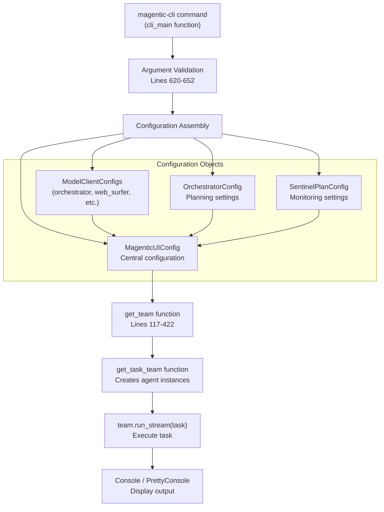
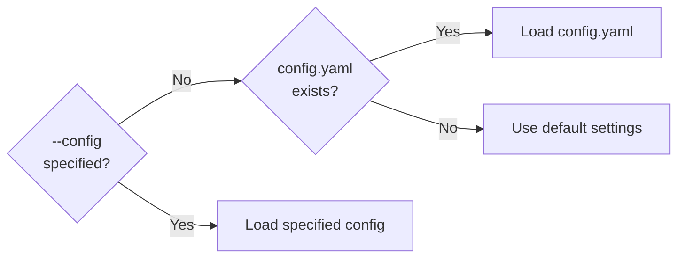
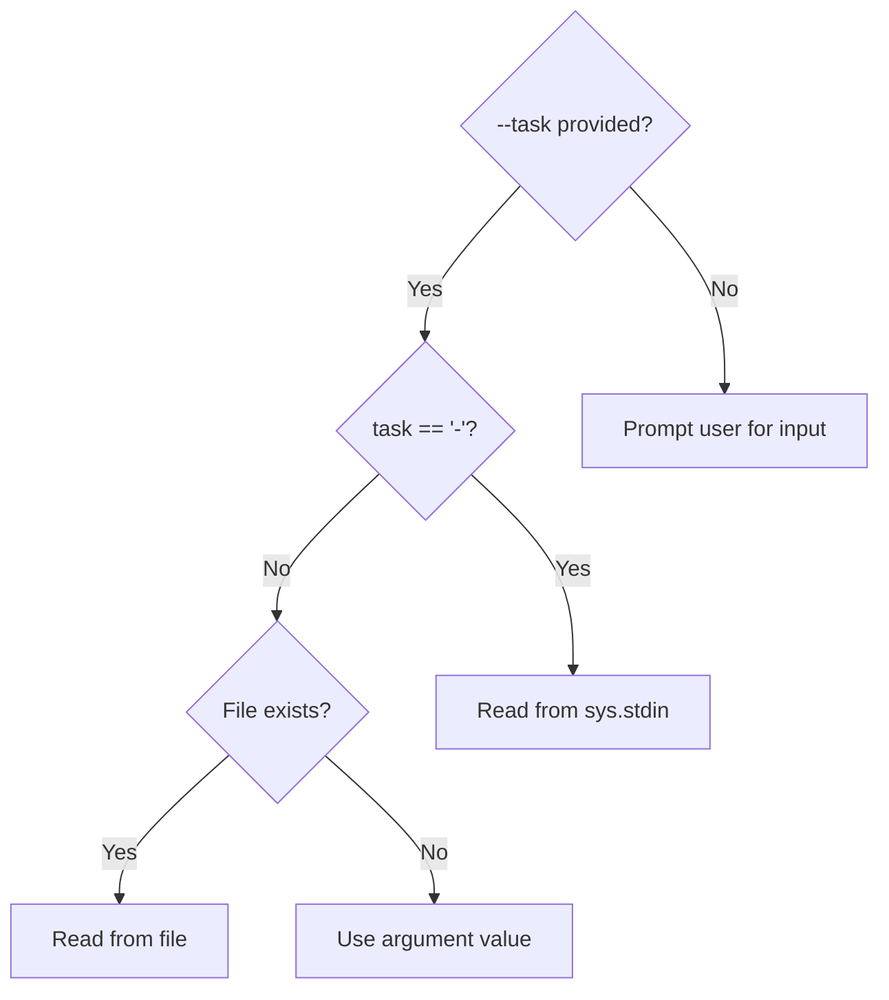
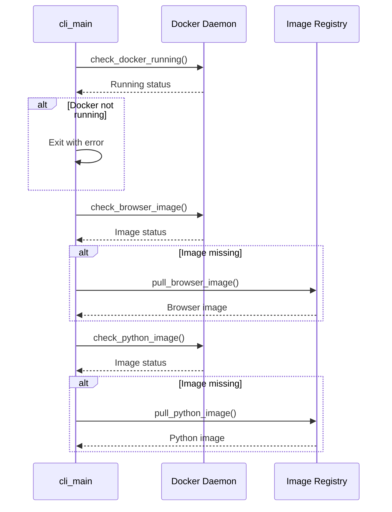
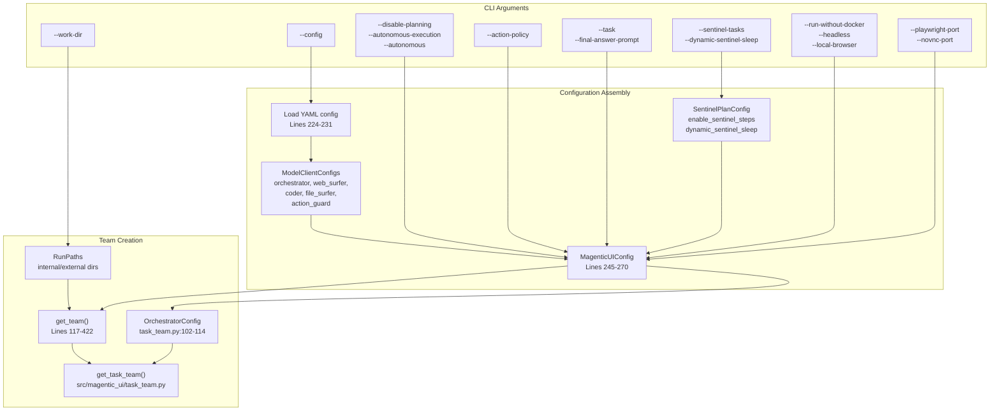

<!-- source: DeepWiki mcp.deepwiki.com · repo microsoft/magentic-ui · page 3.1 CLI Usage and Options · fetched 2026-10-26 -->

# CLI Usage and Options

<details>
<summary>Relevant source files</summary>

The following files were used as context for generating this wiki page:

- [src/magentic_ui/_cli.py](src/magentic_ui/_cli.py)
- [src/magentic_ui/magentic_ui_config.py](src/magentic_ui/magentic_ui_config.py)
- [src/magentic_ui/task_team.py](src/magentic_ui/task_team.py)
- [src/magentic_ui/teams/orchestrator/orchestrator_config.py](src/magentic_ui/teams/orchestrator/orchestrator_config.py)

</details>


This page documents the command-line interface for Magentic-UI, including all available CLI flags, their purposes, and how they configure the agent execution system. For information about configuration file formats, see [Configuration Files](#3.2). For details about the underlying agent orchestration, see [Multi-Agent Orchestration](#2.2).

## Overview

The Magentic-UI CLI is implemented using the Typer framework and provides a `magentic-cli` command that launches multi-agent task execution from the terminal. The CLI supports two primary interaction modes: an interactive mode where the user is prompted for input during planning and execution, and an autonomous mode where the agents execute tasks without human intervention.

The main entry point is defined in `src/magentic_ui/_cli.py` and invokes the Typer application defined at [src/magentic_ui/_cli.py:44]().

**Sources:** [src/magentic_ui/_cli.py:44](), [src/magentic_ui/_cli.py:440-593](), [src/magentic_ui/_cli.py:833-838]()

## CLI Invocation Flow

The following diagram illustrates how CLI arguments flow through the system to configure agent teams:



**Sources:** [src/magentic_ui/_cli.py:440-830](), [src/magentic_ui/_cli.py:117-422](), [src/magentic_ui/magentic_ui_config.py:63-134]()

## Required Arguments

### `--work-dir`

The working directory path where the team stores its state and files. This is the only required argument.

```bash
magentic-cli --work-dir ./my_workspace
```

The working directory structure is managed through the `RunPaths` class defined in [src/magentic_ui/types.py]():
- In non-Docker mode: Both internal and external paths point to `work_dir/cli_files` [src/magentic_ui/_cli.py:204-213]().
- In Docker mode: Uses separate internal and external workspace roots provided via environment variables or arguments [src/magentic_ui/_cli.py:162-181]().

**Implementation:** [src/magentic_ui/_cli.py:442-446](), [src/magentic_ui/_cli.py:186-222]()

**Sources:** [src/magentic_ui/_cli.py:442-446](), [src/magentic_ui/_cli.py:200-222]()

## Configuration Options

| Flag | Type | Default | Description |
|------|------|---------|-------------|
| `--config` | `str` | `config.yaml` (if exists) | Path to YAML configuration file for model clients [src/magentic_ui/_cli.py:448-452]() |
| `--mcp-agents-file` | `str` | `None` | Path to YAML file containing MCP agent configurations [src/magentic_ui/_cli.py:571-575]() |
| `--run-without-docker` | `bool` | `False` | Disable Docker; removes coder and file_surfer agents [src/magentic_ui/_cli.py:453-457]() |
| `--headless` | `bool` | `False` | Run browser in headless mode without GUI [src/magentic_ui/_cli.py:458-464]() |
| `--local-browser` | `bool` | `False` | Run browser locally instead of in Docker container [src/magentic_ui/_cli.py:465-471]() |

### Configuration File Loading

The CLI implements a fallback mechanism for configuration files:



The configuration is loaded at [src/magentic_ui/_cli.py:660-671]() and parsed into `ModelClientConfigs` at [src/magentic_ui/_cli.py:224-241]().

**Sources:** [src/magentic_ui/_cli.py:448-452](), [src/magentic_ui/_cli.py:571-575](), [src/magentic_ui/_cli.py:660-671](), [src/magentic_ui/_cli.py:224-241]()

## Planning and Execution Modes

These options control how the Orchestrator interacts with users during task execution:

| Flag | Type | Default | Description |
|------|------|---------|-------------|
| `--enable-planning` / `--disable-planning` | `bool` | `True` | Enable cooperative planning mode where users review plans [src/magentic_ui/_cli.py:485-491]() |
| `--autonomous-execution` | `bool` | `False` | Execute tasks without user input during execution phase [src/magentic_ui/_cli.py:492-496]() |
| `--autonomous` | `bool` | `False` | Shorthand for `--disable-planning --autonomous-execution` [src/magentic_ui/_cli.py:497-501]() |

### Mode Combinations

The `--autonomous` flag is a convenience option that sets both planning and execution to autonomous mode:

```python
if autonomous:
    autonomous_execution = True
    cooperative_planning = False
```

Implementation at [src/magentic_ui/_cli.py:760-766]().

These flags are passed to `MagenticUIConfig` at [src/magentic_ui/_cli.py:248-249]() and then to `OrchestratorConfig` at [src/magentic_ui/task_team.py:102-104]().

**Sources:** [src/magentic_ui/_cli.py:485-501](), [src/magentic_ui/_cli.py:760-766](), [src/magentic_ui/_cli.py:248-249](), [src/magentic_ui/magentic_ui_config.py:103-104]()

## Task Input Options

### `--task`

Specifies the initial task for the agents. Supports three input methods:

1. **Plain string**: Use the argument value directly as the task
2. **File path**: Read task from a file
3. **stdin**: Use `--task -` to read from stdin

```bash
# Direct task
magentic-cli --work-dir ./workspace --task "Search for Python tutorials"

# From file
magentic-cli --work-dir ./workspace --task task.txt

# From stdin
echo "Find the weather" | magentic-cli --work-dir ./workspace --task -
```

If no `--task` is provided, the CLI prompts the user interactively at [src/magentic_ui/_cli.py:307-374]().

**Task Processing Logic:**



Implementation at [src/magentic_ui/_cli.py:674-698]().

### `--final-answer-prompt`

Overrides the default final answer prompt used by the Orchestrator to summarize results. Supports the same input methods as `--task` (string, file, or stdin). [src/magentic_ui/_cli.py:508-512]()

**Sources:** [src/magentic_ui/_cli.py:503-512](), [src/magentic_ui/_cli.py:674-698](), [src/magentic_ui/_cli.py:737-757]()

## Action Approval Policy

### `--action-policy`

Controls how action approvals are handled through the approval guard system:

| Policy | Behavior |
|--------|----------|
| `always` | Request approval for all actions |
| `never` | Never request approval (auto-approve all) |
| `auto-conservative` | LLM determines approval; conservative bias |
| `auto-permissive` | LLM determines approval; permissive bias |

Default: `auto-conservative` in `MagenticUIConfig` [src/magentic_ui/magentic_ui_config.py:112](), but CLI defaults to `never` [src/magentic_ui/_cli.py:570]().

```bash
magentic-cli --work-dir ./workspace --action-policy auto-conservative
```

The policy is validated at [src/magentic_ui/_cli.py:636-645]() and passed to `MagenticUIConfig` at [src/magentic_ui/_cli.py:250](), which creates an `ApprovalGuard` instance in [src/magentic_ui/task_team.py:177-196]().

**Sources:** [src/magentic_ui/_cli.py:566-570](), [src/magentic_ui/_cli.py:636-645](), [src/magentic_ui/_cli.py:250](), [src/magentic_ui/magentic_ui_config.py:110-112]()

## User Proxy Configuration

These options configure simulated user interactions for testing and benchmarking:

| Flag | Type | Default | Description |
|------|------|---------|-------------|
| `--user-proxy-type` | `str` | `None` | User proxy type: `dummy`, `metadata`, or `None` [src/magentic_ui/_cli.py:540-544]() |
| `--metadata-task` | `str` | `None` | Task description for metadata proxy [src/magentic_ui/_cli.py:545-549]() |
| `--metadata-hints` | `str` | `None` | Task hints for metadata proxy [src/magentic_ui/_cli.py:550-554]() |
| `--metadata-answer` | `str` | `None` | Expected task answer for metadata proxy [src/magentic_ui/_cli.py:555-559]() |

### User Proxy Types

1. **None (default)**: Standard `UserProxyAgent` with interactive input [src/magentic_ui/task_team.py:159-165]().
2. **`dummy`**: Auto-approves all requests without actual user input [src/magentic_ui/task_team.py:140]().
3. **`metadata`**: LLM-based user proxy that simulates user responses using task metadata [src/magentic_ui/task_team.py:151-158]().

The metadata proxy requires all three metadata parameters and is validated at [src/magentic_ui/_cli.py:628-633]().

User proxy instantiation occurs in [src/magentic_ui/task_team.py:137-165]().

**Sources:** [src/magentic_ui/_cli.py:540-559](), [src/magentic_ui/_cli.py:620-633](), [src/magentic_ui/task_team.py:137-165]()

## Debugging and Logging Options

### `--debug`

Enables detailed debug logging throughout execution:

```bash
magentic-cli --work-dir ./workspace --debug
```

When enabled, debug messages are output using `log_debug()` at [src/magentic_ui/_cli.py:49-53](). Debug output includes:
- Argument parsing details [src/magentic_ui/_cli.py:621-651]()
- Configuration loading steps [src/magentic_ui/_cli.py:224-241]()
- Team creation progress [src/magentic_ui/_cli.py:146-154]()
- State management operations [src/magentic_ui/_cli.py:156-160]()

### `--llmlog-dir`

Saves all LLM API calls to timestamped log files in the specified directory:

```bash
magentic-cli --work-dir ./workspace --llmlog-dir ./llm_logs
```

LLM logging is configured at [src/magentic_ui/_cli.py:99-114]() using a custom `LLMCallFilter` [src/magentic_ui/_cli.py:110]() that captures only LLM-related events.

**Sources:** [src/magentic_ui/_cli.py:472-476](), [src/magentic_ui/_cli.py:49-53](), [src/magentic_ui/_cli.py:561-565](), [src/magentic_ui/_cli.py:99-114]()

## Console Display Options

### `--pretty-cli` / `--old-cli`

Controls terminal output formatting:

```bash
# Use modern formatted output (default)
magentic-cli --work-dir ./workspace --pretty-cli

# Use legacy simple output
magentic-cli --work-dir ./workspace --old-cli
```

- `--pretty-cli` (default): Uses `PrettyConsole` with formatted message boxes and colored output [src/magentic_ui/_cli.py:402]().
- `--old-cli`: Uses basic `Console` with minimal formatting [src/magentic_ui/_cli.py:404]().

The selection occurs at [src/magentic_ui/_cli.py:399-404]().

**Sources:** [src/magentic_ui/_cli.py:576-582](), [src/magentic_ui/_cli.py:399-404]()

## State Management

### `--use-state`

Controls whether the CLI persists and reuses team state between runs:

```bash
# Save and reuse state (resume previous execution)
magentic-cli --work-dir ./workspace --use-state

# Start fresh each time (default)
magentic-cli --work-dir ./workspace
```

When `--use-state` is enabled:
1. State is loaded from `.magentic_ui_state.json` at [src/magentic_ui/_cli.py:295-305]().
2. State is saved after execution at [src/magentic_ui/_cli.py:408-415]().

The logic is inverted internally: `reset=not use_state` at [src/magentic_ui/_cli.py:803]().

**Sources:** [src/magentic_ui/_cli.py:477-483](), [src/magentic_ui/_cli.py:156-160](), [src/magentic_ui/_cli.py:295-305](), [src/magentic_ui/_cli.py:408-415]()

## Sentinel Task Options

Sentinel tasks enable long-running monitoring behaviors like "tell me when Bitcoin drops 5%":

| Flag | Type | Default | Description |
|------|------|---------|-------------|
| `--sentinel-tasks` | `bool` | `False` | Enable sentinel plan steps for monitoring [src/magentic_ui/_cli.py:583-587]() |
| `--dynamic-sentinel-sleep` | `bool` | `False` | Adapt sleep duration dynamically (requires `--sentinel-tasks`) [src/magentic_ui/_cli.py:588-592]() |

```bash
magentic-cli --work-dir ./workspace \
  --sentinel-tasks \
  --dynamic-sentinel-sleep
```

These options are validated at [src/magentic_ui/_cli.py:648-652]() and configured in `SentinelPlanConfig` at [src/magentic_ui/_cli.py:263-266]().

**Sources:** [src/magentic_ui/_cli.py:583-592](), [src/magentic_ui/_cli.py:648-652](), [src/magentic_ui/_cli.py:263-266](), [src/magentic_ui/magentic_ui_config.py:10-20]()

## Infrastructure Options

### Docker Configuration

| Flag | Type | Default | Description |
|------|------|---------|-------------|
| `--playwright-port` | `int` | `-1` | Port for Playwright browser (auto-assign if -1) [src/magentic_ui/_cli.py:524-528]() |
| `--novnc-port` | `int` | `-1` | Port for noVNC server (auto-assign if -1) [src/magentic_ui/_cli.py:529-533]() |

### Deprecated Docker Options

The following options are marked as deprecated but still supported:

| Flag | Type | Default | Description |
|------|------|---------|-------------|
| `--inside-docker` | `bool` | `False` | Indicates running inside Docker container [src/magentic_ui/_cli.py:534-538]() |
| `--internal-root` | `str` | `None` | Internal workspace root directory path [src/magentic_ui/_cli.py:514-518]() |
| `--external-root` | `str` | `None` | External workspace root directory path [src/magentic_ui/_cli.py:519-523]() |

These were used for Docker-in-Docker scenarios but are now handled automatically via environment variable fallbacks [src/magentic_ui/_cli.py:165-176]().

**Sources:** [src/magentic_ui/_cli.py:514-538](), [src/magentic_ui/_cli.py:165-176]()

## Docker Image Management

When not running with `--run-without-docker`, the CLI automatically checks and pulls required Docker images:



Docker checking and pulling logic is implemented using functions from `src/magentic_ui/_docker.py` at [src/magentic_ui/_cli.py:700-735]().

**Sources:** [src/magentic_ui/_cli.py:700-735](), [src/magentic_ui/_docker.py:1-36]()

## Complete CLI Options Reference

The following table summarizes all CLI options with their implementation references:

| Category | Flag | Line Reference |
|----------|------|----------------|
| **Required** | `--work-dir` | [442-446]() |
| **Configuration** | `--config` | [448-452]() |
| | `--mcp-agents-file` | [571-575]() |
| | `--run-without-docker` | [453-457]() |
| | `--headless` | [458-464]() |
| | `--local-browser` | [465-471]() |
| **Planning** | `--enable-planning` / `--disable-planning` | [485-491]() |
| | `--autonomous-execution` | [492-496]() |
| | `--autonomous` | [497-501]() |
| **Task Input** | `--task` | [503-507]() |
| | `--final-answer-prompt` | [508-512]() |
| **Approval** | `--action-policy` | [566-570]() |
| **User Proxy** | `--user-proxy-type` | [540-544]() |
| | `--metadata-task` | [545-549]() |
| | `--metadata-hints` | [550-554]() |
| | `--metadata-answer` | [555-559]() |
| **Debugging** | `--debug` | [472-476]() |
| | `--llmlog-dir` | [561-565]() |
| **Display** | `--pretty-cli` / `--old-cli` | [576-582]() |
| **State** | `--use-state` | [477-483]() |
| **Sentinel** | `--sentinel-tasks` | [583-587]() |
| | `--dynamic-sentinel-sleep` | [588-592]() |
| **Infrastructure** | `--playwright-port` | [524-528]() |
| | `--novnc-port` | [529-533]() |
| | `--inside-docker` (deprecated) | [534-538]() |
| | `--internal-root` (deprecated) | [514-518]() |
| | `--external-root` (deprecated) | [519-523]() |

**Sources:** [src/magentic_ui/_cli.py:440-593]()

## Configuration Object Assembly

The following diagram shows how CLI arguments are assembled into configuration objects:



**Sources:** [src/magentic_ui/_cli.py:224-270](), [src/magentic_ui/_cli.py:798-829](), [src/magentic_ui/task_team.py:34-266](), [src/magentic_ui/task_team.py:102-114]()

---

