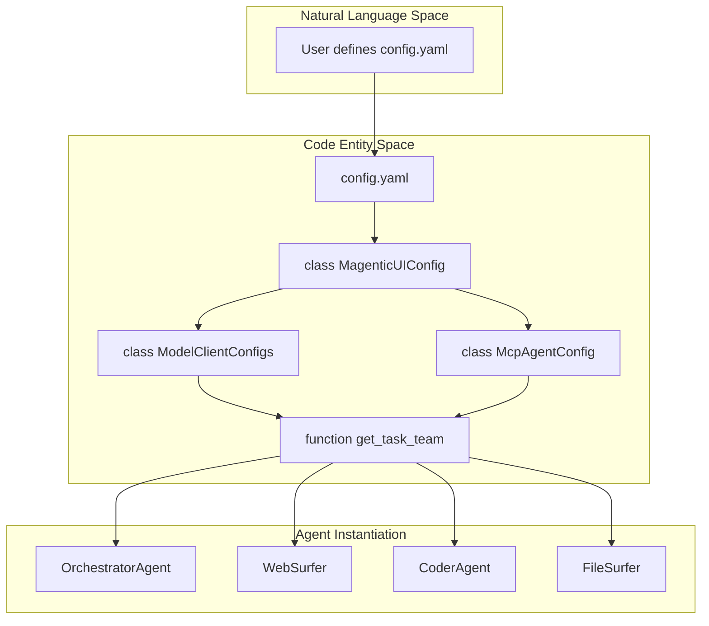
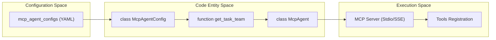

<!-- source: DeepWiki mcp.deepwiki.com · repo microsoft/magentic-ui · page 3.2 Configuration Files · fetched 2026-10-26 -->

# Configuration Files

<details>
<summary>Relevant source files</summary>

The following files were used as context for generating this wiki page:

- [experiments/endpoint_configs/config_template.yaml](experiments/endpoint_configs/config_template.yaml)
- [experiments/eval/README.md](experiments/eval/README.md)
- [samples/README.md](samples/README.md)
- [samples/sample_azure_agent.py](samples/sample_azure_agent.py)
- [samples/sample_coder.py](samples/sample_coder.py)
- [samples/sample_file_surfer.py](samples/sample_file_surfer.py)
- [samples/sample_web_surfer.py](samples/sample_web_surfer.py)
- [src/magentic_ui/_cli.py](src/magentic_ui/_cli.py)
- [src/magentic_ui/magentic_ui_config.py](src/magentic_ui/magentic_ui_config.py)
- [src/magentic_ui/task_team.py](src/magentic_ui/task_team.py)
- [src/magentic_ui/teams/orchestrator/orchestrator_config.py](src/magentic_ui/teams/orchestrator/orchestrator_config.py)

</details>


Configuration files allow you to customize Magentic-UI's behavior, specify which LLM providers to use for different agents, and integrate custom MCP (Model Context Protocol) servers. This page explains the structure and usage of the `config.yaml` file.

For information about CLI arguments and runtime flags, see [CLI Usage and Options](#3.1). For details on how configurations are resolved and prioritized across different sources (CLI, config file, UI settings), see [Configuration System](#2.1).

---

## Configuration File Location and Usage

The primary configuration file is `config.yaml`, which can be passed to both the CLI and web UI:

**Command Line:**
```bash
magentic-cli --work-dir /path/to/workspace --config config.yaml
magentic-ui --port 8081 --config config.yaml
```

**Default Behavior:**
- If no `--config` argument is provided, the system looks for `config.yaml` in the current working directory.
- If no config file is found, default OpenAI settings defined in `ModelClientConfigs` are used `[src/magentic_ui/magentic_ui_config.py:39-52]()`.
- UI settings can override config file values for most parameters depending on the completeness of the file `[src/magentic_ui/_cli.py:224-241]()`.

Sources: `[src/magentic_ui/_cli.py:132-145]()`, `[src/magentic_ui/magentic_ui_config.py:39-52]()`, `[experiments/eval/README.md:15-21]()`

---

## Configuration File Structure

The `config.yaml` file uses YAML format with two main sections:

1. **Model Client Configurations** - Define LLM providers for each agent.
2. **MCP Agent Configurations** - Define custom tool integrations via MCP servers.

### Basic Structure

Title: Configuration Data Flow


**Configuration Loading Flow**

Sources: `[src/magentic_ui/magentic_ui_config.py:63-102]()`, `[src/magentic_ui/task_team.py:34-49]()`, `[src/magentic_ui/_cli.py:224-241]()`

---

## Model Client Configuration

Model client configurations specify which LLM provider and model to use for each agent in the system. Each agent can have a different model configuration.

### Configuration Keys

| Agent | Config Key | Purpose |
|-------|------------|---------|
| Orchestrator | `orchestrator_client` | Plans and coordinates tasks `[src/magentic_ui/magentic_ui_config.py:33-33]()` |
| WebSurfer | `web_surfer_client` | Browser automation and web navigation `[src/magentic_ui/magentic_ui_config.py:34-34]()` |
| Coder | `coder_client` | Code generation and execution `[src/magentic_ui/magentic_ui_config.py:35-35]()` |
| FileSurfer | `file_surfer_client` | File operations and document analysis `[src/magentic_ui/magentic_ui_config.py:36-36]()` |
| ActionGuard | `action_guard_client` | Risk assessment for approvals `[src/magentic_ui/magentic_ui_config.py:37-37]()` |

### Model Client Schema

Each client configuration follows the `ComponentModel` structure from `autogen_core` `[src/magentic_ui/magentic_ui_config.py:3-4]()`:

```yaml
client_name: &anchor_name
  provider: <ProviderClassName>
  config:
    model: <model_identifier>
    api_key: <api_key_or_null>
    base_url: <endpoint_or_null>
  max_retries: <integer>
```

**Provider Options:**
- `OpenAIChatCompletionClient` - OpenAI API
- `AzureOpenAIChatCompletionClient` - Azure OpenAI Service
- `OllamaChatCompletionClient` - Local Ollama models

Sources: `[src/magentic_ui/magentic_ui_config.py:22-37]()`, `[experiments/endpoint_configs/config_template.yaml:3-7]()`

---

## Model Client Examples

### OpenAI Configuration

```yaml
gpt4o_client: &gpt4o_client
  provider: OpenAIChatCompletionClient
  config:
    model: gpt-4o-2024-08-06
  max_retries: 5

orchestrator_client: *gpt4o_client
coder_client: *gpt4o_client
web_surfer_client: *gpt4o_client
file_surfer_client: *gpt4o_client
action_guard_client: *gpt4o_client
```

**YAML Anchors:** The `&gpt4o_client` creates an anchor that can be referenced with `*gpt4o_client`, allowing configuration reuse across agents as seen in the experimental templates `[experiments/endpoint_configs/config_template.yaml:3-15]()`.

Sources: `[experiments/endpoint_configs/config_template.yaml:1-15]()`

### Azure OpenAI Configuration

Azure integration allows using models hosted on Azure AI Foundry.

```yaml
azure_client: &azure_client
  provider: AzureOpenAIChatCompletionClient
  config:
    model: gpt-4o
    azure_endpoint: https://your-resource.openai.azure.com/
    api_version: "2024-02-15-preview"
    azure_deployment: your-deployment-name
  max_retries: 5

orchestrator_client: *azure_client
web_surfer_client: *azure_client
```

**Code Reference:** The system uses `AzureAIAgent` and `AIProjectClient` for specialized Azure workflows `[samples/sample_azure_agent.py:4-5]()`.

Sources: `[samples/sample_azure_agent.py:43-50]()`, `[src/magentic_ui/task_team.py:70-72]()`

### Mixed Configuration (Different Models per Agent)

It is common to use stronger models for the Orchestrator and specialized models for sub-agents.

```yaml
strong_model: &strong_model
  provider: OpenAIChatCompletionClient
  config:
    model: gpt-4o
  max_retries: 5

fast_model: &fast_model
  provider: OpenAIChatCompletionClient
  config:
    model: gpt-4o-mini
  max_retries: 10

orchestrator_client: *strong_model
action_guard_client: *fast_model
```

The `ModelClientConfigs` class manages these mappings and provides defaults if specific keys are missing `[src/magentic_ui/magentic_ui_config.py:33-37]()`.

Sources: `[src/magentic_ui/magentic_ui_config.py:39-60]()`, `[src/magentic_ui/task_team.py:85-88]()`

---

## MCP Server Configuration

MCP (Model Context Protocol) agents extend Magentic-UI with custom tools and integrations. Each MCP agent configuration defines an agent that has access to one or more MCP servers.

### MCP Configuration Mapping

Title: MCP Configuration to Code Entities


**How it Works:**
1. The `McpAgentConfig` stores the server parameters (type, command, args) `[src/magentic_ui/magentic_ui_config.py:6-6]()`.
2. `get_task_team` iterates through `magentic_ui_config.mcp_agent_configs` to instantiate `McpAgent` instances `[src/magentic_ui/task_team.py:204-210]()`.
3. These agents are added as participants to the `GroupChat` or `RoundRobinGroupChat` `[src/magentic_ui/task_team.py:214-216]()`.

Sources: `[src/magentic_ui/task_team.py:15-15]()`, `[src/magentic_ui/magentic_ui_config.py:101-102]()`, `[src/magentic_ui/task_team.py:204-216]()`

---

## Configuration Priority Resolution

Magentic-UI uses a hierarchical configuration system where multiple sources are merged into a single `MagenticUIConfig` object.

### Resolution Logic in `get_task_team`

When `get_task_team` is called, it prioritizes the passed `magentic_ui_config`. If none is provided, it initializes a default `MagenticUIConfig` `[src/magentic_ui/task_team.py:50-51]()`.

| Priority | Source | Implementation Detail |
|----------|--------|-----------------------|
| 1 (Highest) | Function Arguments | Arguments passed to `get_task_team` or CLI flags `[src/magentic_ui/_cli.py:117-145]()` |
| 2 | `config.yaml` | Loaded via `yaml.safe_load` and mapped to `ModelClientConfigs` `[src/magentic_ui/_cli.py:224-241]()` |
| 3 | Environment Variables | Fallback for workspace roots (e.g., `INTERNAL_WORKSPACE_ROOT`) `[src/magentic_ui/_cli.py:165-176]()` |
| 4 (Lowest) | `MagenticUIConfig` Defaults | Hardcoded defaults in the Pydantic model `[src/magentic_ui/magentic_ui_config.py:103-128]()` |

### Behavioral Settings

The `MagenticUIConfig` class defines several behavioral flags that can be set in the configuration file:

- `cooperative_planning`: (bool) User involved in planning `[src/magentic_ui/magentic_ui_config.py:103-103]()`.
- `autonomous_execution`: (bool) No human input during execution `[src/magentic_ui/magentic_ui_config.py:104-104]()`.
- `approval_policy`: (Literal) Policies like `auto-conservative` or `always` `[src/magentic_ui/magentic_ui_config.py:110-112]()`.
- `sentinel_plan`: Configuration for monitoring tasks and dynamic sleep `[src/magentic_ui/magentic_ui_config.py:10-20]()`.

Sources: `[src/magentic_ui/magentic_ui_config.py:63-128]()`, `[src/magentic_ui/task_team.py:102-114]()`, `[src/magentic_ui/_cli.py:224-241]()`

---

## Default Model Configurations

If no configuration is provided, Magentic-UI falls back to the following defaults defined in `ModelClientConfigs` `[src/magentic_ui/magentic_ui_config.py:39-52]()`:

```python
# Default for Orchestrator, WebSurfer, Coder, FileSurfer
default_client_config = {
    "provider": "OpenAIChatCompletionClient",
    "config": {
        "model": "gpt-4.1-2025-04-14",
    },
    "max_retries": 10,
}

# Default for ActionGuard (Security/Approval layer)
default_action_guard_config = {
    "provider": "OpenAIChatCompletionClient",
    "config": {
        "model": "gpt-4.1-nano-2025-04-14",
    },
    "max_retries": 10,
}
```

These defaults are loaded via `ChatCompletionClient.load_component` within the `get_model_client` helper function `[src/magentic_ui/task_team.py:53-63]()`.

Sources: `[src/magentic_ui/magentic_ui_config.py:39-60]()`, `[src/magentic_ui/task_team.py:53-63]()`

---

