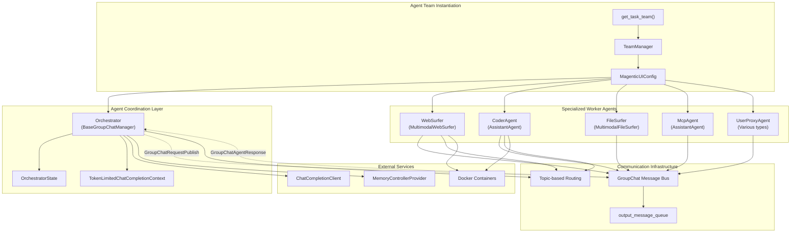
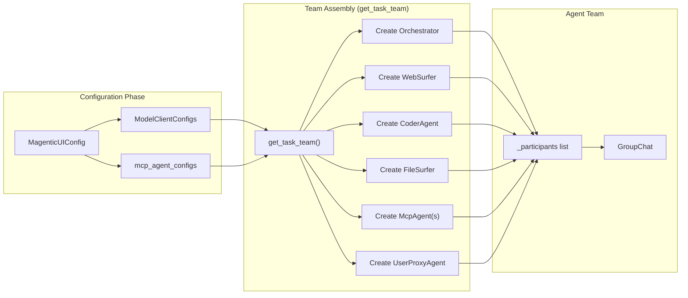
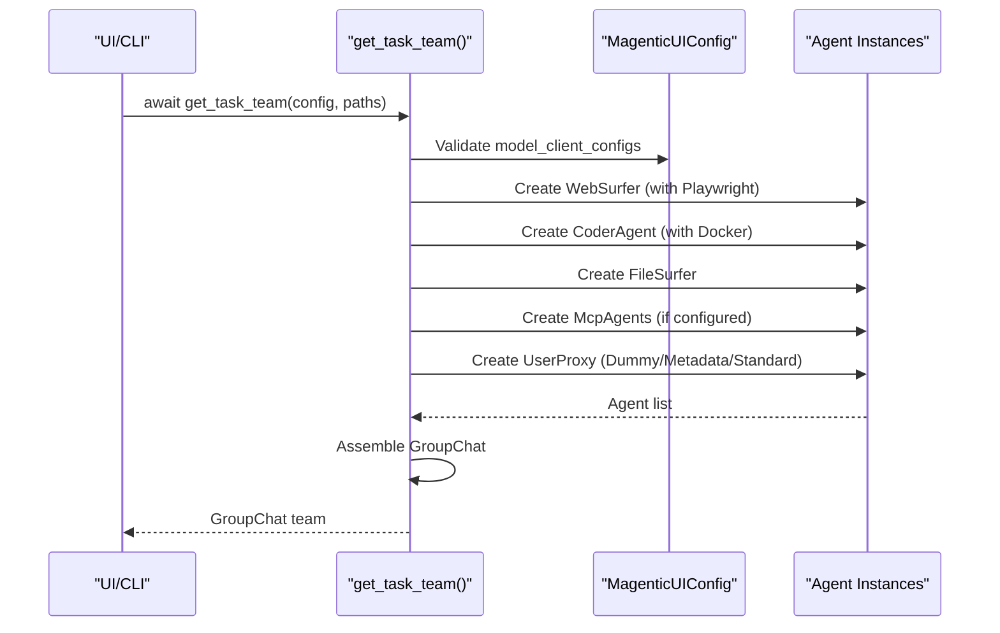

<!-- source: DeepWiki mcp.deepwiki.com · repo microsoft/magentic-ui · page 4 Agent System · fetched 2026-10-26 -->

# Agent System

<details>
<summary>Relevant source files</summary>

The following files were used as context for generating this wiki page:

- [pyproject.toml](pyproject.toml)
- [src/magentic_ui/__init__.py](src/magentic_ui/__init__.py)
- [src/magentic_ui/_cli.py](src/magentic_ui/_cli.py)
- [src/magentic_ui/backend/__init__.py](src/magentic_ui/backend/__init__.py)
- [src/magentic_ui/magentic_ui_config.py](src/magentic_ui/magentic_ui_config.py)
- [src/magentic_ui/task_team.py](src/magentic_ui/task_team.py)
- [src/magentic_ui/teams/orchestrator/orchestrator_config.py](src/magentic_ui/teams/orchestrator/orchestrator_config.py)
- [src/magentic_ui/version.py](src/magentic_ui/version.py)

</details>


## Purpose and Scope

This document provides an overview of the multi-agent architecture in Magentic-UI, including the specialized agent types, their roles, and coordination mechanisms. The agent system is built on the AutoGen framework and uses a group chat pattern where an Orchestrator coordinates execution across specialized agents.

For detailed information about specific agents, see:
- Orchestrator's planning and execution logic: [Orchestrator Agent](#4.1)
- Web browsing automation: [WebSurfer Agent](#4.2)
- Code generation and execution: [Coder Agent](#4.3)
- File system operations: [FileSurfer Agent](#4.4)
- Custom tool integrations: [MCP Agents](#4.5)
- Human-in-the-loop patterns: [User Proxy and Human Interaction](#4.6)

For how planning and execution work, see [Planning and Execution](#5).

---

## Agent Architecture Overview

The Magentic-UI agent system employs a **coordinator-worker pattern** where a central Orchestrator agent manages task execution by delegating subtasks to specialized worker agents. This architecture is implemented using AutoGen's `BaseGroupChatManager` and group chat messaging patterns.

### Core Architecture Components



**Sources:** [src/magentic_ui/task_team.py:34-49](), [src/magentic_ui/magentic_ui_config.py:63-128](), [src/magentic_ui/backend/teammanager.py:3-6]()

---

## Agent Types and Responsibilities

The system includes five primary agent types, each with specialized capabilities:

| Agent Type | Base Class | Primary Responsibility | Key Tools/Capabilities |
|------------|-----------|------------------------|------------------------|
| **Orchestrator** | `BaseGroupChatManager` | Task planning and coordination | LLM-based planning, progress tracking, replanning |
| **WebSurfer** | `MultimodalWebSurfer` | Web browsing and automation | Playwright browser control, screenshot capture, web interaction |
| **Coder** | `AssistantAgent` | Code execution | Python execution in Docker, debugging, code generation |
| **FileSurfer** | `MultimodalFileSurfer` | File system operations | File navigation, document conversion, content extraction |
| **McpAgent** | `AssistantAgent` | Custom tool integration | MCP server connections, tool execution |
| **UserProxy** | Various implementations | Human interaction | Input collection, approval requests, plan modification |

### Agent Instantiation Pattern



**Sources:** [src/magentic_ui/task_team.py:34-215](), [src/magentic_ui/magentic_ui_config.py:22-61](), [src/magentic_ui/magentic_ui_config.py:63-128]()

---

## Orchestrator Coordination Mechanism

The Orchestrator implements a state machine that controls task execution flow. It maintains conversation context, manages plan execution, and routes work to appropriate agents.

### Orchestrator Configuration

The `OrchestratorConfig` class [src/magentic_ui/teams/orchestrator/orchestrator_config.py:7-48]() tracks:

```python
class OrchestratorConfig(BaseModel):
    cooperative_planning: bool = True
    autonomous_execution: bool = False
    allow_follow_up_input: bool = True
    plan: Optional[Plan] = None
    max_turns: Optional[int] = 20
    allow_for_replans: bool = True
    max_json_retries: int = 3
    allowed_websites: Optional[List[str]] = None
    do_bing_search: bool = False
    final_answer_prompt: Optional[str] = None
    model_context_token_limit: Optional[int] = None
    retrieve_relevant_plans: Literal["never", "hint", "reuse"] = "never"
    max_replans: Union[int, None] = 3
    sentinel_plan: SentinelPlanConfig = Field(default_factory=SentinelPlanConfig)
```

### Agent Selection and Routing

The Orchestrator uses LLM-based decision making to select the next agent for each plan step. It builds a progress ledger context including the current task, plan status, and available team members to determine the next action.

**Sources:** [src/magentic_ui/teams/orchestrator/orchestrator_config.py:7-48](), [src/magentic_ui/task_team.py:102-114]()

---

## Team Lifecycle Management

The `get_task_team` function [src/magentic_ui/task_team.py:34-215]() handles the instantiation and assembly of the agent group.

### Team Creation Flow



**Sources:** [src/magentic_ui/task_team.py:34-215](), [src/magentic_ui/magentic_ui_config.py:63-128]()

---

## Agent Autonomy Levels

Agents operate with different levels of autonomy based on configuration defined in `MagenticUIConfig` [src/magentic_ui/magentic_ui_config.py:103-112]():

| Configuration | Orchestrator Behavior | User Proxy Role |
|--------------|----------------------|-----------------|
| `cooperative_planning=True` | Requests user approval for plans | Active participant |
| `cooperative_planning=False` | Executes plans autonomously | Passive observer |
| `autonomous_execution=True` | Excludes user from agent selection | Not available during execution |
| `autonomous_execution=False` | Can request user input during execution | Active participant |

**Sources:** [src/magentic_ui/magentic_ui_config.py:103-112](), [src/magentic_ui/teams/orchestrator/orchestrator_config.py:31-32]()

---

## Memory and Plan Retrieval

The Orchestrator can leverage task-centric memory for plan reuse and hints, controlled by the `retrieve_relevant_plans` setting [src/magentic_ui/magentic_ui_config.py:117]():

- **`reuse`**: Uses the most relevant plan directly from memory, skipping new plan generation.
- **`hint`**: Retrieves relevant plans to provide as context (hints) to the LLM during new plan generation.
- **`never`**: Standard planning without memory retrieval.

**Sources:** [src/magentic_ui/magentic_ui_config.py:117-118](), [src/magentic_ui/teams/orchestrator/orchestrator_config.py:43-44]()

---

## Summary

The Magentic-UI agent system implements a coordinator-worker architecture where:

1. **Orchestrator** acts as the central coordinator using AutoGen's `GroupChat` management patterns.
2. **Specialized agents** (WebSurfer, Coder, FileSurfer, MCP) handle specific task domains like browsing or coding.
3. **get_task_team** handles team assembly based on `MagenticUIConfig` and `RunPaths`.
4. **Configurable autonomy** allows both human-in-the-loop (cooperative) and fully autonomous modes.
5. **Memory integration** enables plan reuse and learning from past executions.

The subsequent pages in this section provide detailed documentation for each agent type and their specific capabilities.

---

