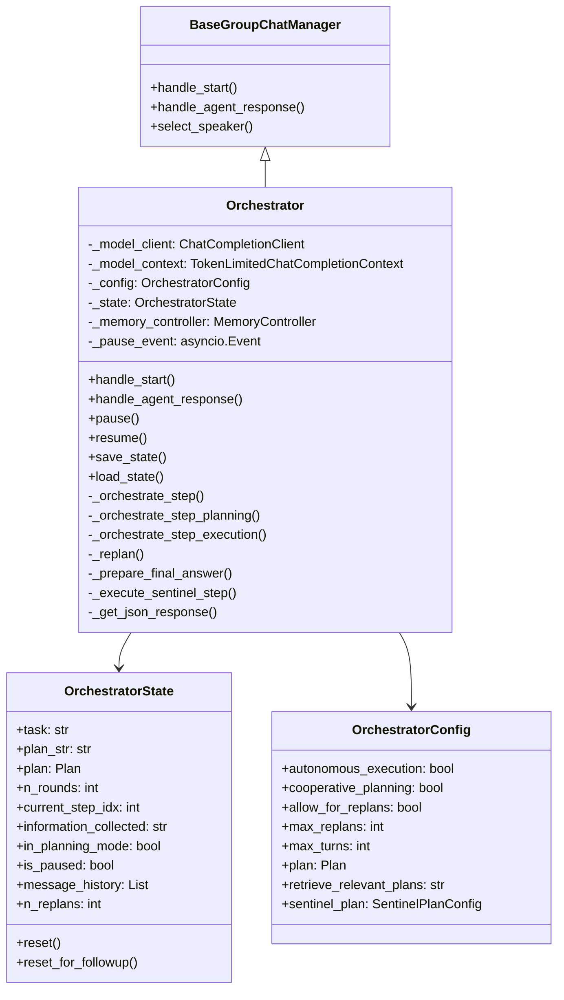
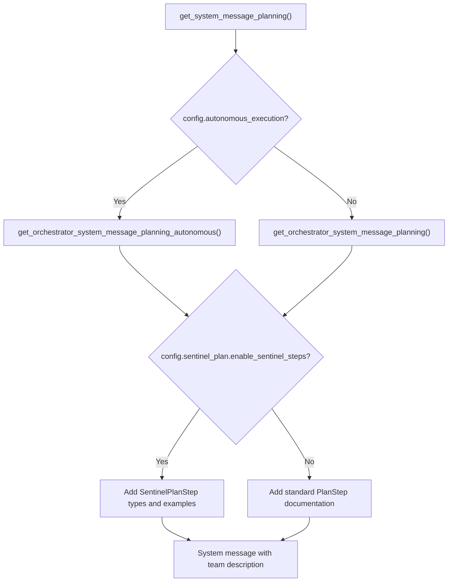
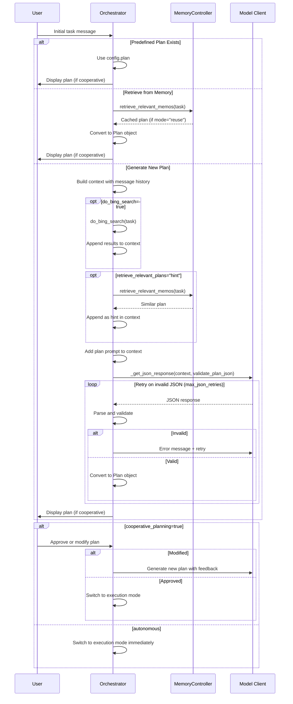
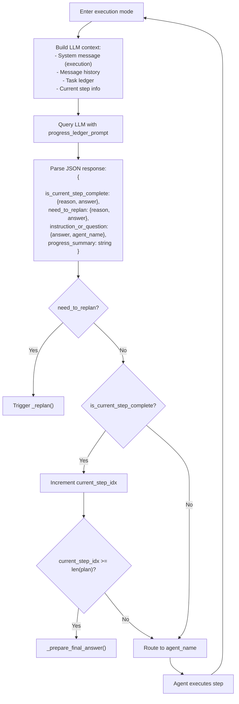
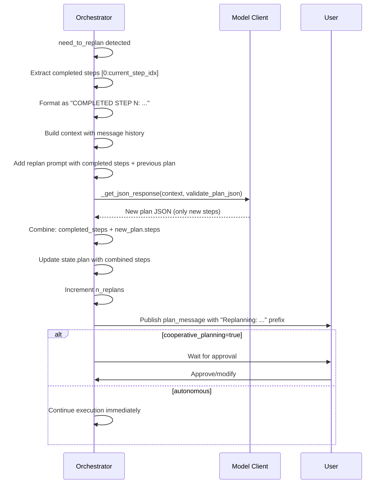
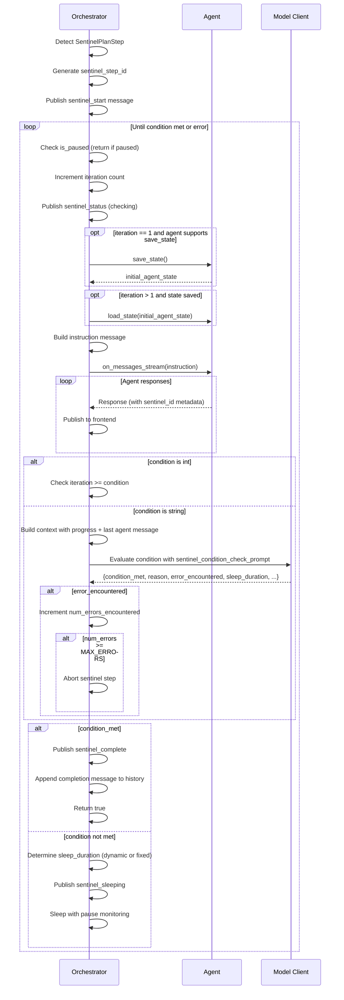
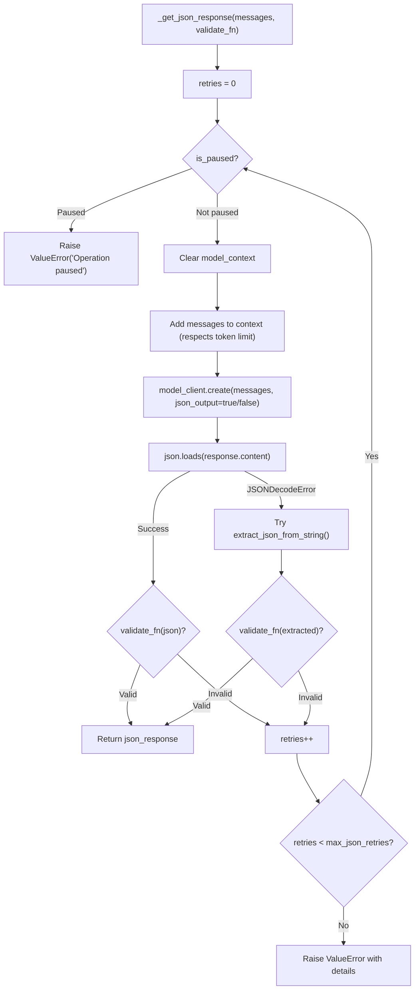
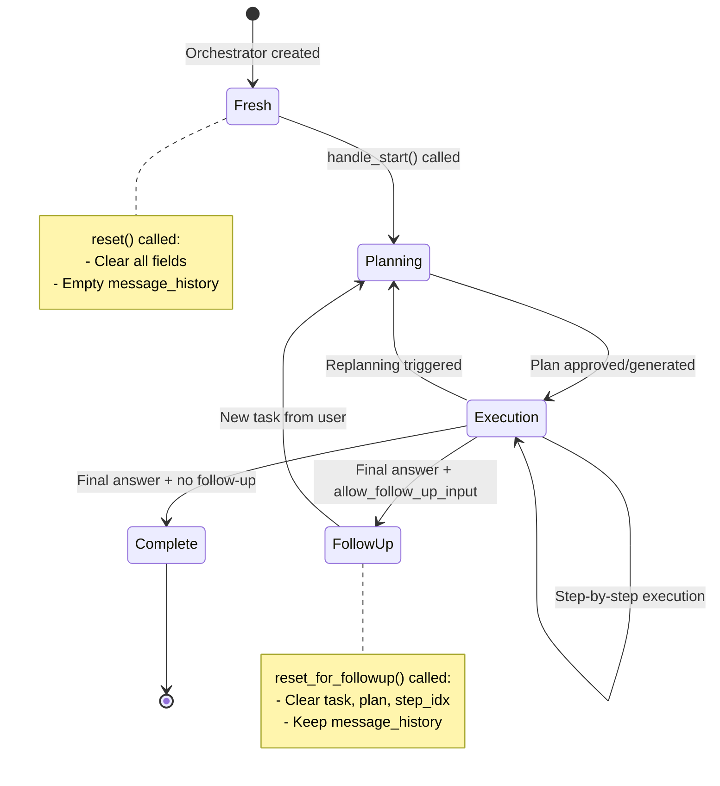
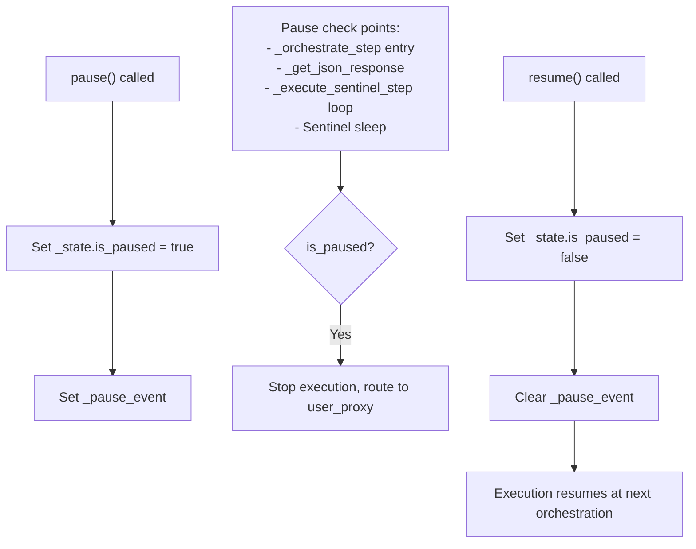

<!-- source: DeepWiki mcp.deepwiki.com · repo microsoft/magentic-ui · page 4.1 Orchestrator Agent · fetched 2026-10-26 -->

# Orchestrator Agent

<details>
<summary>Relevant source files</summary>

The following files were used as context for generating this wiki page:

- [frontend/src/components/views/chat/rendersentinelstep.tsx](frontend/src/components/views/chat/rendersentinelstep.tsx)
- [frontend/src/components/views/chat/sampletasks.tsx](frontend/src/components/views/chat/sampletasks.tsx)
- [frontend/src/components/views/statusicon.tsx](frontend/src/components/views/statusicon.tsx)
- [src/magentic_ui/teams/orchestrator/_group_chat.py](src/magentic_ui/teams/orchestrator/_group_chat.py)
- [src/magentic_ui/teams/orchestrator/_orchestrator.py](src/magentic_ui/teams/orchestrator/_orchestrator.py)
- [src/magentic_ui/teams/orchestrator/_prompts.py](src/magentic_ui/teams/orchestrator/_prompts.py)
- [src/magentic_ui/teams/orchestrator/_sentinel_prompts.py](src/magentic_ui/teams/orchestrator/_sentinel_prompts.py)

</details>


## Purpose and Scope

The Orchestrator Agent is the central coordinator in Magentic-UI's multi-agent system. It manages task execution through a two-phase workflow: generating and refining execution plans, then coordinating specialized agents to carry out those plans. The Orchestrator maintains conversation state, handles dynamic replanning, routes instructions to appropriate agents, and manages long-running monitoring tasks through sentinel steps.

For information about the specialized agents that the Orchestrator coordinates, see [WebSurfer Agent](#4.2), [Coder Agent](#4.3), [FileSurfer Agent](#4.4), and [MCP Agents](#4.5). For details on the planning system itself, see [Planning System](#5.1). For user interaction patterns, see [User Proxy and Human Interaction](#4.6).

---

## Architecture and Core Components

The Orchestrator is implemented as a subclass of `BaseGroupChatManager` from the AutoGen framework, extending it with planning capabilities, state management, and agent coordination logic.

### Class Structure



**Sources:** [src/magentic_ui/teams/orchestrator/_orchestrator.py:113-191]()

### Key Components

| Component | Type | Purpose |
|-----------|------|---------|
| `Orchestrator` | Class | Main orchestration logic, inherits from `BaseGroupChatManager` [src/magentic_ui/teams/orchestrator/_orchestrator.py:113-123]() |
| `OrchestratorState` | State Object | Tracks task, plan, execution progress, and message history [src/magentic_ui/teams/orchestrator/_orchestrator.py:70-86]() |
| `OrchestratorConfig` | Configuration | Controls planning behavior, replanning, autonomous execution [src/magentic_ui/teams/orchestrator/_orchestrator.py:48-48]() |
| `_model_client` | ChatCompletionClient | LLM interface for plan generation and decision-making [src/magentic_ui/teams/orchestrator/_orchestrator.py:155-155]() |
| `_model_context` | TokenLimitedChatCompletionContext | Manages conversation context within token limits [src/magentic_ui/teams/orchestrator/_orchestrator.py:156-158]() |
| `_memory_controller` | MemoryController | Retrieves relevant plans from vector memory (optional) [src/magentic_ui/teams/orchestrator/_orchestrator.py:171-187]() |

**Sources:** [src/magentic_ui/teams/orchestrator/_orchestrator.py:70-111](), [src/magentic_ui/teams/orchestrator/_orchestrator.py:125-191]()

---

## Two-Phase Execution Model

The Orchestrator operates in two distinct modes, controlled by the `in_planning_mode` flag in `OrchestratorState`.

### Execution Flow

```mermaid
stateDiagram-v2
    [*] --> PlanningMode: User task received
    
    state PlanningMode {
        [*] --> CheckForExistingPlan
        CheckForExistingPlan --> UsePredefinedPlan: config.plan exists
        CheckForExistingPlan --> CheckMemory: No predefined plan
        CheckMemory --> UseCachedPlan: retrieve_relevant_plans="reuse"
        CheckMemory --> GeneratePlan: No cached plan or mode="hint"
        GeneratePlan --> LLMPlanGeneration
        LLMPlanGeneration --> ValidatePlanJSON
        ValidatePlanJSON --> LLMPlanGeneration: Invalid JSON
        ValidatePlanJSON --> CheckCooperative: Valid plan
        UsePredefinedPlan --> CheckCooperative
        UseCachedPlan --> CheckCooperative
        CheckCooperative --> WaitForUserApproval: cooperative_planning=true
        CheckCooperative --> ExecutionMode: autonomous
        WaitForUserApproval --> UserModifiesPlan: User edits plan
        UserModifiesPlan --> GeneratePlan
        WaitForUserApproval --> ExecutionMode: User approves
    }
    
    state ExecutionMode {
        [*] --> LoadProgressLedger
        LoadProgressLedger --> CheckStepType
        CheckStepType --> StandardStep: PlanStep
        CheckStepType --> SentinelStep: SentinelPlanStep
        StandardStep --> RouteToAgent
        RouteToAgent --> AgentExecution
        AgentExecution --> UpdateProgressLedger
        SentinelStep --> ExecuteSentinelLoop
        ExecuteSentinelLoop --> UpdateProgressLedger
        UpdateProgressLedger --> CheckReplan: Step complete
        CheckReplan --> PlanningMode: need_to_replan=true
        CheckReplan --> CheckCompletion: Continue
        CheckCompletion --> LoadProgressLedger: More steps
        CheckCompletion --> FinalAnswer: All steps complete
    }
    
    PlanningMode --> ExecutionMode
    ExecutionMode --> FinalAnswer
    FinalAnswer --> [*]: Task complete
    FinalAnswer --> PlanningMode: allow_follow_up_input=true
```

**Sources:** [src/magentic_ui/teams/orchestrator/_orchestrator.py:578-589](), [src/magentic_ui/teams/orchestrator/_orchestrator.py:709-941](), [src/magentic_ui/teams/orchestrator/_orchestrator.py:943-1117]()

### Mode Transition Logic

The `_orchestrate_step` method routes control to either planning or execution:

```python
async def _orchestrate_step(self, cancellation_token: CancellationToken) -> None:
    if self._state.is_paused:
        await self._request_next_speaker(self._user_agent_topic, cancellation_token)
        return
    
    if self._state.in_planning_mode:
        await self._orchestrate_step_planning(cancellation_token)
    else:
        await self._orchestrate_step_execution(cancellation_token)
```

**Sources:** [src/magentic_ui/teams/orchestrator/_orchestrator.py:578-589]()

---

## Planning Mode

Planning mode generates a structured execution plan by interacting with the LLM using system messages and prompts tailored for plan generation.

### System Message Construction

The Orchestrator uses different system messages depending on configuration:



The system messages are formatted with:
- Current date
- Team member descriptions (`_team_description`)
- Examples of plan structure [src/magentic_ui/teams/orchestrator/_prompts.py:60-101]()
- Instructions for when to plan vs. answer directly [src/magentic_ui/teams/orchestrator/_prompts.py:132-143]()

**Sources:** [src/magentic_ui/teams/orchestrator/_orchestrator.py:234-251](), [src/magentic_ui/teams/orchestrator/_prompts.py:114-233]()

### Plan Generation Process



**Sources:** [src/magentic_ui/teams/orchestrator/_orchestrator.py:709-941](), [src/magentic_ui/teams/orchestrator/_orchestrator.py:673-707]()

### Plan JSON Schema

The LLM must return a JSON object matching this structure:

| Field | Type | Description |
|-------|------|-------------|
| `task` | string | Complete description of the user's task |
| `plan_summary` | string | High-level summary of the plan |
| `needs_plan` | boolean | Whether a plan is needed (false if direct answer suffices) |
| `response` | string | Direct response if `needs_plan=false` |
| `steps` | array | List of `PlanStep` or `SentinelPlanStep` objects |

Each step in the `steps` array contains:
- `title`: Short description (one sentence)
- `details`: Detailed instructions for the agent
- `agent_name`: Which agent should execute this step
- For `SentinelPlanStep` only:
  - `step_type`: `"SentinelPlanStep"` [src/magentic_ui/teams/orchestrator/_sentinel_prompts.py:73-73]()
  - `condition`: Completion condition (int for iteration count, string for LLM-evaluated condition) [src/magentic_ui/teams/orchestrator/_sentinel_prompts.py:127-127]()
  - `sleep_duration`: Seconds to wait between checks [src/magentic_ui/teams/orchestrator/_sentinel_prompts.py:121-121]()

**Sources:** [src/magentic_ui/teams/orchestrator/_prompts.py:235-334](), [src/magentic_ui/teams/orchestrator/_prompts.py:471-512](), [src/magentic_ui/teams/orchestrator/_sentinel_prompts.py:60-143]()

### Cooperative Planning

When `cooperative_planning=true`, the Orchestrator waits for user approval before execution:

1. Generate plan and display to user [src/magentic_ui/teams/orchestrator/_orchestrator.py:769-779]()
2. Route to `user_proxy` agent [src/magentic_ui/teams/orchestrator/_orchestrator.py:838-850]()
3. User can:
   - Accept plan (triggers execution mode) [src/magentic_ui/teams/orchestrator/_orchestrator.py:863-868]()
   - Modify plan (regenerates with LLM incorporating feedback) [src/magentic_ui/teams/orchestrator/_orchestrator.py:880-888]()

**Sources:** [src/magentic_ui/teams/orchestrator/_orchestrator.py:769-779](), [src/magentic_ui/teams/orchestrator/_orchestrator.py:838-850]()

---

## Execution Mode

Execution mode steps through the plan, using the LLM to generate instructions for each step and route to appropriate agents.

### Progress Ledger System

For each step, the Orchestrator generates a "progress ledger" by querying the LLM:



**Sources:** [src/magentic_ui/teams/orchestrator/_orchestrator.py:943-1117](), [src/magentic_ui/teams/orchestrator/_prompts.py:356-424]()

### Step Execution Workflow

The execution loop at [src/magentic_ui/teams/orchestrator/_orchestrator.py:943-1117]():

1. **First step initialization** (`first_step=True`):
   - Clear non-user messages from history [src/magentic_ui/teams/orchestrator/_orchestrator.py:953-955]()
   - Add task ledger with full task, team, and plan context [src/magentic_ui/teams/orchestrator/_orchestrator.py:960-971]()
   
2. **Generate progress ledger**:
   - Build context from message history [src/magentic_ui/teams/orchestrator/_orchestrator.py:981-981]()
   - Query LLM with `get_progress_ledger_prompt` [src/magentic_ui/teams/orchestrator/_orchestrator.py:982-996]()
   - Validate JSON response with `validate_ledger_json` [src/magentic_ui/teams/orchestrator/_orchestrator.py:982-982]()
   
3. **Check for replanning** (not first step):
   - If `need_to_replan["answer"]=true` and `allow_for_replans=true` [src/magentic_ui/teams/orchestrator/_orchestrator.py:1003-1004]()
   - Call `_replan()` to generate new plan [src/magentic_ui/teams/orchestrator/_orchestrator.py:1016-1016]()
   
4. **Update step index**:
   - If `is_current_step_complete["answer"]=true` [src/magentic_ui/teams/orchestrator/_orchestrator.py:1022-1022]()
   - Increment `current_step_idx` [src/magentic_ui/teams/orchestrator/_orchestrator.py:1025-1025]()
   
5. **Check step type**:
   - Standard `PlanStep`: Route to agent via `_request_next_speaker()` [src/magentic_ui/teams/orchestrator/_orchestrator.py:1034-1035]()
   - `SentinelPlanStep`: Execute via `_execute_sentinel_step()` [src/magentic_ui/teams/orchestrator/_orchestrator.py:1041-1041]()
   
6. **Broadcast step execution**:
   - Send `step_execution` message with metadata to frontend [src/magentic_ui/teams/orchestrator/_orchestrator.py:1064-1077]()

**Sources:** [src/magentic_ui/teams/orchestrator/_orchestrator.py:943-1117]()

### Agent Routing

The Orchestrator maintains filtered agent lists for execution:

```python
self._agent_execution_names = self._participant_names.copy()
self._agent_execution_descriptions = self._participant_descriptions.copy()

if self._config.autonomous_execution:
    # Remove user_proxy from execution list
    user_indices = [i for i, name in enumerate(self._agent_execution_names) 
                    if name == self._user_agent_topic]
    if user_indices:
        self._agent_execution_names.pop(user_indices[0])
        self._agent_execution_descriptions.pop(user_indices[0])

# Add no-op agent for steps requiring no action
self._agent_execution_names.append("no_action_agent")
```

Routing logic at [src/magentic_ui/teams/orchestrator/_orchestrator.py:418-432]():
- If `next_speaker="no_action_agent"`: Skip and continue orchestration [src/magentic_ui/teams/orchestrator/_orchestrator.py:421-422]()
- Otherwise: Publish `GroupChatRequestPublish` to agent's topic [src/magentic_ui/teams/orchestrator/_orchestrator.py:430-432]()

**Sources:** [src/magentic_ui/teams/orchestrator/_orchestrator.py:195-231](), [src/magentic_ui/teams/orchestrator/_orchestrator.py:418-432]()

---

## Replanning

When the current plan fails or the user provides new instructions incompatible with the current approach, the Orchestrator can generate a new plan while preserving completed steps.

### Replan Trigger Conditions

Replanning occurs when:
1. `need_to_replan["answer"]=true` from progress ledger [src/magentic_ui/teams/orchestrator/_orchestrator.py:1003-1003]()
2. `config.allow_for_replans=true` [src/magentic_ui/teams/orchestrator/_orchestrator.py:1004-1004]()
3. `n_replans < config.max_replans` (if `max_replans` is set) [src/magentic_ui/teams/orchestrator/_orchestrator.py:1005-1005]()

**Sources:** [src/magentic_ui/teams/orchestrator/_orchestrator.py:998-1020]()

### Replan Process



**Sources:** [src/magentic_ui/teams/orchestrator/_orchestrator.py:1119-1194]()

The replan preserves context by:
1. Storing completed steps: `list(self._state.plan.steps[:self._state.current_step_idx])` [src/magentic_ui/teams/orchestrator/_orchestrator.py:1130-1132]()
2. Generating only new steps via LLM [src/magentic_ui/teams/orchestrator/_orchestrator.py:1152-1163]()
3. Combining: `Plan(task=task, steps=completed_steps + new_plan.steps)` [src/magentic_ui/teams/orchestrator/_orchestrator.py:1174-1176]()

This ensures `current_step_idx` remains valid and execution can continue from where it left off.

**Sources:** [src/magentic_ui/teams/orchestrator/_orchestrator.py:1128-1176]()

---

## Sentinel Steps

Sentinel steps enable monitoring and periodic checking of conditions, useful for tasks like waiting for data to appear or tracking long-running processes.

### Sentinel Step Structure

A `SentinelPlanStep` extends `PlanStep` with:

| Field | Type | Purpose |
|-------|------|---------|
| `condition` | int or str | Iteration count (int) or LLM-evaluated condition (str) [src/magentic_ui/teams/orchestrator/_sentinel_prompts.py:127-127]() |
| `sleep_duration` | int | Seconds to wait between condition checks [src/magentic_ui/teams/orchestrator/_sentinel_prompts.py:121-121]() |
| `step_type` | str | Always `"SentinelPlanStep"` to distinguish from standard steps [src/magentic_ui/teams/orchestrator/_sentinel_prompts.py:119-119]() |

**Sources:** [src/magentic_ui/teams/orchestrator/_orchestrator.py:1037-1040](), [src/magentic_ui/teams/orchestrator/_sentinel_prompts.py:60-143]()

### Sentinel Execution Loop



**Sources:** [src/magentic_ui/teams/orchestrator/_orchestrator.py:1344-1768]()

### Key Sentinel Features

**Agent State Persistence**: On the first iteration, the Orchestrator saves the agent's state (if supported). On subsequent iterations, it reloads this state to ensure consistent starting conditions for each check [src/magentic_ui/teams/orchestrator/_orchestrator.py:1400-1457](). This prevents state accumulation across iterations.

```python
if iteration == 1 and can_save_load:
    initial_agent_state = await agent.save_state()

# Later iterations
if can_save_load and initial_agent_state is not None:
    if agent_name == self._web_agent_topic:
        await agent.load_state(initial_agent_state, load_browser=False)
    else:
        await agent.load_state(initial_agent_state)
```

**Dynamic Sleep Duration**: When `config.sentinel_plan.dynamic_sentinel_sleep=true`, the LLM can suggest sleep durations based on the task's progress and expected timing [src/magentic_ui/teams/orchestrator/_sentinel_prompts.py:32-45]().

**Error Handling**: The system tracks errors during condition checks. After 3 consecutive errors (`MAX_SENTINEL_STEP_ERRORS_ALLOWED`), the sentinel step aborts [src/magentic_ui/teams/orchestrator/_orchestrator.py:1646-1649]().

**Pause Support**: At multiple points in the loop, the Orchestrator checks `_state.is_paused` and returns `False` if paused, allowing graceful suspension of long-running sentinels [src/magentic_ui/teams/orchestrator/_orchestrator.py:1385-1387]().

**Sources:** [src/magentic_ui/teams/orchestrator/_orchestrator.py:1400-1457](), [src/magentic_ui/teams/orchestrator/_orchestrator.py:1566-1567](), [src/magentic_ui/teams/orchestrator/_orchestrator.py:1627-1649](), [src/magentic_ui/teams/orchestrator/_orchestrator.py:1708-1714]()

---

## LLM Interaction Patterns

The Orchestrator uses structured LLM interactions for planning and decision-making.

### JSON Response Pattern

The `_get_json_response` method handles all LLM queries requiring structured output:



**Sources:** [src/magentic_ui/teams/orchestrator/_orchestrator.py:434-512]()

### Token Management

The Orchestrator uses `TokenLimitedChatCompletionContext` to manage conversation history:

1. **Context initialization**: `TokenLimitedChatCompletionContext(model_client, token_limit=config.model_context_token_limit)` [src/magentic_ui/teams/orchestrator/_orchestrator.py:156-158]()
2. **Message addition**: Messages added via `add_message()` are automatically truncated if they exceed token limits [src/magentic_ui/teams/orchestrator/_orchestrator.py:463-465]()
3. **Context retrieval**: `get_messages()` returns the token-limited message list [src/magentic_ui/teams/orchestrator/_orchestrator.py:467-468]()

For final answer generation, the context is explicitly rebuilt to ensure the most recent information fits [src/magentic_ui/teams/orchestrator/_orchestrator.py:1225-1229]().

**Sources:** [src/magentic_ui/teams/orchestrator/_orchestrator.py:156-158](), [src/magentic_ui/teams/orchestrator/_orchestrator.py:460-468](), [src/magentic_ui/teams/orchestrator/_orchestrator.py:1225-1229]()

### Context Building

The `_thread_to_context` method converts message history to LLM-compatible format:

1. **System message**: Varies by mode (planning vs execution) [src/magentic_ui/teams/orchestrator/_orchestrator.py:1268-1271]()
2. **Message history**: Converted via `thread_to_context()` utility [src/magentic_ui/teams/orchestrator/_orchestrator.py:1274-1274]()
3. **Multimodal support**: If `model_client.model_info["vision"]=true`, images are included [src/magentic_ui/teams/orchestrator/_orchestrator.py:1282-1282]()

**Sources:** [src/magentic_ui/teams/orchestrator/_orchestrator.py:1262-1297]()

---

## State Management

The Orchestrator maintains state through `OrchestratorState` and provides serialization for session persistence.

### OrchestratorState Fields

| Field | Type | Purpose |
|-------|------|---------|
| `task` | str | Current task description |
| `plan_str` | str | String representation of plan |
| `plan` | Plan &#124; None | Parsed Plan object |
| `n_rounds` | int | Number of execution rounds |
| `current_step_idx` | int | Index of current step in plan |
| `information_collected` | str | Accumulated progress summaries |
| `in_planning_mode` | bool | Whether in planning (true) or execution (false) mode |
| `is_paused` | bool | Pause flag for sentinel steps and user interruption |
| `message_history` | List | All messages exchanged in the session |
| `n_replans` | int | Number of replans performed |

**Sources:** [src/magentic_ui/teams/orchestrator/_orchestrator.py:70-111]()

### State Lifecycle



**Sources:** [src/magentic_ui/teams/orchestrator/_orchestrator.py:88-111](), [src/magentic_ui/teams/orchestrator/_orchestrator.py:1249-1253]()

### Serialization

The `save_state` and `load_state` methods enable session persistence:

**Saving State** ([src/magentic_ui/teams/orchestrator/_orchestrator.py:1299-1317]()):
```python
async def save_state(self) -> Mapping[str, Any]:
    data = self._state.model_dump(exclude={"is_paused"})
    data["message_history"] = [message.dump() for message in self._state.message_history]
    if self._state.plan is not None:
        data["plan"] = self._state.plan.model_dump()
    return data
```

**Loading State** ([src/magentic_ui/teams/orchestrator/_orchestrator.py:1319-1342]()):
```python
async def load_state(self, state: Mapping[str, Any]) -> None:
    new_state = OrchestratorState()
    for key, value in state.items():
        if key == "message_history":
            new_state.message_history = [self._message_factory.create(message) for message in value]
        elif key == "plan" and value is not None:
            new_state.plan = Plan(**value)
        elif key != "is_paused" and hasattr(new_state, key):
            setattr(new_state, key, value)
    self._state = new_state
```

Note that `is_paused` is excluded from serialization, ensuring sessions always resume in an unpaused state.

**Sources:** [src/magentic_ui/teams/orchestrator/_orchestrator.py:1299-1342]()

---

## Pause and Resume

The Orchestrator supports pausing execution, particularly useful for sentinel steps and user interruptions.

### Pause Mechanism



**Sources:** [src/magentic_ui/teams/orchestrator/_orchestrator.py:543-552](), [src/magentic_ui/teams/orchestrator/_orchestrator.py:580-583](), [src/magentic_ui/teams/orchestrator/_orchestrator.py:453-458]()

The `_pause_event` is specifically used in sentinel step sleep to allow immediate wake-up:

```python
sleep_task = asyncio.create_task(asyncio.sleep(sleep_duration))
pause_task = asyncio.create_task(self._pause_event.wait())

_, pending = await asyncio.wait([sleep_task, pause_task], return_when=asyncio.FIRST_COMPLETED)

for task in pending:
    task.cancel()
```

**Sources:** [src/magentic_ui/teams/orchestrator/_orchestrator.py:1741-1753]()

---

## Integration Points

### Message Publishing

The Orchestrator publishes messages through two channels:

1. **Group chat messages** (`GroupChatMessage`): Published to `_output_topic_type`, distributed to all participants [src/magentic_ui/teams/orchestrator/_orchestrator.py:363-388]()
2. **Output queue**: Messages added to `_output_message_queue` for external consumption (e.g., WebSocket streaming) [src/magentic_ui/teams/orchestrator/_orchestrator.py:390-416]()

**Sources:** [src/magentic_ui/teams/orchestrator/_orchestrator.py:363-388](), [src/magentic_ui/teams/orchestrator/_orchestrator.py:390-416]()

### Event Handling

The Orchestrator responds to two primary events:

1. **`handle_start`** (RPC): Initiates orchestration with initial messages, broadcasts `GroupChatStart` to all agents [src/magentic_ui/teams/orchestrator/_orchestrator.py:514-541]()
2. **`handle_agent_response`** (Event): Processes agent responses, checks termination conditions, continues orchestration [src/magentic_ui/teams/orchestrator/_orchestrator.py:553-576]()

**Sources:** [src/magentic_ui/teams/orchestrator/_orchestrator.py:514-541](), [src/magentic_ui/teams/orchestrator/_orchestrator.py:553-576]()

### Memory Integration

When configured with `memory_controller_key` and `retrieve_relevant_plans`, the Orchestrator queries vector memory:

```python
if self._memory_controller:
    memos = await self._memory_controller.retrieve_relevant_memos(task=task)
    if len(memos) > 0:
        most_relevant_plan = memos[0].insight
        if mode == "reuse":
            return most_relevant_plan  # Use directly
        elif mode == "hint":
            context.append(UserMessage(content="Relevant plan:\n " + most_relevant_plan))
```

**Sources:** [src/magentic_ui/teams/orchestrator/_orchestrator.py:673-707]()

---

## Configuration Options

The `OrchestratorConfig` class controls orchestrator behavior:

| Config Field | Type | Purpose |
|--------------|------|---------|
| `autonomous_execution` | bool | If true, removes user_proxy from execution agent list [src/magentic_ui/teams/orchestrator/_orchestrator.py:164-165]() |
| `cooperative_planning` | bool | If true, waits for user approval before executing plans [src/magentic_ui/teams/orchestrator/_orchestrator.py:769-769]() |
| `allow_for_replans` | bool | Enables replanning when current plan fails [src/magentic_ui/teams/orchestrator/_orchestrator.py:1004-1004]() |
| `max_replans` | int &#124; None | Maximum number of replans allowed [src/magentic_ui/teams/orchestrator/_orchestrator.py:1005-1005]() |
| `max_turns` | int &#124; None | Maximum execution rounds before forcing completion [src/magentic_ui/teams/orchestrator/_orchestrator.py:139-139]() |
| `plan` | Plan &#124; None | Predefined plan to use instead of generating one [src/magentic_ui/teams/orchestrator/_orchestrator.py:716-716]() |
| `do_bing_search` | bool | Perform web search during planning [src/magentic_ui/teams/orchestrator/_orchestrator.py:741-741]() |
| `retrieve_relevant_plans` | str | Mode for memory retrieval: "reuse", "hint", or disabled [src/magentic_ui/teams/orchestrator/_orchestrator.py:177-177]() |
| `sentinel_plan.enable_sentinel_steps` | bool | Enable SentinelPlanStep support [src/magentic_ui/teams/orchestrator/_orchestrator.py:241-241]() |
| `sentinel_plan.dynamic_sentinel_sleep` | bool | Allow LLM to adjust sleep durations [src/magentic_ui/teams/orchestrator/_orchestrator.py:1566-1567]() |
| `model_context_token_limit` | int | Token limit for conversation context [src/magentic_ui/teams/orchestrator/_orchestrator.py:157-157]() |
| `max_json_retries` | int | Maximum retries for invalid JSON responses [src/magentic_ui/teams/orchestrator/_orchestrator.py:441-441]() |
| `final_answer_prompt` | str &#124; None | Custom prompt for final answer generation [src/magentic_ui/teams/orchestrator/_orchestrator.py:1218-1218]() |
| `allow_follow_up_input` | bool | Keep session active for follow-up questions [src/magentic_ui/teams/orchestrator/_orchestrator.py:165-165]() |

**Sources:** [src/magentic_ui/teams/orchestrator/_orchestrator.py:159](), [src/magentic_ui/teams/orchestrator/_orchestrator.py:162-169](), [src/magentic_ui/teams/orchestrator/_orchestrator.py:205-215](), [src/magentic_ui/teams/orchestrator/_orchestrator.py:255-273](), [src/magentic_ui/teams/orchestrator/_orchestrator.py:318-322]()

---

