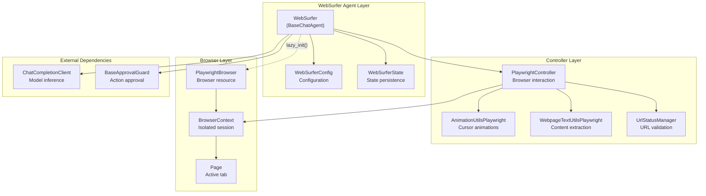
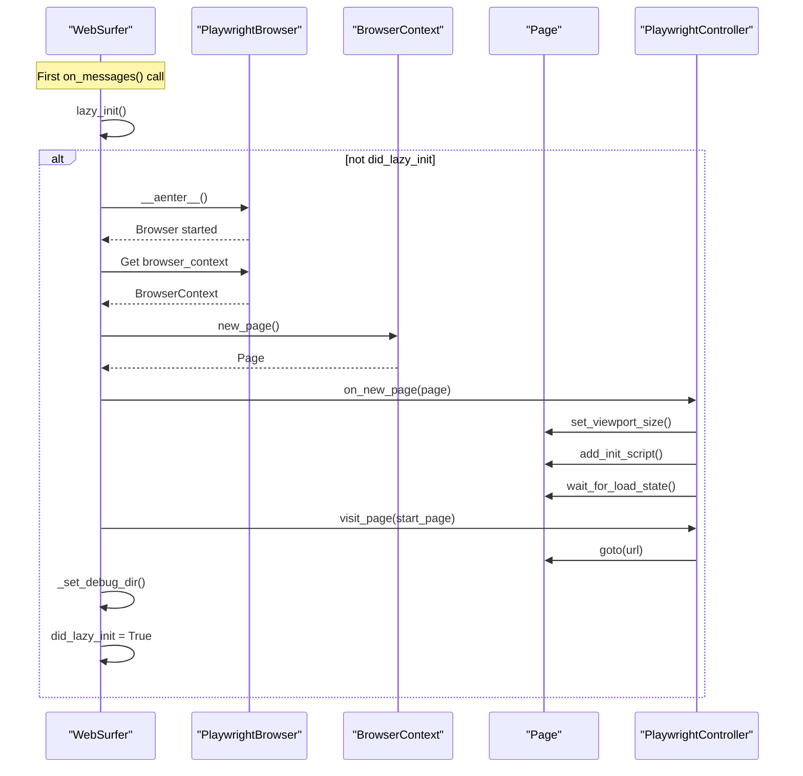
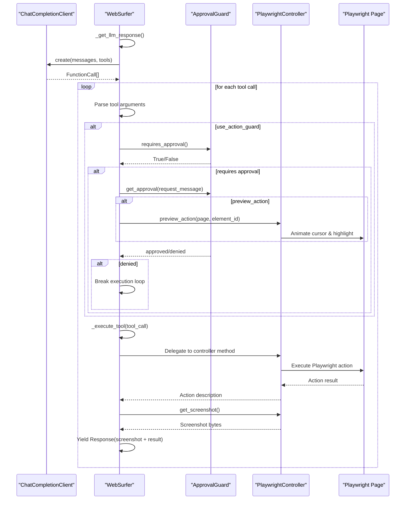
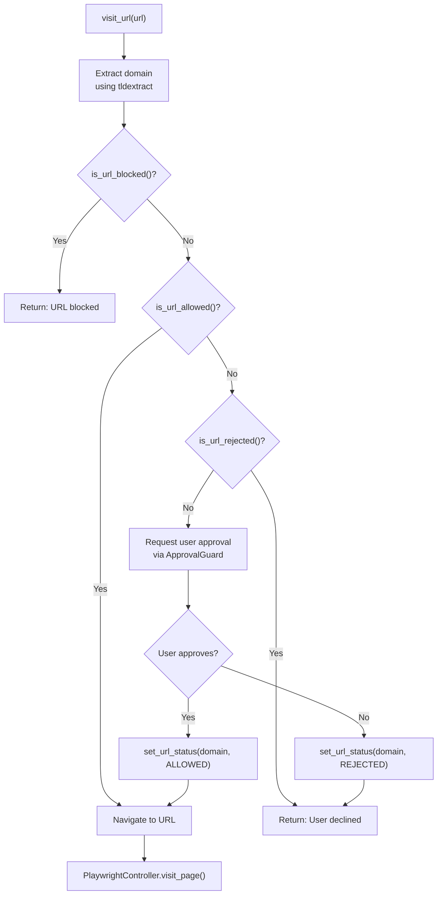
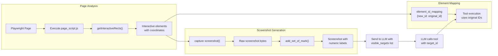
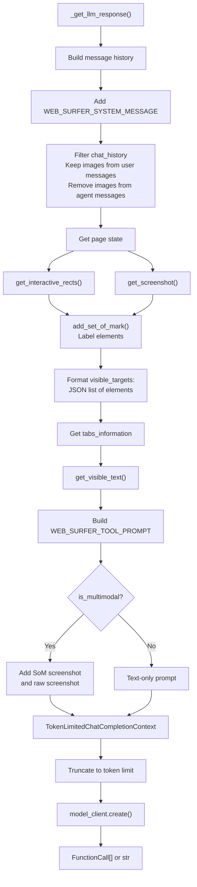
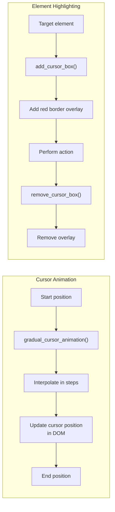
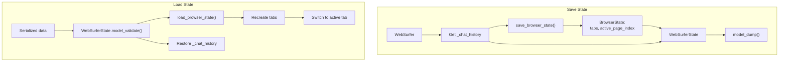
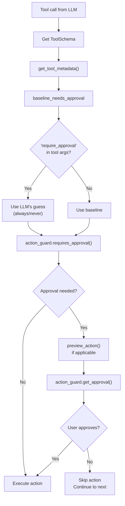

<!-- source: DeepWiki mcp.deepwiki.com · repo microsoft/magentic-ui · page 4.2 WebSurfer Agent · fetched 2026-10-26 -->

# WebSurfer Agent

<details>
<summary>Relevant source files</summary>

The following files were used as context for generating this wiki page:

- [frontend/src/components/settings/tabs/agentSettings/modelSelector/ModelSelector.tsx](frontend/src/components/settings/tabs/agentSettings/modelSelector/ModelSelector.tsx)
- [src/magentic_ui/agents/file_surfer/_tool_definitions.py](src/magentic_ui/agents/file_surfer/_tool_definitions.py)
- [src/magentic_ui/agents/web_surfer/_prompts.py](src/magentic_ui/agents/web_surfer/_prompts.py)
- [src/magentic_ui/agents/web_surfer/_tool_definitions.py](src/magentic_ui/agents/web_surfer/_tool_definitions.py)
- [src/magentic_ui/agents/web_surfer/_web_surfer.py](src/magentic_ui/agents/web_surfer/_web_surfer.py)
- [src/magentic_ui/agents/web_surfer/fara/_fara_web_surfer.py](src/magentic_ui/agents/web_surfer/fara/_fara_web_surfer.py)
- [src/magentic_ui/tools/playwright/browser/headless_docker_playwright_browser.py](src/magentic_ui/tools/playwright/browser/headless_docker_playwright_browser.py)
- [src/magentic_ui/tools/playwright/browser/vnc_docker_playwright_browser.py](src/magentic_ui/tools/playwright/browser/vnc_docker_playwright_browser.py)
- [src/magentic_ui/tools/playwright/playwright_controller.py](src/magentic_ui/tools/playwright/playwright_controller.py)
- [src/magentic_ui/tools/playwright/utils/animation_utils.py](src/magentic_ui/tools/playwright/utils/animation_utils.py)
- [src/magentic_ui/types.py](src/magentic_ui/types.py)
- [tests/test_playwright_controller.py](tests/test_playwright_controller.py)

</details>


This document describes the **WebSurfer Agent**, a specialized agent that performs web browser automation using Playwright. The WebSurfer can navigate websites, interact with web pages, fill forms, click elements, and extract information. It uses vision-capable LLMs to understand page content from screenshots and decide what actions to take.

For information about how WebSurfer fits into the overall agent orchestration, see [Multi-Agent Orchestration](#2.2). For details about action approval mechanisms, see [Action Guards and Approval Policies](#5.3). For browser state persistence, see [State Management and Persistence](#9.2).

---

## Overview

The WebSurfer agent (`WebSurfer` class) provides automated web browsing capabilities through Playwright browser control. It operates as a `BaseChatAgent` that receives tasks, captures screenshots of web pages, analyzes them using multimodal LLMs, and executes browser actions to complete objectives.

**Key Capabilities:**
- Visit URLs and perform web searches [src/magentic_ui/agents/web_surfer/_web_surfer.py:167]()
- Click links and buttons, fill in forms, and type text [src/magentic_ui/agents/web_surfer/_web_surfer.py:168-169]()
- Scroll and hover over elements [src/magentic_ui/agents/web_surfer/_web_surfer.py:170]()
- Read and extract content from pages [src/magentic_ui/agents/web_surfer/_web_surfer.py:171]()
- Take screenshots and handle downloads [src/magentic_ui/agents/web_surfer/_web_surfer.py:172]()
- Manage multiple browser tabs [src/magentic_ui/agents/web_surfer/_web_surfer.py:173]()

The WebSurfer delegates low-level browser interactions to `PlaywrightController`, which handles the actual Playwright API calls, animations, and page state management.

**Sources:** [src/magentic_ui/agents/web_surfer/_web_surfer.py:160-226](), [src/magentic_ui/tools/playwright/playwright_controller.py:72-145]()

---

## Architecture and Core Components

The WebSurfer architecture consists of three main layers: the agent layer (WebSurfer), the controller layer (PlaywrightController), and the browser layer (Playwright).

### WebSurfer Agent Architecture



**Sources:** [src/magentic_ui/agents/web_surfer/_web_surfer.py:120-143, 160-309](), [src/magentic_ui/tools/playwright/playwright_controller.py:90-145]()

### Core Classes

| Class | Purpose | Key Attributes |
|-------|---------|----------------|
| `WebSurfer` | Main agent implementation | `_model_client`, `_browser`, `_page`, `_playwright_controller` [src/magentic_ui/agents/web_surfer/_web_surfer.py:235-309]() |
| `WebSurferConfig` | Configuration schema | `model_client`, `browser`, `viewport_width`, `viewport_height`, `url_statuses` [src/magentic_ui/agents/web_surfer/_web_surfer.py:120-143]() |
| `WebSurferState` | State serialization | `chat_history`, `browser_state` [src/magentic_ui/agents/web_surfer/_web_surfer.py:145-158]() |
| `PlaywrightController` | Browser interaction abstraction | `animate_actions`, `viewport_width`, `viewport_height`, `url_status_manager` [src/magentic_ui/tools/playwright/playwright_controller.py:90-129]() |

**Sources:** [src/magentic_ui/agents/web_surfer/_web_surfer.py:120-158, 235-309]()

---

## Browser Initialization and Lifecycle

The WebSurfer uses lazy initialization to defer browser startup until first use. This approach reduces resource consumption when the agent is instantiated but not yet active.

### Lazy Initialization Flow



**Key Methods:**
- `lazy_init()` [src/magentic_ui/agents/web_surfer/_web_surfer.py:402-459]() - Initializes browser on first use.
- `close()` [src/magentic_ui/agents/web_surfer/_web_surfer.py:475-487]() - Cleans up browser resources.
- `on_reset()` [src/magentic_ui/agents/web_surfer/_web_surfer.py:500-515]() - Resets agent state to start page.

**Sources:** [src/magentic_ui/agents/web_surfer/_web_surfer.py:402-459](), [src/magentic_ui/tools/playwright/playwright_controller.py:146-213]()

---

## Tool System and Action Execution

The WebSurfer exposes browser capabilities through a tool-based interface. The LLM invokes tools as function calls, which the agent executes and returns observations.

### Available Tools

The default tool set is defined in `_tool_definitions.py` and referenced in the agent:

| Tool Name | Purpose | Key Arguments |
|-----------|---------|---------------|
| `stop_action` | Finish task and return answer | `answer` [src/magentic_ui/agents/web_surfer/_tool_definitions.py:270-288]() |
| `visit_url` | Navigate to URL | `url` [src/magentic_ui/agents/web_surfer/_tool_definitions.py:17-42]() |
| `web_search` | Perform search query | `query` [src/magentic_ui/agents/web_surfer/_tool_definitions.py:44-69]() |
| `click` | Click element | `target_id` [src/magentic_ui/agents/web_surfer/_tool_definitions.py:206-224]() |
| `input_text` | Type text in field | `input_field_id`, `text_value` [src/magentic_ui/agents/web_surfer/_tool_definitions.py:226-250]() |
| `answer_question` | Extract page content to answer | `question` [src/magentic_ui/agents/web_surfer/_tool_definitions.py:117-136]() |
| `sleep` | Wait for page to load | `duration` [src/magentic_ui/agents/web_surfer/_tool_definitions.py:138-158]() |
| `hover` | Hover over element | `target_id` [src/magentic_ui/agents/web_surfer/_tool_definitions.py:252-268]() |
| `history_back` | Navigate back | None [src/magentic_ui/agents/web_surfer/_tool_definitions.py:71-92]() |
| `keypress` | Press keyboard keys | `key_sequence` [src/magentic_ui/agents/web_surfer/_tool_definitions.py:312-331]() |
| `refresh_page` | Reload current page | None [src/magentic_ui/agents/web_surfer/_tool_definitions.py:94-115]() |
| `scroll_down` | Scroll down | `explanation` [src/magentic_ui/agents/web_surfer/_tool_definitions.py:159-183]() |
| `scroll_up` | Scroll up | `explanation` [src/magentic_ui/agents/web_surfer/_tool_definitions.py:185-204]() |
| `select_option` | Select dropdown option | `target_id` [src/magentic_ui/agents/web_surfer/_tool_definitions.py:290-310]() |

Dynamic tools are added based on page state:
- `create_tab`: Always available when not in `single_tab_mode` [src/magentic_ui/agents/web_surfer/_web_surfer.py:1085-1087]()
- `switch_tab`: Available when multiple tabs exist [src/magentic_ui/agents/web_surfer/_web_surfer.py:1090-1091]()

**Sources:** [src/magentic_ui/agents/web_surfer/_web_surfer.py:343-358, 1082-1108](), [src/magentic_ui/agents/web_surfer/_tool_definitions.py]()

### Tool Execution Flow



**Sources:** [src/magentic_ui/agents/web_surfer/_web_surfer.py:614-902, 995-1294]()

---

## URL Validation and Approval System

The WebSurfer implements a URL validation system to control which domains the agent can access. This provides security by preventing access to unauthorized sites.

### URL Status Manager

The `UrlStatusManager` [src/magentic_ui/tools/url_status_manager.py]() tracks states for URLs:

| Status | Meaning | Access Allowed |
|--------|---------|----------------|
| `URL_ALLOWED` | Domain is whitelisted | Yes [src/magentic_ui/tools/url_status_manager.py:114]() |
| `URL_REJECTED` | User denied access | No [src/magentic_ui/tools/url_status_manager.py:115]() |

### URL Validation Workflow



**Key Methods:**
- `_check_url_and_generate_msg()` [src/magentic_ui/agents/web_surfer/_web_surfer.py:1296-1342]() - Validates URL and requests approval if needed.
- `_get_search_url()` [src/magentic_ui/agents/web_surfer/_web_surfer.py:371-400]() - Resolves search engine URLs.

**Sources:** [src/magentic_ui/agents/web_surfer/_web_surfer.py:292-317, 371-400, 1296-1342](), [src/magentic_ui/tools/url_status_manager.py]()

---

## Screenshot Capture and Set-of-Mark System

The WebSurfer uses a "set-of-mark" (SoM) system to help the LLM understand and interact with web pages. Interactive elements are labeled with numeric IDs overlaid on screenshots.

### Set-of-Mark Process



**Key Components:**
- `add_set_of_mark()` [src/magentic_ui/agents/web_surfer/_set_of_mark.py:11-131]() - Adds numeric labels to screenshot.
- `get_interactive_rects()` [src/magentic_ui/tools/playwright/playwright_controller.py:279-307]() - Extracts interactive elements.
- `page_script.js` [src/magentic_ui/tools/playwright/playwright_controller.py:135-141]() - JavaScript injected into page to identify elements.

**Sources:** [src/magentic_ui/agents/web_surfer/_web_surfer.py:1050-1073](), [src/magentic_ui/agents/web_surfer/_set_of_mark.py](), [src/magentic_ui/tools/playwright/playwright_controller.py:279-307]()

---

## LLM Interaction and Prompting

The WebSurfer constructs rich prompts that include screenshots, page text, interactive element descriptions, and tool schemas.

### LLM Request Construction



**Prompt Templates:**
- `WEB_SURFER_SYSTEM_MESSAGE` [src/magentic_ui/agents/web_surfer/_prompts.py:1-68]() - System message defining agent role.
- `WEB_SURFER_TOOL_PROMPT` [src/magentic_ui/agents/web_surfer/_prompts.py:71-86]() - Main prompt with page context.
- `WEB_SURFER_QA_PROMPT` [src/magentic_ui/agents/web_surfer/_prompts.py:138-144]() - Prompt for read_page_and_answer tool.

**Sources:** [src/magentic_ui/agents/web_surfer/_web_surfer.py:995-1294](), [src/magentic_ui/agents/web_surfer/_prompts.py]()

---

## PlaywrightController: Browser Interaction Layer

The `PlaywrightController` class abstracts Playwright operations and provides a consistent interface for browser automation.

### Controller Architecture

| Responsibility | Methods | Purpose |
|----------------|---------|---------|
| Page Navigation | `visit_page()`, `go_back()`, `refresh_page()` | Navigate between pages [src/magentic_ui/tools/playwright/playwright_controller.py:417-535]() |
| Element Interaction | `click_id()`, `hover_id()`, `fill_id()`, `select_option()` | Interact with elements [src/magentic_ui/tools/playwright/playwright_controller.py:595-1042]() |
| Viewport Control | `scroll_mousewheel()`, `page_up()`, `page_down()` | Scroll page [src/magentic_ui/tools/playwright/playwright_controller.py:1172-1271]() |
| Content Extraction | `get_visible_text()`, `get_page_markdown()`, `describe_page()` | Extract page content [src/magentic_ui/tools/playwright/playwright_controller.py:1335-1477]() |
| Tab Management | `create_new_tab()`, `switch_tab()`, `close_tab()` | Manage browser tabs [src/magentic_ui/tools/playwright/playwright_controller.py:1044-1170]() |
| Animation | `add_cursor_box()`, `gradual_cursor_animation()` | Visual feedback [src/magentic_ui/tools/playwright/utils/animation_utils.py:14-128]() |

**Sources:** [src/magentic_ui/tools/playwright/playwright_controller.py:72-1477](), [src/magentic_ui/tools/playwright/utils/animation_utils.py]()

---

## Animation System

When `animate_actions=True`, the WebSurfer displays visual feedback for actions:

### Animation Features



**Animation Methods:**
- `gradual_cursor_animation()` [src/magentic_ui/tools/playwright/utils/animation_utils.py:66-128]() - Smoothly moves cursor.
- `add_cursor_box()` [src/magentic_ui/tools/playwright/utils/animation_utils.py:14-62]() - Highlights target element.
- `remove_cursor_box()` [src/magentic_ui/tools/playwright/utils/animation_utils.py:129-157]() - Removes highlight.
- `cleanup_animations()` [src/magentic_ui/tools/playwright/utils/animation_utils.py:158-190]() - Clears all animations.

**Sources:** [src/magentic_ui/tools/playwright/playwright_controller.py:1479-1541](), [src/magentic_ui/tools/playwright/utils/animation_utils.py]()

---

## Tab Management

The WebSurfer supports multi-tab browsing when `single_tab_mode=False`:

### Tab Operations

| Operation | Method | Description |
|-----------|--------|-------------|
| Get tabs info | `get_tabs_information()` | Returns list of tabs with title, URL, index, is_active [src/magentic_ui/tools/playwright/playwright_controller.py:1127-1170]() |
| Create tab | `create_new_tab()` | Opens new tab and navigates to URL [src/magentic_ui/tools/playwright/playwright_controller.py:1044-1077]() |
| Switch tab | `switch_tab()` | Brings specified tab to foreground [src/magentic_ui/tools/playwright/playwright_controller.py:1079-1100]() |
| Close tab | `close_tab()` | Closes tab and switches to adjacent one [src/magentic_ui/tools/playwright/playwright_controller.py:1102-1125]() |

**Sources:** [src/magentic_ui/agents/web_surfer/_web_surfer.py:278](), [src/magentic_ui/tools/playwright/playwright_controller.py:1044-1170]()

---

## State Management

The WebSurfer supports state serialization for pause/resume and session persistence.

### State Serialization



**WebSurferState Structure:**
```python
class WebSurferState(BaseState):
    chat_history: List[LLMMessage]
    type: str = Field(default="WebSurferState")
    browser_state: BrowserState | None = None
```
[src/magentic_ui/agents/web_surfer/_web_surfer.py:145-158]()

**Sources:** [src/magentic_ui/agents/web_surfer/_web_surfer.py:145-158](), [src/magentic_ui/tools/playwright/playwright_state.py]()

---

## Configuration Options

The `WebSurferConfig` class defines all configurable parameters:

### Configuration Parameters

| Parameter | Type | Default | Description |
|-----------|------|---------|-------------|
| `name` | str | Required | Agent name |
| `model_client` | ComponentModel | Required | LLM client configuration |
| `browser` | ComponentModel | Required | Browser resource configuration |
| `animate_actions` | bool | False | Enable visual animations |
| `single_tab_mode` | bool | False | Disable multi-tab |
| `viewport_height` | int | 900 | Viewport height in pixels |
| `viewport_width` | int | 1440 | Viewport width in pixels |
| `use_action_guard` | bool | False | Enable approval guards |
| `search_engine` | str | "duckduckgo" | Default search engine |

[src/magentic_ui/agents/web_surfer/_web_surfer.py:120-143]()

**Sources:** [src/magentic_ui/agents/web_surfer/_web_surfer.py:120-143, 235-288]()

---

## Integration with Action Guards

When `use_action_guard=True`, the WebSurfer integrates with the approval guard system:

### Approval Integration Flow



**Sources:** [src/magentic_ui/agents/web_surfer/_web_surfer.py:363-365, 688-822](), [src/magentic_ui/tools/tool_metadata.py]()

---

