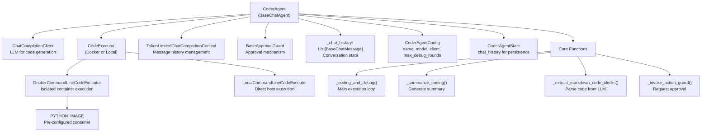
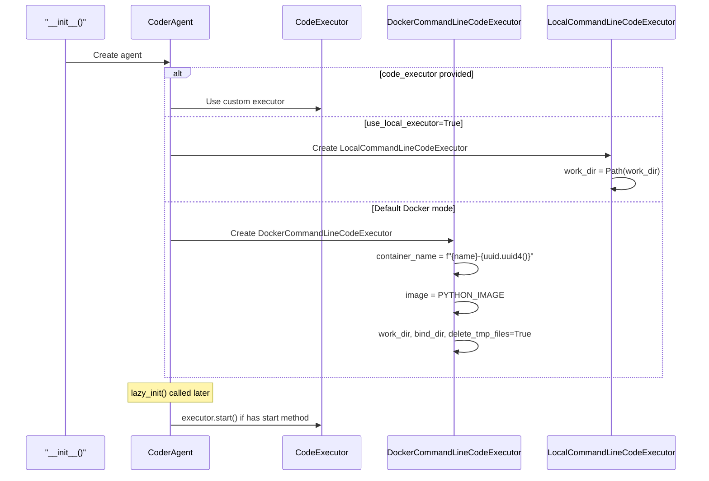
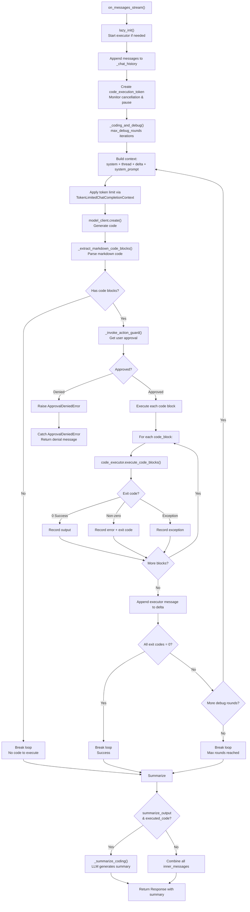

<!-- source: DeepWiki mcp.deepwiki.com · repo microsoft/magentic-ui · page 4.3 Coder Agent · fetched 2026-10-26 -->

# Coder Agent

<details>
<summary>Relevant source files</summary>

The following files were used as context for generating this wiki page:

- [frontend/src/components/views/api.ts](frontend/src/components/views/api.ts)
- [src/magentic_ui/agents/_coder.py](src/magentic_ui/agents/_coder.py)
- [src/magentic_ui/agents/file_surfer/_file_surfer.py](src/magentic_ui/agents/file_surfer/_file_surfer.py)
- [src/magentic_ui/backend/utils/utils.py](src/magentic_ui/backend/utils/utils.py)

</details>


## Purpose and Scope

The **CoderAgent** is a specialized agent within the Magentic-UI system designed to generate, execute, and debug code to solve complex tasks. It primarily handles Python and shell scripts, executing them in isolated environments (typically Docker) and performing iterative debugging when errors occur. It integrates with the system's approval guard to ensure user consent before any code is run on the host or in a container.

Key capabilities include:
- **Code Generation**: Writing scripts based on natural language requirements.
- **Isolated Execution**: Running code in a `DockerCommandLineCodeExecutor` or `LocalCommandLineCodeExecutor`.
- **Iterative Debugging**: Capturing `stdout`, `stderr`, and exit codes to automatically fix scripts.
- **Human-in-the-Loop**: Requesting approval via `BaseApprovalGuard` before execution.

---

## Architecture Overview

The CoderAgent implements a **generate-execute-debug** loop. It acts as a wrapper around an LLM and a code execution engine, managing the state of the conversation and the lifecycle of the execution environment.

### CoderAgent Component Structure



**Sources:** [src/magentic_ui/agents/_coder.py:1-649]()

---

## Code Execution Environment

The CoderAgent supports two execution modes, configured during the `__init__` phase [src/magentic_ui/agents/_coder.py:357-416]().

| Execution Mode | Implementation | Use Case |
|----------------|----------------|----------|
| **Docker** (default) | `DockerCommandLineCodeExecutor` | Isolated, safe execution in a container. |
| **Local** | `LocalCommandLineCodeExecutor` | Direct host execution (useful for local development). |

### Executor Initialization Flow

The agent performs a "lazy initialization" of the executor to ensure resources are only allocated when needed [src/magentic_ui/agents/_coder.py:418-431]().



**Sources:** [src/magentic_ui/agents/_coder.py:357-431]()

### Docker Configuration
The `DockerCommandLineCodeExecutor` is patched with `exec_command_umask_patched` to ensure correct file permissions within the container [src/magentic_ui/agents/_coder.py:40-45](). It uses a `PYTHON_IMAGE` that includes standard data science libraries like `pandas`, `numpy`, and `matplotlib` [src/magentic_ui/agents/_coder.py:344-345]().

---

## Code Generation and Debugging Loop

The core logic resides in `_coding_and_debug()`. This function orchestrates the iterative process of generating code, seeking approval, and handling execution results [src/magentic_ui/agents/_coder.py:92-102]().

### Generate-Execute-Debug Flow



**Sources:** [src/magentic_ui/agents/_coder.py:92-251](), [src/magentic_ui/agents/_coder.py:475-601]()

### Execution Results and Error Handling

The agent interprets `CodeResult` objects from the executor [src/magentic_ui/agents/_coder.py:35](). 

| Condition | Output Format |
|-----------|---------------|
| **Success (exit_code=0)** | Raw output or a message indicating no console output was produced [src/magentic_ui/agents/_coder.py:218-223](). |
| **Error (exit_code≠0)** | Includes the POSIX exit code and the captured output for the LLM to analyze [src/magentic_ui/agents/_coder.py:224-229](). |
| **Exception** | Returns the exception message directly to the LLM context [src/magentic_ui/agents/_coder.py:236-239](). |

---

## Approval Mechanism

The CoderAgent uses a `TrivialGuardedAction` named `"coding"` to interface with the `BaseApprovalGuard` [src/magentic_ui/agents/_coder.py:70]().

### Approval Flow

```mermaid
sequenceDiagram
    participant Loop as _coding_and_debug()
    participant Guard as _invoke_action_guard()
    participant Action as TrivialGuardedAction
    participant Context as Thread Context
    participant User as ApprovalGuard
    
    Loop->>Loop: Extract code blocks from LLM response
    Loop->>Loop: Check: len(code_blocks) > 0?
    
    alt Has code blocks & approval_guard exists
        Loop->>Guard: _invoke_action_guard(thread, delta, code_msg)
        
        Guard->>Action: Create TrivialGuardedAction("coding", baseline_override="maybe")
        Guard->>Context: thread_to_context(thread, agent_name)
        
        Guard->>Action: invoke_with_approval(code_message, context, approval_guard)
        
        Action->>User: Request approval with action description
        User-->>Action: User approves/denies
        
        alt Approved
            Action-->>Guard: Continue
            Guard-->>Loop: Continue execution
        else Denied
            Action-->>Guard: Raise ApprovalDeniedError
            Guard-->>Loop: Raise ApprovalDeniedError
            Loop->>Loop: Catch and return denial message
        end
    else No approval guard or no code
        Loop->>Loop: Execute directly
    end
```

**Sources:** [src/magentic_ui/agents/_coder.py:59-90](), [src/magentic_ui/agents/_coder.py:178-186]()

---

## State Management and Persistence

CoderAgent state is encapsulated in the `CoderAgentState` class, which primarily persists the `chat_history` [src/magentic_ui/agents/_coder.py:311-314]().

### State Operations

| Method | Role |
|--------|------|
| `save_state()` | Dumps the `_chat_history` list into a serializable format [src/magentic_ui/agents/_coder.py:630-633](). |
| `load_state()` | Reconstructs `_chat_history` using the `MessageFactory` [src/magentic_ui/agents/_coder.py:635-649](). |

### Pause and Cancellation
The agent monitors a `_paused` asyncio event. If the agent is paused during code execution, it triggers a cancellation of the current LLM or executor task via a `CancellationToken` [src/magentic_ui/agents/_coder.py:449-457](), [src/magentic_ui/agents/_coder.py:500-505]().

---

## Summary of Configuration

### CoderAgentConfig Schema
The agent is configured using a Pydantic model that defines its behavior and resource limits [src/magentic_ui/agents/_coder.py:298-309]().

| Parameter | Type | Default | Description |
|-----------|------|---------|-------------|
| `name` | `str` | - | Unique identifier for the agent. |
| `model_client` | `ComponentModel` | - | The LLM configuration. |
| `max_debug_rounds` | `int` | `3` | Iterations allowed to fix code errors [src/magentic_ui/agents/_coder.py:117](). |
| `summarize_output` | `bool` | `False` | Whether to provide a final text summary after execution [src/magentic_ui/agents/_coder.py:308](). |

**Sources:** [src/magentic_ui/agents/_coder.py:298-309](), [src/magentic_ui/agents/_coder.py:607-628]()

---

