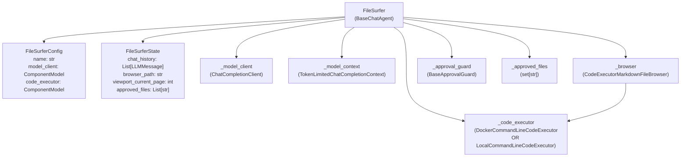
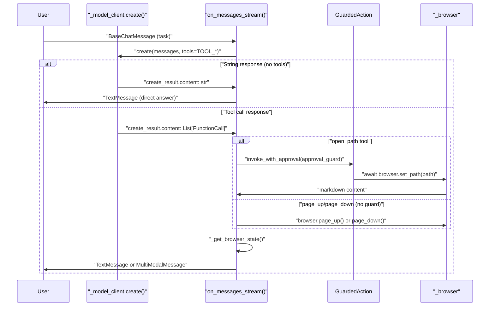
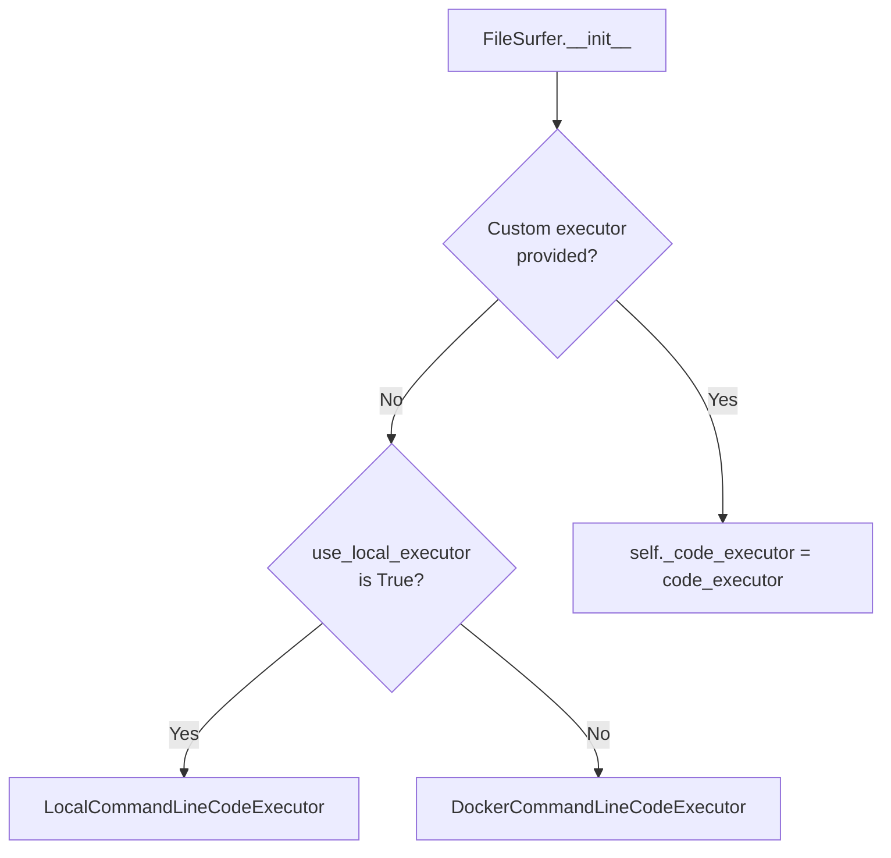

<!-- source: DeepWiki mcp.deepwiki.com · repo microsoft/magentic-ui · page 4.4 FileSurfer Agent · fetched 2026-10-26 -->

# FileSurfer Agent

<details>
<summary>Relevant source files</summary>

The following files were used as context for generating this wiki page:

- [frontend/src/components/views/api.ts](frontend/src/components/views/api.ts)
- [src/magentic_ui/agents/_coder.py](src/magentic_ui/agents/_coder.py)
- [src/magentic_ui/agents/file_surfer/_code_markdown_file_browser.py](src/magentic_ui/agents/file_surfer/_code_markdown_file_browser.py)
- [src/magentic_ui/agents/file_surfer/_file_surfer.py](src/magentic_ui/agents/file_surfer/_file_surfer.py)
- [src/magentic_ui/backend/utils/utils.py](src/magentic_ui/backend/utils/utils.py)

</details>


The FileSurfer Agent is a specialized agent for file system interaction and document analysis. It provides controlled access to local files and directories through an LLM-powered tool interface that converts various file formats (including audio, images, PDFs, spreadsheets) to markdown-formatted text for analysis using the `markitdown` library.

The agent operates within Docker containers for security isolation by default and implements an approval guard system for sensitive file operations. It maintains a viewport-based pagination system to handle large files efficiently within LLM token limits.

**Related Pages:** [WebSurfer Agent (4.2)]() for web content, [Coder Agent (4.3)]() for file manipulation, [Orchestrator Agent (4.1)]() for coordination, [Action Guards (5.3)]() for approval policies.

## Core Architecture

The `FileSurfer` class extends `BaseChatAgent` and implements `Component[FileSurferConfig]` for serialization support [src/magentic_ui/agents/file_surfer/_file_surfer.py:94-94](). It combines LLM-based tool selection with a file browser that converts arbitrary file formats to markdown.

### Component Structure Diagram


**Sources:** [src/magentic_ui/agents/file_surfer/_file_surfer.py:55-108](), [src/magentic_ui/agents/file_surfer/_file_surfer.py:149-206]()

### Key Class Attributes

| Attribute | Type | Purpose |
|-----------|------|---------|
| `_model_client` | `ChatCompletionClient` | LLM for tool selection and text analysis [src/magentic_ui/agents/file_surfer/_file_surfer.py:163-163]() |
| `_model_context` | `TokenLimitedChatCompletionContext` | Token-limited context with tool schemas [src/magentic_ui/agents/file_surfer/_file_surfer.py:175-175]() |
| `_browser` | `CodeExecutorMarkdownFileBrowser` | File navigation and markdown conversion [src/magentic_ui/agents/file_surfer/_file_surfer.py:199-203]() |
| `_code_executor` | `CodeExecutor` | Docker or local file system access [src/magentic_ui/agents/file_surfer/_file_surfer.py:184-198]() |
| `_approval_guard` | `BaseApprovalGuard` | Safety policy for file operations [src/magentic_ui/agents/file_surfer/_file_surfer.py:159-159]() |
| `_approved_files` | `set[str]` | Tracks previously approved file paths [src/magentic_ui/agents/file_surfer/_file_surfer.py:164-164]() |

**Sources:** [src/magentic_ui/agents/file_surfer/_file_surfer.py:149-206]()

## Tool System and File Operations

The FileSurfer uses seven tool schemas passed to the LLM via `_model_client.create()`. The LLM returns `FunctionCall` objects which are dispatched through a pattern-matching system in `on_messages_stream`.

### Tool Execution Flow Diagram


**Sources:** [src/magentic_ui/agents/file_surfer/_file_surfer.py:252-559](), [src/magentic_ui/agents/file_surfer/_file_surfer.py:405-506]()

### Tool Catalog

| Tool Constant | Function Name | Arguments | Guarded | Implementation |
|---------------|---------------|-----------|---------|----------------|
| `TOOL_OPEN_PATH` | `open_path` | `path: str`, `explanation: str` | Yes | `browser.set_path(path)` [src/magentic_ui/agents/file_surfer/_file_surfer.py:406-429]() |
| `TOOL_LIST_CURRENT_DIRECTORY` | `list_current_directory` | `explanation: str` | Yes | `browser.set_path(".")` [src/magentic_ui/agents/file_surfer/_file_surfer.py:431-448]() |
| `TOOL_PAGE_DOWN` | `page_down` | `explanation: str` | No | `browser.page_down()` [src/magentic_ui/agents/file_surfer/_file_surfer.py:453-454]() |
| `TOOL_PAGE_UP` | `page_up` | `explanation: str` | No | `browser.page_up()` [src/magentic_ui/agents/file_surfer/_file_surfer.py:450-451]() |
| `TOOL_FIND_ON_PAGE_CTRL_F` | `find_on_page_ctrl_f` | `search_string: str`, `explanation: str` | No | `browser.find_on_page(search_string)` [src/magentic_ui/agents/file_surfer/_file_surfer.py:456-458]() |
| `TOOL_FIND_NEXT` | `find_next` | `explanation: str` | No | `browser.find_next()` [src/magentic_ui/agents/file_surfer/_file_surfer.py:460-461]() |
| `TOOL_FIND_FILE` | `find_file` | `query: str`, `explanation: str` | Yes | `browser.find_files(query)` [src/magentic_ui/agents/file_surfer/_file_surfer.py:463-503]() |

**Sources:** [src/magentic_ui/agents/file_surfer/_file_surfer.py:166-174](), [src/magentic_ui/agents/file_surfer/_tool_definitions.py]()

## File Browser and Markdown Conversion

The `CodeExecutorMarkdownFileBrowser` class provides file navigation with automatic format conversion. It converts diverse file types (PDFs, DOCX, XLSX, images, audio) to markdown text, then chunks the output into viewport pages.

### Viewport Pagination System

The browser uses `viewport_size` (default 8192 characters) to chunk large files [src/magentic_ui/agents/file_surfer/_code_markdown_file_browser.py:31-39](). The `_get_browser_state()` method returns the current viewport content with context headers [src/magentic_ui/agents/file_surfer/_file_surfer.py:611-631]().

```python
# Example state returned to LLM
Path: /workspace/data/report.pdf
Title: report.pdf
Viewport position: Showing page 3 of 12.
[Markdown Content...]
```

### Markitdown Conversion Process

When `set_path(path)` is called, the browser executes helper code in the code executor to perform validation and conversion [src/magentic_ui/agents/file_surfer/_code_markdown_file_browser.py:73-84](). For image files, the agent returns a `MultiModalMessage` containing the image content [src/magentic_ui/agents/file_surfer/_file_surfer.py:527-544]().

**Sources:** [src/magentic_ui/agents/file_surfer/_code_markdown_file_browser.py:10-16](), [src/magentic_ui/agents/file_surfer/_file_surfer.py:527-544]()

## Code Executor Integration

FileSurfer initializes its code executor in `__init__` [src/magentic_ui/agents/file_surfer/_file_surfer.py:184-198](). The agent applies a umask patch to `DockerCommandLineCodeExecutor._execute_command` to ensure correct file permissions [src/magentic_ui/agents/file_surfer/_file_surfer.py:52-52]().

### Executor Initialization Logic


**Sources:** [src/magentic_ui/agents/file_surfer/_file_surfer.py:184-198]()

## Safety and Approval System

FileSurfer implements `GuardedAction` for sensitive operations like opening new files or listing directories.

### Guarded vs Unguarded Operations

1.  **Guarded**: `open_path`, `list_current_directory`, `find_file`. These use `GuardedAction.invoke_with_approval()` [src/magentic_ui/agents/file_surfer/_file_surfer.py:508-525]().
2.  **Unguarded**: Navigation and search on the current page (`page_up`, `page_down`, `find_on_page_ctrl_f`, `find_next`).

The `_approved_files` set tracks paths the user has already permitted [src/magentic_ui/agents/file_surfer/_file_surfer.py:164-164](). If a file is in this set, the agent bypasses the approval request for subsequent opens [src/magentic_ui/agents/file_surfer/_file_surfer.py:410-420]().

**Sources:** [src/magentic_ui/agents/file_surfer/_file_surfer.py:406-525](), [src/magentic_ui/agents/file_surfer/_file_surfer.py:560-576]()

---

