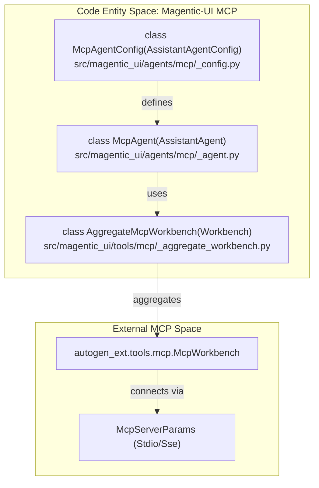
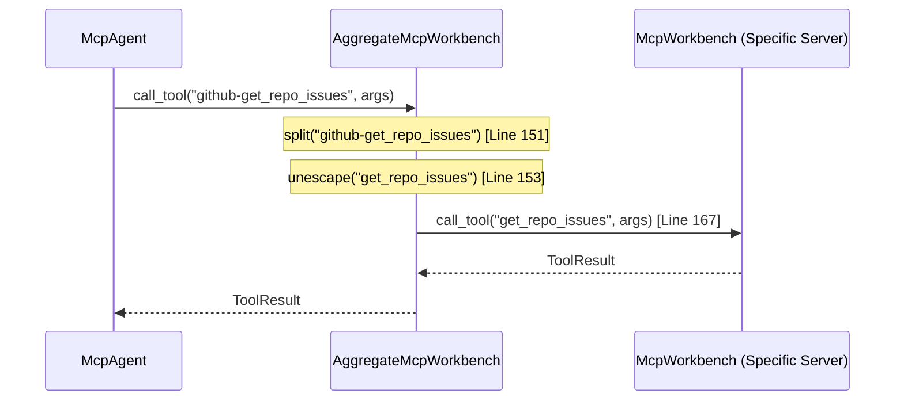

<!-- source: DeepWiki mcp.deepwiki.com · repo microsoft/magentic-ui · page 4.5 MCP Agents · fetched 2026-10-26 -->

# MCP Agents

<details>
<summary>Relevant source files</summary>

The following files were used as context for generating this wiki page:

- [src/magentic_ui/agents/mcp/_agent.py](src/magentic_ui/agents/mcp/_agent.py)
- [src/magentic_ui/agents/mcp/_config.py](src/magentic_ui/agents/mcp/_config.py)
- [src/magentic_ui/tools/mcp/__init__.py](src/magentic_ui/tools/mcp/__init__.py)
- [src/magentic_ui/tools/mcp/_aggregate_workbench.py](src/magentic_ui/tools/mcp/_aggregate_workbench.py)

</details>


## Purpose and Scope

This document explains how Magentic-UI integrates with the Model Context Protocol (MCP) to extend agent capabilities with external tools. MCP Agents allow you to dynamically add custom functionality to the multi-agent team by connecting to MCP servers that provide specialized tools and APIs.

For information about the overall agent system and specialized agents, see [Agent System](). For details on how the Orchestrator coordinates these agents, see [Orchestrator Agent]().

---

## What are MCP Agents?

MCP Agents are dynamically configured agents that expose external tools through the Model Context Protocol. Unlike the built-in specialized agents (WebSurfer, Coder, FileSurfer), MCP Agents can be customized by users to access virtually any service or API that provides an MCP server implementation.

**Key Characteristics:**
- Each MCP Agent is implemented as an `McpAgent` class, which is a thin wrapper around `autogen_agentchat.agents.AssistantAgent` [src/magentic_ui/agents/mcp/_agent.py:20-23]().
- Tools are exposed via an `AggregateMcpWorkbench` [src/magentic_ui/tools/mcp/_aggregate_workbench.py:55-60]().
- Tools from multiple servers are namespaced to prevent collisions (e.g., `server_name-tool_name`) [src/magentic_ui/tools/mcp/_aggregate_workbench.py:131-141]().
- Agents can be configured per-deployment (via YAML) or selected per-session (via UI).

**Sources:** [src/magentic_ui/agents/mcp/_agent.py:20-54](), [src/magentic_ui/tools/mcp/_aggregate_workbench.py:55-97]()

---

## Architecture and Implementation

### MCP Agent Structure

The `McpAgent` class handles the lifecycle of MCP tool integration. It uses an `AggregateMcpWorkbench` to manage connections to one or more MCP servers simultaneously.



**Sources:** [src/magentic_ui/agents/mcp/_agent.py:20-54](), [src/magentic_ui/agents/mcp/_config.py:8-13](), [src/magentic_ui/tools/mcp/_aggregate_workbench.py:55-120]()

### Tool Namespacing and Execution

To support multiple MCP servers within a single agent without tool name collisions, Magentic-UI implements an aggregation and namespacing logic in `AggregateMcpWorkbench`.

| Component | Logic | Code Reference |
|-----------|-------|----------------|
| **Namespacing** | Joins `server_name` and `tool_name` with `-` | [src/magentic_ui/tools/mcp/_aggregate_workbench.py:136-138]() |
| **Escaping** | Replaces existing `-` in tool names with `:` to avoid ambiguity | [src/magentic_ui/tools/mcp/_aggregate_workbench.py:24-35]() |
| **Routing** | Splits incoming tool calls by `-` to find the correct sub-workbench | [src/magentic_ui/tools/mcp/_aggregate_workbench.py:150-169]() |

**Sources:** [src/magentic_ui/tools/mcp/_aggregate_workbench.py:19-35](), [src/magentic_ui/tools/mcp/_aggregate_workbench.py:130-169]()

---

## Configuration

### McpAgentConfig

The configuration for an MCP agent extends the standard `AssistantAgentConfig`. It requires a list of `mcp_servers` and allows for specific tool-use reflection settings.

| Field | Type | Description |
|-------|------|-------------|
| `mcp_servers` | `List[NamedMcpServerParams]` | List of servers this agent can access |
| `reflect_on_tool_use` | `bool` | If true, agent reasons about tool output before responding |
| `tool_call_summary_format` | `str` | Template for summarizing tool execution results |

**Sources:** [src/magentic_ui/agents/mcp/_config.py:8-13]()

### YAML Configuration Example

Configuration can be provided in the main `config.yaml` or a dedicated MCP agents file.

```yaml
mcp_agent_configs:
  - name: "github_assistant"
    description: "Agent with access to GitHub repositories."
    model_client: 
      provider: "OpenAIChatCompletionClient"
      config:
        model: "gpt-4o"
    system_message: "You are a GitHub expert."
    mcp_servers:
      - server_name: "github"
        server_params:
          type: "StdioServerParams"
          command: "npx"
          args: ["-y", "@modelcontextprotocol/server-github"]
```

---

## Data Flow: Tool Call Resolution

When the Orchestrator requests a tool call from an `McpAgent`, the request flows through the `AggregateMcpWorkbench` to the specific server.



**Sources:** [src/magentic_ui/tools/mcp/_aggregate_workbench.py:143-169]()

---

## Implementation Details

### Message Streaming and UI Metadata

The `McpAgent` overrides `on_messages_stream` to ensure that tool calls and progress messages are correctly flagged for display in the Magentic-UI frontend. It injects metadata into events to set `"internal": "no"` and `"type": "progress_message"`.

**Sources:** [src/magentic_ui/agents/mcp/_agent.py:56-81]()

### Server Parameter Models

The system uses `NamedMcpServerParams` to associate a unique name with standard MCP connection parameters.

```python
class NamedMcpServerParams(BaseModel):
    server_name: str
    server_params: McpServerParams # StdioServerParams or SseServerParams
```

**Sources:** [src/magentic_ui/tools/mcp/_aggregate_workbench.py:38-44]()

### Factory Method

The `_from_config` class method in `McpAgent` handles the conversion of a configuration object into a live agent by initializing the `AggregateMcpWorkbench` and dumping its component state for persistence.

**Sources:** [src/magentic_ui/agents/mcp/_agent.py:83-95]()

---

## Summary of Key Classes

| Class | File | Responsibility |
|-------|------|----------------|
| `McpAgent` | `src/magentic_ui/agents/mcp/_agent.py` | Main agent class that integrates MCP tools into the chat team. |
| `AggregateMcpWorkbench` | `src/magentic_ui/tools/mcp/_aggregate_workbench.py` | Orchestrates multiple MCP servers and handles tool namespacing. |
| `McpAgentConfig` | `src/magentic_ui/agents/mcp/_config.py` | Pydantic model for defining MCP agent settings. |
| `NamedMcpServerParams` | `src/magentic_ui/tools/mcp/_aggregate_workbench.py` | Pairs a server identifier with its connection parameters. |

**Sources:** [src/magentic_ui/agents/mcp/_agent.py:20-23](), [src/magentic_ui/tools/mcp/_aggregate_workbench.py:55-60](), [src/magentic_ui/agents/mcp/_config.py:8-9]()

---

