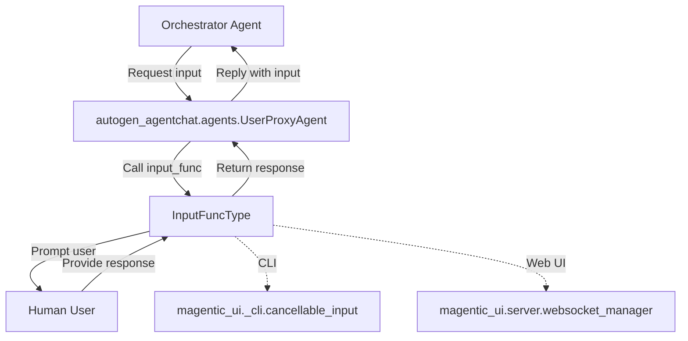
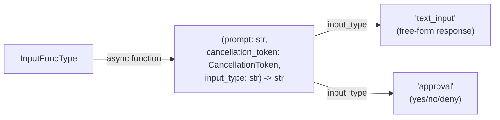
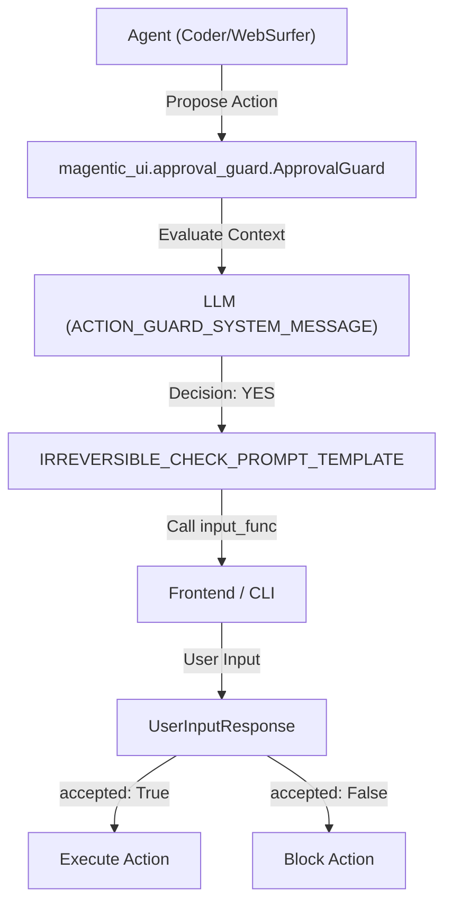

<!-- source: DeepWiki mcp.deepwiki.com · repo microsoft/magentic-ui · page 4.6 User Proxy and Human Interaction · fetched 2026-10-26 -->

# User Proxy and Human Interaction

Relevant source files

The following files were used as context for generating this wiki page:

- [src/magentic_ui/agents/_user_proxy.py](src/magentic_ui/agents/_user_proxy.py)
- [src/magentic_ui/agents/users/_metadata_user_proxy.py](src/magentic_ui/agents/users/_metadata_user_proxy.py)
- [src/magentic_ui/approval_guard.py](src/magentic_ui/approval_guard.py)
- [src/magentic_ui/eval/benchmark.py](src/magentic_ui/eval/benchmark.py)
- [src/magentic_ui/eval/benchmarks/webvoyager/webvoyager.py](src/magentic_ui/eval/benchmarks/webvoyager/webvoyager.py)
- [src/magentic_ui/teams/orchestrator/_utils.py](src/magentic_ui/teams/orchestrator/_utils.py)

This document describes the user proxy agent system in Magentic-UI and how human interaction is integrated into the multi-agent workflow. It covers the three types of user proxy agents (standard, dummy, and metadata), the input function mechanism, and the human-in-the-loop patterns used throughout execution.

For information about action approval mechanisms and guarded actions, see [Action Guards and Approval Policies](#5.3).

---

## Overview

The user proxy agent serves as the interface between the human user and the multi-agent system. It is responsible for:

- Requesting input from the user during task execution.
- Relaying user responses back to the orchestrator.
- Enabling cooperative planning through plan review and modification. [src/magentic_ui/teams/orchestrator/_utils.py:6-27]()
- Supporting different execution modes (interactive, automated, benchmark evaluation). [src/magentic_ui/eval/benchmark.py:11-32]()

The user proxy is always part of the agent team and is referenced by name `"user_proxy"` in agent conversations. The orchestrator directs input requests to the user proxy when human feedback is needed. [src/magentic_ui/agents/_user_proxy.py:1-8]()

---

## User Proxy Types

Magentic-UI supports three distinct user proxy implementations, selected via the `user_proxy_type` configuration parameter:

| Type | Value | Use Case | Input Source |
|------|-------|----------|--------------|
| Standard | `None` (default) | Interactive use via CLI or web UI | Human user |
| Dummy | `"dummy"` | Automated testing without human input | Auto-approves all requests |
| Metadata | `"metadata"` | Benchmark evaluation with ground truth | LLM simulates user with task metadata |

### Standard User Proxy (UserProxyAgent)

The standard user proxy uses AutoGen's `UserProxyAgent` class with a custom `input_func` to collect input from the actual human user.

**Natural Language Space to Code Entity Space: Standard Interaction**

**Sources:** [src/magentic_ui/agents/_user_proxy.py:1-8](), [src/magentic_ui/approval_guard.py:156-172]()

### Dummy User Proxy

The dummy user proxy automatically approves all requests without human intervention. It is used for testing and fully autonomous execution. When a dummy user proxy is used, the approval guard also uses an `always_yes_input` function that automatically returns `"yes"` for all approval requests. [src/magentic_ui/approval_guard.py:75-78]()

### Metadata User Proxy

The `MetadataUserProxy` uses an LLM to simulate realistic user behavior for benchmark evaluation. It has access to ground truth information about the task. [src/magentic_ui/agents/users/_metadata_user_proxy.py:148-164]()

**Simulation Phases:**
- **Planning Phase**: The agent reviews the AI's plan and provides feedback based on `helpful_task_hints`. [src/magentic_ui/agents/users/_metadata_user_proxy.py:21-43]()
- **Execution Phase**: The agent answers questions from the AI using the provided `task_answer`. [src/magentic_ui/agents/users/_metadata_user_proxy.py:73-92]()

**Helpfulness Levels:**
- `strict`: Simulated user does not have access to answer and rewrites hints to remove answer. [src/magentic_ui/agents/users/_metadata_user_proxy.py:21-43]()
- `soft`: Simulated user has access to answer and helpful hints. [src/magentic_ui/agents/users/_metadata_user_proxy.py:46-70]()
- `no_hints`: Simulated user does not have access to hints or answer. [src/magentic_ui/agents/users/_metadata_user_proxy.py:114-130]()

**Sources:** [src/magentic_ui/agents/users/_metadata_user_proxy.py:148-185]()

---

## Input Function System

The input function (`input_func`) is the bridge between the agent system and the user interface. It defines how input is collected from the user.

### InputFuncType Definition

The input function must be async and support cancellation through a `CancellationToken`. The `input_type` parameter distinguishes between different kinds of input requests. [src/magentic_ui/approval_guard.py:1-12]()

**Sources:** [src/magentic_ui/approval_guard.py:173-192]()

---

## Human-in-the-Loop Workflows

### Approval Requests

Approval requests are handled by the `ApprovalGuard` system for sensitive actions. The `ApprovalGuard` evaluates if an action requires human intervention based on its `approval_policy`. [src/magentic_ui/approval_guard.py:75-78]()

**Action Evaluation Logic:**
1. **Always**: Tool is marked as always requiring approval. [src/magentic_ui/approval_guard.py:44-46]()
2. **Maybe**: The `ApprovalGuard` uses an LLM with the `ACTION_GUARD_SYSTEM_MESSAGE` to determine if the specific context requires approval. [src/magentic_ui/approval_guard.py:116-145]()
3. **Never**: The action is executed without checking. [src/magentic_ui/approval_guard.py:76-78]()

**Natural Language Space to Code Entity Space: Approval Guard Workflow**

**Sources:** [src/magentic_ui/approval_guard.py:49-65](), [src/magentic_ui/approval_guard.py:147-153]()

### Plan Acceptance

When cooperative planning is enabled, the orchestrator generates a plan and requests user feedback. The system checks if the user's string response constitutes an acceptance using `is_accepted_str`. [src/magentic_ui/teams/orchestrator/_utils.py:6-27]()

**Accepted Strings include:**
- "accept", "accepted"
- "run", "execute plan"
- "looks good", "do it"
- "i don't know. use your best judgment." [src/magentic_ui/teams/orchestrator/_utils.py:7-22]()

If the user provides feedback instead of acceptance, the orchestrator may use `extract_json_from_string` to parse structured modifications from the response. [src/magentic_ui/teams/orchestrator/_utils.py:30-42]()

**Sources:** [src/magentic_ui/teams/orchestrator/_utils.py:1-42]()

---

## Evaluation Integration

The user proxy system is critical for automated benchmarks like **WebVoyager**. In these scenarios, the `WebVoyagerBenchmark` class uses an evaluator to compare the agent's final result (and screenshots) against ground truth, effectively acting as a "perfect" user proxy for scoring. [src/magentic_ui/eval/benchmarks/webvoyager/webvoyager.py:49-82]()

The evaluator uses a specific `SYSTEM_PROMPT` to assess:
- If actions taken align with instructions. [src/magentic_ui/eval/benchmarks/webvoyager/webvoyager.py:30-31]()
- Discrepancies between text responses and visual screenshots. [src/magentic_ui/eval/benchmarks/webvoyager/webvoyager.py:32-33]()

**Sources:** [src/magentic_ui/eval/benchmarks/webvoyager/webvoyager.py:20-35](), [src/magentic_ui/eval/benchmark.py:50-55]()

---

