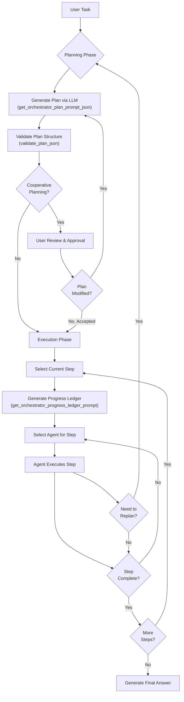
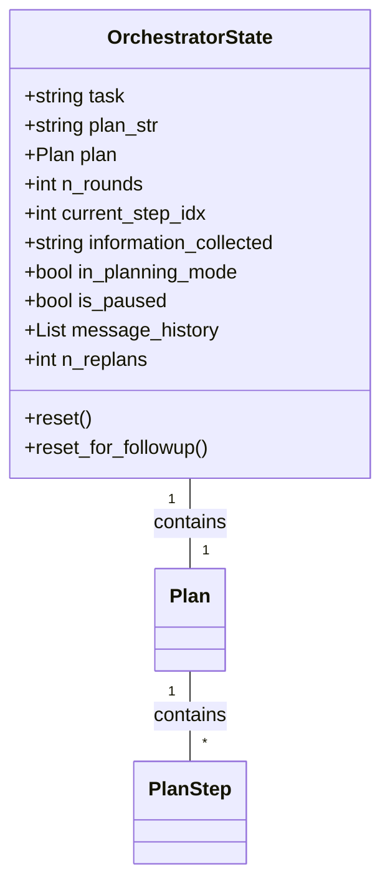
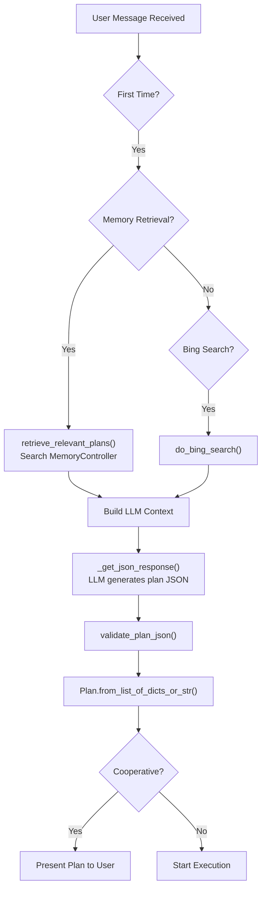

<!-- source: DeepWiki mcp.deepwiki.com · repo microsoft/magentic-ui · page 5 Planning and Execution · fetched 2026-10-26 -->

# Planning and Execution

<details>
<summary>Relevant source files</summary>

The following files were used as context for generating this wiki page:

- [src/magentic_ui/agents/web_surfer/_web_surfer.py](src/magentic_ui/agents/web_surfer/_web_surfer.py)
- [src/magentic_ui/teams/orchestrator/_orchestrator.py](src/magentic_ui/teams/orchestrator/_orchestrator.py)
- [src/magentic_ui/teams/orchestrator/_prompts.py](src/magentic_ui/teams/orchestrator/_prompts.py)
- [src/magentic_ui/tools/playwright/playwright_controller.py](src/magentic_ui/tools/playwright/playwright_controller.py)
- [src/magentic_ui/types.py](src/magentic_ui/types.py)

</details>


This document explains the plan-centric execution model at the core of Magentic-UI. The system organizes all task execution around structured **Plans** that are generated by the `Orchestrator` agent, validated, optionally reviewed by users, and then executed step-by-step. This page provides an overview of plan generation, validation, execution flow, and state management.

For detailed information about planning modes and memory retrieval, see [Planning System](#5.1). For long-running monitoring tasks, see [Sentinel Steps and Monitoring](#5.2). For security controls during execution, see [Action Guards and Approval Policies](#5.3).

---

## The Plan-Centric Execution Model

The `Orchestrator` agent operates on a **plan-centric model** where every task is first converted into a structured plan before execution begins. This approach provides several benefits:

1. **Transparency**: Users can review and modify plans before execution [src/magentic_ui/teams/orchestrator/_orchestrator.py:848-868]().
2. **Resumability**: Plans capture execution state for pause/resume operations [src/magentic_ui/teams/orchestrator/_orchestrator.py:82-83]().
3. **Learning**: Successful plans can be stored and reused for similar tasks [src/magentic_ui/teams/orchestrator/_orchestrator.py:673-707]().
4. **Coordination**: Plans explicitly specify which agent performs each step [src/magentic_ui/types.py:29-41]().

The planning and execution cycle follows a two-phase pattern:

**Execution Logic Overview**


**Sources:** [src/magentic_ui/teams/orchestrator/_orchestrator.py:709-1029](), [src/magentic_ui/teams/orchestrator/_prompts.py:114-151]()

---

## Plan Structure and Types

Plans are represented by the `Plan` class [src/magentic_ui/types.py:62-78](), which contains a task description and a sequence of steps. There are two types of steps:

### Plan Data Model

| Component | Type | Description |
|-----------|------|-------------|
| **Plan** | `BaseModel` | Contains `task` (string) and `steps` (Sequence of `PlanStep` or `SentinelPlanStep`) [src/magentic_ui/types.py:62-78]() |
| **PlanStep** | `BaseModel` | Standard step for immediate, one-time actions [src/magentic_ui/types.py:29-41]() |
| **SentinelPlanStep** | `PlanStep` | Special step for long-running monitoring tasks [src/magentic_ui/types.py:44-59]() |

### PlanStep Structure

A standard `PlanStep` has three required fields:

```json
{
  "title": "Short one-sentence description of the step",
  "details": "Detailed instruction for the agent to perform.",
  "agent_name": "web_surfer"
}
```

| Field | Type | Description |
|-------|------|-------------|
| `title` | string | One-sentence summary of what the step accomplishes [src/magentic_ui/types.py:39]() |
| `details` | string | Complete instruction with all context needed for the agent [src/magentic_ui/types.py:40]() |
| `agent_name` | string | Name of the agent that should execute this step [src/magentic_ui/types.py:41]() |

### SentinelPlanStep Structure

A `SentinelPlanStep` extends `PlanStep` with monitoring capabilities:

| Field | Type | Description |
|-------|------|-------------|
| `sleep_duration` | integer | Seconds to wait between checks [src/magentic_ui/types.py:58]() |
| `condition` | string or int | Iteration count or description of completion condition [src/magentic_ui/types.py:59]() |

**Sources:** [src/magentic_ui/types.py:29-139](), [src/magentic_ui/teams/orchestrator/_prompts.py:60-101]()

---

## Orchestrator State Management

The `Orchestrator` maintains execution state through the `OrchestratorState` class [src/magentic_ui/teams/orchestrator/_orchestrator.py:70-111]():

**State Entity Relationship**


### State Fields

| Field | Type | Purpose |
|-------|------|---------|
| `task` | string | The original user request [src/magentic_ui/teams/orchestrator/_orchestrator.py:75]() |
| `plan` | `Plan \| None` | The current plan being executed [src/magentic_ui/teams/orchestrator/_orchestrator.py:77]() |
| `current_step_idx` | int | Index of the currently executing step [src/magentic_ui/teams/orchestrator/_orchestrator.py:79]() |
| `in_planning_mode` | bool | `True` during planning, `False` during execution [src/magentic_ui/teams/orchestrator/_orchestrator.py:81]() |
| `message_history` | List | Complete conversation history [src/magentic_ui/teams/orchestrator/_orchestrator.py:84]() |

**Sources:** [src/magentic_ui/teams/orchestrator/_orchestrator.py:70-111]()

---

## Planning Phase

The planning phase is orchestrated by the `_orchestrate_step_planning()` method [src/magentic_ui/teams/orchestrator/_orchestrator.py:709-905](), which generates a plan using LLM reasoning.

### Planning Process Flow



### Key Methods and Prompts

| Method/Prompt | Purpose | Location |
|---------------|---------|----------|
| `_orchestrate_step_planning()` | Main planning loop coordinator | [src/magentic_ui/teams/orchestrator/_orchestrator.py:709-905]() |
| `get_orchestrator_system_message_planning()` | System message explaining planning capabilities | [src/magentic_ui/teams/orchestrator/_prompts.py:114-181]() |
| `get_orchestrator_plan_prompt_json()` | Prompt for generating plan JSON | [src/magentic_ui/teams/orchestrator/_prompts.py:235-333]() |
| `validate_plan_json()` | Validates plan structure and required fields | [src/magentic_ui/teams/orchestrator/_prompts.py:471-511]() |

**Sources:** [src/magentic_ui/teams/orchestrator/_orchestrator.py:709-905](), [src/magentic_ui/teams/orchestrator/_prompts.py:114-333]()

---

## Execution Phase

Once a plan is accepted, the `Orchestrator` switches to execution mode (`in_planning_mode = False`) and begins executing steps sequentially through `_orchestrate_step_execution()` [src/magentic_ui/teams/orchestrator/_orchestrator.py:931-1101].

### Progress Ledger JSON Schema

At each execution step, the `Orchestrator` generates a "progress ledger" to assess the state [src/magentic_ui/teams/orchestrator/_prompts.py:410-424]():

| Field | Type | Purpose |
|-------|------|---------|
| `is_current_step_complete` | object | Assessment if current step objectives are met [src/magentic_ui/teams/orchestrator/_prompts.py:412]() |
| `need_to_replan` | object | Whether current plan is still viable [src/magentic_ui/teams/orchestrator/_prompts.py:416]() |
| `instruction_or_question` | object | Detailed instruction for the next agent [src/magentic_ui/teams/orchestrator/_prompts.py:420]() |
| `progress_summary` | string | User-facing summary of progress [src/magentic_ui/teams/orchestrator/_prompts.py:424]() |

**Sources:** [src/magentic_ui/teams/orchestrator/_orchestrator.py:931-1101](), [src/magentic_ui/teams/orchestrator/_prompts.py:356-424]()

---

## Replanning

Replanning occurs via the `_replan()` method [src/magentic_ui/teams/orchestrator/_orchestrator.py:1103-1176] when the current plan cannot make progress.

### Replanning Triggers
1. **Agent Failure**: The agent is unable to complete the instruction [src/magentic_ui/teams/orchestrator/_prompts.py:341-344]().
2. **Context Change**: New information renders the old plan obsolete [src/magentic_ui/teams/orchestrator/_prompts.py:345-348]().
3. **User Input**: The user provides new instructions that conflict with the plan [src/magentic_ui/teams/orchestrator/_orchestrator.py:870-892]().

The replanning process uses `get_orchestrator_plan_replan_json()` to generate a new sequence of steps while considering the failed plan as context [src/magentic_ui/teams/orchestrator/_prompts.py:336-353]().

**Sources:** [src/magentic_ui/teams/orchestrator/_orchestrator.py:1103-1176](), [src/magentic_ui/teams/orchestrator/_prompts.py:336-353]()

---

## Memory Integration and Plan Learning

The `Orchestrator` can integrate with a `MemoryController` to store and retrieve successful plans [src/magentic_ui/teams/orchestrator/_orchestrator.py:172-188]().

### Memory Configuration

| Config Field | Value | Behavior |
|--------------|-------|----------|
| `retrieve_relevant_plans` | `"reuse"` | Retrieve and use most relevant plan directly [src/magentic_ui/teams/orchestrator/_orchestrator.py:734-754]() |
| `retrieve_relevant_plans` | `"hint"` | Include retrieved plan as a context hint [src/magentic_ui/teams/orchestrator/_orchestrator.py:763-780]() |

**Sources:** [src/magentic_ui/teams/orchestrator/_orchestrator.py:172-188](), [src/magentic_ui/teams/orchestrator/_orchestrator.py:673-707]()

---

## Configuration and Prompts

The planning and execution behavior is configured via `OrchestratorConfig` [src/magentic_ui/teams/orchestrator/orchestrator_config.py]().

### Prompt Templates

| Prompt Function | Purpose | Location |
|-----------------|---------|----------|
| `get_orchestrator_system_message_planning()` | System message for planning phase | [src/magentic_ui/teams/orchestrator/_prompts.py:114-181]() |
| `get_orchestrator_plan_prompt_json()` | Request plan generation in JSON | [src/magentic_ui/teams/orchestrator/_prompts.py:235-333]() |
| `get_orchestrator_progress_ledger_prompt()` | Request execution decision | [src/magentic_ui/teams/orchestrator/_prompts.py:356-424]() |
| `ORCHESTRATOR_FINAL_ANSWER_PROMPT` | Synthesis of final response | [src/magentic_ui/teams/orchestrator/_prompts.py:18-33]() |

**Sources:** [src/magentic_ui/teams/orchestrator/_prompts.py:8-424]()

---

