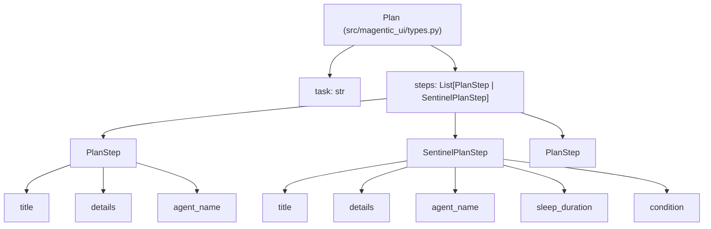
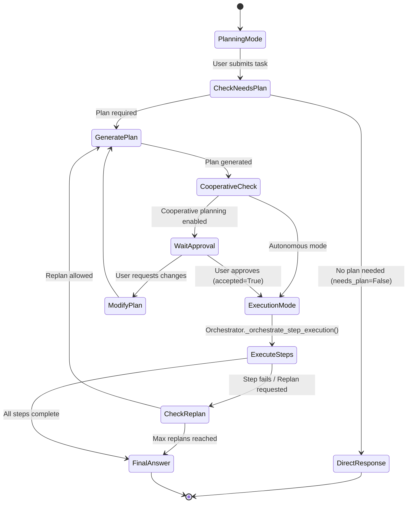
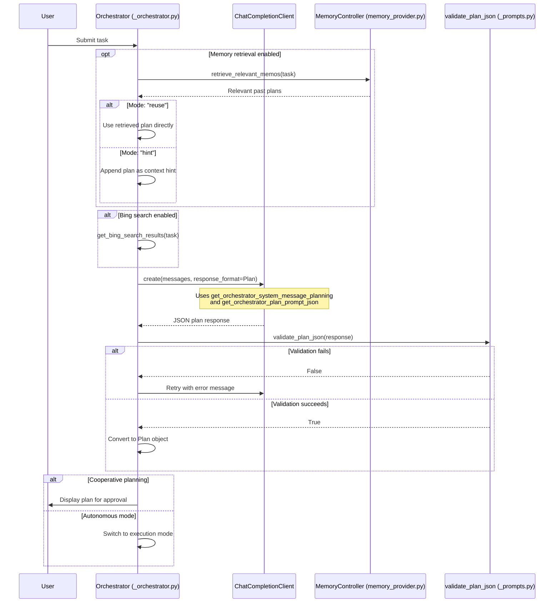
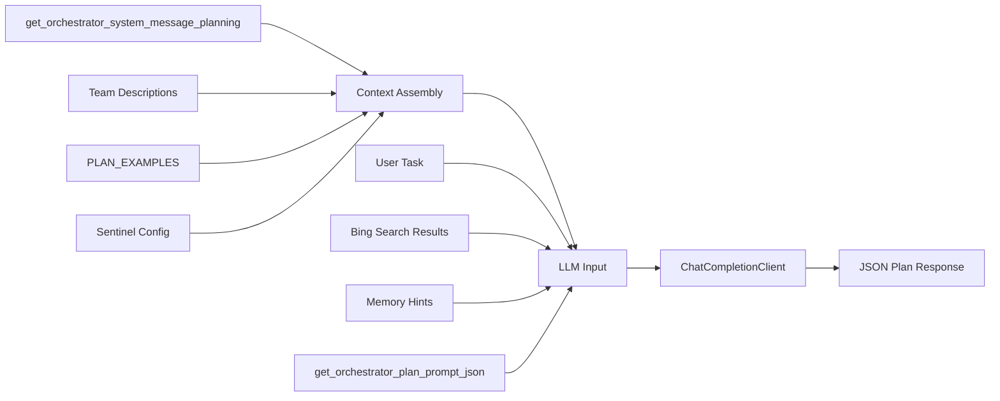
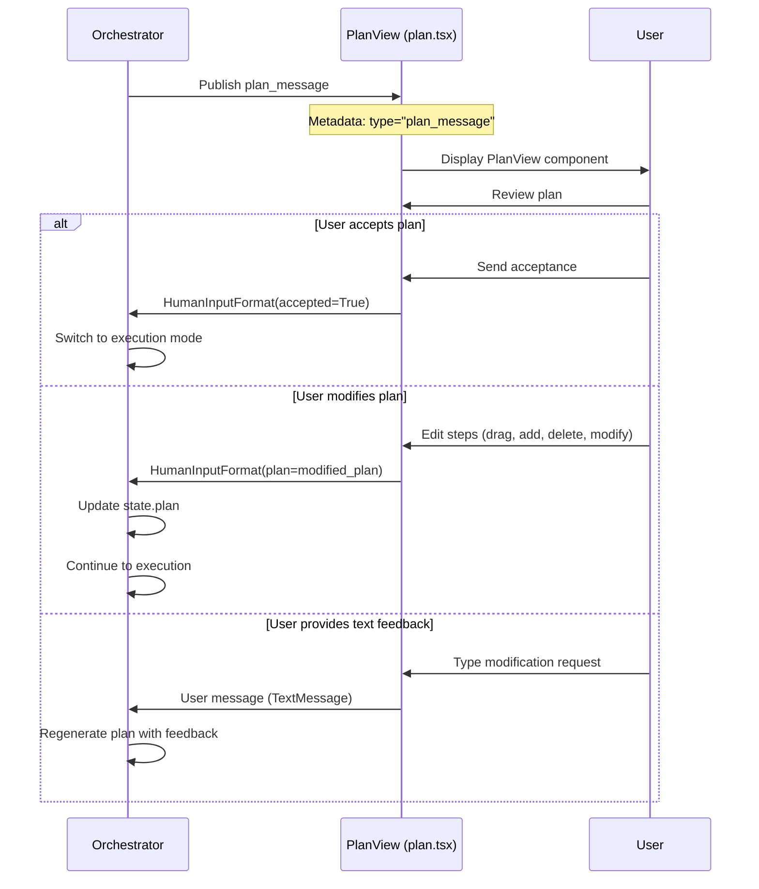
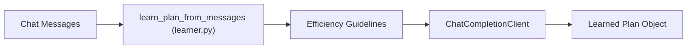
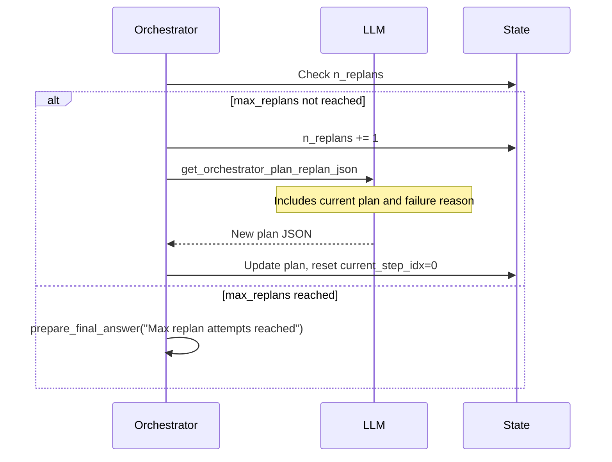
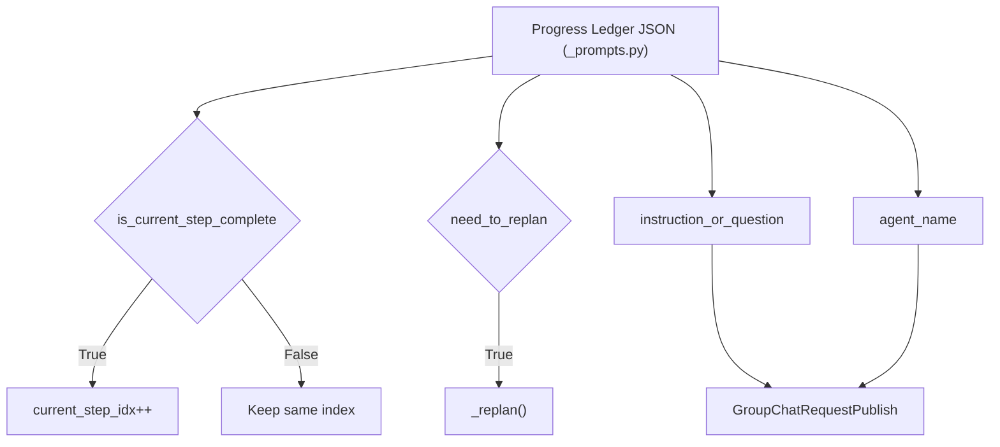

<!-- source: DeepWiki mcp.deepwiki.com · repo microsoft/magentic-ui · page 5.1 Planning System · fetched 2026-10-26 -->

# Planning System

Relevant source files

The following files were used as context for generating this wiki page:

- [frontend/src/components/views/chat/plan.tsx](frontend/src/components/views/chat/plan.tsx)
- [frontend/src/components/views/chat/rendermessage.tsx](frontend/src/components/views/chat/rendermessage.tsx)
- [src/magentic_ui/learning/learner.py](src/magentic_ui/learning/learner.py)
- [src/magentic_ui/teams/orchestrator/_orchestrator.py](src/magentic_ui/teams/orchestrator/_orchestrator.py)
- [src/magentic_ui/teams/orchestrator/_prompts.py](src/magentic_ui/teams/orchestrator/_prompts.py)

## Purpose and Scope

The Planning System is responsible for generating, validating, modifying, and executing structured plans that break down user tasks into actionable steps. Each plan consists of an ordered sequence of steps assigned to specialized agents. The system supports both autonomous planning (where plans execute immediately) and cooperative planning (where users can review and modify plans before execution).

For information about how sentinel steps enable long-running monitoring tasks within plans, see [Sentinel Steps and Monitoring](#5.2). For details on the approval mechanisms that control step execution, see [Action Guards and Approval Policies](#5.3).

---

## Plan Data Structures

### PlanStep

A `PlanStep` represents a standard action to be performed by an agent. The structure is defined in `src/magentic_ui/types.py` and contains:

| Field | Type | Description |
|-------|------|-------------|
| `title` | `str` | Short one-sentence description of the step |
| `details` | `str` | Detailed instructions for the agent |
| `agent_name` | `str` | Name of agent assigned to execute this step |
| `enabled` | `bool` | Whether this step is active (default: `True`) |

### SentinelPlanStep

A `SentinelPlanStep` extends `PlanStep` with fields for monitoring tasks (see [Sentinel Steps and Monitoring](#5.2)):

| Field | Type | Description |
|-------|------|-------------|
| `sleep_duration` | `int` | Seconds to wait between condition checks |
| `condition` | `int \| str` | Number of iterations or completion condition |

### Plan Container

**Sources:** [src/magentic_ui/types.py:1-100](), [src/magentic_ui/teams/orchestrator/_orchestrator.py:70-111]()

---

## Planning Workflow

### Planning vs Execution Modes

The `Orchestrator` operates in two distinct phases controlled by the `in_planning_mode` flag in `OrchestratorState`:

**Sources:** [src/magentic_ui/teams/orchestrator/_orchestrator.py:70-111](), [src/magentic_ui/teams/orchestrator/_orchestrator.py:709-942](), [src/magentic_ui/teams/orchestrator/_orchestrator.py:943-1118]()

---

## Plan Generation Process

### Initial Plan Creation

When a user submits a task, the Orchestrator determines whether a plan is needed by examining the request complexity and available context. The process is handled in `_orchestrate_step_planning`:

**Sources:** [src/magentic_ui/teams/orchestrator/_orchestrator.py:673-708](), [src/magentic_ui/teams/orchestrator/_orchestrator.py:709-942](), [src/magentic_ui/teams/orchestrator/_prompts.py:471-512]()

### LLM Prompt Construction

The system constructs different prompts depending on the planning context:

**Planning System Message** ([src/magentic_ui/teams/orchestrator/_prompts.py:114-181]()):
- Describes Magentic-UI's capabilities.
- Lists available team members and their expertise.
- Provides examples of good vs bad plans (e.g., direct answers for simple queries).
- Includes current date for temporal context.

**Plan Prompt JSON** ([src/magentic_ui/teams/orchestrator/_prompts.py:235-334]()):
- Specifies JSON output schema using `Plan.model_json_schema()`.
- Enforces agent name constraints.
- Includes sentinel step schema if `sentinel_tasks_enabled` is True.

**Sources:** [src/magentic_ui/teams/orchestrator/_prompts.py:114-233](), [src/magentic_ui/teams/orchestrator/_orchestrator.py:234-281]()

---

## Cooperative Planning

When `cooperative_planning` is enabled in `OrchestratorConfig`, users can review and modify plans before execution.

### User Approval Workflow

The Orchestrator checks for user acceptance by parsing the `HumanInputFormat` from the last user message or checking string content via `is_accepted_str`.

**Sources:** [src/magentic_ui/teams/orchestrator/_orchestrator.py:709-942](), [src/magentic_ui/teams/orchestrator/_utils.py:1-20](), [frontend/src/components/views/chat/plan.tsx:86-496]()

### Frontend Plan Editor

The `PlanView` component ([frontend/src/components/views/chat/plan.tsx]()) provides rich editing capabilities:

| Feature | Implementation |
|---------|---------------|
| Drag-and-drop reordering | `react-beautiful-dnd` with `onDragEnd` handler [plan.tsx:191-199]() |
| Add/delete steps | `addLocalPlan()` and `deleteLocalPlan()` [plan.tsx:173-189]() |
| Edit step details | `AutoResizeTextarea` with `updateDetails()` [plan.tsx:150-158]() |
| Agent assignment | Visual icons mapped via `getAgentIcon()` [plan.tsx:201-212]() |
| Sentinel step editing | `updateSentinelField()` for `sleep_duration` and `condition` [plan.tsx:160-171]() |
| Auto-save | Debounced save with 1-second delay via `useDebounce` [plan.tsx:30-53]() |

**Sentinel Step Rendering:**
The frontend distinguishes sentinel steps using the `isSentinelStep()` helper which checks for `sleep_duration` and `condition` fields [frontend/src/components/views/chat/plan.tsx:55-57]().

---

## Memory-Based Plan Retrieval and Learning

The system can retrieve plans from memory or learn new plans from conversation history.

### Retrieval Modes

The `retrieve_relevant_plans` config option controls how memory is used:

| Mode | Behavior |
|------|----------|
| `"reuse"` | Directly uses most relevant past plan if found [src/magentic_ui/teams/orchestrator/_orchestrator.py:733-744]() |
| `"hint"` | Appends relevant plan as context for LLM [src/magentic_ui/teams/orchestrator/_orchestrator.py:745-758]() |

### Plan Learning

The `learn_plan_from_messages` function allows the system to extract an efficient plan from a completed conversation history.

**Sources:** [src/magentic_ui/learning/learner.py:27-111](), [src/magentic_ui/learning/learner.py:114-154]()

---

## Replanning

The system can generate new plans when the current plan fails or becomes inadequate.

### Replan Triggers

During step execution, the Orchestrator evaluates `need_to_replan` after each step via the progress ledger JSON response [src/magentic_ui/teams/orchestrator/_orchestrator.py:997-1020]().

### Replan Process

**Sources:** [src/magentic_ui/teams/orchestrator/_orchestrator.py:1119-1159](), [src/magentic_ui/teams/orchestrator/_prompts.py:336-354]()

---

## Plan Execution State Management

### Progress Ledger

For each step, the Orchestrator generates a progress ledger that determines completion and next actions:

**Sources:** [src/magentic_ui/teams/orchestrator/_orchestrator.py:943-1118](), [src/magentic_ui/teams/orchestrator/_prompts.py:356-424]()

---

## Configuration Options

The Planning System is configured through `OrchestratorConfig`:

| Option | Type | Default | Description |
|--------|------|---------|-------------|
| `cooperative_planning` | `bool` | `True` | Enable user review before execution |
| `allow_for_replans` | `bool` | `True` | Allow plan regeneration on failure |
| `max_replans` | `int \| None` | `None` | Maximum replan attempts |
| `retrieve_relevant_plans` | `str \| None` | `None` | Memory retrieval mode ("reuse", "hint") |
| `do_bing_search` | `bool` | `False` | Perform web search during planning |

**Sources:** [src/magentic_ui/teams/orchestrator/orchestrator_config.py:1-100]()

---

