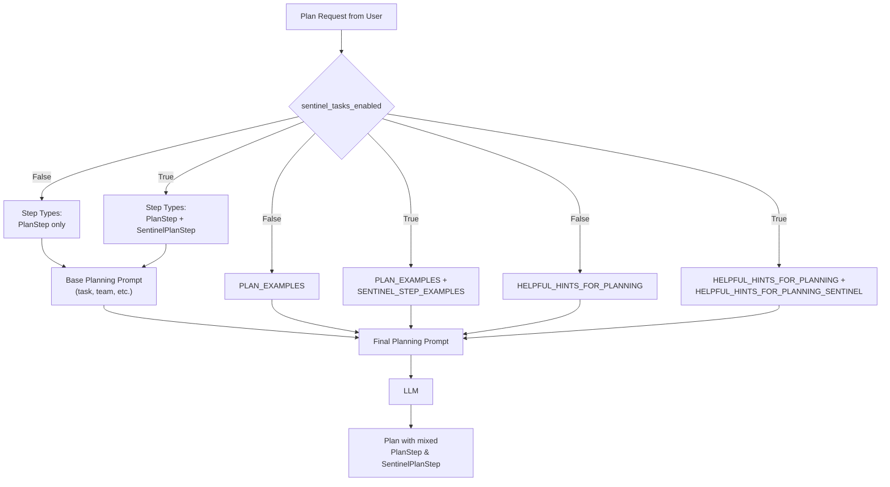
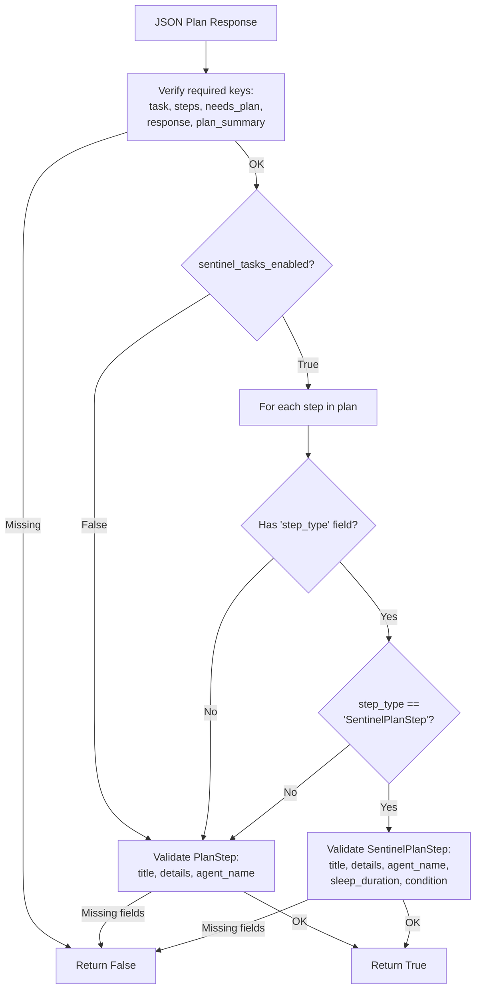
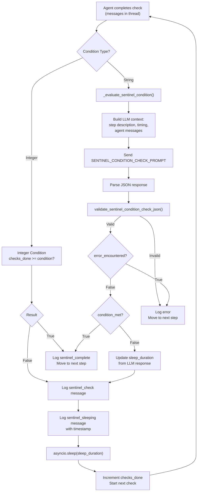
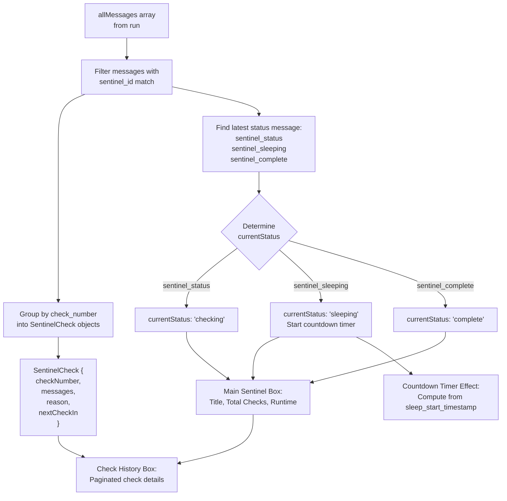
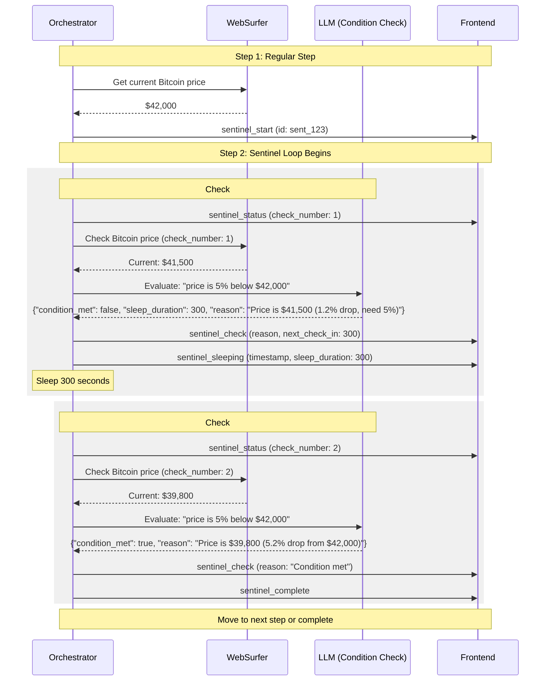

<!-- source: DeepWiki mcp.deepwiki.com · repo microsoft/magentic-ui · page 5.2 Sentinel Steps and Monitoring · fetched 2026-10-26 -->

# Sentinel Steps and Monitoring

<details>
<summary>Relevant source files</summary>

The following files were used as context for generating this wiki page:

- [frontend/src/components/views/chat/plan.tsx](frontend/src/components/views/chat/plan.tsx)
- [frontend/src/components/views/chat/rendermessage.tsx](frontend/src/components/views/chat/rendermessage.tsx)
- [frontend/src/components/views/chat/rendersentinelstep.tsx](frontend/src/components/views/chat/rendersentinelstep.tsx)
- [frontend/src/components/views/chat/sampletasks.tsx](frontend/src/components/views/chat/sampletasks.tsx)
- [frontend/src/components/views/statusicon.tsx](frontend/src/components/views/statusicon.tsx)
- [src/magentic_ui/teams/orchestrator/_orchestrator.py](src/magentic_ui/teams/orchestrator/_orchestrator.py)
- [src/magentic_ui/teams/orchestrator/_prompts.py](src/magentic_ui/teams/orchestrator/_prompts.py)
- [src/magentic_ui/teams/orchestrator/_sentinel_prompts.py](src/magentic_ui/teams/orchestrator/_sentinel_prompts.py)

</details>


## Purpose and Scope

This document describes **Sentinel Steps** (`SentinelPlanStep`), a specialized plan step type designed for long-running monitoring tasks that require periodic execution over extended time periods. Sentinel steps enable "Tell me when" functionality, allowing users to set up continuous monitoring for conditions like "tell me when Bitcoin drops 5%" or "notify me when there's a new issue in the repository." [src/magentic_ui/teams/orchestrator/_sentinel_prompts.py:60-139](), [src/magentic_ui/teams/orchestrator/_orchestrator.py:45]().

---

## Sentinel Step vs Regular Step

The system supports two types of plan steps with fundamentally different execution patterns:

| Aspect | **PlanStep** | **SentinelPlanStep** |
|--------|-------------|---------------------|
| **Execution Pattern** | Single execution, then complete | Repeated execution until condition met |
| **Use Case** | Immediate tasks (send email, search web) | Long-running monitoring (wait for event, periodic checks) |
| **Duration** | Seconds to minutes | Minutes to days or indefinite |
| **Fields** | `title`, `details`, `agent_name` | `title`, `details`, `agent_name`, `step_type`, `condition`, `sleep_duration` |
| **Completion** | After agent responds once | After condition evaluation returns true |
| **State** | Checking → Complete | Checking → Sleeping → Checking → ... → Complete |

Sources: [src/magentic_ui/teams/orchestrator/_sentinel_prompts.py:60-100](), [src/magentic_ui/types.py]()

---

## Sentinel Step Structure

### Required Fields

A `SentinelPlanStep` extends the base plan step structure with monitoring-specific fields: [src/magentic_ui/types.py]().

```python
class SentinelPlanStep:
    title: str              # Short description of the monitoring task
    details: str            # Single instruction the agent executes each check
    agent_name: str         # Which agent performs the checks
    step_type: str          # Must be "SentinelPlanStep"
    condition: int | str    # Completion condition (count or LLM-evaluated string)
    sleep_duration: int     # Seconds to wait between checks
```

**Critical Design Rule**: The `details` field contains ONLY the action to perform on each check, without any mention of monitoring, waiting, or repetition. The system handles the loop logic automatically. [src/magentic_ui/teams/orchestrator/_sentinel_prompts.py:110-114]().

**Example**:
- ✅ Good: `"check the number of stars of https://github.com/magentic-ai/magentic-ui repo"` [src/magentic_ui/teams/orchestrator/_sentinel_prompts.py:112-112]().
- ❌ Bad: `"Monitor the repo every 5 minutes until it reaches 7k stars"` [src/magentic_ui/teams/orchestrator/_sentinel_prompts.py:114-114]().

### Condition Field

The `condition` field determines when the sentinel step completes:

**Integer Condition**: Fixed number of iterations.
```json
{
  "condition": 5,
  "details": "Visit the magentic-ui GitHub repository and record the star count"
}
```
Executes exactly 5 times, regardless of results. [src/magentic_ui/teams/orchestrator/_sentinel_prompts.py:84-88]().

**String Condition**: Natural language description evaluated by LLM. [src/magentic_ui/teams/orchestrator/_sentinel_prompts.py:128-136]().
```json
{
  "condition": "a new genuine (non-spam) issue is found",
  "details": "Check for new open issues in the microsoft/magentic-ui GitHub repository"
}
```

### Sleep Duration Field

The `sleep_duration` field (in seconds) controls the interval between checks. The orchestrator can dynamically adjust this value based on progress observations. [src/magentic_ui/teams/orchestrator/_sentinel_prompts.py:121-127]().

**Common Patterns**:
- Explicit timing: "every 5 seconds" → 5, "check hourly" → 3600. [src/magentic_ui/teams/orchestrator/_sentinel_prompts.py:122-122]().
- Social media monitoring: Based on frequency of poster. [src/magentic_ui/teams/orchestrator/_sentinel_prompts.py:125-125]().
- Countdown timers: Sleep for roughly 80-90% of the remaining time. [src/magentic_ui/teams/orchestrator/_sentinel_prompts.py:35-35]().
- Default (no context): 60 or 300 seconds. [src/magentic_ui/teams/orchestrator/_sentinel_prompts.py:43-43]().

---

## Planning with Sentinel Steps

### LLM Prompt Configuration

When `sentinel_tasks_enabled` is true, the planning system prompt includes sentinel step types and examples. [src/magentic_ui/teams/orchestrator/_prompts.py:114-153]().

**Planning Prompt Assembly**

Sources: [src/magentic_ui/teams/orchestrator/_prompts.py:114-181](), [src/magentic_ui/teams/orchestrator/_prompts.py:235-287]().

### Plan Validation

The `validate_plan_json()` function checks step structure differently based on sentinel mode. [src/magentic_ui/teams/orchestrator/_prompts.py:471-511]().

**Validation Logic Flow**

Sources: [src/magentic_ui/teams/orchestrator/_prompts.py:471-511]().

---

## Sentinel Execution Loop

### Orchestrator Execution Flow

When the `Orchestrator` encounters a `SentinelPlanStep` during execution, it enters a specialized monitoring loop distinct from regular step execution. [src/magentic_ui/teams/orchestrator/_orchestrator.py:920-1098]().

**Sentinel Step Execution Flow**
```mermaid
stateDiagram-v2
    [*] --> CheckStepType
    
    CheckStepType: Orchestrator._orchestrate_step_execution()
    
    state "Step Type Check" as CheckStepType {
        [*] --> IsSentinel
        IsSentinel: isinstance(step, SentinelPlanStep)?
        IsSentinel --> RegularExecution: No
        IsSentinel --> SentinelExecution: Yes
    }
    
    state "Regular Step Execution" as RegularExecution {
        [*] --> ExecuteOnce
        ExecuteOnce: Request agent action
        ExecuteOnce --> WaitResponse
        WaitResponse: Await agent response
        WaitResponse --> StepComplete
        StepComplete: Mark step complete
        StepComplete --> [*]
    }
    
    state "Sentinel Step Execution" as SentinelExecution {
        [*] --> InitSentinel
        InitSentinel: Initialize sentinel tracking
        InitSentinel --> CheckLoop
        
        state "Sentinel Loop" as CheckLoop {
            [*] --> RequestAgent
            RequestAgent: Dispatch agent with<br/>current check_number
            RequestAgent --> WaitAgent
            WaitAgent: Collect agent response
            WaitAgent --> EvaluateCondition
            
            state "Condition Evaluation" as EvaluateCondition {
                [*] --> IntOrString
                IntOrString: Integer or String condition?
                IntOrString --> CountCheck: Integer
                IntOrString --> LLMEval: String
                
                CountCheck: checks_done >= condition?
                CountCheck --> CondMet: Yes
                CountCheck --> CondNotMet: No
                
                LLMEval: Call _evaluate_sentinel_condition()
                LLMEval --> CondMet: condition_met=true
                LLMEval --> CondNotMet: condition_met=false
                LLMEval --> ErrorState: error_encountered=true
            }
            
            EvaluateCondition --> CondMet: Condition satisfied
            EvaluateCondition --> CondNotMet: Continue monitoring
            EvaluateCondition --> ErrorState: Error
            
            CondNotMet --> SleepPhase
            SleepPhase: asyncio.sleep(sleep_duration)
            SleepPhase --> PauseCheck
            PauseCheck: Check if paused
            PauseCheck --> RequestAgent: Continue
            PauseCheck --> [*]: Paused
            
            CondMet --> [*]
            ErrorState --> [*]
        }
        
        CheckLoop --> SentinelComplete
        SentinelComplete: Log completion, move to next step
        SentinelComplete --> [*]
    }
    
    RegularExecution --> [*]
    SentinelExecution --> [*]
```
Sources: [src/magentic_ui/teams/orchestrator/_orchestrator.py:920-1098]().

### Key Implementation Details

*   **Check Number Tracking**: Each iteration increments `checks_done` and tags messages with `sentinel_id` and `check_number` metadata. [src/magentic_ui/teams/orchestrator/_orchestrator.py:920-950]().
*   **Pause Handling**: The loop checks `self._state.is_paused` and `self._pause_event` before iterations. [src/magentic_ui/teams/orchestrator/_orchestrator.py:1089-1091]().
*   **Dynamic Sleep Adjustment**: LLM evaluation can override the initial `sleep_duration` for subsequent checks. [src/magentic_ui/teams/orchestrator/_orchestrator.py:1056-1065]().
*   **Message Streaming**: The orchestrator emits `sentinel_start`, `sentinel_status`, `sentinel_check`, `sentinel_sleeping`, and `sentinel_complete`. [src/magentic_ui/teams/orchestrator/_orchestrator.py:920-1098]().

---

## LLM-Based Condition Evaluation

### Evaluation Prompt

When the condition is a string, `_evaluate_sentinel_condition()` uses `ORCHESTRATOR_SENTINEL_CONDITION_CHECK_PROMPT`. [src/magentic_ui/teams/orchestrator/_sentinel_prompts.py:3-58]().

**Condition Evaluation Result Processing**

Sources: [src/magentic_ui/teams/orchestrator/_orchestrator.py:1013-1098]().

---

## Frontend Visualization

### RenderSentinelStep Component

The frontend displays sentinel steps using a specialized component in `rendersentinelstep.tsx` that groups messages by check number. [frontend/src/components/views/chat/rendersentinelstep.tsx:23-32]().

**Component Logic**

Sources: [frontend/src/components/views/chat/rendersentinelstep.tsx:43-154]().

### Status Indicators

The frontend uses `getStatusIcon` to show a blue `Clock` and "Sleeping" text when `isSentinelSleeping` is true. [frontend/src/components/views/statusicon.tsx:24-33]().

**Countdown Calculation**:
```typescript
const sleepStart = new Date(sleepStartTimestamp).getTime();
const now = Date.now();
const elapsed = Math.floor((now - sleepStart) / 1000);
const remaining = Math.max(0, sleepDurationSeconds - elapsed);
```
Sources: [frontend/src/components/views/chat/rendersentinelstep.tsx:163-167]().

---

## Example: Complete Sentinel Step Flow

### User Request
```
"Tell me when Bitcoin price drops 5% below its current value"
```
Sources: [frontend/src/components/views/chat/sampletasks.tsx:11]().

### Execution Timeline

Sources: [src/magentic_ui/teams/orchestrator/_orchestrator.py:920-1098]().

---

