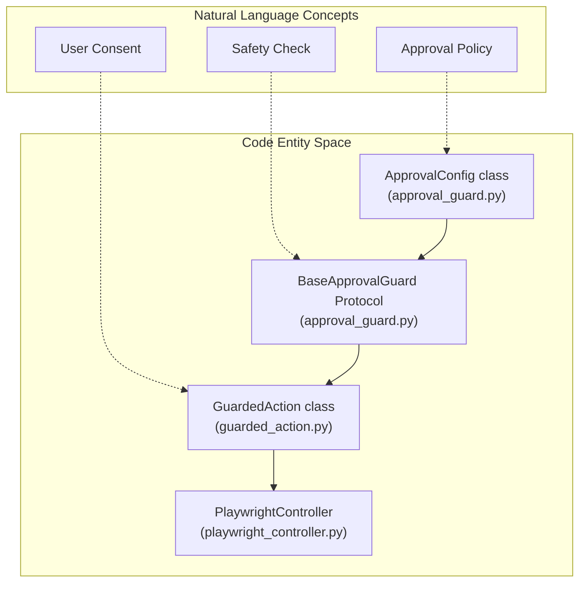
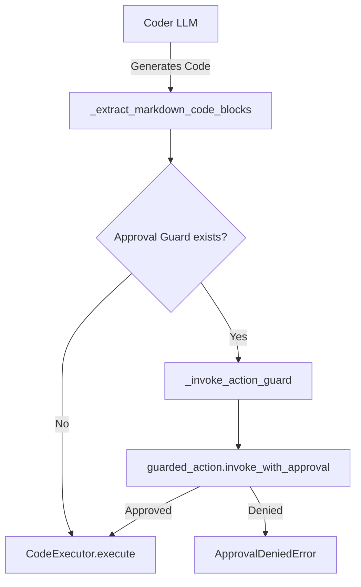
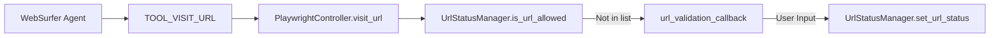

<!-- source: DeepWiki mcp.deepwiki.com · repo microsoft/magentic-ui · page 5.3 Action Guards and Approval Policies · fetched 2026-10-26 -->

# Action Guards and Approval Policies

Relevant source files

The following files were used as context for generating this wiki page:

- [frontend/src/components/views/api.ts](frontend/src/components/views/api.ts)
- [src/magentic_ui/agents/_coder.py](src/magentic_ui/agents/_coder.py)
- [src/magentic_ui/agents/file_surfer/_file_surfer.py](src/magentic_ui/agents/file_surfer/_file_surfer.py)
- [src/magentic_ui/agents/web_surfer/_web_surfer.py](src/magentic_ui/agents/web_surfer/_web_surfer.py)
- [src/magentic_ui/approval_guard.py](src/magentic_ui/approval_guard.py)
- [src/magentic_ui/backend/utils/utils.py](src/magentic_ui/backend/utils/utils.py)
- [src/magentic_ui/tools/playwright/playwright_controller.py](src/magentic_ui/tools/playwright/playwright_controller.py)
- [src/magentic_ui/types.py](src/magentic_ui/types.py)

This document covers the action guard and approval policy system in Magentic-UI, which provides human oversight and control over agent actions. The system allows users to configure when explicit approval is required before agents execute potentially sensitive operations, such as running code or submitting web forms.

## Overview

The action guard system is a safety mechanism that intercepts agent actions and determines whether human approval is required before execution. While primarily integrated into the `WebSurfer` and `Coder` agents, it uses a standardized protocol to handle different levels of risk.

The system consists of:
- **Approval Guards**: Classes implementing `BaseApprovalGuard` [src/magentic_ui/approval_guard.py:49-65]() that manage the logic for determining and requesting approval.
- **Approval Policies**: High-level configurations (`always`, `never`, `auto-conservative`) [src/magentic_ui/approval_guard.py:75-79]() that define the default stance on autonomy.
- **Guarded Actions**: Wrapper classes like `GuardedAction` [src/magentic_ui/guarded_action.py:118]() and `TrivialGuardedAction` [src/magentic_ui/guarded_action.py:236]() that encapsulate specific tool calls.

### System Architecture: Natural Language to Code Entities
The following diagram illustrates how high-level concepts map to specific code structures and classes.

**Action Guard System Mapping**

Sources: [src/magentic_ui/approval_guard.py:49-79](), [src/magentic_ui/guarded_action.py:118-236](), [src/magentic_ui/tools/playwright/playwright_controller.py:72-105]()

## Approval Policies

The system supports several policies defined in `ApprovalConfig` [src/magentic_ui/approval_guard.py:75-79]():

| Policy | Description | Implementation Detail |
|--------|-------------|-----------------------|
| `never` | No approval required for any actions. | Default policy in many configurations. |
| `always` | Every action requires explicit user approval. | Forces `get_approval` for every intercepted tool. |
| `auto-conservative` | Uses an LLM to judge if an action is risky. | Calls `requires_approval` with `ACTION_GUARD_SYSTEM_MESSAGE`. |
| `auto-permissive` | Similar to conservative but errs on the side of autonomy. | Influences the `llm_guess` logic. |

The `ACTION_GUARD_SYSTEM_MESSAGE` [src/magentic_ui/approval_guard.py:116-145]() provides the LLM with criteria for "harmful" or "impactful" actions, such as submitting forms, sending emails, or making purchases.

Sources: [src/magentic_ui/approval_guard.py:75-79](), [src/magic_ui/approval_guard.py:116-145]()

## Agent Integration Patterns

### WebSurfer URL Validation
The `WebSurfer` agent utilizes a specialized form of guard for navigation. The `PlaywrightController` includes a `url_validation_callback` [src/magentic_ui/tools/playwright/playwright_controller.py:102-104]() and uses a `UrlStatusManager` [src/magentic_ui/tools/playwright/playwright_controller.py:125]() to track allowed and rejected domains.

When a new page is loaded, the controller checks the `UrlStatusManager`. If a site is not whitelisted, it aborts the request and triggers a validation callback to ask the user for permission [src/magentic_ui/tools/playwright/playwright_controller.py:158-174]().

### Coder Action Guards
The `Coder` agent implements guards during the code-debug loop. Before executing generated code blocks, it invokes `_invoke_action_guard` [src/magentic_ui/agents/_coder.py:59-66](). It uses a `TrivialGuardedAction` with a baseline override of "maybe" [src/magentic_ui/agents/_coder.py:70](), prompting the user: "Do you want to execute the code above?" [src/magentic_ui/agents/_coder.py:82-85]().

**Code Execution Approval Flow**

Sources: [src/magentic_ui/agents/_coder.py:59-90](), [src/magentic_ui/agents/_coder.py:178-185]()

## Guarded Action Implementation

The `GuardedAction` class [src/magentic_ui/guarded_action.py:118]() is the primary engine for executing tools with safety checks. 

### Data Flow for Tool Execution
1. **Metadata Retrieval**: The system fetches `ToolMetadata` to determine the `baseline_needs_approval` (`always`, `maybe`, or `never`) [src/magentic_ui/guarded_action.py:350-362]().
2. **LLM Guessing**: If the policy is `auto-conservative`, the `ApprovalGuard` uses an LLM to evaluate the specific action context against the `ACTION_GUARD_SYSTEM_MESSAGE` [src/magentic_ui/approval_guard.py:116-145]().
3. **User Interaction**: If approval is required, the `input_func` (typically a WebSocket-linked function) is called to wait for a `UserInputResponse` [src/magentic_ui/approval_guard.py:69-72]().

### URL Validation Logic
In the `WebSurfer`, the `TOOL_VISIT_URL` and `TOOL_WEB_SEARCH` tools are explicitly guarded. The `UrlStatusManager` maintains a dictionary of `UrlStatus` (either `URL_ALLOWED` or `URL_REJECTED`) [src/magentic_ui/tools/url_status_manager.py:11-15]().

**URL Safety Data Flow**

Sources: [src/magentic_ui/agents/web_surfer/_web_surfer.py:111-116](), [src/magentic_ui/tools/playwright/playwright_controller.py:158-174]()

## Key Classes and Functions

| Entity | File Path | Role |
|--------|-----------|------|
| `BaseApprovalGuard` | [src/magentic_ui/approval_guard.py:49]() | Protocol defining `requires_approval` and `get_approval`. |
| `ApprovalGuardContext` | [src/magentic_ui/approval_guard.py:84]() | Static class providing context management for guards via `ContextVar`. |
| `TrivialGuardedAction` | [src/magentic_ui/guarded_action.py:236]() | Simplified guard for actions without complex tool schemas (e.g., coding). |
| `exec_command_umask_patched` | [src/magentic_ui/agents/_utils.py:40]() | Patched Docker command execution used by Coder and FileSurfer for secure file creation. |

Sources: [src/magentic_ui/approval_guard.py:49-115](), [src/magentic_ui/guarded_action.py:236](), [src/magentic_ui/agents/_coder.py:40-45]()

---

