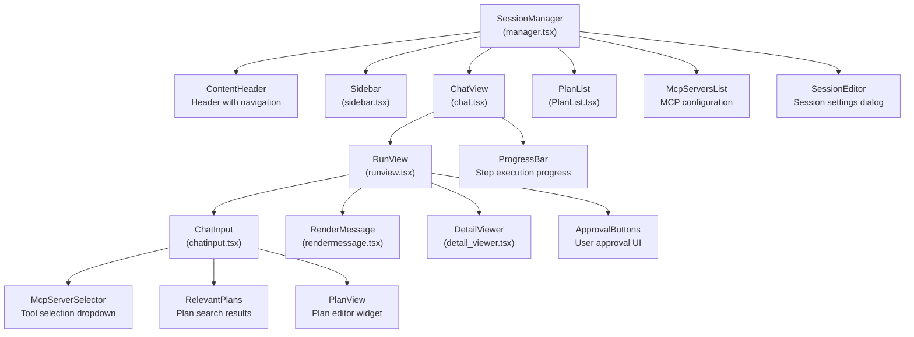
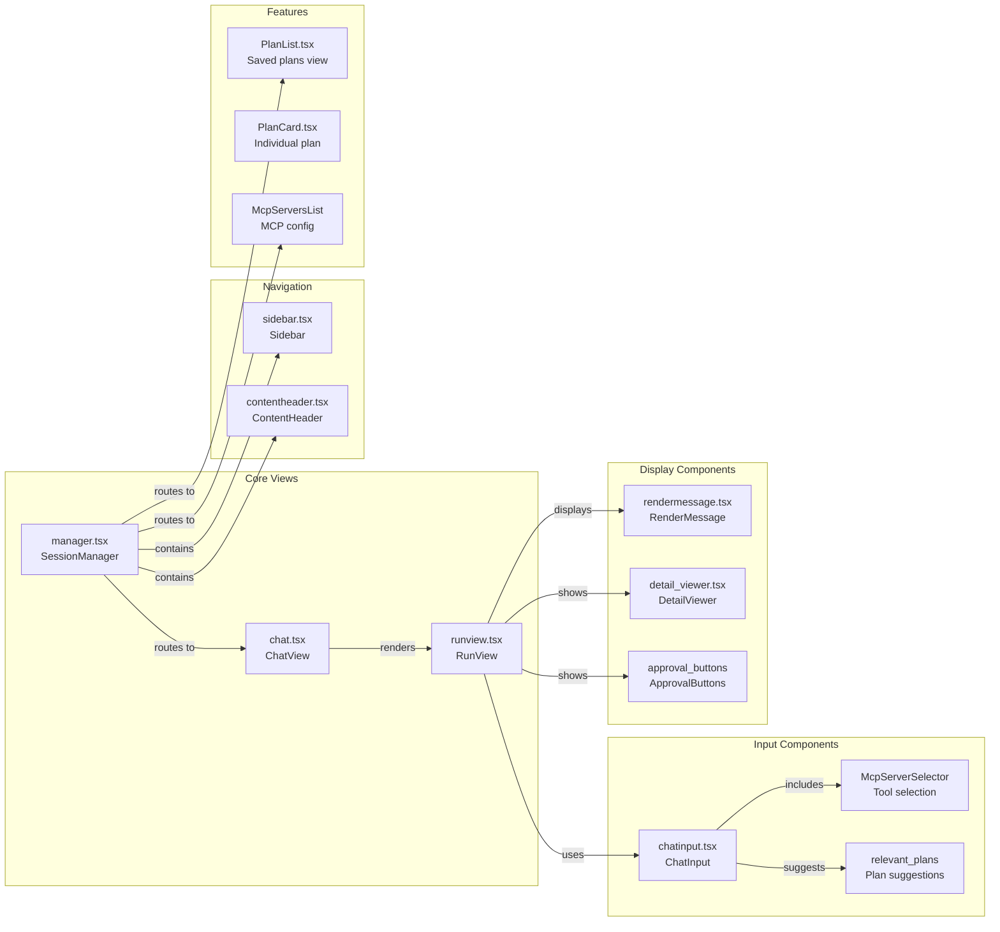
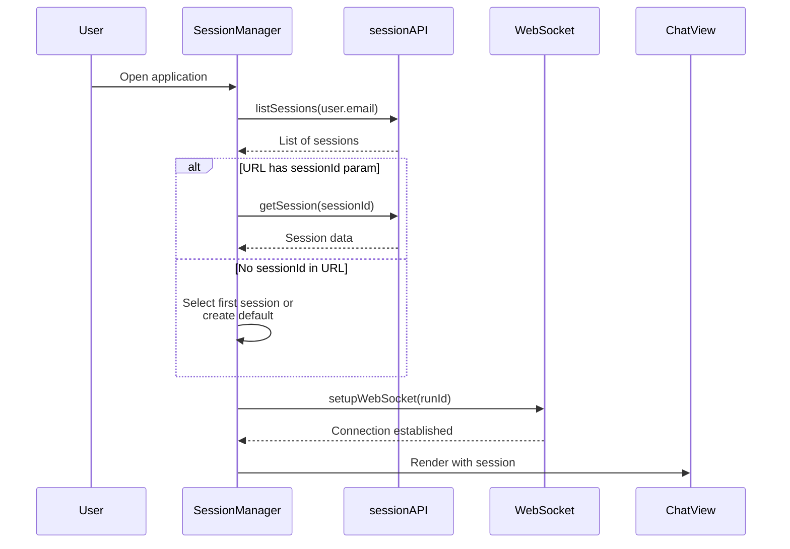

<!-- source: DeepWiki mcp.deepwiki.com · repo microsoft/magentic-ui · page 6 Frontend Interface · fetched 2026-10-26 -->

# Frontend Interface

Relevant source files

The following files were used as context for generating this wiki page:

- [frontend/src/assets/logo.svg](frontend/src/assets/logo.svg)
- [frontend/src/components/contentheader.tsx](frontend/src/components/contentheader.tsx)
- [frontend/src/components/features/Plans/PlanCard.tsx](frontend/src/components/features/Plans/PlanCard.tsx)
- [frontend/src/components/features/Plans/PlanList.tsx](frontend/src/components/features/Plans/PlanList.tsx)
- [frontend/src/components/settings/tabs/GeneralSettings/GeneralSettings.tsx](frontend/src/components/settings/tabs/GeneralSettings/GeneralSettings.tsx)
- [frontend/src/components/signin.tsx](frontend/src/components/signin.tsx)
- [frontend/src/components/store.tsx](frontend/src/components/store.tsx)
- [frontend/src/components/types/plan.ts](frontend/src/components/types/plan.ts)
- [frontend/src/components/views/manager.tsx](frontend/src/components/views/manager.tsx)
- [frontend/src/components/views/sidebar.tsx](frontend/src/components/views/sidebar.tsx)
- [frontend/src/images/icon.png](frontend/src/images/icon.png)
- [frontend/src/styles/global.css](frontend/src/styles/global.css)

This document provides an overview of the React-based web interface for Magentic-UI. It covers the component architecture, state management, WebSocket integration, and user interaction patterns that enable real-time communication with the multi-agent backend system.

For detailed information about specific subsystems:
- Session lifecycle and routing: see [Session Management](#6.1)
- User input and file handling: see [Chat Interface and Task Input](#6.2)
- Plan creation and editing: see [Plan Editor and Visualization](#6.3)
- Configuration UI: see [Settings Management](#6.4)

For backend WebSocket implementation: see [Web API and WebSocket Communication](#7.1)

## Component Architecture

The frontend is built using React and TypeScript, organized as a single-page application with real-time streaming capabilities. The `SessionManager` component serves as the root orchestrator, managing the overall application state and routing between different views.

### Component Hierarchy

**Sources:** [frontend/src/components/views/manager.tsx:31-548](), [frontend/src/components/views/chat/chat.tsx:1-1321](), [frontend/src/components/views/chat/runview.tsx:1-779]()

### Component File Mapping

**Sources:** [frontend/src/components/views/manager.tsx:11-20](), [frontend/src/components/views/chat/chat.tsx:1-29](), [frontend/src/components/views/chat/runview.tsx:1-12]()

## SessionManager: Application Root

The `SessionManager` component ([frontend/src/components/views/manager.tsx:31-547]()) serves as the application's main orchestrator, responsible for session lifecycle and view routing.

### Core Responsibilities

| Responsibility | Implementation | Key State |
|---------------|---------------|-----------|
| Session CRUD operations | `sessionAPI` calls | `sessions`, `session` |
| WebSocket lifecycle | `setupWebSocket()`, `getSessionSocket()` | `sessionSockets` |
| View routing | Conditional rendering based on `activeSubMenuItem` | `activeSubMenuItem` |
| Sidebar state | Persist to `localStorage` | `isSidebarOpen` |
| Run status tracking | Per-session status updates | `sessionRunStatuses` |

**Sources:** [frontend/src/components/views/manager.tsx:31-47](), [frontend/src/components/views/manager.tsx:59-230]()

### WebSocket Management

The `SessionManager` maintains a mapping of active WebSocket connections per session using the `SessionWebSockets` type [frontend/src/components/views/manager.tsx:22-29](). Connections are established to `${serverUrl}/api/ws/runs/${runId}` [frontend/src/components/views/manager.tsx:275-319]().

### Session Lifecycle Flow

**Sources:** [frontend/src/components/views/manager.tsx:59-230](), [frontend/src/components/views/manager.tsx:275-319]()

## Navigation and Sidebar

The `Sidebar` ([frontend/src/components/views/sidebar.tsx:37-330]()) and `ContentHeader` ([frontend/src/components/contentheader.tsx:20-125]()) provide the primary navigation framework.

### Sidebar Features
- **Session Grouping**: Sessions are grouped by time (Today, Yesterday, Last 7 Days, etc.) using `groupSessions` [frontend/src/components/views/sidebar.tsx:52-84]().
- **Status Indicators**: `SessionRunStatusIndicator` displays the real-time execution state (active, awaiting_input, complete) for each session [frontend/src/components/views/sidebar.tsx:132-136]().
- **Sub-Menu Navigation**: Access to "MCP Servers" and "Saved Plans" via `SubMenu` [frontend/src/components/views/sidebar.tsx:213-229]().

### Content Header Features
- **Sidebar Toggle**: Controls `isSidebarOpen` state [frontend/src/components/contentheader.tsx:36-50]().
- **User Profile**: Managed via `SignInModal` [frontend/src/components/contentheader.tsx:112-115]().
- **Settings Access**: Opens `SettingsModal` for global configuration [frontend/src/components/contentheader.tsx:116-119]().

**Sources:** [frontend/src/components/views/sidebar.tsx:52-229](), [frontend/src/components/contentheader.tsx:31-125]()

## State Management Patterns

The frontend uses a combination of local state, context, and global stores to manage data.

### Zustand Global Stores
- **`useConfigStore`**: Manages active session data and the list of available sessions [frontend/src/components/views/manager.tsx:51]().
- **`useSettingsStore`**: Manages the `GeneralConfig` including model client configurations and agent behavior settings like `approval_policy` [frontend/src/components/store.tsx:72-79]().

### Local and Context State
- **`appContext`**: Stores user authentication info (email, name, avatar) [frontend/src/components/contentheader.tsx:25]().
- **URL Parameters**: The `sessionId` is synchronized with the browser URL using `window.history.pushState` to support direct linking and navigation [frontend/src/components/views/manager.tsx:217]().

**Sources:** [frontend/src/components/store.tsx:5-79](), [frontend/src/components/views/manager.tsx:51-217](), [frontend/src/components/contentheader.tsx:25]()

## Theming and Styles

Magentic-UI supports both Light and Dark modes. Theming is implemented via CSS variables defined in `frontend/src/styles/global.css`.

| Mode | Background Variable | Text Variable | Border Variable |
|------|---------------------|---------------|-----------------|
| Dark | `--color-bg-primary: #1a1a1a` | `--color-text-primary: #ffffff` | `--color-border-primary: #ffffff30` |
| Light | `--color-bg-primary: #ffffff` | `--color-text-primary: #000000` | `--color-border-primary: #e2e8f0` |

**Sources:** [frontend/src/styles/global.css:1-63](), [frontend/src/components/settings/tabs/GeneralSettings/GeneralSettings.tsx:21-35]()

## Feature Overviews

### Saved Plans
Users can browse and manage reusable agent plans in the `PlanList` [frontend/src/components/features/Plans/PlanList.tsx:49-381](). Plans can be exported as JSON or used to create new sessions [frontend/src/components/features/Plans/PlanCard.tsx:132-154]().

### Settings Management
The `SettingsModal` provides a tabbed interface for:
- **General Settings**: Dark mode, approval policies, and website allow-lists [frontend/src/components/settings/tabs/GeneralSettings/GeneralSettings.tsx:13-145]().
- **Model Configuration**: Setup for OpenAI, Azure, and other providers [frontend/src/components/store.tsx:54-63]().
- **MCP Servers**: Management of Model Context Protocol server integrations.

**Sources:** [frontend/src/components/features/Plans/PlanList.tsx:49-381](), [frontend/src/components/settings/tabs/GeneralSettings/GeneralSettings.tsx:13-145](), [frontend/src/components/store.tsx:5-63]()

---

