<!-- source: DeepWiki mcp.deepwiki.com · repo microsoft/magentic-ui · page 6.1 Session Management · fetched 2026-10-26 -->

# Session Management

<details>
<summary>Relevant source files</summary>

The following files were used as context for generating this wiki page:

- [frontend/src/components/features/Plans/PlanList.tsx](frontend/src/components/features/Plans/PlanList.tsx)
- [frontend/src/components/settings/tabs/GeneralSettings/GeneralSettings.tsx](frontend/src/components/settings/tabs/GeneralSettings/GeneralSettings.tsx)
- [frontend/src/components/store.tsx](frontend/src/components/store.tsx)
- [frontend/src/components/types/plan.ts](frontend/src/components/types/plan.ts)
- [frontend/src/components/views/manager.tsx](frontend/src/components/views/manager.tsx)
- [frontend/src/components/views/sidebar.tsx](frontend/src/components/views/sidebar.tsx)

</details>


## Purpose and Scope

This document describes the frontend session management system in Magentic-UI, which handles the lifecycle of user conversation sessions, including creation, selection, deletion, and WebSocket connection management. The `SessionManager` component coordinates session state, UI navigation, and real-time communication channels.

For information about the backend database schema and persistence layer, see [Database Schema and Persistence](#7.2). For details on WebSocket message streaming protocols, see [Web API and WebSocket Communication](#7.1). For the chat interface within a session, see [Chat Interface and Task Input](#6.2).

---

## Session Lifecycle Overview

Sessions represent isolated conversation contexts where users interact with the multi-agent system. Each session maintains its own message history, run state, and configuration.

**Session Lifecycle States**

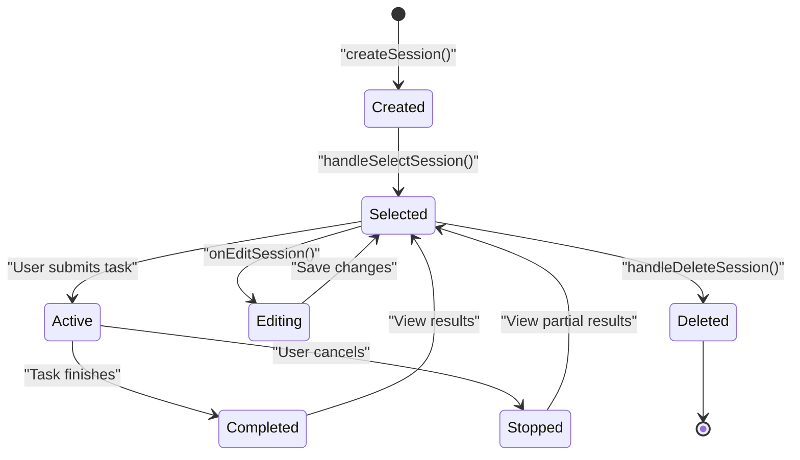

**Sources:** [frontend/src/components/views/manager.tsx:110-154](), [frontend/src/components/views/manager.tsx:168-196](), [frontend/src/components/views/manager.tsx:198-230]()

---

## Core Components and Architecture

The session management system consists of three primary components that work together to provide session orchestration.

**Component Relationships**

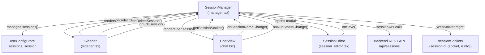

**Sources:** [frontend/src/components/views/manager.tsx:31-51](), [frontend/src/components/views/sidebar.tsx:22-35]()

---

## Session State Management

The `SessionManager` component maintains several state variables to track sessions and their execution status.

**State Variables**

| State Variable | Type | Purpose |
|---------------|------|---------|
| `sessions` | `Session[]` | All sessions for the current user |
| `session` | `Session \| null` | Currently selected session |
| `sessionSockets` | `SessionWebSockets` | Active WebSocket connections per session |
| `sessionRunStatuses` | `{[sessionId: number]: RunStatus}` | Current execution status per session |
| `isEditorOpen` | `boolean` | Controls session editor modal visibility |
| `editingSession` | `Session \| undefined` | Session being edited |
| `isSidebarOpen` | `boolean` | Sidebar visibility state (persisted to localStorage) |

**Sources:** [frontend/src/components/views/manager.tsx:32-48]()

**Session Data Model**

The `Session` type represents a conversation context with associated metadata:

```typescript
interface Session {
  id: number;
  user_id: string;
  team_id?: number;
  name: string;
  selected_mcp_configs?: string[];
  created_at: string;
}
```

**Sources:** [frontend/src/components/views/manager.tsx:13]()

---

## WebSocket Connection Management

Each active session maintains its own WebSocket connection for real-time streaming of agent actions and results. The `SessionManager` handles connection lifecycle, reuse, and cleanup.

**WebSocket Management Architecture**

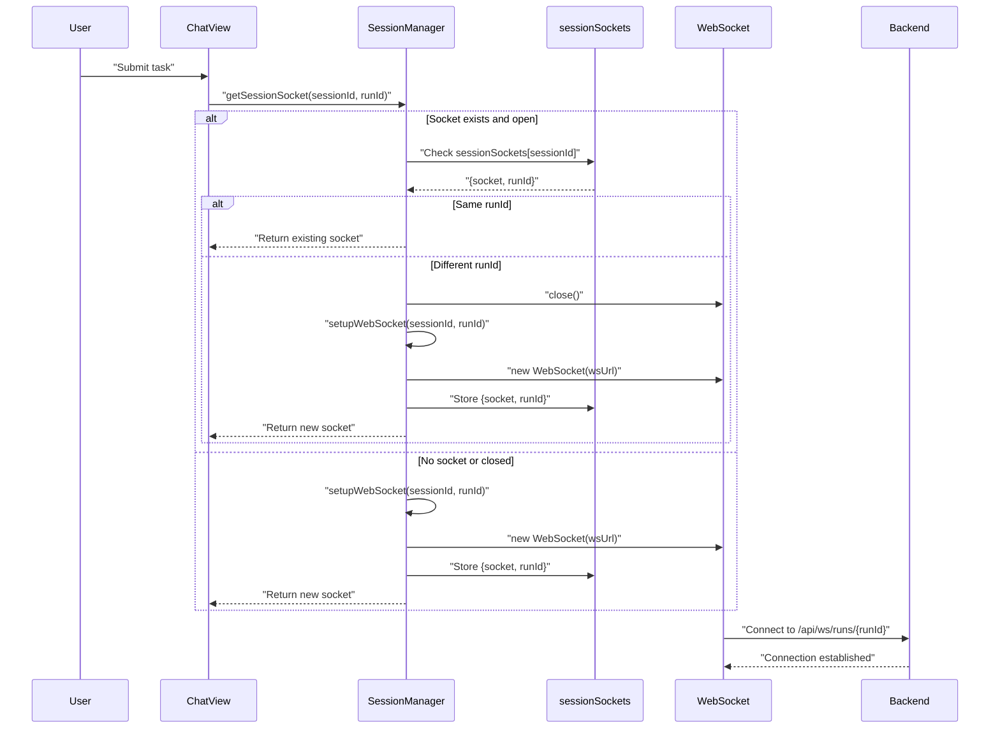

**Sources:** [frontend/src/components/views/manager.tsx:275-295](), [frontend/src/components/views/manager.tsx:297-319]()

**WebSocket State Tracking**

The `SessionWebSocket` interface tracks both the WebSocket instance and the associated run ID:

```typescript
interface SessionWebSocket {
  socket: WebSocket;
  runId: string;
}

type SessionWebSockets = {
  [sessionId: number]: SessionWebSocket;
};
```

**Sources:** [frontend/src/components/views/manager.tsx:22-29]()

**getSessionSocket Function Signature**

The `getSessionSocket` function provides flexible WebSocket retrieval with three modes:

```typescript
getSessionSocket(
  sessionId: number,
  runId: string,
  fresh_socket: boolean = false,
  only_retrieve_existing_socket: boolean = false
): WebSocket | null
```

- `fresh_socket=true`: Forces creation of a new WebSocket, closing any existing one [frontend/src/components/views/manager.tsx:304-309]()
- `only_retrieve_existing_socket=true`: Returns existing socket or null, never creates new [frontend/src/components/views/manager.tsx:302-303]()
- Default behavior: Returns existing socket if it matches the runId, otherwise creates new [frontend/src/components/views/manager.tsx:311-318]()

**Sources:** [frontend/src/components/views/manager.tsx:297-319]()

**WebSocket URL Construction**

The WebSocket URL is constructed from the server URL, using `ws:` or `wss:` protocol based on the page protocol:

```typescript
const serverUrl = getServerUrl();
const baseUrl = getBaseUrl(serverUrl);
const wsProtocol = window.location.protocol === "https:" ? "wss:" : "ws:";
const wsUrl = `${wsProtocol}//${baseUrl}/api/ws/runs/${runId}`;
```

**Sources:** [frontend/src/components/views/manager.tsx:281-284]()

---

## Session CRUD Operations

The `SessionManager` uses the `sessionAPI` client to perform CRUD operations against the backend REST API.

**Session API Operations Flow**

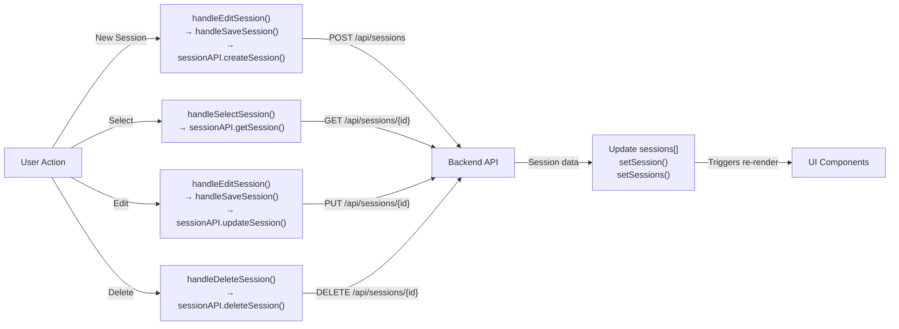

**Sources:** [frontend/src/components/views/manager.tsx:110-154](), [frontend/src/components/views/manager.tsx:168-196](), [frontend/src/components/views/manager.tsx:198-230]()

**Creating Sessions**

Session creation follows two paths:

1. **Explicit creation**: User clicks "New Session" button, opens editor, saves [frontend/src/components/views/manager.tsx:156-166]()
2. **Automatic creation**: On first load if no sessions exist [frontend/src/components/views/manager.tsx:73-75]()

```typescript
// Explicit creation via editor
const handleEditSession = (session?: Session) => {
  if (session) {
    setEditingSession(session);
    setIsEditorOpen(true);
  } else {
    // Create new session with default name
    handleSaveSession({});
  }
};

// Automatic default session creation
const createDefaultSession = async () => {
  const defaultName = `Default Session - ${new Date().toLocaleDateString(...)}`;
  const created = await sessionAPI.createSession({ name: defaultName }, user.email);
  setSessions([created, ...sessions]);
  setSession(created);
  window.history.pushState({}, "", `?sessionId=${created.id}`);
};
```

**Sources:** [frontend/src/components/views/manager.tsx:156-166](), [frontend/src/components/views/manager.tsx:332-364]()

**Session Deletion and Cleanup**

When deleting a session, the manager performs cleanup operations:

1. Close and remove associated WebSocket connection [frontend/src/components/views/manager.tsx:174-181]()
2. Delete session via API [frontend/src/components/views/manager.tsx:183]()
3. Update local state [frontend/src/components/views/manager.tsx:184-186]()
4. Select another session if the deleted one was active [frontend/src/components/views/manager.tsx:186]()
5. Clear URL parameters [frontend/src/components/views/manager.tsx:187]()

**Sources:** [frontend/src/components/views/manager.tsx:168-196]()

---

## URL-Based Navigation and Deep Linking

Sessions support URL-based navigation through `sessionId` query parameters, enabling direct links to specific sessions and browser back/forward navigation.

**URL Navigation Flow**

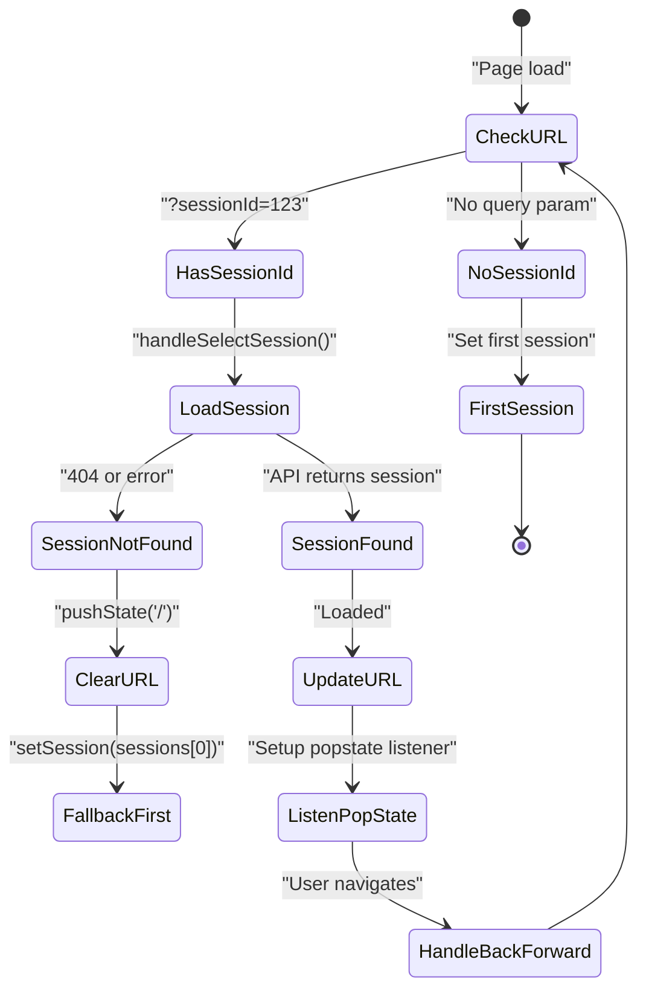

**Sources:** [frontend/src/components/views/manager.tsx:85-108](), [frontend/src/components/views/manager.tsx:198-230]()

**Initial URL Parameter Handling**

On component mount, the manager checks for a `sessionId` query parameter and loads that session:

```typescript
useEffect(() => {
  const params = new URLSearchParams(window.location.search);
  const sessionId = params.get("sessionId");
  
  if (sessionId && !session) {
    handleSelectSession({ id: parseInt(sessionId) } as Session);
  }
}, []);
```

**Sources:** [frontend/src/components/views/manager.tsx:86-93]()

**Browser Back/Forward Navigation**

A `popstate` event listener handles browser navigation:

```typescript
useEffect(() => {
  const handleLocationChange = () => {
    const params = new URLSearchParams(window.location.search);
    const sessionId = params.get("sessionId");
    
    if (!sessionId && session) {
      setSession(null);
    }
  };
  
  window.addEventListener("popstate", handleLocationChange);
  return () => window.removeEventListener("popstate", handleLocationChange);
}, [session]);
```

**Sources:** [frontend/src/components/views/manager.tsx:96-108]()

**URL Updates on Session Selection**

When a user selects a session, the URL is updated without a page reload:

```typescript
setSession(data);
window.history.pushState({}, "", `?sessionId=${selectedSession.id}`);
```

**Sources:** [frontend/src/components/views/manager.tsx:216-217]()

---

## Session Organization and Grouping

The `Sidebar` component organizes sessions into time-based groups for easier navigation.

**Time-Based Grouping Logic**

Sessions are grouped into five categories based on their `created_at` timestamp:

| Group | Time Range | Description |
|-------|-----------|-------------|
| Today | ≥ start of today | Sessions created today [frontend/src/components/views/sidebar.tsx:63-66]() |
| Yesterday | ≥ start of yesterday, < start of today | Sessions from yesterday [frontend/src/components/views/sidebar.tsx:67-70]() |
| Last 7 Days | ≥ 7 days ago, < yesterday | Sessions from the past week [frontend/src/components/views/sidebar.tsx:71-74]() |
| Last 30 Days | ≥ 30 days ago, < 7 days ago | Sessions from the past month [frontend/src/components/views/sidebar.tsx:75-78]() |
| Older | < 30 days ago | Sessions older than 30 days [frontend/src/components/views/sidebar.tsx:79-82]() |

**Sources:** [frontend/src/components/views/sidebar.tsx:52-84]()

**Session Sorting**

Sessions are sorted in descending order by creation date (most recent first):

```typescript
const sortedSessions = useMemo(
  () => [...sessions].sort((a, b) => {
    return new Date(b.created_at || "").getTime() - 
           new Date(a.created_at || "").getTime();
  }),
  [sessions]
);
```

**Sources:** [frontend/src/components/views/sidebar.tsx:87-96]()

**Grouping Implementation**

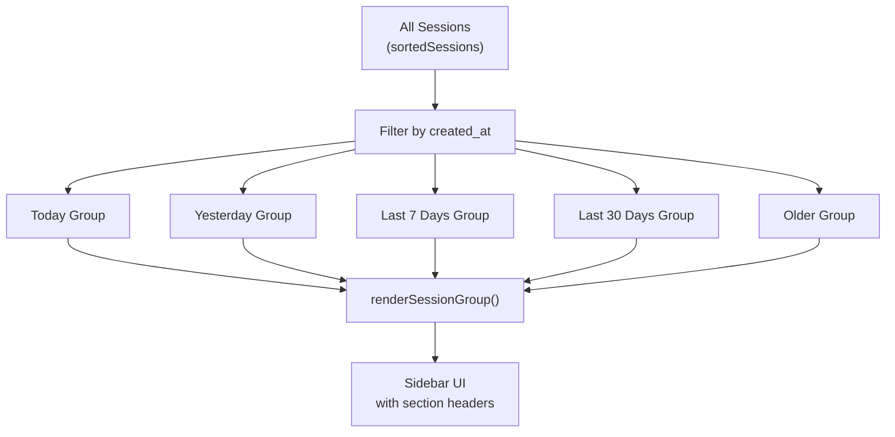

**Sources:** [frontend/src/components/views/sidebar.tsx:52-101](), [frontend/src/components/views/sidebar.tsx:104-203]()

---

## Run Status Tracking

Each session can have an associated run status that indicates the current execution state. The `SessionManager` tracks these statuses and propagates them to child components.

**RunStatus Enumeration**

The `RunStatus` type is used to track session states such as `active`, `awaiting_input`, `pausing`, `paused`, `stopped`, `complete`, or `error`.

**Sources:** [frontend/src/components/views/manager.tsx:17](), [frontend/src/components/views/sidebar.tsx:16]()

**Status Update Flow**

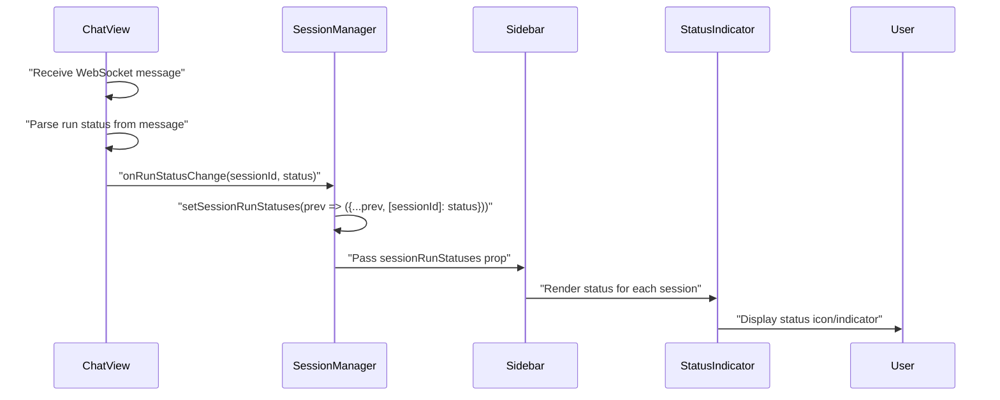

**Sources:** [frontend/src/components/views/manager.tsx:325-330](), [frontend/src/components/views/manager.tsx:393]()

**Status-Based Session Visibility**

Sessions are kept in memory (not unmounted) if they have an active status:

```typescript
const isSessionPotentiallyActive = [
  "active",
  "awaiting_input", 
  "pausing",
  "paused",
].includes(status);

if (!isSessionPotentiallyActive && session?.id !== s.id) return null;
```

This ensures that active sessions maintain their WebSocket connections and component state even when not visible.

**Sources:** [frontend/src/components/views/manager.tsx:369-376]()

**Status Indicator Component**

The `SessionRunStatusIndicator` component displays a visual indicator based on the run status:

```typescript
<SessionRunStatusIndicator status={sessionRunStatuses[s.id]} />
```

**Sources:** [frontend/src/components/views/sidebar.tsx:133-135]()

---

## Stopping Active Sessions

Users can stop active sessions through the sidebar menu. This sends a stop message through the WebSocket and updates the session status.

**Session Stop Flow**

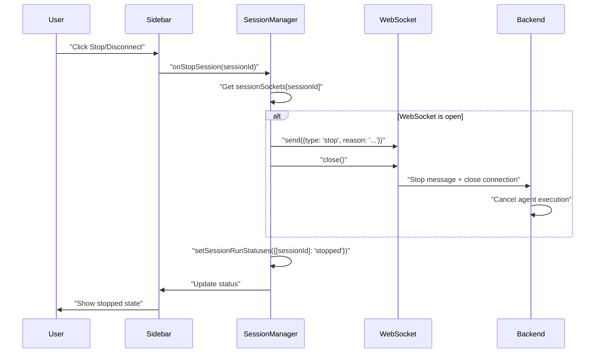

**Sources:** [frontend/src/components/views/sidebar.tsx:154-159](), [frontend/src/components/views/manager.tsx:486-504]()

**Stop Implementation**

The stop handler in `SessionManager`:

```typescript
onStopSession={(sessionId: number) => {
  if (sessionId === undefined || sessionId === null) return;
  const id = Number(sessionId);
  
  const ws = sessionSockets[id]?.socket;
  if (ws && ws.readyState === WebSocket.OPEN) {
    ws.send(JSON.stringify({
      type: "stop",
      reason: "Cancelled by user (sidebar)",
    }));
    ws.close();
  }
  
  setSessionRunStatuses((prev) => ({
    ...prev,
    [id]: "stopped",
  }));
}}
```

**Sources:** [frontend/src/components/views/manager.tsx:486-504]()

---

## Session Cleanup and Resource Management

The `SessionManager` implements cleanup handlers to properly close WebSocket connections when the page is unloaded, the browser goes offline, or the component unmounts.

**Cleanup Event Handlers**

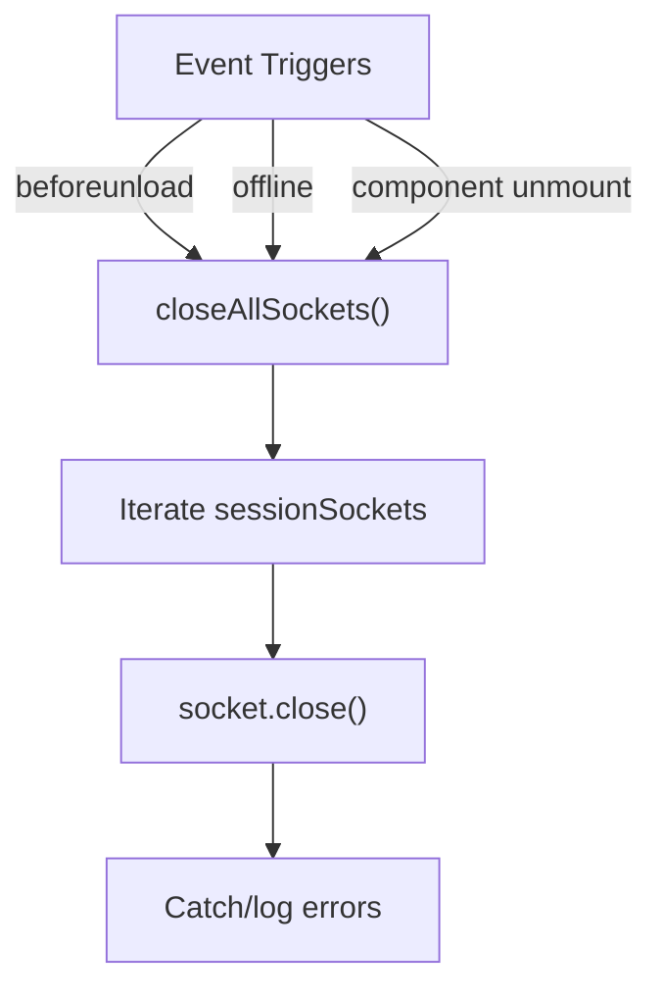

**Sources:** [frontend/src/components/views/manager.tsx:410-432]()

**Cleanup Implementation**

```typescript
useEffect(() => {
  const closeAllSockets = () => {
    Object.values(sessionSockets).forEach(({ socket }) => {
      try {
        socket.close();
      } catch (error) {
        console.error("Error closing socket:", error);
      }
    });
  };
  
  window.addEventListener("beforeunload", closeAllSockets);
  window.addEventListener("offline", closeAllSockets);
  
  return () => {
    window.removeEventListener("beforeunload", closeAllSockets);
    window.removeEventListener("offline", closeAllSockets);
    closeAllSockets();
  };
}, []);
```

**Sources:** [frontend/src/components/views/manager.tsx:410-432]()

---

## Session Name Auto-Update

The `SessionManager` can automatically update session names based on the task content. This occurs when a session has the default naming pattern and the first message is sent.

**Auto-Update Logic**

The `handleSessionName` function only updates sessions with names starting with `"Default Session - "`:

```typescript
const handleSessionName = async (sessionData: Partial<Session>) => {
  const currentSession = sessions.find((s) => s.id === sessionData.id);
  if (!currentSession) return;
  
  // Only update if it starts with "Default Session - "
  if (currentSession.name.startsWith("Default Session - ")) {
    const updated = await sessionAPI.updateSession(
      sessionData.id,
      sessionData,
      user.email
    );
    setSessions(sessions.map((s) => (s.id === updated.id ? updated : s)));
    if (session?.id === updated.id) {
      setSession(updated);
    }
  }
};
```

**Sources:** [frontend/src/components/views/manager.tsx:232-256]()

This function is called from `ChatView` when processing the first user message, allowing the session name to be derived from the task content.

**Sources:** [frontend/src/components/views/manager.tsx:390]()

---

## Integration with Plans

The `SessionManager` supports creating sessions from saved plans. When a plan is selected for use, a new session is created and the plan data is dispatched to the `ChatView`.

**Plan-to-Session Flow**

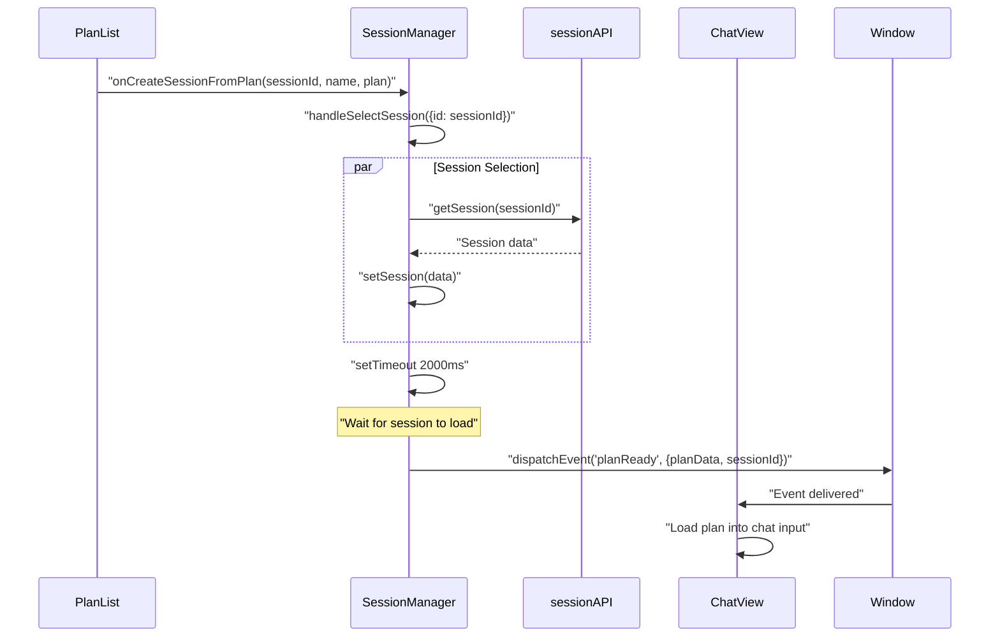

**Sources:** [frontend/src/components/views/manager.tsx:434-454](), [frontend/src/components/features/Plans/PlanList.tsx:110-135]()

**Event Dispatch Implementation**

```typescript
const handleCreateSessionFromPlan = (
  sessionId: number,
  sessionName: string,
  planData: any
) => {
  // First select the session
  handleSelectSession({ id: sessionId } as Session);
  
  // Then dispatch the plan data to the chat component
  setTimeout(() => {
    window.dispatchEvent(
      new CustomEvent("planReady", {
        detail: {
          planData: planData,
          sessionId: sessionId,
          messageId: `plan_${Date.now()}`,
        },
      })
    );
  }, 2000); // Give time for session selection to complete
};
```

**Sources:** [frontend/src/components/views/manager.tsx:434-454]()

---

## Sidebar State Persistence

The sidebar open/closed state is persisted to `localStorage` to maintain user preferences across page reloads.

**Persistence Implementation**

```typescript
// Initialize from localStorage
const [isSidebarOpen, setIsSidebarOpen] = useState(() => {
  if (typeof window !== "undefined") {
    const stored = localStorage.getItem("sessionSidebar");
    return stored !== null ? JSON.parse(stored) : true;
  }
  return true;
});

// Save to localStorage on change
useEffect(() => {
  if (typeof window !== "undefined") {
    localStorage.setItem("sessionSidebar", JSON.stringify(isSidebarOpen));
  }
}, [isSidebarOpen]);
```

**Sources:** [frontend/src/components/views/manager.tsx:35-57]()

---

## Conditional Rendering and Performance

The `SessionManager` uses conditional rendering to optimize performance, only rendering `ChatView` components for sessions that are either currently selected or have an active run status.

**Rendering Strategy**

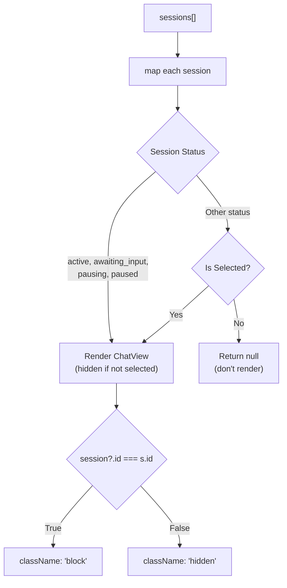

**Sources:** [frontend/src/components/views/manager.tsx:366-408]()

**Implementation**

```typescript
const chatViews = useMemo(() => {
  return sessions.map((s: Session) => {
    const status = (s.id ? sessionRunStatuses[s.id] : undefined) as RunStatus;
    const isSessionPotentiallyActive = [
      "active",
      "awaiting_input",
      "pausing",
      "paused",
    ].includes(status);
    
    // Don't render if not active and not selected
    if (!isSessionPotentiallyActive && session?.id !== s.id) return null;
    
    return (
      <div
        key={s.id}
        className={`${session?.id === s.id ? "block" : "hidden"} relative`}
      >
        <ChatView
          session={s}
          onSessionNameChange={handleSessionName}
          getSessionSocket={getSessionSocket}
          visible={session?.id === s.id}
          onRunStatusChange={updateSessionRunStatus}
          onSubMenuChange={setActiveSubMenuItem}
        />
      </div>
    );
  });
}, [sessions, session?.id, sessionRunStatuses]);
```

This approach ensures that:
- Active sessions maintain their WebSocket connections even when not visible.
- Inactive sessions don't consume resources by being unmounted.
- The currently selected session is always rendered and visible.

**Sources:** [frontend/src/components/views/manager.tsx:366-408]()

---

