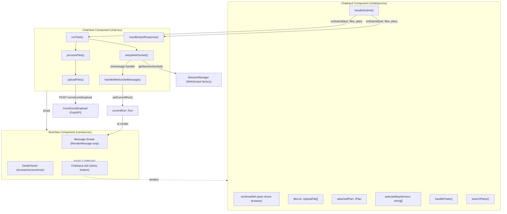
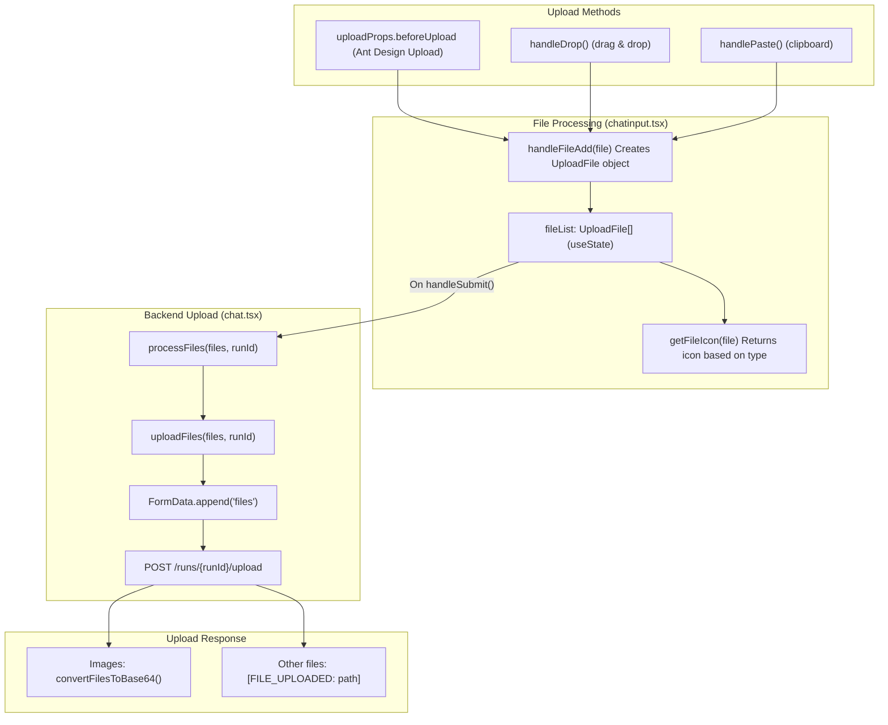
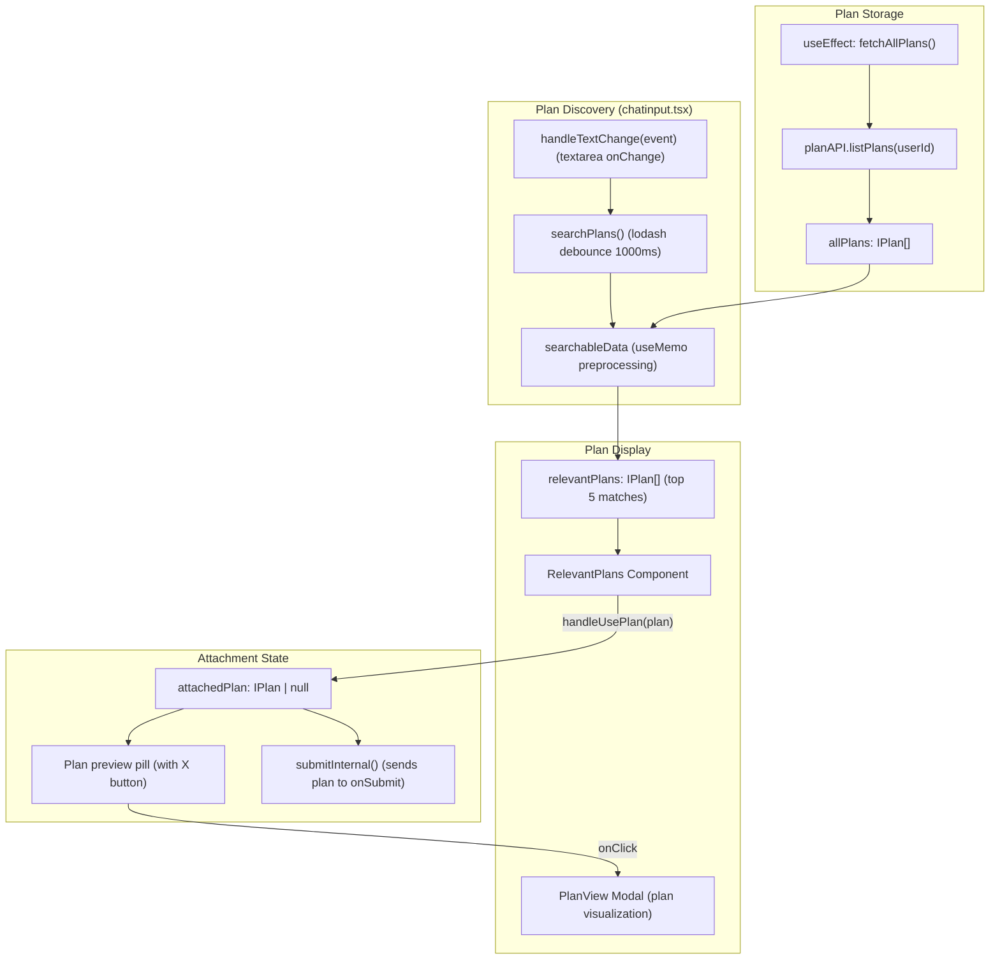
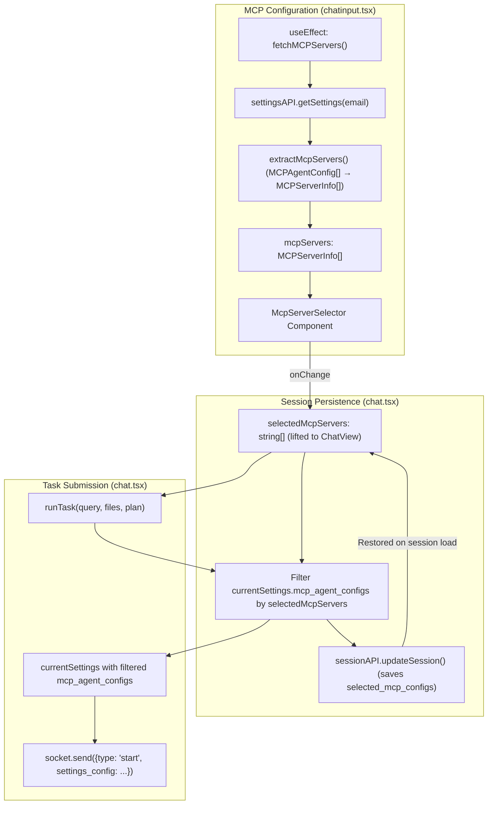
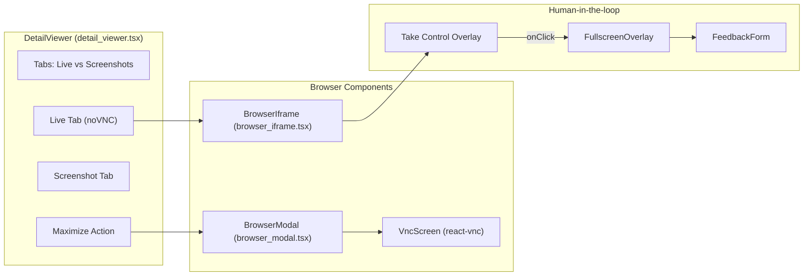
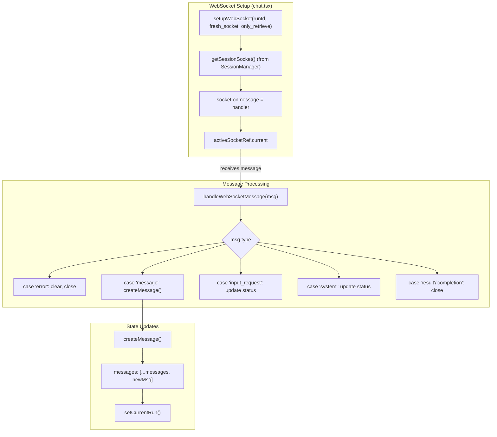

<!-- source: DeepWiki mcp.deepwiki.com · repo microsoft/magentic-ui · page 6.2 Chat Interface and Task Input · fetched 2026-10-26 -->

# Chat Interface and Task Input

<details>
<summary>Relevant source files</summary>

The following files were used as context for generating this wiki page:

- [frontend/src/components/common/AutoResizeTextarea.tsx](frontend/src/components/common/AutoResizeTextarea.tsx)
- [frontend/src/components/common/Button.tsx](frontend/src/components/common/Button.tsx)
- [frontend/src/components/common/filerenderer.tsx](frontend/src/components/common/filerenderer.tsx)
- [frontend/src/components/common/markdownrender.tsx](frontend/src/components/common/markdownrender.tsx)
- [frontend/src/components/views/chat/DetailViewer/browser_iframe.tsx](frontend/src/components/views/chat/DetailViewer/browser_iframe.tsx)
- [frontend/src/components/views/chat/DetailViewer/fullscreen_overlay.tsx](frontend/src/components/views/chat/DetailViewer/fullscreen_overlay.tsx)
- [frontend/src/components/views/chat/chat.tsx](frontend/src/components/views/chat/chat.tsx)
- [frontend/src/components/views/chat/chatinput.tsx](frontend/src/components/views/chat/chatinput.tsx)
- [frontend/src/components/views/chat/detail_viewer.tsx](frontend/src/components/views/chat/detail_viewer.tsx)
- [frontend/src/components/views/chat/runview.tsx](frontend/src/components/views/chat/runview.tsx)
- [src/magentic_ui/backend/web/routes/plans.py](src/magentic_ui/backend/web/routes/plans.py)
- [src/magentic_ui/backend/web/routes/runs.py](src/magentic_ui/backend/web/routes/runs.py)
- [src/magentic_ui/tools/playwright/browser/utils.py](src/magentic_ui/tools/playwright/browser/utils.py)

</details>


This page documents the chat interface components for user input, file uploads, plan attachment, and MCP server selection. The core components are `ChatInput` (user input widget), `ChatView` (orchestrator and WebSocket handler), and `RunView` (message thread container). For message rendering details, see [Plan Editor and Visualization](#6.3). For session lifecycle, see [Session Management](#6.1).

---

## Component Architecture

The chat interface uses three React components with hierarchical data flow:

Title: Chat Component Architecture


Sources: [frontend/src/components/views/chat/chat.tsx:73-320](), [frontend/src/components/views/chat/runview.tsx:45-68](), [frontend/src/components/views/chat/chatinput.tsx:61-80]()

---

## ChatInput Component

The `ChatInput` component is the primary user input interface, providing a feature-rich textarea with support for file attachments, plan selection, and MCP server configuration.

### Core Input Interface

| Feature | Implementation | File Reference |
|---------|---------------|----------------|
| Auto-resizing textarea | `useEffect` adjusts `textAreaRef.current.style.height` based on `scrollHeight` | [frontend/src/components/views/chat/chatinput.tsx:109-120]() |
| Enter to submit | `handleKeyDown`: Enter submits, Shift+Enter adds newline | [frontend/src/components/views/chat/chatinput.tsx:443-448]() |
| Input states | `isInputDisabled` computed from `runStatus` and `inputRequest.input_type` | [frontend/src/components/views/chat/chatinput.tsx:102-106]() |
| Focus management | `useImperativeHandle` exposes `focus()` method via `ref` | [frontend/src/components/views/chat/chatinput.tsx:450-455]() |

### Input Props Interface

```typescript
interface ChatInputProps {
  onSubmit: (text: string, files: RcFile[], accepted?: boolean, plan?: IPlan) => void;
  error: IStatus | null;
  disabled?: boolean;
  onCancel?: () => void;
  runStatus?: string;
  inputRequest?: InputRequest;
  isPlanMessage?: boolean;
  onPause?: () => void;
  enable_upload?: boolean;
  onExecutePlan?: (plan: IPlan) => void;
  onSubMenuChange: React.Dispatch<React.SetStateAction<string>>;
  mcpSelectorDisabled: boolean;
  selectedMcpServers: string[];
  onSelectedMcpServersChange: (servers: string[]) => void;
}
```

Sources: [frontend/src/components/views/chat/chatinput.tsx:39-59]()

---

## File Upload System

The file upload system supports three distinct methods of attachment: manual upload, drag-and-drop, and clipboard paste. All methods converge on a unified file processing pipeline.

Title: File Upload Processing Pipeline


### Manual Upload

The manual upload interface uses Ant Design's `Upload` component with custom handling. The `beforeUpload` callback prevents automatic upload and instead adds files to `fileList` state for preview.

Sources: [frontend/src/components/views/chat/chatinput.tsx:474-492](), [frontend/src/components/views/chat/chatinput.tsx:806-856]()

### Drag and Drop

The textarea container acts as a drop zone with event handlers:

| Event Handler | Purpose | Implementation | Reference |
|---------------|---------|----------------|-----------|
| `handleDragOver` | Prevent browser default, set `dragOver` state | `e.preventDefault(); setDragOver(true)` | [frontend/src/components/views/chat/chatinput.tsx:523-529]() |
| `handleDragLeave` | Clear drag state | `setDragOver(false)` | [frontend/src/components/views/chat/chatinput.tsx:531-535]() |
| `handleDrop` | Extract files, call `handleFileAdd` | `Array.from(e.dataTransfer.files).forEach(handleFileAdd)` | [frontend/src/components/views/chat/chatinput.tsx:538-547]() |

Sources: [frontend/src/components/views/chat/chatinput.tsx:85](), [frontend/src/components/views/chat/chatinput.tsx:738-742]()

### Clipboard Paste

The paste handler intelligently processes both images and large text content:

**Image Paste Processing:**
1. Detect image items in clipboard data [frontend/src/components/views/chat/chatinput.tsx:187-194]().
2. Create a named file with timestamp [frontend/src/components/views/chat/chatinput.tsx:203-208]().
3. Convert to `UploadFile` format and add to list [frontend/src/components/views/chat/chatinput.tsx:211-230]().

**Large Text Conversion:**
- Text exceeding `LARGE_TEXT_THRESHOLD` (1500 characters) is automatically converted to a `.txt` file [frontend/src/components/views/chat/chatinput.tsx:37](), [frontend/src/components/views/chat/chatinput.tsx:264-280]().
- Original paste into textarea is prevented via `e.preventDefault()` [frontend/src/components/views/chat/chatinput.tsx:274]().

Sources: [frontend/src/components/views/chat/chatinput.tsx:183-297]()

### Backend File Upload

The `uploadFiles` function in `ChatView` sends files to the backend via `FormData` [frontend/src/components/views/chat/chat.tsx:457-485]().

**Request:**
- Endpoint: `POST ${serverUrl}/runs/${runId}/upload` [frontend/src/components/views/chat/chat.tsx:466]().
- Body: `FormData` with multiple files appended under `"files"` key [frontend/src/components/views/chat/chat.tsx:461-464]().

**Backend Implementation:**
- The FastAPI router `upload_files` in `runs.py` receives the files [src/magentic_ui/backend/web/routes/runs.py:94-100]().
- It uses `TeamManager.prepare_run_paths` to create directories [src/magentic_ui/backend/web/routes/runs.py:119]().
- Files are saved to the internal run directory [src/magentic_ui/backend/web/routes/runs.py:138-146]().

Sources: [frontend/src/components/views/chat/chat.tsx:457-485](), [src/magentic_ui/backend/web/routes/runs.py:94-171]()

---

## Plan Attachment System

The plan attachment system enables users to attach pre-existing plans to their tasks, supporting both search-based discovery and manual selection.

Title: Plan Search and Attachment Flow


### Plan Search Algorithm

The `searchableData` memo preprocesses plans by lowercasing fields for efficient matching [frontend/src/components/views/chat/chatinput.tsx:313-332]().

**Matching Algorithm (searchPlans debounced function):**
1. Split query into search terms [frontend/src/components/views/chat/chatinput.tsx:343]().
2. Match if all terms appear in `taskLower` OR all terms appear in any `stepTexts` entry [frontend/src/components/views/chat/chatinput.tsx:345-364]().
3. Sort matches by `created_at` (newest first) [frontend/src/components/views/chat/chatinput.tsx:366-371]().
4. Return top 5 matches [frontend/src/components/views/chat/chatinput.tsx:373]().

Sources: [frontend/src/components/views/chat/chatinput.tsx:313-380]()

---

## MCP Server Selection

The MCP (Model Context Protocol) server selection system allows users to choose which external tool servers to enable for a task.

Title: MCP Server Selection and Persistence Flow


### Server List Retrieval

The `fetchMCPServers` function in `ChatInput` loads servers from user settings [frontend/src/components/views/chat/chatinput.tsx:156-180](). It calls `settingsAPI.getSettings` [frontend/src/components/views/chat/chatinput.tsx:167]() and uses `extractMcpServers` to process the configurations [frontend/src/components/views/chat/chatinput.tsx:169]().

### Session Persistence

**On Task Submission:**
The `runTask` function filters `currentSettings.mcp_agent_configs` to include only selected servers, then saves the full config objects to the session via `sessionAPI.updateSession()` [frontend/src/components/views/chat/chat.tsx:746-777]().

**On Session Load:**
The `useEffect` in `ChatView` restores the selection by extracting server names from `session.selected_mcp_configs` [frontend/src/components/views/chat/chat.tsx:174-182]().

Sources: [frontend/src/components/views/chat/chat.tsx:174-182](), [frontend/src/components/views/chat/chat.tsx:746-777](), [frontend/src/components/views/chat/chatinput.tsx:156-180]()

---

## Detail Viewer and Browser Interaction

The `DetailViewer` component provides a split view for browser screenshots and a live browser session via noVNC.

### Detail Viewer Architecture

Title: Detail Viewer Interaction Space


### Live Browser (noVNC)

The `DetailViewer` receives a `novncPort` from the run messages [frontend/src/components/views/chat/runview.tsx:130-146](). It renders `BrowserIframe`, which constructs a URL to the VNC server [frontend/src/components/views/chat/DetailViewer/browser_iframe.tsx:78-82]().

**Take Control Mode:**
- When a user hovers over the live view during an active run, a "Take Control" overlay appears [frontend/src/components/views/chat/DetailViewer/browser_iframe.tsx:120-130]().
- Clicking this triggers `onPause` and `onTakeControl` [frontend/src/components/views/chat/DetailViewer/browser_iframe.tsx:55-67]().
- The `FullscreenOverlay` then captures all browser events to prevent accidental interactions while providing a `FeedbackForm` to resume or provide instructions [frontend/src/components/views/chat/DetailViewer/fullscreen_overlay.tsx:33-102]().

Sources: [frontend/src/components/views/chat/detail_viewer.tsx:183-215](), [frontend/src/components/views/chat/DetailViewer/browser_iframe.tsx:20-134](), [frontend/src/components/views/chat/DetailViewer/fullscreen_overlay.tsx:6-158]()

---

## WebSocket Message Handling

The `ChatView` component manages WebSocket communication with the backend, handling various message types for real-time updates.

Title: WebSocket Message Processing Flow


Sources: [frontend/src/components/views/chat/chat.tsx:336-443](), [frontend/src/components/views/chat/chat.tsx:133-144]()

---

