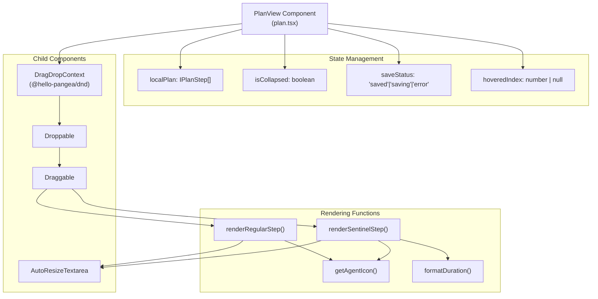
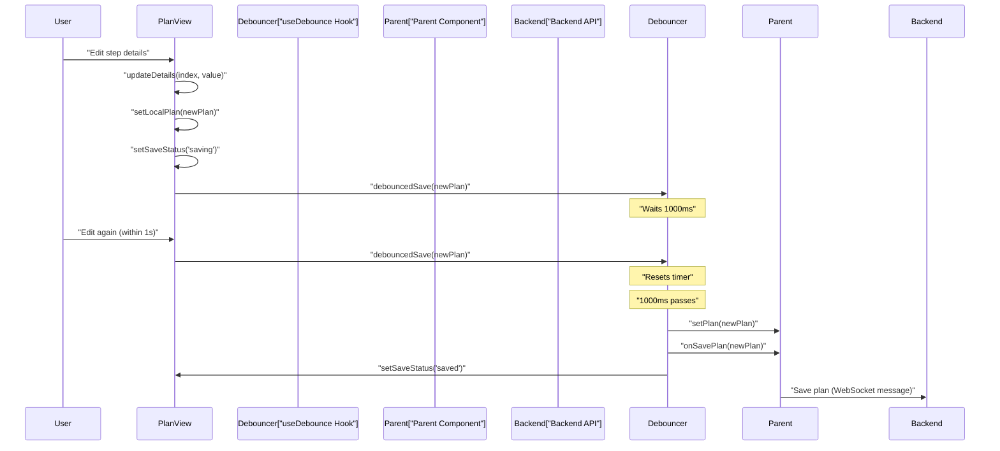
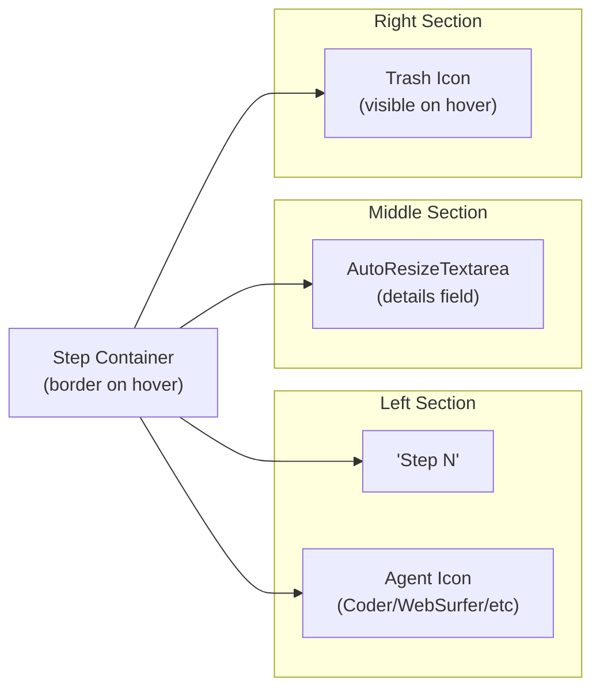
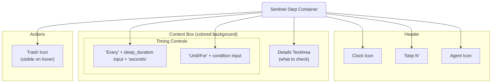
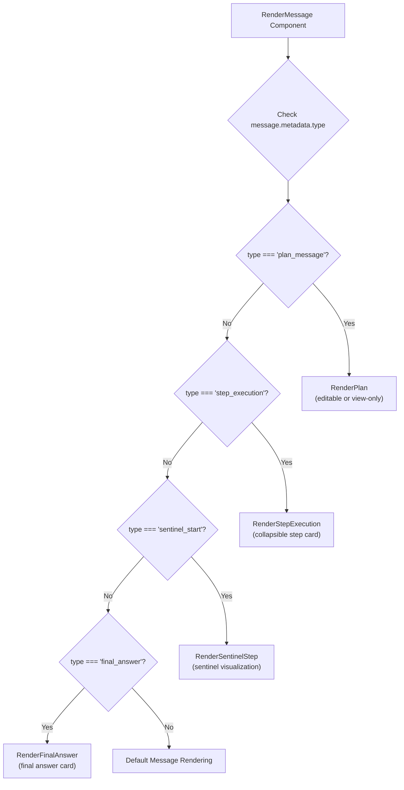
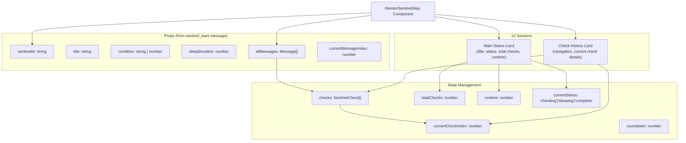
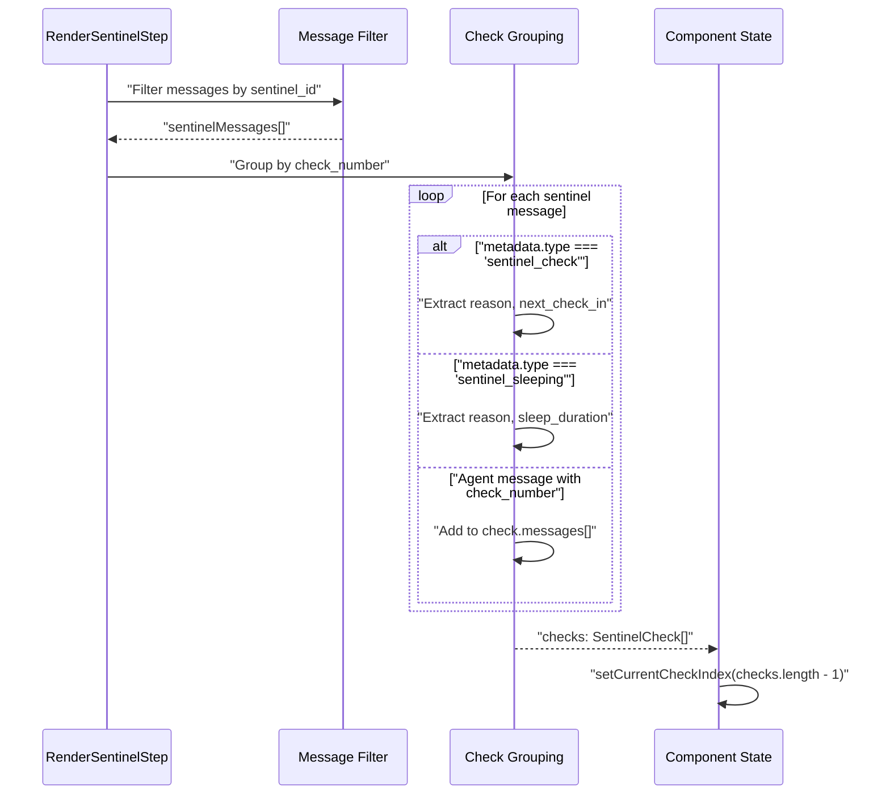

<!-- source: DeepWiki mcp.deepwiki.com · repo microsoft/magentic-ui · page 6.3 Plan Editor and Visualization · fetched 2026-10-26 -->

# Plan Editor and Visualization

<details>
<summary>Relevant source files</summary>

The following files were used as context for generating this wiki page:

- [frontend/src/components/features/Plans/PlanList.tsx](frontend/src/components/features/Plans/PlanList.tsx)
- [frontend/src/components/views/chat/chat.tsx](frontend/src/components/views/chat/chat.tsx)
- [frontend/src/components/views/chat/chatinput.tsx](frontend/src/components/views/chat/chatinput.tsx)
- [frontend/src/components/views/chat/plan.tsx](frontend/src/components/views/chat/plan.tsx)
- [frontend/src/components/views/chat/rendermessage.tsx](frontend/src/components/views/chat/rendermessage.tsx)
- [frontend/src/components/views/chat/runview.tsx](frontend/src/components/views/chat/runview.tsx)
- [frontend/src/components/views/manager.tsx](frontend/src/components/views/manager.tsx)
- [frontend/src/components/views/sidebar.tsx](frontend/src/components/views/sidebar.tsx)

</details>


## Purpose and Scope

This document details the frontend components responsible for displaying, editing, and visualizing execution plans in the Magentic-UI interface. The primary components covered are `PlanView` for interactive plan editing, `RenderMessage` for displaying plan messages in the chat interface, and `RenderSentinelStep` for visualizing long-running monitoring tasks.

For information about how plans are created and structured by the backend Orchestrator, see [Planning System](#5.1). For details about sentinel step execution logic and condition evaluation, see [Sentinel Steps and Monitoring](#5.2).

## Plan Data Structure

Plans in Magentic-UI consist of an array of steps, where each step can be either a regular immediate task or a sentinel monitoring task.

### IPlanStep Interface

The `IPlanStep` interface defines the structure of a plan step:

| Field | Type | Required | Description |
|-------|------|----------|-------------|
| `title` | `string` | Yes | Short one-sentence description of the step |
| `details` | `string` | Yes | Detailed instruction for the agent |
| `enabled` | `boolean` | Yes | Whether the step is active |
| `agent_name` | `string` | Yes | Name of the agent to execute this step (e.g., `"web_surfer"`, `"coder_agent"`) |
| `sleep_duration` | `number` | No | For sentinel steps: seconds to wait between checks |
| `condition` | `number \| string` | No | For sentinel steps: iteration count (number) or LLM-evaluated condition (string) |

**Sources:** [frontend/src/components/views/chat/plan.tsx:19](), [frontend/src/components/views/chat/plan.tsx:55-57]()

### Step Type Classification

The system distinguishes between two step types based on the presence of sentinel-specific fields:

```typescript
// Utility function to identify sentinel steps
const isSentinelStep = (step: IPlanStep): boolean => {
  return step.sleep_duration !== undefined && step.condition !== undefined;
};
```

- **Regular PlanStep**: Immediate, one-time execution tasks. Contains only `title`, `details`, `enabled`, and `agent_name`.
- **SentinelPlanStep**: Long-running monitoring tasks. Additionally includes `sleep_duration` and `condition` fields for periodic execution control.

**Sources:** [frontend/src/components/views/chat/plan.tsx:55-57]()

## PlanView Component Architecture

The `PlanView` component [frontend/src/components/views/chat/plan.tsx:98]() provides the primary interface for displaying and editing plans. It supports both interactive editing mode and read-only view mode.

### Component Overview Diagram



**Sources:** [frontend/src/components/views/chat/plan.tsx:1-496]()

### Key Props and Callbacks

```typescript
interface PlanProps {
  task: string;                      // Task description
  fromMemory?: boolean;              // Whether plan was retrieved from memory
  plan: IPlanStep[];                 // The plan steps
  setPlan: Dispatch<SetStateAction<IPlanStep[]>>;  // Update parent state
  viewOnly?: boolean;                // Read-only mode toggle
  onSavePlan?: (plan: IPlanStep[]) => void;        // Save callback
  onRegeneratePlan?: () => void;     // Regenerate plan callback
  isCollapsed?: boolean;             // Initial collapsed state
  forceCollapsed?: boolean;          // Force collapsed state
}
```

**Sources:** [frontend/src/components/views/chat/plan.tsx:86-96]()

## Interactive Plan Editing Features

### Debounced Auto-Save

The component implements a debounced save mechanism using the `useDebounce` hook [frontend/src/components/views/chat/plan.tsx:30-53]() to avoid excessive updates during rapid user edits:



The debounce delay is set to 1000ms (1 second) [frontend/src/components/views/chat/plan.tsx:134](), balancing responsiveness with performance.

**Sources:** [frontend/src/components/views/chat/plan.tsx:30-53](), [frontend/src/components/views/chat/plan.tsx:127-148]()

### Drag-and-Drop Reordering

Plans can be reordered using drag-and-drop, implemented via `@hello-pangea/dnd` in the `onDragEnd` function [frontend/src/components/views/chat/plan.tsx:191-199]():

```typescript
const onDragEnd = (result: DropResult) => {
  if (!result.destination) return;
  
  const items = Array.from(localPlan);
  const [reorderedItem] = items.splice(result.source.index, 1);
  items.splice(result.destination.index, 0, reorderedItem);
  
  handlePlanChange(items);
};
```

**Sources:** [frontend/src/components/views/chat/plan.tsx:191-199]()

### Step Operations

| Operation | Function | Description |
|-----------|----------|-------------|
| Update Details | `updateDetails(index, value)` | Modifies step details and title [frontend/src/components/views/chat/plan.tsx:150-158]() |
| Update Sentinel Field | `updateSentinelField(index, field, value)` | Modifies `sleep_duration` or `condition` [frontend/src/components/views/chat/plan.tsx:160-171]() |
| Delete Step | `deleteLocalPlan(index)` | Removes step from plan [frontend/src/components/views/chat/plan.tsx:173-176]() |
| Add Step | `addLocalPlan()` | Appends new empty step [frontend/src/components/views/chat/plan.tsx:178-189]() |

**Sources:** [frontend/src/components/views/chat/plan.tsx:150-189]()

## Regular Step Rendering

Regular steps display as compact cards with step number, agent icon, and editable details field via `renderRegularStep` [frontend/src/components/views/chat/plan.tsx:226]().

### Regular Step Layout



**Sources:** [frontend/src/components/views/chat/plan.tsx:226-276]()

### Agent Icon Mapping

The component maps agent names to visual icons in `getAgentIcon` [frontend/src/components/views/chat/plan.tsx:201]():

```typescript
const getAgentIcon = (agentName: string | undefined): JSX.Element | null => {
  const lowerCaseName = (agentName || "").toLowerCase();
  if (lowerCaseName === "coder_agent") return <CoderIcon tooltip="Coder" />;
  if (lowerCaseName === "web_surfer") return <WebSurferIcon tooltip="WebSurfer" />;
  if (lowerCaseName === "file_surfer") return <FileSurferIcon tooltip="FileSurfer" />;
  if (lowerCaseName === "user_proxy") return <UserIcon tooltip="User" />;
  if (lowerCaseName === "no_action_agent") return <AgentIcon tooltip="Self-Reflection" />;
  return <AgentIcon tooltip="Agent" />;
};
```

**Sources:** [frontend/src/components/views/chat/plan.tsx:201-222]()

## Sentinel Step Rendering

Sentinel steps have a distinct visual treatment with a clock icon and specialized fields for monitoring parameters, rendered via `renderSentinelStep` [frontend/src/components/views/chat/plan.tsx:278]().

### Sentinel Step Layout (Edit Mode)



**Sources:** [frontend/src/components/views/chat/plan.tsx:278-408]()

### View Mode Sentinel Rendering

In view-only mode, sentinel steps display as a single read-only text area combining all fields using the `formatDuration` utility [frontend/src/components/views/chat/plan.tsx:59-83]().

Examples:
- `"Check Bitcoin price EVERY 5 minutes FOR 10 times"`
- `"Monitor repository stars EVERY 1 hour UNTIL star count reaches 2000"`

**Sources:** [frontend/src/components/views/chat/plan.tsx:59-83](), [frontend/src/components/views/chat/plan.tsx:319-334]()

## Plan Message Rendering in Chat

Plans appear in the chat interface through the `RenderMessage` component [frontend/src/components/views/chat/rendermessage.tsx:497](), which delegates to `RenderPlan` [frontend/src/components/views/chat/rendermessage.tsx:319]() for plan-specific rendering.

### Message Type Detection Flow



**Sources:** [frontend/src/components/views/chat/rendermessage.tsx:497-600](), [frontend/src/components/views/chat/rendermessage.tsx:769-824]()

## Sentinel Step Execution Visualization

The `RenderSentinelStep` component [frontend/src/components/views/chat/rendersentinelstep.tsx:28]() provides real-time visualization of long-running sentinel steps during execution.

### Component Architecture



**Sources:** [frontend/src/components/views/chat/rendersentinelstep.tsx:1-345]()

### Message Grouping by Check Number

The component groups related messages by their `check_number` metadata in a `useEffect` hook [frontend/src/components/views/chat/rendersentinelstep.tsx:43-154]():



**Sources:** [frontend/src/components/views/chat/rendersentinelstep.tsx:43-154]()

### Real-Time Countdown Timer

For sleeping status, the component implements a timestamp-based countdown in a `useEffect` hook [frontend/src/components/views/chat/rendersentinelstep.tsx:157-177](). The countdown is computed from the `sleep_start_timestamp` provided by the backend.

**Sources:** [frontend/src/components/views/chat/rendersentinelstep.tsx:157-177]()

## Plan-to-Session Integration

The `PlanList` component [frontend/src/components/features/Plans/PlanList.tsx:49]() manages saved plans and allows creating new sessions from them via `handleUsePlan` [frontend/src/components/features/Plans/PlanList.tsx:110]():

1.  **Selection**: User selects a plan from the list.
2.  **Creation**: `PlanList` calls `sessionAPI.createSession` [frontend/src/components/features/Plans/PlanList.tsx:117]().
3.  **Initialization**: Once the session is created, the UI triggers `onCreateSessionFromPlan` [frontend/src/components/features/Plans/PlanList.tsx:126](), which passes the plan data to the new session's orchestrator.

**Sources:** [frontend/src/components/features/Plans/PlanList.tsx:110-135]()

---

