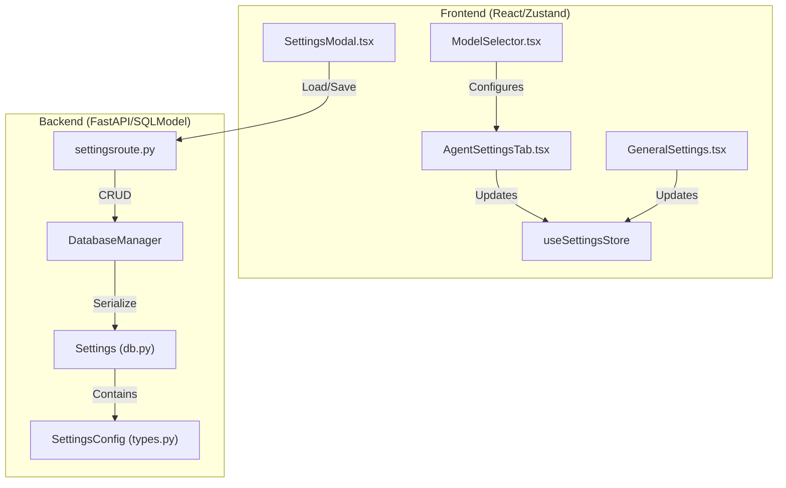
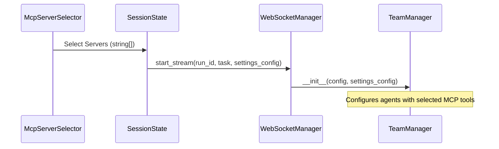

<!-- source: DeepWiki mcp.deepwiki.com · repo microsoft/magentic-ui · page 6.4 Settings Management · fetched 2026-10-26 -->

# Settings Management

Relevant source files

The following files were used as context for generating this wiki page:

- [frontend/package.json](frontend/package.json)
- [frontend/src/components/features/McpServerSelector/McpServerSelector.css](frontend/src/components/features/McpServerSelector/McpServerSelector.css)
- [frontend/src/components/features/McpServerSelector/McpServerSelector.tsx](frontend/src/components/features/McpServerSelector/McpServerSelector.tsx)
- [frontend/src/components/features/McpServersConfig/McpConfigModal.tsx](frontend/src/components/features/McpServersConfig/McpConfigModal.tsx)
- [frontend/src/components/features/McpServersConfig/McpServerCard.tsx](frontend/src/components/features/McpServersConfig/McpServerCard.tsx)
- [frontend/src/components/features/McpServersConfig/McpServersList.tsx](frontend/src/components/features/McpServersConfig/McpServersList.tsx)
- [frontend/src/components/features/McpServersConfig/configForms/JsonForm.tsx](frontend/src/components/features/McpServersConfig/configForms/JsonForm.tsx)
- [frontend/src/components/features/McpServersConfig/configForms/SseServerForm.tsx](frontend/src/components/features/McpServersConfig/configForms/SseServerForm.tsx)
- [frontend/src/components/features/McpServersConfig/configForms/StdioServerForm.tsx](frontend/src/components/features/McpServersConfig/configForms/StdioServerForm.tsx)
- [frontend/src/components/features/McpServersConfig/types.ts](frontend/src/components/features/McpServersConfig/types.ts)
- [frontend/src/components/settings/SettingsModal.tsx](frontend/src/components/settings/SettingsModal.tsx)
- [frontend/src/components/settings/hooks/useDefaultModel.ts](frontend/src/components/settings/hooks/useDefaultModel.ts)
- [frontend/src/components/settings/tabs/GeneralSettings/AllowedWebsitesList.tsx](frontend/src/components/settings/tabs/GeneralSettings/AllowedWebsitesList.tsx)
- [frontend/src/components/settings/tabs/advancedSetings/AdvancedSettings.tsx](frontend/src/components/settings/tabs/advancedSetings/AdvancedSettings.tsx)
- [frontend/src/components/settings/tabs/agentSettings/AgentSettingsTab.tsx](frontend/src/components/settings/tabs/agentSettings/AgentSettingsTab.tsx)
- [frontend/src/components/settings/tabs/agentSettings/modelSelector/modelConfigForms/AzureModelConfigForm.tsx](frontend/src/components/settings/tabs/agentSettings/modelSelector/modelConfigForms/AzureModelConfigForm.tsx)
- [frontend/src/components/settings/tabs/agentSettings/modelSelector/modelConfigForms/OllamaModelConfigForm.tsx](frontend/src/components/settings/tabs/agentSettings/modelSelector/modelConfigForms/OllamaModelConfigForm.tsx)
- [frontend/src/components/settings/tabs/agentSettings/modelSelector/modelConfigForms/OpenAIModelConfigForm.tsx](frontend/src/components/settings/tabs/agentSettings/modelSelector/modelConfigForms/OpenAIModelConfigForm.tsx)
- [frontend/src/components/settings/tabs/agentSettings/modelSelector/modelConfigForms/types.tsx](frontend/src/components/settings/tabs/agentSettings/modelSelector/modelConfigForms/types.tsx)
- [frontend/src/components/types/datamodel.ts](frontend/src/components/types/datamodel.ts)
- [src/magentic_ui/backend/datamodel/db.py](src/magentic_ui/backend/datamodel/db.py)
- [src/magentic_ui/backend/datamodel/types.py](src/magentic_ui/backend/datamodel/types.py)
- [src/magentic_ui/backend/web/deps.py](src/magentic_ui/backend/web/deps.py)
- [src/magentic_ui/backend/web/managers/connection.py](src/magentic_ui/backend/web/managers/connection.py)
- [src/magentic_ui/backend/web/routes/settingsroute.py](src/magentic_ui/backend/web/routes/settingsroute.py)
- [src/magentic_ui/cli/pretty_console.py](src/magentic_ui/cli/pretty_console.py)

## Purpose and Scope

Settings Management provides the user interface and persistence mechanisms for configuring Magentic-UI's runtime behavior, including model client configurations, MCP server integrations, and general system preferences. This page details the implementation of the settings UI, the underlying data models, and the flow of configuration from the frontend to the backend execution environment.

**Sources:** [frontend/src/components/settings/SettingsModal.tsx:1-25](), [src/magentic_ui/backend/web/routes/settingsroute.py:1-11]()

---

## Settings Architecture Overview

The settings system follows a multi-tier architecture. Configurations are defined in the frontend via React components, managed globally using a Zustand store (`useSettingsStore`), and persisted in a SQLite database via a FastAPI REST API.

### Code-to-System Mapping

The following diagram maps UI components to their corresponding backend data models and persistence logic.

**Diagram: Settings Component Mapping**

**Sources:** [frontend/src/components/settings/SettingsModal.tsx:33-51](), [src/magentic_ui/backend/datamodel/db.py:185-200](), [src/magentic_ui/backend/web/routes/settingsroute.py:29-51]()

---

## Data Persistence and Schema

Settings are stored in the `settings` table. Unlike sessions or messages, settings are unique per user (`user_id`).

### Settings Model Implementation
The `Settings` class in `src/magentic_ui/backend/datamodel/db.py` defines the structure:
- `user_id`: Unique identifier for the user [src/magentic_ui/backend/datamodel/db.py:195]().
- `config`: A JSON column storing the `SettingsConfig` [src/magentic_ui/backend/datamodel/db.py:197-199]().

### API Interaction
The backend provides endpoints for retrieving and updating these settings:
- `GET /api/settings/`: Fetches settings for a `user_id`. If none exist, it creates default settings using `_get_or_create_settings` [src/magentic_ui/backend/web/routes/settingsroute.py:14-35]().
- `PUT /api/settings/`: Updates the configuration. It preserves the existing ID to perform an upsert [src/magentic_ui/backend/web/routes/settingsroute.py:38-50]().

**Sources:** [src/magentic_ui/backend/datamodel/db.py:185-202](), [src/magentic_ui/backend/web/routes/settingsroute.py:14-51]()

---

## Model Client Configuration

The `AgentSettingsTab` allows users to configure which LLM provider and model each agent uses. This can be done in "Basic" mode (one model for all) or "Advanced" mode (specific models for specific agents) [frontend/src/components/settings/tabs/agentSettings/AgentSettingsTab.tsx:84-173]().

### Model Configuration Forms
The system uses specialized forms for different providers to ensure valid configuration:
- **OpenAI**: Configures `model`, `api_key`, `base_url`, and advanced toggles like `vision` or `structured_output` [frontend/src/components/settings/tabs/agentSettings/modelSelector/modelConfigForms/OpenAIModelConfigForm.tsx:74-108]().
- **Azure**: Includes Azure-specific fields like `azure_endpoint`, `azure_deployment`, and `api_version` [frontend/src/components/settings/tabs/agentSettings/modelSelector/modelConfigForms/AzureModelConfigForm.tsx:70-86]().

### Configuration Overrides
If the application is started with a YAML config file (indicated by the `_CONFIG` environment variable), the UI displays a warning that manual settings will be ignored [frontend/src/components/settings/tabs/agentSettings/AgentSettingsTab.tsx:90-130](). The `get_config_info` endpoint provides this state to the frontend [src/magentic_ui/backend/web/routes/settingsroute.py:53-75]().

**Sources:** [frontend/src/components/settings/tabs/agentSettings/AgentSettingsTab.tsx:24-59](), [frontend/src/components/settings/tabs/agentSettings/modelSelector/modelConfigForms/OpenAIModelConfigForm.tsx:5-35](), [src/magentic_ui/backend/web/routes/settingsroute.py:53-75]()

---

## MCP Server Management

MCP (Model Context Protocol) integration allows agents to use external tools. Management is split between global configuration and per-session selection.

### Global Configuration
Users manage their MCP servers in the `McpServersList` component. Servers are grouped under "MCP Agents" [frontend/src/components/features/McpServersConfig/McpServersList.tsx:32-52]().
- **Addition**: New servers are added via `McpConfigModal` [frontend/src/components/features/McpServersConfig/McpServersList.tsx:153-156]().
- **Persistence**: Updates are saved to the user's global settings under `mcp_agent_configs` [frontend/src/components/features/McpServersConfig/McpServersList.tsx:162-186]().

### Runtime Selection
In the chat interface, the `McpServerSelector` allows users to pick which of their configured servers to enable for a specific session [frontend/src/components/features/McpServerSelector/McpServerSelector.tsx:19-53]().

**Diagram: MCP Configuration Flow**

**Sources:** [frontend/src/components/features/McpServersConfig/McpServersList.tsx:54-141](), [frontend/src/components/features/McpServerSelector/McpServerSelector.tsx:9-53](), [src/magentic_ui/backend/web/managers/connection.py:115-145]()

---

## Runtime Settings Application

When a run starts, settings are transmitted via WebSocket to the backend. The `WebSocketManager` receives these in `start_stream` [src/magentic_ui/backend/web/managers/connection.py:115-122]().

1. **Initialization**: A `TeamManager` is created or retrieved for the `run_id` [src/magentic_ui/backend/web/managers/connection.py:137-148]().
2. **Context Injection**: The `settings_config` (containing model clients and MCP choices) is used to instantiate the agent team [src/magentic_ui/backend/web/managers/connection.py:120-132]().
3. **Execution**: The `TeamManager` uses these settings to determine which LLM clients to initialize and which MCP tools to attach to the agents.

**Sources:** [src/magentic_ui/backend/web/managers/connection.py:115-150](), [src/magentic_ui/backend/datamodel/db.py:104-147]()

---

