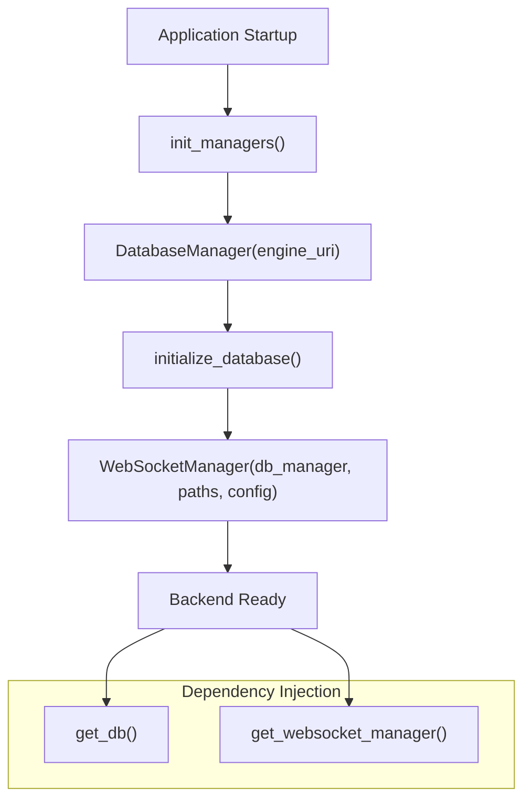
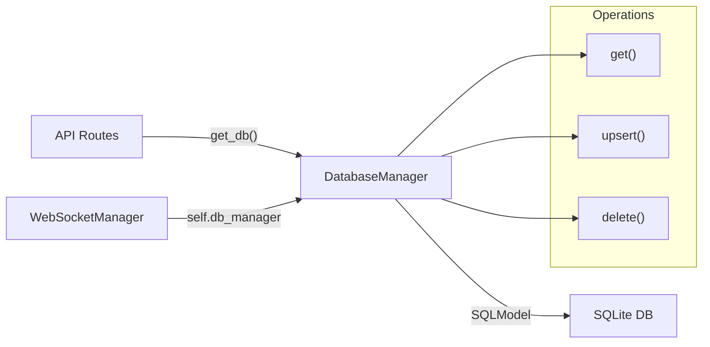
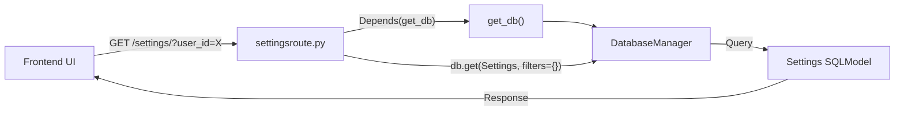
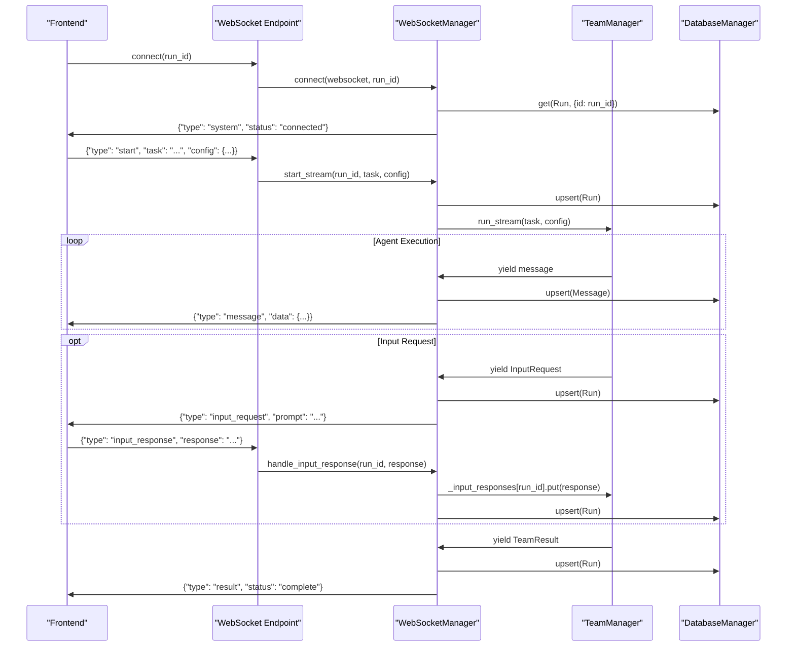

<!-- source: DeepWiki mcp.deepwiki.com · repo microsoft/magentic-ui · page 7 Backend Infrastructure · fetched 2026-10-26 -->

# Backend Infrastructure

<details>
<summary>Relevant source files</summary>

The following files were used as context for generating this wiki page:

- [src/magentic_ui/backend/cli.py](src/magentic_ui/backend/cli.py)
- [src/magentic_ui/backend/datamodel/db.py](src/magentic_ui/backend/datamodel/db.py)
- [src/magentic_ui/backend/datamodel/types.py](src/magentic_ui/backend/datamodel/types.py)
- [src/magentic_ui/backend/web/app.py](src/magentic_ui/backend/web/app.py)
- [src/magentic_ui/backend/web/deps.py](src/magentic_ui/backend/web/deps.py)
- [src/magentic_ui/backend/web/managers/connection.py](src/magentic_ui/backend/web/managers/connection.py)
- [src/magentic_ui/backend/web/routes/settingsroute.py](src/magentic_ui/backend/web/routes/settingsroute.py)

</details>


## Purpose and Scope

This page provides an overview of the Magentic-UI backend infrastructure, which is built on FastAPI and handles HTTP/WebSocket APIs, database persistence, and workspace management. The backend serves as the bridge between the frontend interface and the agent orchestration system.

For detailed information about specific subsystems:
- **Web API and WebSocket Communication**: see [Web API and WebSocket Communication](#7.1)
- **Database Schema and Persistence**: see [Database Schema and Persistence](#7.2)
- **File and Workspace Management**: see [File and Workspace Management](#7.3)

## FastAPI Application Architecture

The backend is a FastAPI application that provides both HTTP REST endpoints and WebSocket connections for real-time agent execution streaming. The application is initialized with dependency injection to manage global instances of core services.

**Core Backend Components:**

| Component | Class | Purpose |
|-----------|-------|---------|
| Web Server | `FastAPI` | HTTP/WebSocket server [src/magentic_ui/backend/web/app.py:87-101]() |
| Database | `DatabaseManager` | SQLModel-based database operations [src/magentic_ui/backend/database.py]() |
| WebSocket Handler | `WebSocketManager` | Real-time message streaming [src/magentic_ui/backend/web/managers/connection.py:40-73]() |
| Session Manager | N/A (routes) | CRUD for sessions and runs [src/magentic_ui/backend/web/routes/sessions.py]() |
| Settings Manager | N/A (routes) | User configuration persistence [src/magentic_ui/backend/web/routes/settingsroute.py]() |

**Backend Service Initialization Flow:**



The initialization sequence ensures proper dependency order: the database must be ready before the `WebSocketManager`, which needs database access to persist messages and run state.

**Sources:** [src/magentic_ui/backend/web/deps.py:65-99](), [src/magentic_ui/backend/web/app.py:34-75]()

## Core Manager Components

### DatabaseManager

The `DatabaseManager` handles all database operations using SQLModel. It provides a unified interface for CRUD operations across all data models and manages the database connection lifecycle.



**Sources:** [src/magentic_ui/backend/web/deps.py:42-49](), [src/magentic_ui/backend/web/managers/connection.py:53-67](), [src/magentic_ui/backend/web/deps.py:82-83]()

### WebSocketManager

The `WebSocketManager` is a critical backend component, orchestrating real-time communication between the frontend and the agent execution system. It maintains active WebSocket connections, manages `TeamManager` instances per run, and handles input/response queues.

**Key Responsibilities:**
- WebSocket connection lifecycle (`connect`, `disconnect`) [src/magentic_ui/backend/web/managers/connection.py:93-113]()
- Message streaming from agents to frontend [src/magentic_ui/backend/web/managers/connection.py:115-151]()
- Input request/response handling for human-in-the-loop [src/magentic_ui/backend/web/managers/connection.py:494-520]()
- Run state transitions (CREATED → ACTIVE → COMPLETE/ERROR/STOPPED) [src/magentic_ui/backend/web/managers/connection.py:164-170]()
- Cancellation token management [src/magentic_ui/backend/web/managers/connection.py:149-150]()
- Team manager lifecycle per run [src/magentic_ui/backend/web/managers/connection.py:137-148]()

**Internal State Tracking:**

The `WebSocketManager` maintains several dictionaries to track active runs:

| Dictionary | Type | Purpose |
|------------|------|---------|
| `_connections` | `Dict[int, WebSocket]` | Maps `run_id` to `WebSocket` |
| `_cancellation_tokens` | `Dict[int, CancellationToken]` | Cancellation control per run |
| `_closed_connections` | `set[int]` | Explicitly closed connections |
| `_input_responses` | `Dict[int, asyncio.Queue[str]]` | Input response queues |
| `_team_managers` | `Dict[int, TeamManager]` | Active `TeamManager` per run |

**Sources:** [src/magentic_ui/backend/web/managers/connection.py:68-73](), [src/magentic_ui/backend/web/managers/connection.py:115-292]()

## Backend Initialization and Lifecycle

### Startup Sequence

The backend initialization follows this sequence in `init_managers()`:

1. **Database Initialization:** Create `DatabaseManager` with engine URI [src/magentic_ui/backend/web/deps.py:82]()
2. **Database Schema Setup:** Call `initialize_database(auto_upgrade=True)` [src/magentic_ui/backend/web/deps.py:83]()
3. **WebSocket Manager Creation:** Instantiate with workspace paths and config [src/magentic_ui/backend/web/deps.py:86-93]()
4. **Dependency Injection Setup:** Make managers available via FastAPI dependencies [src/magentic_ui/backend/web/deps.py:42-59]()

```python
# From src/magentic_ui/backend/web/deps.py
async def init_managers(
    database_uri: str,
    config_dir: Path,
    app_root: Path,
    internal_workspace_root: str,
    external_workspace_root: str,
    inside_docker: bool,
    config: Dict[str, Any],
    run_without_docker: bool,
) -> None:
```

**Workspace Path Configuration:**

The backend manages two workspace root paths:
- **Internal Workspace Root:** Path used within Docker containers (e.g., `/workspace`)
- **External Workspace Root:** Path on host machine where files are actually stored

This dual-path system enables Docker isolation while maintaining persistent file storage.

**Sources:** [src/magentic_ui/backend/web/deps.py:65-99](), [src/magentic_ui/backend/web/app.py:54-64]()

### Shutdown and Cleanup

The `cleanup_managers()` function ensures graceful shutdown:

1. **WebSocketManager cleanup:** Disconnects all active WebSockets, updates runs to STOPPED status [src/magentic_ui/backend/web/deps.py:109-115]()
2. **TeamManager cleanup:** Handled implicitly by `WebSocketManager`.
3. **DatabaseManager cleanup:** Closes database connections [src/magentic_ui/backend/web/deps.py:121-128]()

The cleanup sequence is important: `WebSocketManager` must close before `DatabaseManager` to ensure all final database writes complete.

**Sources:** [src/magentic_ui/backend/web/deps.py:102-129]()

## API Route Structure

The backend exposes several REST API route groups through a nested FastAPI instance mounted at `/api` [src/magentic_ui/backend/web/app.py:104-110]():

| Route Prefix | Module | Purpose |
|--------------|--------|---------|
| `/sessions/` | `sessions.py` | Session and Run CRUD [src/magentic_ui/backend/web/app.py:113-118]() |
| `/teams/` | `teams.py` | Team configuration management [src/magentic_ui/backend/web/app.py:134-139]() |
| `/settings/` | `settingsroute.py` | User settings persistence [src/magentic_ui/backend/web/app.py:156-161]() |
| `/plans/` | `plans.py` | Plan storage and learning [src/magentic_ui/backend/web/app.py:120-125]() |
| `/mcp/` | `mcp.py` | MCP server testing [src/magentic_ui/backend/web/app.py:163-167]() |
| `/ws/` | `ws.py` | WebSocket endpoint [src/magentic_ui/backend/web/app.py:142-147]() |

### Settings API Example

The settings API demonstrates the typical pattern of using the `DatabaseManager` for persistence:



The settings route uses the `get_db()` dependency to obtain the `DatabaseManager` instance, then performs database operations. The `_get_or_create_settings()` helper ensures every user has a settings record [src/magentic_ui/backend/web/routes/settingsroute.py:14-26]().

**Sources:** [src/magentic_ui/backend/web/routes/settingsroute.py:29-50](), [src/magentic_ui/backend/web/app.py:156-161]()

## Data Flow: Task Execution

The complete data flow for executing a task through the backend:



**Key State Transitions:**

The `Run` model transitions through these states [src/magentic_ui/backend/datamodel/db.py:89-96]():
- **CREATED** → **ACTIVE**: When `start_stream()` begins execution [src/magentic_ui/backend/web/managers/connection.py:166-169]()
- **ACTIVE** → **AWAITING_INPUT**: When agent requests user input [src/magentic_ui/backend/web/managers/connection.py:494-500]()
- **AWAITING_INPUT** → **ACTIVE**: After user provides input.
- **ACTIVE** → **COMPLETE**: On successful completion [src/magentic_ui/backend/web/managers/connection.py:265-273]()
- **ACTIVE** → **ERROR**: On exception during execution [src/magentic_ui/backend/web/managers/connection.py:284-292]()
- **ACTIVE** → **STOPPED**: On user cancellation [src/magentic_ui/backend/web/managers/connection.py:465-475]()

**Sources:** [src/magentic_ui/backend/web/managers/connection.py:115-292](), [src/magentic_ui/backend/datamodel/db.py:104-147]()

## Configuration and Environment

The backend accepts configuration through multiple sources, coordinated by the `AppInitializer` [src/magentic_ui/backend/web/app.py:30]() and CLI [src/magentic_ui/backend/cli.py:54-93]():

1. **Environment Variables:** API keys, database URI, and workspace roots.
2. **Config Files:** `config.yaml` for model clients and MCP servers [src/magentic_ui/backend/web/app.py:43-50]().
3. **Settings Database:** User-specific settings stored in the `Settings` table [src/magentic_ui/backend/datamodel/db.py:185-199]().
4. **Runtime Arguments:** Command-line flags for Docker mode, debug settings, and port selection [src/magentic_ui/backend/cli.py:56-92]().

**Sources:** [src/magentic_ui/backend/cli.py:122-151](), [src/magentic_ui/backend/web/app.py:41-64]()

## Message Formatting and Serialization

The `_format_message()` method in `WebSocketManager` converts agent messages to WebSocket-compatible JSON format [src/magentic_ui/backend/web/managers/connection.py:554-615]():

| Message Type | Formatted As | Special Handling |
|--------------|--------------|------------------|
| `MultiModalMessage` | `{"type": "message", "data": {...}}` | Images converted to base64 data URLs |
| `TeamResult` | `{"type": "result", "status": "complete"}` | Includes task result and usage stats |
| `ModelClientStreamingChunkEvent` | `{"type": "message_chunk"}` | Streaming token output |
| `TextMessage` | `{"type": "message", "data": {...}}` | Standard text message |
| `ToolCallRequestEvent` | `{"type": "message", "data": {...}}` | Tool call request |
| `ToolCallExecutionEvent` | `{"type": "message", "data": {...}}` | Tool execution result |

**Sources:** [src/magentic_ui/backend/web/managers/connection.py:554-615](), [src/magentic_ui/backend/datamodel/types.py:11-27]()

---

