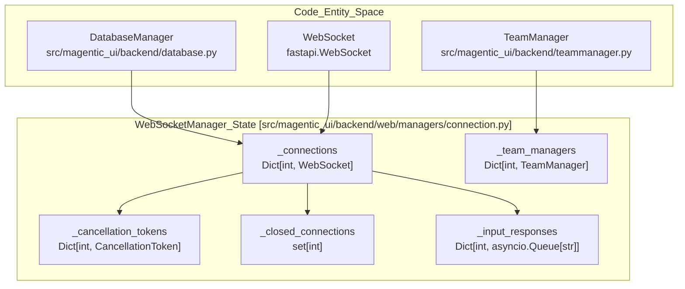
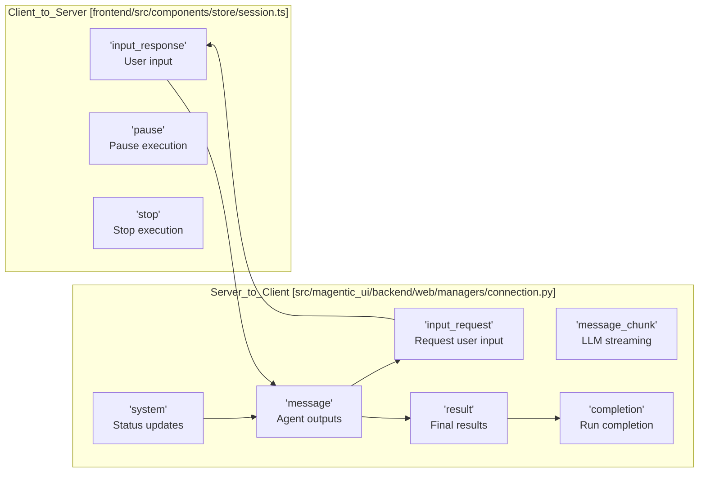
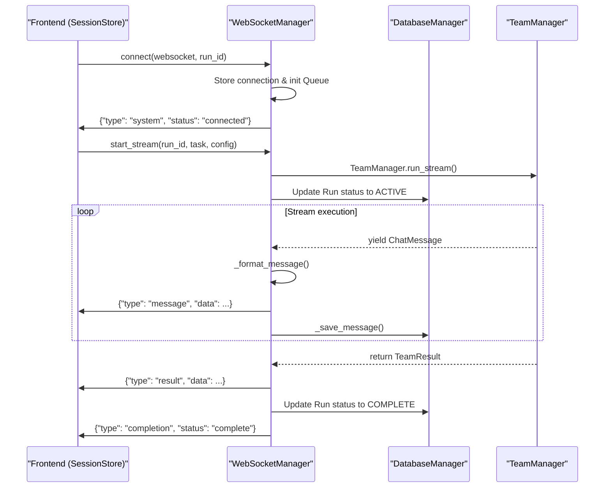

<!-- source: DeepWiki mcp.deepwiki.com · repo microsoft/magentic-ui · page 7.1 Web API and WebSocket Communication · fetched 2026-10-26 -->

# Web API and WebSocket Communication

Relevant source files

The following files were used as context for generating this wiki page:

- [frontend/src/components/views/chat/DetailViewer/browser_iframe.tsx](frontend/src/components/views/chat/DetailViewer/browser_iframe.tsx)
- [frontend/src/components/views/chat/DetailViewer/fullscreen_overlay.tsx](frontend/src/components/views/chat/DetailViewer/fullscreen_overlay.tsx)
- [frontend/src/components/views/chat/detail_viewer.tsx](frontend/src/components/views/chat/detail_viewer.tsx)
- [src/magentic_ui/backend/cli.py](src/magentic_ui/backend/cli.py)
- [src/magentic_ui/backend/datamodel/db.py](src/magentic_ui/backend/datamodel/db.py)
- [src/magentic_ui/backend/datamodel/types.py](src/magentic_ui/backend/datamodel/types.py)
- [src/magentic_ui/backend/web/app.py](src/magentic_ui/backend/web/app.py)
- [src/magentic_ui/backend/web/deps.py](src/magentic_ui/backend/web/deps.py)
- [src/magentic_ui/backend/web/managers/connection.py](src/magentic_ui/backend/web/managers/connection.py)
- [src/magentic_ui/backend/web/routes/mcp.py](src/magentic_ui/backend/web/routes/mcp.py)
- [src/magentic_ui/backend/web/routes/plans.py](src/magentic_ui/backend/web/routes/plans.py)
- [src/magentic_ui/backend/web/routes/runs.py](src/magentic_ui/backend/web/routes/runs.py)
- [src/magentic_ui/backend/web/routes/settingsroute.py](src/magentic_ui/backend/web/routes/settingsroute.py)
- [src/magentic_ui/tools/playwright/browser/utils.py](src/magentic_ui/tools/playwright/browser/utils.py)

## Purpose and Scope

This page documents the backend communication infrastructure that enables real-time bidirectional interaction between the web frontend and agent execution system. It covers the `WebSocketManager` class, the WebSocket protocol and message types, HTTP API endpoints for settings and runs, message streaming patterns, and the input request/response mechanism that enables human-in-the-loop interactions.

For information about frontend WebSocket handling and session management, see [Session Management](6.1). For details about the agent execution that generates messages streamed through WebSockets, see [Multi-Agent Orchestration](2.2) and [Task Team Assembly and Management](2.3).

---

## WebSocketManager Architecture

The `WebSocketManager` class is the central component managing WebSocket connections, message streaming, and coordinating communication between the web frontend and the `TeamManager` that executes agent tasks.

### Core Responsibilities

The `WebSocketManager` [src/magentic_ui/backend/web/managers/connection.py:40-82]():

- **Connection Management**: Accepts WebSocket connections and tracks active connections per run ID.
- **Message Streaming**: Formats and streams agent messages, events, and LLM chunks to clients in real-time.
- **Input Handling**: Manages asynchronous input queues for human-in-the-loop interactions using `asyncio.Queue`.
- **Run Lifecycle**: Coordinates run status transitions and database persistence via `DatabaseManager`.
- **Resource Cleanup**: Handles `CancellationToken` management and cleans up resources on disconnect or server shutdown.

### Initialization and State

**WebSocketManager State and Code Entities**

The manager maintains several dictionaries indexed by `run_id` [src/magentic_ui/backend/web/managers/connection.py:68-73]():

| Data Structure | Type | Purpose |
|---|---|---|
| `_connections` | `Dict[int, WebSocket]` | Maps run IDs to active WebSocket connections |
| `_cancellation_tokens` | `Dict[int, CancellationToken]` | Tokens used to cancel long-running agent tasks |
| `_closed_connections` | `set[int]` | Tracks explicitly closed connections to prevent message sending |
| `_input_responses` | `Dict[int, asyncio.Queue[str]]` | Async queues for handling user input responses |
| `_team_managers` | `Dict[int, TeamManager]` | Active TeamManager instances per run |

**Sources**: [src/magentic_ui/backend/web/managers/connection.py:40-82](), [src/magentic_ui/backend/web/deps.py:86-94]()

---

## WebSocket Message Protocol

### Message Types

The WebSocket protocol defines several message types for different communication patterns:

**WebSocket Message Flow**

### Message Type Reference

| Message Type | Direction | Purpose | Key Fields |
|---|---|---|---|
| `system` | Server → Client | Status updates (connected, active, paused) | `status`, `timestamp` |
| `message` | Server → Client | Agent chat messages (TextMessage, MultiModalMessage) | `data` (formatted message) |
| `message_chunk` | Server → Client | Streaming LLM tokens | `data` (ModelClientStreamingChunkEvent) |
| `input_request` | Server → Client | Request user input or approval | `input_type`, `prompt`, `data` |
| `input_response` | Client → Server | User's input response | `response` (string) |
| `result` | Server → Client | Task execution result | `data` (TeamResult model) |
| `completion` | Server → Client | Run completion/cancellation | `status`, `data` (TeamResult) |

**Sources**: [src/magentic_ui/backend/web/managers/connection.py:554-615](), [src/magentic_ui/backend/datamodel/types.py:103-107]()

---

## WebSocket Connection Lifecycle

### Connection Flow

The lifecycle begins when a client connects to the `/ws/{run_id}` endpoint [src/magentic_ui/backend/web/app.py:143-147]().

**Complete WebSocket Connection and Message Streaming Lifecycle**

### Key Methods

#### `connect(websocket: WebSocket, run_id: int)`
Accepts a WebSocket connection and initializes per-run resources [src/magentic_ui/backend/web/managers/connection.py:93-113]():
1. Accept the WebSocket connection.
2. Store connection in `_connections[run_id]`.
3. Initialize input response queue in `_input_responses[run_id]`.
4. Send a "connected" system message.

#### `start_stream(run_id, task, team_config, settings_config)`
Orchestrates task execution and real-time streaming [src/magentic_ui/backend/web/managers/connection.py:115-292]():
1. **Team Manager Setup**: Creates a new `TeamManager` or reuses an existing one for the run [src/magentic_ui/backend/web/managers/connection.py:137-148]().
2. **Status Update**: Updates the `Run` status in the database to `ACTIVE` [src/magentic_ui/backend/web/managers/connection.py:166-169]().
3. **Stream Loop**: Iterates through the `TeamManager.run_stream()` async generator.
4. **Formatting**: Each yielded message is formatted via `_format_message()` and sent via the WebSocket [src/magentic_ui/backend/web/managers/connection.py:214-220]().
5. **Persistence**: Messages are saved to the database via `_save_message()` [src/magentic_ui/backend/web/managers/connection.py:221-223]().

**Sources**: [src/magentic_ui/backend/web/managers/connection.py:93-292](), [src/magentic_ui/backend/web/deps.py:65-94]()

---

## Message Formatting and Streaming

### Message Transformation
The `_format_message()` method transforms internal agent objects into client-ready JSON [src/magentic_ui/backend/web/managers/connection.py:554-615]():

- **MultiModalMessage**: Extracts base64 image data and converts it into data URLs (e.g., `data:image/png;base64,...`) for direct rendering in the browser [src/magentic_ui/backend/web/managers/connection.py:565-581]().
- **ModelClientStreamingChunkEvent**: Formats as a `message_chunk` for real-time token display [src/magentic_ui/backend/web/managers/connection.py:592-595]().
- **TeamResult**: Formats as a `result` message containing final usage statistics and duration [src/magentic_ui/backend/web/managers/connection.py:603-606]().

### Message Persistence
Messages are persisted to the database via the `Message` model [src/magentic_ui/backend/datamodel/db.py:38-64]().
- **Filtering**: Internal messages (marked with `metadata.internal == "yes"`) are excluded from both streaming and persistence [src/magentic_ui/backend/web/managers/connection.py:189-191]().
- **Storage**: The `config` field of the `Message` object stores the serialized `MessageConfig` [src/magentic_ui/backend/datamodel/db.py:50-53]().

**Sources**: [src/magentic_ui/backend/web/managers/connection.py:554-615](), [src/magentic_ui/backend/datamodel/db.py:38-64]()

---

## Input Request/Response Mechanism

The system supports synchronous-style human-in-the-loop interactions over asynchronous WebSockets using a per-run queue.

### Input Function Implementation
The `create_input_func()` method returns an async function passed to the `TeamManager` [src/magentic_ui/backend/web/managers/connection.py:341-427]():

1. **Status Change**: Sets `Run.status` to `AWAITING_INPUT` [src/magentic_ui/backend/web/managers/connection.py:358]().
2. **Client Notification**: Sends an `input_request` message to the frontend [src/magentic_ui/backend/web/managers/connection.py:363-370]().
3. **Blocking Wait**: Calls `self._input_responses[run_id].get()` to wait for the user's response [src/magentic_ui/backend/web/managers/connection.py:406]().
4. **Timeout Handling**: If no response is received within the timeout (default 3600s), the run is stopped [src/magentic_ui/backend/web/managers/connection.py:414-419]().

### Input Types
The system supports different input types defined in `InputType` [src/magentic_ui/backend/datamodel/db.py:99-102]():
- `text_input`: Standard text response.
- `approval`: Binary decision (Approve/Deny).

**Sources**: [src/magentic_ui/backend/web/managers/connection.py:341-434](), [src/magentic_ui/backend/datamodel/db.py:99-102]()

---

## HTTP API Endpoints

The backend provides a REST API via FastAPI routers [src/magentic_ui/backend/web/app.py:113-167]().

### Key Routes

| Prefix | File | Purpose |
|---|---|---|
| `/api/sessions` | `sessions.py` | CRUD operations for chat sessions |
| `/api/runs` | `runs.py` | Create runs, upload files, and retrieve run history |
| `/api/settings` | `settingsroute.py` | Manage user configuration and LLM profiles |
| `/api/plans` | `plans.py` | Manage and retrieve generated execution plans |
| `/api/mcp` | `mcp.py` | Manage Model Context Protocol (MCP) server configurations |

### Run Management Endpoints
- **POST `/api/runs/`**: Creates a new run for a session or returns the latest existing run [src/magentic_ui/backend/web/routes/runs.py:22-68]().
- **POST `/api/runs/{run_id}/upload`**: Uploads files to the specific run directory. It uses the `TeamManager.prepare_run_paths` to ensure directories exist before writing [src/magentic_ui/backend/web/routes/runs.py:94-171]().
- **GET `/api/runs/{run_id}/messages`**: Retrieves all persisted messages for a specific run ordered by creation time [src/magentic_ui/backend/web/routes/runs.py:84-91]().

### Settings Endpoints
- **GET `/api/settings/`**: Retrieves settings for a `user_id`, creating defaults if none exist [src/magentic_ui/backend/web/routes/settingsroute.py:29-35]().
- **GET `/api/settings/config-info`**: Checks if the application was started with a YAML config file via the `_CONFIG` environment variable [src/magentic_ui/backend/web/routes/settingsroute.py:53-75]().

**Sources**: [src/magentic_ui/backend/web/app.py:113-167](), [src/magentic_ui/backend/web/routes/runs.py:1-171](), [src/magentic_ui/backend/web/routes/settingsroute.py:1-75]()

---

## Connection Lifecycle and Cleanup

### Error Handling
If an error occurs during streaming, `_handle_stream_error()` is invoked [src/magentic_ui/backend/web/managers/connection.py:522-552]():
1. Captures the exception traceback.
2. Updates the `Run` status to `RunStatus.ERROR`.
3. Sends a `completion` message with the error details to the client.

### Shutdown and Cleanup
The `WebSocketManager.cleanup()` method ensures no orphaned runs remain [src/magentic_ui/backend/web/managers/connection.py:666-717]():
1. Cancels all active `CancellationToken` instances.
2. Updates all active runs to `STOPPED` status in the database.
3. Closes all active WebSocket connections gracefully.

The `cleanup_managers()` utility [src/magentic_ui/backend/web/deps.py:102-130]() is called by the FastAPI lifespan manager to ensure the `DatabaseManager` and `WebSocketManager` are properly shut down.

**Sources**: [src/magentic_ui/backend/web/managers/connection.py:666-717](), [src/magentic_ui/backend/web/deps.py:102-130]()

---

