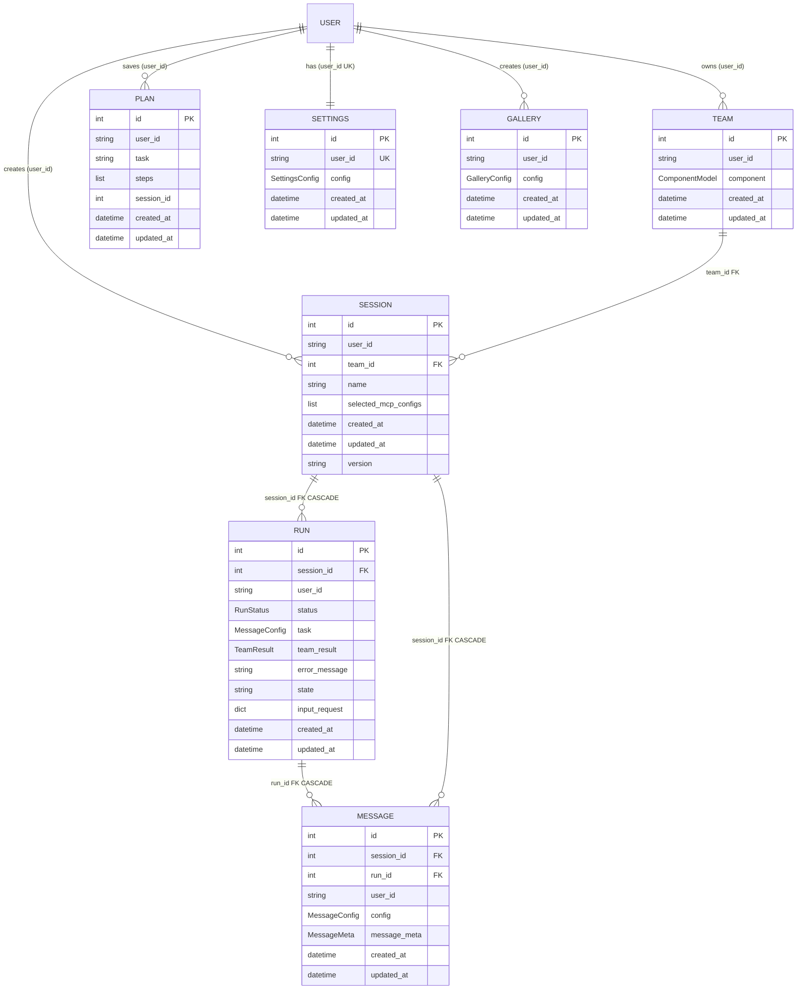
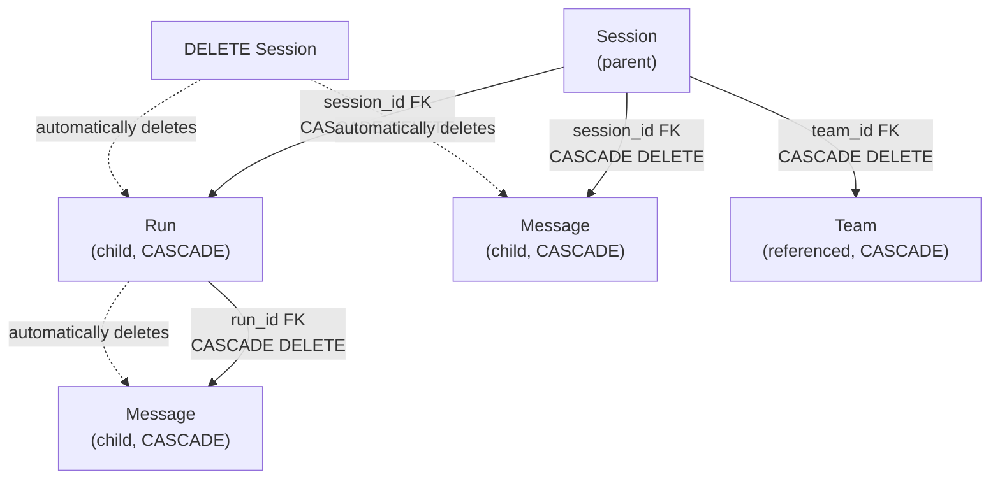
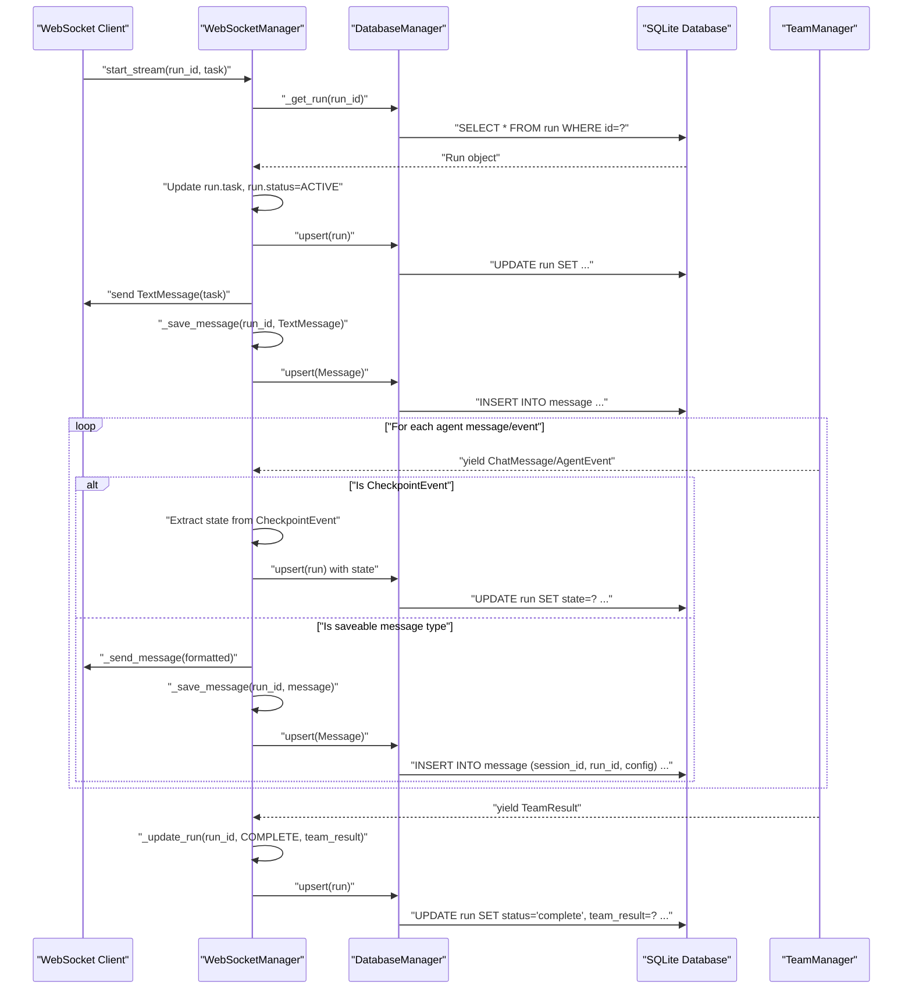
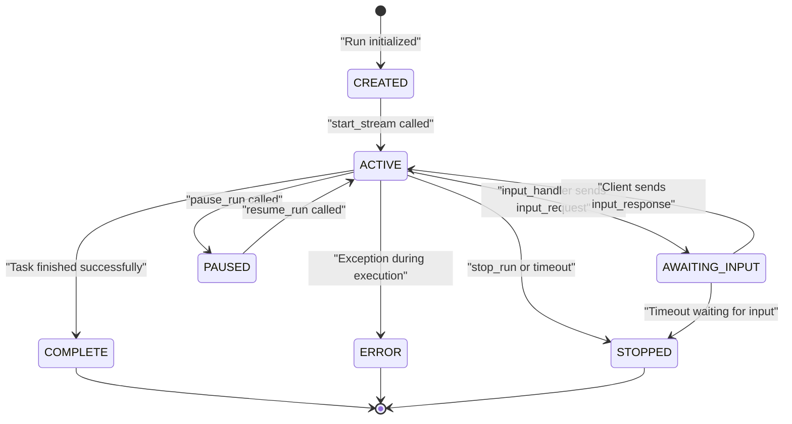
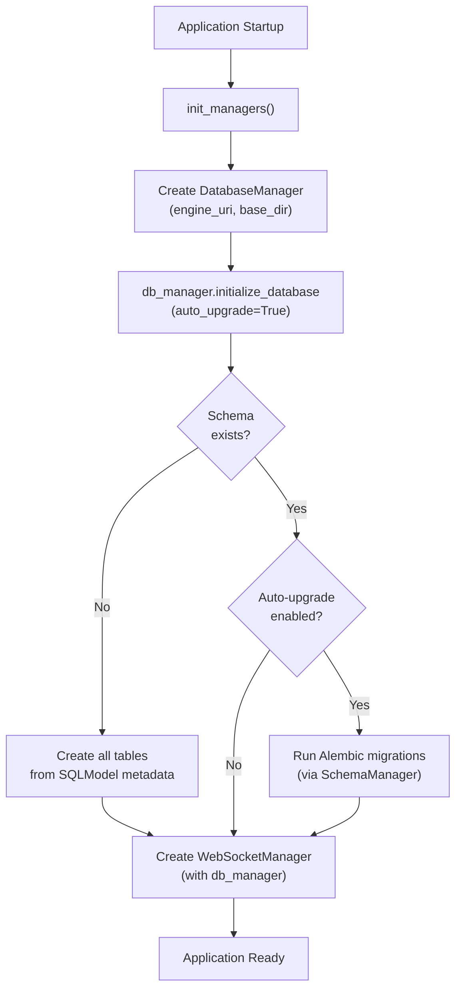

<!-- source: DeepWiki mcp.deepwiki.com · repo microsoft/magentic-ui · page 7.2 Database Schema and Persistence · fetched 2026-10-26 -->

# Database Schema and Persistence

Relevant source files

The following files were used as context for generating this wiki page:

- [src/magentic_ui/backend/database/db_manager.py](src/magentic_ui/backend/database/db_manager.py)
- [src/magentic_ui/backend/datamodel/db.py](src/magentic_ui/backend/datamodel/db.py)
- [src/magentic_ui/backend/datamodel/types.py](src/magentic_ui/backend/datamodel/types.py)
- [src/magentic_ui/backend/web/config.py](src/magentic_ui/backend/web/config.py)
- [src/magentic_ui/backend/web/deps.py](src/magentic_ui/backend/web/deps.py)
- [src/magentic_ui/backend/web/managers/connection.py](src/magentic_ui/backend/web/managers/connection.py)
- [src/magentic_ui/backend/web/routes/settingsroute.py](src/magentic_ui/backend/web/routes/settingsroute.py)

This document describes the database schema, data models, and persistence mechanisms used by Magentic-UI to store sessions, runs, messages, plans, teams, and settings. The system uses SQLModel (built on SQLAlchemy) with SQLite for persistent storage of all application state.

For information about how state is serialized and checkpointed during agent execution, see [State Management and Persistence](#9.2). For details on the REST API endpoints that interact with these database entities, see [Web API and WebSocket Communication](#7.1).

---

## Overview

Magentic-UI persists all user interactions, agent execution history, and configuration data in a SQLite database. The schema supports multi-user tenancy (via `user_id` fields), hierarchical session organization, and cascade deletion to maintain referential integrity. All database models are defined using SQLModel, which provides both Pydantic validation and SQLAlchemy ORM capabilities.

**Sources:** [src/magentic_ui/backend/datamodel/db.py:1-235]()

---

## Database Technology Stack

The persistence layer uses:

- **SQLite**: Embedded relational database stored in a single file.
- **SQLModel**: Declarative ORM combining SQLAlchemy and Pydantic.
- **SQLAlchemy**: Underlying engine for database operations.
- **DatabaseManager**: Singleton manager for database initialization, connection pooling, and CRUD operations.

The `DatabaseManager` is initialized at application startup via `init_managers` and handles schema creation, auto-migration via `SchemaManager`, and SQLite-specific optimizations like WAL mode and foreign key enforcement.

**Sources:** [src/magentic_ui/backend/web/deps.py:65-99](), [src/magentic_ui/backend/datamodel/db.py:1-10](), [src/magentic_ui/backend/database/db_manager.py:16-95]()

---

## Schema Entity Relationship Diagram

**Sources:** [src/magentic_ui/backend/datamodel/db.py:23-232]()

---

## Core Database Models

### Session Model

The `Session` model represents a conversation thread that can contain multiple execution runs. Each session is associated with a `Team` configuration and can have selected MCP (Model Context Protocol) configurations.

| Field | Type | Description |
|-------|------|-------------|
| `id` | `int` (PK) | Auto-incrementing primary key |
| `user_id` | `str` | User identifier for multi-tenancy |
| `team_id` | `int` (FK) | Reference to Team configuration |
| `name` | `str` | Session display name |
| `selected_mcp_configs` | `List[dict]` | MCP server configurations selected for this session |
| `created_at` | `datetime` | Timestamp of creation (auto-generated) |
| `updated_at` | `datetime` | Timestamp of last update (auto-updated) |
| `version` | `str` | Schema version (default: "0.0.1") |

**Relationships:**
- Foreign key to `Team(id)` with CASCADE delete.
- One-to-many with `Run` (CASCADE delete).
- One-to-many with `Message` (CASCADE delete).

**Sources:** [src/magentic_ui/backend/datamodel/db.py:67-87]()

---

### Run Model

The `Run` model represents a single execution instance within a session. It tracks the task, execution status, results, and stores serialized agent state for pause/resume functionality.

| Field | Type | Description |
|-------|------|-------------|
| `id` | `int` (PK) | Auto-incrementing primary key |
| `session_id` | `int` (FK, NOT NULL) | Parent session (CASCADE delete) |
| `user_id` | `str` | User identifier |
| `status` | `RunStatus` enum | Current execution status |
| `task` | `MessageConfig` | Original user task/query |
| `team_result` | `TeamResult` | Final execution result with TaskResult |
| `error_message` | `str` | Error details if status is ERROR |
| `state` | `str` | Serialized agent state for checkpointing |
| `input_request` | `dict` | Pending input request details |
| `created_at` | `datetime` | Timestamp of creation |
| `updated_at` | `datetime` | Timestamp of last update |
| `version` | `str` | Schema version |

**RunStatus Enum Values:**
- `CREATED`: Run initialized but not started.
- `ACTIVE`: Currently executing.
- `AWAITING_INPUT`: Paused waiting for user input/approval.
- `PAUSED`: Manually paused by user.
- `COMPLETE`: Successfully finished.
- `STOPPED`: Cancelled by user.
- `ERROR`: Terminated due to error.

**Relationships:**
- Foreign key to `Session(id)` with CASCADE delete (required).
- One-to-many with `Message` (CASCADE delete).

**Sources:** [src/magentic_ui/backend/datamodel/db.py:89-153]()

---

### Message Model

The `Message` model stores individual chat messages, agent events, and tool execution records. Messages are associated with both a session and a specific run.

| Field | Type | Description |
|-------|------|-------------|
| `id` | `int` (PK) | Auto-incrementing primary key |
| `session_id` | `int` (FK) | Parent session (CASCADE delete) |
| `run_id` | `int` (FK) | Associated run (CASCADE delete) |
| `user_id` | `str` | User identifier |
| `config` | `MessageConfig` | Message content and metadata |
| `message_meta` | `MessageMeta` | Additional metadata (task result, usage, logs) |
| `created_at` | `datetime` | Timestamp of creation |
| `updated_at` | `datetime` | Timestamp of last update |
| `version` | `str` | Schema version |

**MessageConfig Fields:**
- `source`: Agent or component that generated the message.
- `content`: Text, multimodal content, or structured message object.
- `message_type`: Type classification (default: "text").

**Sources:** [src/magentic_ui/backend/datamodel/db.py:38-65](), [src/magentic_ui/backend/datamodel/types.py:11-15]()

---

### Team Model

The `Team` model stores reusable agent team configurations as `ComponentModel` objects from the AutoGen framework.

| Field | Type | Description |
|-------|------|-------------|
| `id` | `int` (PK) | Auto-incrementing primary key |
| `user_id` | `str` | Owner user identifier |
| `component` | `ComponentModel` or `dict` | AutoGen team configuration |
| `created_at` | `datetime` | Timestamp of creation |
| `updated_at` | `datetime` | Timestamp of last update |
| `version` | `str` | Schema version |

**Sources:** [src/magentic_ui/backend/datamodel/db.py:23-36]()

---

### Settings Model

The `Settings` model stores user-specific configuration preferences. Each user has exactly one settings record (enforced by unique constraint on `user_id`).

| Field | Type | Description |
|-------|------|-------------|
| `id` | `int` (PK) | Auto-incrementing primary key |
| `user_id` | `str` (UNIQUE) | User identifier (unique constraint) |
| `config` | `SettingsConfig` or `dict` | User preferences and configuration |
| `created_at` | `datetime` | Timestamp of creation |
| `updated_at` | `datetime` | Timestamp of last update |
| `version` | `str` | Schema version |

**Sources:** [src/magentic_ui/backend/datamodel/db.py:185-208](), [src/magentic_ui/backend/web/routes/settingsroute.py:14-50]()

---

### Plan Model

The `Plan` model stores saved execution plans that can be reused across sessions. Plans consist of a task description and a list of step dictionaries.

| Field | Type | Description |
|-------|------|-------------|
| `id` | `int` (PK) | Auto-incrementing primary key |
| `user_id` | `str` | Owner user identifier |
| `task` | `str` | Original task/goal description |
| `steps` | `List[dict]` | Ordered list of plan steps |
| `session_id` | `int` | Optional associated session |
| `created_at` | `datetime` | Timestamp of creation |
| `updated_at` | `datetime` | Timestamp of last update |
| `version` | `str` | Schema version |

**Sources:** [src/magentic_ui/backend/datamodel/db.py:210-232]()

---

### Gallery Model

The `Gallery` model stores shareable component galleries with metadata about authors, versions, and component collections.

| Field | Type | Description |
|-------|------|-------------|
| `id` | `int` (PK) | Auto-incrementing primary key |
| `user_id` | `str` | Creator user identifier |
| `config` | `GalleryConfig` | Gallery configuration including components |
| `created_at` | `datetime` | Timestamp of creation |
| `updated_at` | `datetime` | Timestamp of last update |
| `version` | `str` | Schema version |

**Sources:** [src/magentic_ui/backend/datamodel/db.py:155-183](), [src/magentic_ui/backend/datamodel/types.py:39-73]()

---

## Cascade Deletion Behavior

The schema implements CASCADE deletion to maintain referential integrity:

**Cascade Rules:**
1. Deleting a `Session` automatically deletes all associated `Run` records and all `Message` records with matching `session_id`.
2. Deleting a `Run` automatically deletes all `Message` records with matching `run_id`.
3. Deleting a `Team` cascades to associated `Session` records.

**Sources:** [src/magentic_ui/backend/datamodel/db.py:54-61](), [src/magentic_ui/backend/datamodel/db.py:117-122]()

---

## Message Persistence Flow

The following diagram shows how messages are persisted during a WebSocket streaming session managed by `WebSocketManager`:

**Key Persistence Operations:**
- **Task Initialization**: Updates `Run.task` and sets `Run.status` to `ACTIVE` [src/magentic_ui/backend/web/managers/connection.py:165-169]().
- **Message Streaming**: Saves messages like `TextMessage`, `MultiModalMessage`, and `ToolCallRequestEvent` to the database [src/magentic_ui/backend/web/managers/connection.py:240-257]().
- **State Checkpointing**: Extracts state from `CheckpointEvent` and updates `Run.state` [src/magentic_ui/backend/web/managers/connection.py:220-227]().

**Sources:** [src/magentic_ui/backend/web/managers/connection.py:115-293]()

---

## Run Status Updates and Input Handling

The `WebSocketManager` manages run status transitions and persists input request state:

**Input Request Persistence:**
When an agent requests user input via the `input_handler`, the system stores the request details in `Run.input_request` [src/magentic_ui/backend/web/managers/connection.py:388-392]().

**Sources:** [src/magentic_ui/backend/web/managers/connection.py:316-425](), [src/magentic_ui/backend/web/managers/connection.py:641-665](), [src/magentic_ui/backend/datamodel/db.py:89-97]()

---

## DatabaseManager Operations

The `DatabaseManager` class provides the primary interface for database operations, including connection pooling and SQLite optimization:

| Method | Purpose | Parameters | Returns |
|--------|---------|------------|---------|
| `initialize_database` | Create tables and apply migrations | `auto_upgrade: bool` | `Response` |
| `get` | Retrieve records with filters | `model_class`, `filters: dict` | `Response` with data list |
| `upsert` | Insert or update record | `model: SQLModel` | `Response` with saved entity |
| `delete` | Remove record(s) | `model_class`, `filters: dict` | `Response` |
| `close` | Cleanup database connections | None | None |

**SQLite Optimization:**
The manager sets critical performance pragmas like `WAL` mode, `foreign_keys=ON`, and `busy_timeout` for concurrent access [src/magentic_ui/backend/database/db_manager.py:73-89]().

**Sources:** [src/magentic_ui/backend/database/db_manager.py:16-149](), [src/magentic_ui/backend/web/deps.py:65-99]()

---

## JSON Field Serialization

Several models use SQLAlchemy's `JSON` column type to store complex objects.

| Model | JSON Field | Stored Type |
|-------|-----------|-------------|
| `Team` | `component` | `ComponentModel` or `dict` |
| `Message` | `config` | `MessageConfig` or `dict` |
| `Message` | `message_meta` | `MessageMeta` or `dict` |
| `Run` | `task` | `MessageConfig` or `dict` |
| `Run` | `team_result` | `TeamResult` or `dict` |
| `Run` | `input_request` | `dict` |
| `Settings` | `config` | `SettingsConfig` or `dict` |

**Sources:** [src/magentic_ui/backend/datamodel/db.py:35](), [src/magentic_ui/backend/datamodel/db.py:50-53](), [src/magentic_ui/backend/datamodel/db.py:126-134](), [src/magentic_ui/backend/datamodel/db.py:197-207]()

---

## Database Initialization and Migration

The database is initialized at application startup through the `init_managers` function:

**Sources:** [src/magentic_ui/backend/web/deps.py:65-99](), [src/magentic_ui/backend/database/db_manager.py:104-149]()

---

