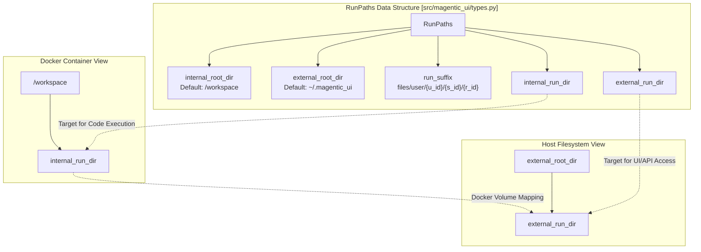
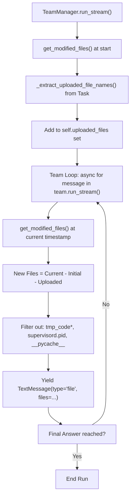
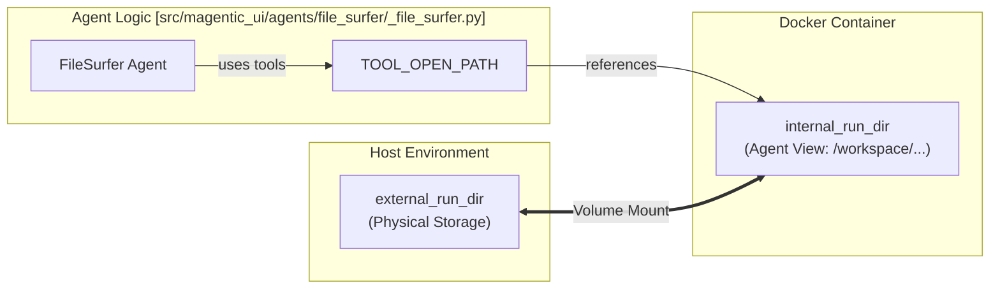

<!-- source: DeepWiki mcp.deepwiki.com · repo microsoft/magentic-ui · page 7.3 File and Workspace Management · fetched 2026-10-26 -->

# File and Workspace Management

<details>
<summary>Relevant source files</summary>

The following files were used as context for generating this wiki page:

- [README.md](README.md)
- [frontend/src/components/views/api.ts](frontend/src/components/views/api.ts)
- [src/magentic_ui/agents/_coder.py](src/magentic_ui/agents/_coder.py)
- [src/magentic_ui/agents/file_surfer/_file_surfer.py](src/magentic_ui/agents/file_surfer/_file_surfer.py)
- [src/magentic_ui/backend/teammanager/teammanager.py](src/magentic_ui/backend/teammanager/teammanager.py)
- [src/magentic_ui/backend/utils/utils.py](src/magentic_ui/backend/utils/utils.py)
- [src/magentic_ui/utils.py](src/magentic_ui/utils.py)
- [uv.lock](uv.lock)

</details>


This document describes how Magentic-UI manages workspaces, file paths, and file tracking across the system. It covers the directory structure for storing user files, the distinction between uploaded and generated files, path resolution for Docker containers, and the mechanisms for detecting and tracking file changes during task execution.

---

## Purpose and Scope

The file and workspace management system is responsible for:

- Creating isolated workspace directories for each user, session, and run. [src/magentic_ui/backend/teammanager/teammanager.py:77-113]()
- Managing path resolution between the host filesystem and Docker containers. [src/magentic_ui/backend/teammanager/teammanager.py:52-66]()
- Tracking uploaded files separately from agent-generated files. [src/magentic_ui/backend/teammanager/teammanager.py:115-166]()
- Detecting newly created files during task execution via timestamp comparisons. [src/magentic_ui/backend/utils/utils.py:207-263]()
- Classifying files by type (code, image, pdf, etc.) for appropriate UI rendering. [src/magentic_ui/backend/utils/utils.py:117-204]()

---

## Workspace Directory Structure

Magentic-UI organizes files in a hierarchical directory structure under the workspace root. Each run gets its own isolated directory to prevent conflicts and enable clean separation of artifacts.

### Directory Hierarchy

```
workspace_root/
└── files/
    └── user/
        └── {user_id}/
            └── {session_id}/
                └── {run_id}/
                    ├── uploaded_file_1.txt
                    ├── uploaded_file_2.png
                    ├── generated_script.py
                    └── output.csv
```

The path structure follows the pattern: `files/user/{user_id}/{session_id}/{run_id}/`. This ensures user isolation and predictable paths for referencing files consistently across the system. [src/magentic_ui/backend/teammanager/teammanager.py:84-95]()

---

## Path Management and RunPaths

The system maintains two distinct path perspectives: **internal paths** (from the Docker container's view) and **external paths** (from the host filesystem's view). The `RunPaths` type encapsulates this dual perspective. [src/magentic_ui/types.py:26-32]()

### RunPaths Data Flow



### Path Resolution Logic

The `prepare_run_paths()` method in `TeamManager` constructs the `RunPaths` object by joining the root directories with the generated `run_suffix`. [src/magentic_ui/backend/teammanager/teammanager.py:77-113]()

1. **Suffix Generation**: Creates `files/user/{user_id}/{session_id}/{run_id}`. [src/magentic_ui/backend/teammanager/teammanager.py:85-91]()
2. **Directory Creation**: If `inside_docker` is True, it creates the `internal_run_dir`. Otherwise, it creates the `external_run_dir`. [src/magentic_ui/backend/teammanager/teammanager.py:102-105]()

---

## File Upload Pipeline

Files uploaded through the frontend are processed to make them available to agents either as embedded content or disk references.

### Upload Processing Logic

The `construct_task()` function handles different file types: [src/magentic_ui/backend/utils/utils.py:12-114]()

- **Images**: Decoded from base64 and added as `Image` objects to a `MultiModalMessage`. [src/magentic_ui/backend/utils/utils.py:48-60]()
- **Text Files**: Decoded from base64 and appended to the message text content. [src/magentic_ui/backend/utils/utils.py:61-72]()
- **Uploaded References**: If the file metadata contains `uploaded: true` and a `path`, it is treated as a reference to a file already on the filesystem. [src/magentic_ui/backend/utils/utils.py:35-47]()

The `TeamManager` then extracts these file names using `_extract_uploaded_file_names()` to ensure they are not flagged as "newly generated" files later in the run. [src/magentic_ui/backend/teammanager/teammanager.py:115-159]()

---

## File Tracking and Detection

Magentic-UI tracks files created or modified during a run to report them as outputs to the user.

### File Tracking Flow



### Exclusion Rules

The `get_modified_files()` function and `run_stream()` logic exclude several types of files to avoid cluttering the UI: [src/magentic_ui/backend/utils/utils.py:207-263]()

- **Python Artifacts**: `__pycache__`, `.pyc`, `__init__.py`.
- **System Files**: `supervisord.pid`, `.cache`.
- **Temporary Code**: Files prefixed with `tmp_code` (generated by the `Coder` agent during execution). [src/magentic_ui/backend/teammanager/teammanager.py:440-445]()

**Sources:** [src/magentic_ui/backend/teammanager/teammanager.py:353-501](), [src/magentic_ui/backend/utils/utils.py:207-263]()

---

## File Type Classification

The system uses `get_file_type()` to determine how to render files in the frontend. [src/magentic_ui/backend/utils/utils.py:117-204]()

| Category | Extensions |
| :--- | :--- |
| **Code** | `.py`, `.js`, `.java`, `.cpp`, `.html`, `.json`, `.yaml`, `.md`, `.sh`, `.sql`, etc. |
| **CSV** | `.csv`, `.xlsx` |
| **Image** | `.png`, `.jpg`, `.jpeg`, `.gif`, `.bmp`, `.svg`, `.webp` |
| **Video** | `.mp4`, `.webm`, `.ogg`, `.mov`, `.avi` |
| **PDF** | `.pdf` |

---

## Docker Volume Mapping

Agents that interact with the filesystem (e.g., `Coder`, `FileSurfer`) use `DockerCommandLineCodeExecutor` or `LocalCommandLineCodeExecutor`.

### Agent Workspace Configuration

When `TeamManager` initializes an agent like `FileSurfer`, it passes the workspace paths: [src/magentic_ui/agents/file_surfer/_file_surfer.py:149-161]()

- **`work_dir`**: Set to the `internal_run_dir` (e.g., `/workspace/files/...`). This is the path the agent uses in its system prompt and tool calls.
- **`bind_dir`**: Set to the `external_run_dir`. This is used by the Docker executor to map the host directory to the container.



**Sources:** [src/magentic_ui/agents/file_surfer/_file_surfer.py:94-161](), [src/magentic_ui/agents/_coder.py:366-416]()

---

## Implementation Details

### TeamManager Path Preparation
The `prepare_run_paths` method is the central authority for workspace creation. It handles the logic for `unknown_user` or `unknown_session` fallbacks if a `Run` object is not provided. [src/magentic_ui/backend/teammanager/teammanager.py:77-113]()

### File Tracking Persistence
The `uploaded_files` set in `TeamManager` persists across the entire conversation. This prevents a file uploaded at the start of a session from being incorrectly identified as a "generated output" in subsequent turns. [src/magentic_ui/backend/teammanager/teammanager.py:68-69](), [src/magentic_ui/backend/teammanager/teammanager.py:161-166]()

**Sources:** [src/magentic_ui/backend/teammanager/teammanager.py:1-166](), [src/magentic_ui/backend/utils/utils.py:1-263](), [src/magentic_ui/types.py:26-32]()

---

