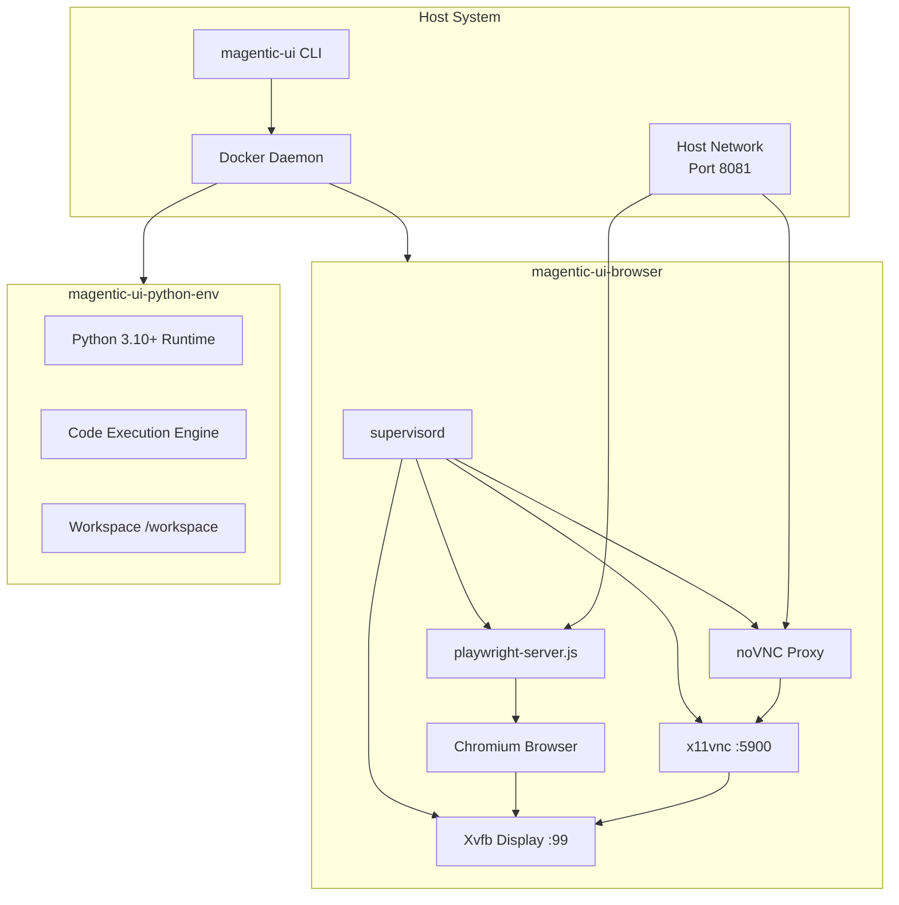
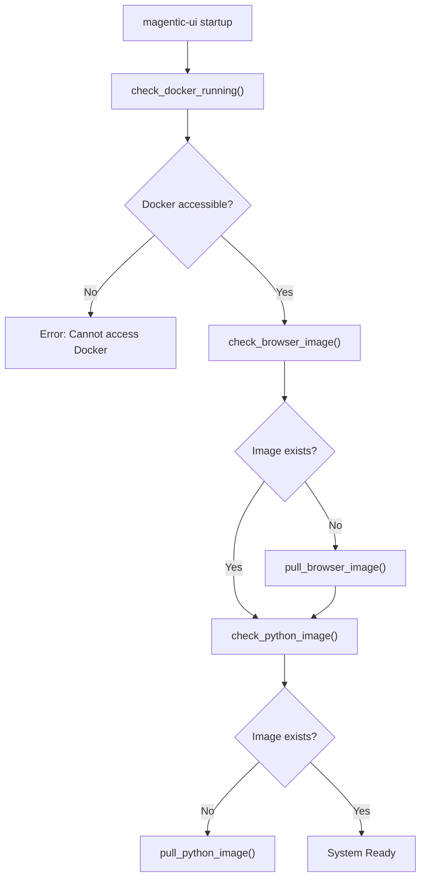

<!-- source: DeepWiki mcp.deepwiki.com · repo microsoft/magentic-ui · page 8 Docker and Deployment · fetched 2026-10-26 -->

# Docker and Deployment

<details>
<summary>Relevant source files</summary>

The following files were used as context for generating this wiki page:

- [.github/workflows/docker-build-push.yml](.github/workflows/docker-build-push.yml)
- [TROUBLESHOOTING.md](TROUBLESHOOTING.md)
- [docker/magentic-ui-browser-docker/build.sh](docker/magentic-ui-browser-docker/build.sh)
- [docker/magentic-ui-browser-docker/playwright-server.js](docker/magentic-ui-browser-docker/playwright-server.js)
- [docker/magentic-ui-browser-docker/supervisord.conf](docker/magentic-ui-browser-docker/supervisord.conf)
- [docker/magentic-ui-browser-docker/x11-setup.sh](docker/magentic-ui-browser-docker/x11-setup.sh)
- [fara_config.yaml](fara_config.yaml)
- [src/magentic_ui/_docker.py](src/magentic_ui/_docker.py)
- [src/magentic_ui/agents/__init__.py](src/magentic_ui/agents/__init__.py)
- [src/magentic_ui/agents/web_surfer/__init__.py](src/magentic_ui/agents/web_surfer/__init__.py)
- [src/magentic_ui/eval/README.md](src/magentic_ui/eval/README.md)

</details>


This document explains Docker integration, container management, and deployment considerations for Magentic-UI. Docker provides isolated execution environments for browser automation (via Playwright) and Python code execution. The system supports both Docker-based and Docker-free deployment modes through the `--run-without-docker` flag.

## Docker Architecture Overview

Magentic-UI uses Docker containers to provide isolated, reproducible execution environments. The system employs two primary container types managed via the `docker` Python SDK [src/magentic_ui/_docker.py:4]().

1.  **Browser Container**: Runs Playwright with a VNC-accessible display for the `WebSurfer` agent [docker/magentic-ui-browser-docker/supervisord.conf:53-63]().
2.  **Python Execution Container**: Provides an isolated Python environment for the `CoderAgent` and `FileSurfer` agents [src/magentic_ui/_docker.py:14-16]().

### Container Architecture

The system uses `supervisord` inside the browser container to manage multiple processes required for visual automation.



**Container Image Sources:**
The default images are hosted on GitHub Container Registry (GHCR):
*   Browser: `ghcr.io/microsoft/magentic-ui-browser:0.0.2` [src/magentic_ui/_docker.py:12]()
*   Python: `ghcr.io/microsoft/magentic-ui-python-env:0.0.1` [src/magentic_ui/_docker.py:15]()

Sources: [src/magentic_ui/_docker.py:10-16](), [docker/magentic-ui-browser-docker/supervisord.conf:1-63](), [docker/magentic-ui-browser-docker/playwright-server.js:1-39]()

### Docker Image Management

The system performs automated checks to ensure the environment is ready.

**Docker Startup Flow**



**Image Management Logic:**
*   `check_docker_access()` verifies the daemon is reachable via `client.ping()` [src/magentic_ui/_docker.py:54-63]().
*   `pull_browser_image()` and `pull_python_image()` use the Docker SDK to fetch images from GHCR [src/magentic_ui/_docker.py:42-52]().
*   Image names and versions can be overridden using `MAGENTIC_UI_BROWSER_IMAGE` and `MAGENTIC_UI_PYTHON_IMAGE` environment variables [src/magentic_ui/_docker.py:7-16]().

Sources: [src/magentic_ui/_docker.py:19-78]()

## Deployment Scenarios

### Standard Deployment (With Docker)
This is the recommended mode. It ensures that the `CoderAgent` can safely execute generated code in a sandbox and `WebSurfer` has a consistent browser environment.

For details, see [Docker Environment Setup](#8.1).

### Docker-Free Deployment
If Docker is unavailable, the system can run with the `--run-without-docker` flag.
*   **Limitations**: `CoderAgent` and `FileSurfer` are typically disabled or restricted because they rely on the sandbox for safety.
*   **Browser**: Playwright will attempt to run on the host machine's local browser instance.

For details, see [Browser and Code Execution Containers](#8.2).

### Troubleshooting Common Issues
Deployment often encounters issues with Docker socket permissions, port conflicts (specifically 8081), or WSL2 configuration on Windows.

**Common Port Mappings:**
*   `8081`: Web UI [TROUBLESHOOTING.md:31-39]()
*   `5900`: VNC [docker/magentic-ui-browser-docker/supervisord.conf:37]()
*   `37367`: Playwright Server [docker/magentic-ui-browser-docker/playwright-server.js:4]()

For details, see [Troubleshooting](#8.3).

Sources: [TROUBLESHOOTING.md:1-134]()

## Platform Compatibility

| OS | Docker Requirement | Notes |
| :--- | :--- | :--- |
| **Windows** | Docker Desktop + WSL2 | Ensure WSL integration is enabled in Docker settings [TROUBLESHOOTING.md:55-65](). |
| **Linux** | Docker Engine | User must be in the `docker` group to avoid `sudo` requirements [TROUBLESHOOTING.md:26-29](). |
| **macOS** | Docker Desktop / Colima | May require setting `DOCKER_HOST` environment variable [TROUBLESHOOTING.md:17-21](). |

**Important**: Podman is currently **not supported** [TROUBLESHOOTING.md:6-15]().

Sources: [TROUBLESHOOTING.md:6-81]()

## Manual Image Building
Developers can build the images manually using the provided scripts in the `docker/` directory.

```bash
# Example for browser image
cd docker/magentic-ui-browser-docker
./build.sh
```

The build scripts use `docker buildx` to support multi-platform builds (`linux/amd64`, `linux/arm64`) [docker/magentic-ui-browser-docker/build.sh:16-21]().

Sources: [docker/magentic-ui-browser-docker/build.sh:1-22](), [.github/workflows/docker-build-push.yml:47-61]()

---

