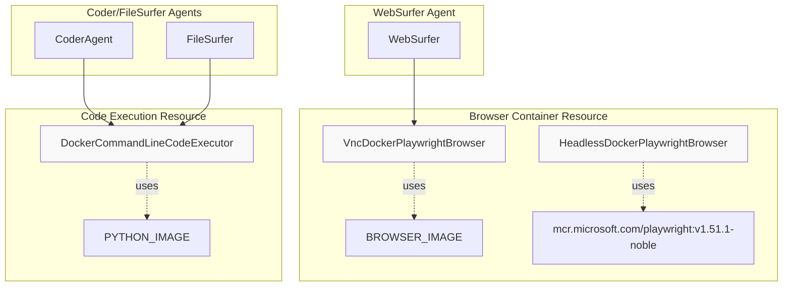
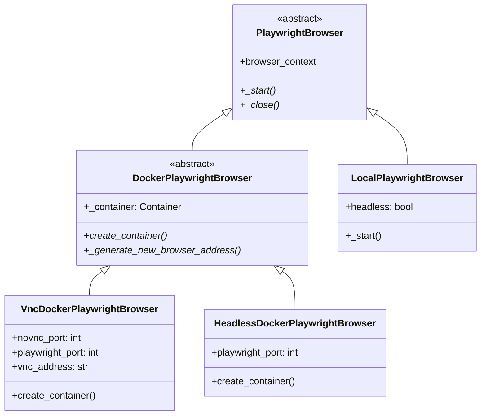
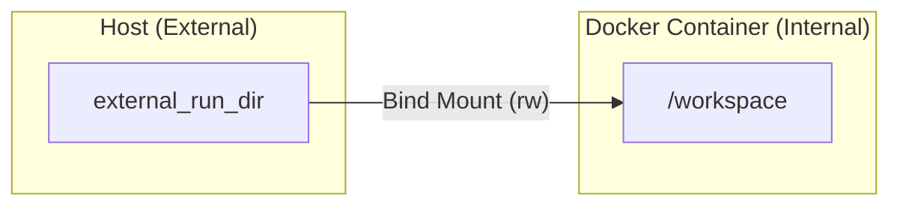
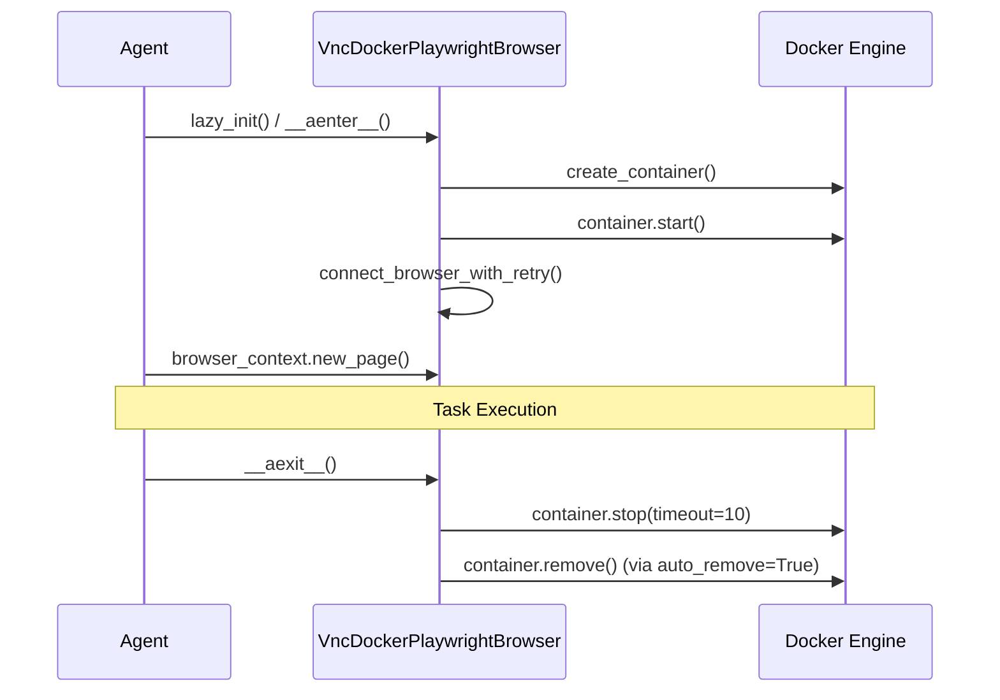

<!-- source: DeepWiki mcp.deepwiki.com · repo microsoft/magentic-ui · page 8.2 Browser and Code Execution Containers · fetched 2026-10-26 -->

# Browser and Code Execution Containers

<details>
<summary>Relevant source files</summary>

The following files were used as context for generating this wiki page:

- [src/magentic_ui/tools/playwright/browser/base_playwright_browser.py](src/magentic_ui/tools/playwright/browser/base_playwright_browser.py)
- [src/magentic_ui/tools/playwright/browser/headless_docker_playwright_browser.py](src/magentic_ui/tools/playwright/browser/headless_docker_playwright_browser.py)
- [src/magentic_ui/tools/playwright/browser/local_playwright_browser.py](src/magentic_ui/tools/playwright/browser/local_playwright_browser.py)
- [src/magentic_ui/tools/playwright/browser/vnc_docker_playwright_browser.py](src/magentic_ui/tools/playwright/browser/vnc_docker_playwright_browser.py)

</details>


## Purpose and Scope

This document describes the Docker container infrastructure used by Magentic-UI for isolated browser automation and code execution. It covers the two primary container types: the **browser container** with Playwright and noVNC for web automation, and the **Python execution container** for running agent-generated code. For general Docker installation and setup, see [8.1 Docker Environment Setup](). For container troubleshooting, see [8.3 Troubleshooting]().

---

## Container Architecture Overview

Magentic-UI uses distinct Docker container types to provide isolated execution environments. The system leverages `autogen_core.Component` to manage these resources as modular units.

### Natural Language to Code Entity Mapping: Containers

The following diagram bridges the conceptual "Containers" with the specific Python classes and images used in the codebase.



**Sources:** [src/magentic_ui/tools/playwright/browser/vnc_docker_playwright_browser.py:36-38](), [src/magentic_ui/tools/playwright/browser/headless_docker_playwright_browser.py:38-40](), [src/magentic_ui/agents/_coder.py:406-416](), [src/magentic_ui/agents/file_surfer/_file_surfer.py:189-198]()

---

## Browser Container Implementation

The system supports multiple browser backend implementations through an inheritance hierarchy based on `PlaywrightBrowser` and `DockerPlaywrightBrowser`.

### Browser Class Hierarchy



**Sources:** [src/magentic_ui/tools/playwright/browser/base_playwright_browser.py:41-43](), [src/magentic_ui/tools/playwright/browser/base_playwright_browser.py:103-103](), [src/magentic_ui/tools/playwright/browser/vnc_docker_playwright_browser.py:36-38](), [src/magentic_ui/tools/playwright/browser/headless_docker_playwright_browser.py:38-40](), [src/magentic_ui/tools/playwright/browser/local_playwright_browser.py:31-33]()

### VncDockerPlaywrightBrowser

This is the primary container used in the Web UI. It provides both programmatic control and a visual noVNC interface.

| Feature | Implementation Detail | Source |
| :--- | :--- | :--- |
| **Base Image** | Defined by `BROWSER_IMAGE` constant | [src/magentic_ui/tools/playwright/browser/vnc_docker_playwright_browser.py:15]() |
| **Ports** | Default Playwright: `37367`, noVNC: `6080` | [src/magentic_ui/tools/playwright/browser/vnc_docker_playwright_browser.py:29-30]() |
| **Workspace** | Binds host `bind_dir` to `/workspace` in container | [src/magentic_ui/tools/playwright/browser/vnc_docker_playwright_browser.py:175-177]() |
| **Networking** | Joins `network_name` (default: `my-network`) | [src/magentic_ui/tools/playwright/browser/vnc_docker_playwright_browser.py:33]() |

#### Connection Logic

The `DockerPlaywrightBrowser` base class implements a robust connection loop in `_start()`:
1. Calls `create_container()` to define the Docker instance [src/magentic_ui/tools/playwright/browser/base_playwright_browser.py:169]().
2. Attempts to start the container, retrying up to 3 times on `DockerException` [src/magentic_ui/tools/playwright/browser/base_playwright_browser.py:173-184]().
3. If a port conflict occurs, `_generate_new_browser_address()` is called to find available local ports [src/magentic_ui/tools/playwright/browser/vnc_docker_playwright_browser.py:111-125]().
4. Uses `connect_browser_with_retry()` to establish the WebSocket connection to the Playwright server [src/magentic_ui/tools/playwright/browser/base_playwright_browser.py:190-192]().

### HeadlessDockerPlaywrightBrowser

A lighter implementation using the official Playwright image (`mcr.microsoft.com/playwright:v1.51.1-noble`) without VNC support. It runs the server via `npx playwright run-server` [src/magentic_ui/tools/playwright/browser/headless_docker_playwright_browser.py:135-139]().

---

## Python Execution Container

The Python execution container provides an isolated environment for executing agent-generated code via the `DockerCommandLineCodeExecutor`.

### DockerCommandLineCodeExecutor Configuration

The executor is used by both `CoderAgent` and `FileSurfer`. It is configured to use the `PYTHON_IMAGE` defined in the system's Docker constants.

| Parameter | CoderAgent Usage | FileSurfer Usage |
| :--- | :--- | :--- |
| **Image** | `PYTHON_IMAGE` | `PYTHON_IMAGE` |
| **Container Name** | `{name}-{uuid.uuid4()}` | `{name}-{uuid.uuid4()}` |
| **Work Dir** | Internal `self._work_dir` | Internal `work_dir` |
| **Bind Dir** | Host `bind_dir` | Host `bind_dir` |

**Sources:** [src/magentic_ui/agents/_coder.py:409-416](), [src/magentic_ui/agents/file_surfer/_file_surfer.py:191-198]()

### Workspace and Volume Mapping

The `TeamManager` prepares the directory structure before the container starts. It maps an external host directory to the container's internal workspace.



**Sources:** [src/magentic_ui/backend/teammanager/teammanager.py:77-113](), [src/magentic_ui/tools/playwright/browser/vnc_docker_playwright_browser.py:175-177]()

---

## Networking and Port Management

To prevent collisions in multi-session environments, Magentic-UI uses dynamic port discovery.

### Port Discovery Mechanism

The system uses `socket.bind(("127.0.0.1", 0))` to find available ports on the host.

[src/magentic_ui/tools/playwright/browser/vnc_docker_playwright_browser.py:104-108]()
```python
def _get_available_port(self) -> tuple[int, socket.socket]:
    s = socket.socket(socket.AF_INET, socket.SOCK_STREAM)
    s.bind(("127.0.0.1", 0))
    port = s.getsockname()[1]
    return port, s
```

### Addressing Logic

The `browser_address` property determines how the agent connects to the container based on whether the agent itself is running inside a Docker network.

- **Inside Docker:** Connects via the container name/hostname [src/magentic_ui/tools/playwright/browser/vnc_docker_playwright_browser.py:97-101]().
- **Outside Docker:** Connects via `127.0.0.1` and mapped ports [src/magentic_ui/tools/playwright/browser/vnc_docker_playwright_browser.py:100]().

---

## Resource Lifecycle Management

Containers are managed using an asynchronous context manager pattern (`__aenter__` / `__aexit__`) to ensure proper cleanup.

### Lifecycle Flow



**Sources:** [src/magentic_ui/tools/playwright/browser/base_playwright_browser.py:74-82](), [src/magentic_ui/tools/playwright/browser/base_playwright_browser.py:146-161](), [src/magentic_ui/tools/playwright/browser/vnc_docker_playwright_browser.py:169]()

### Cleanup Implementation

The `_close()` method in `DockerPlaywrightBrowser` ensures that the Playwright library, the browser connection, and the Docker container are all terminated.

[src/magentic_ui/tools/playwright/browser/base_playwright_browser.py:146-161]()
```python
async def _close(self) -> None:
    if self._context:
        await self._context.close()
    if self._browser:
        await self._browser.close()
    if self._playwright:
        await self._playwright.stop()
    self._close_container()
```

**Sources:** [src/magentic_ui/tools/playwright/browser/base_playwright_browser.py:141-161]()

---

