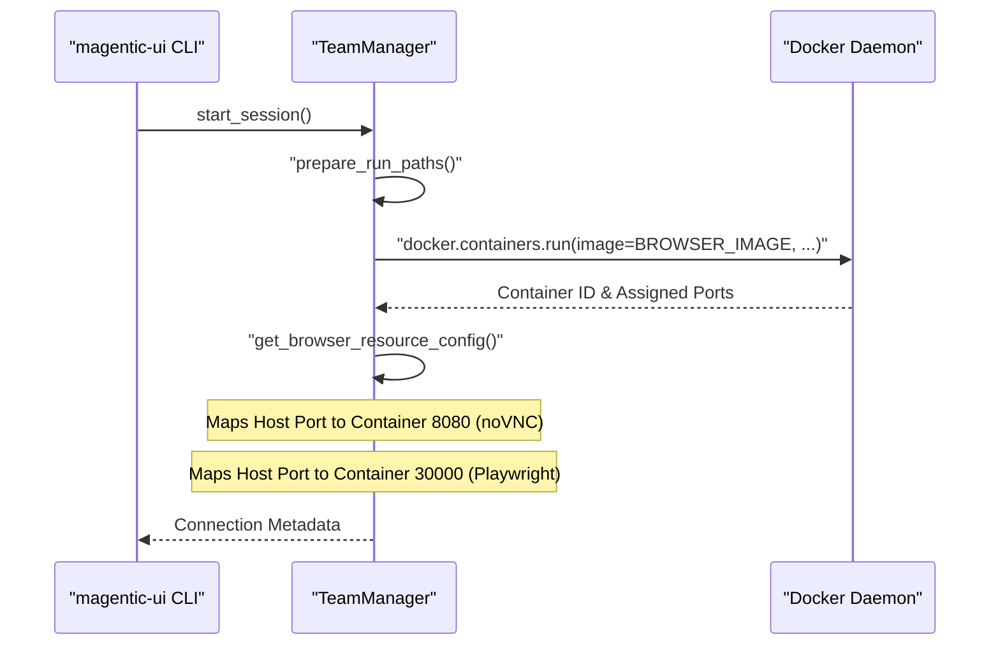
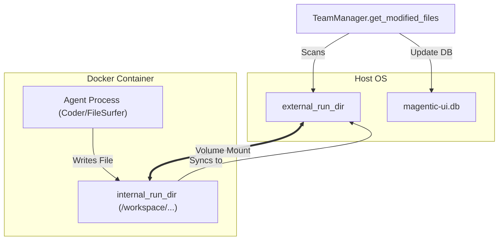

<!-- source: DeepWiki mcp.deepwiki.com · repo microsoft/magentic-ui · page 8.3 Troubleshooting · fetched 2026-10-26 -->

# Troubleshooting

<details>
<summary>Relevant source files</summary>

The following files were used as context for generating this wiki page:

- [TROUBLESHOOTING.md](TROUBLESHOOTING.md)
- [src/magentic_ui/_docker.py](src/magentic_ui/_docker.py)
- [src/magentic_ui/eval/README.md](src/magentic_ui/eval/README.md)

</details>


This page provides technical solutions for common issues encountered when deploying and running Magentic-UI, specifically focusing on Docker environments, networking, and filesystem integration.

## Docker Connectivity and Initialization

Magentic-UI relies on the `docker` Python SDK to manage the lifecycle of browser and code execution containers. The system performs health checks on the Docker daemon before attempting to provision resources.

### Docker Daemon Not Detected
**Symptoms:**
- CLI Error: `Checking if Docker is running...Failed` [[TROUBLESHOOTING.md:8-10]]()
- Backend logs: `Error: Cannot access Docker.` [[src/magentic_ui/_docker.py:60-61]]()

**Technical Implementation:**
The function `check_docker_running` in `_docker.py` attempts to instantiate a client using `docker.from_env()` and calls `client.ping()`. If a `DockerException` or `ConnectionError` is caught, the system assumes the daemon is unreachable [[src/magentic_ui/_docker.py:19-25]]().

**Solutions:**
*   **Linux/Ubuntu:** Ensure your user is in the `docker` group to avoid permission issues with `/var/run/docker.sock` [[TROUBLESHOOTING.md:26-29]]().
*   **macOS (Colima/Docker Desktop):** If the socket is in a non-standard location, set the `DOCKER_HOST` environment variable:
    ```bash
    export DOCKER_HOST=unix:///home/<your-username>/.docker/desktop/docker.sock
    ```
    [[TROUBLESHOOTING.md:17-22]]()
*   **Windows (WSL2):** Ensure Docker Desktop is configured for WSL2 integration in **Settings > Resources > WSL Integration** [[TROUBLESHOOTING.md:61-64]]().

### Image Pull and Management
The system uses specific images for its agents:
*   **Browser Image:** `ghcr.io/microsoft/magentic-ui-browser:0.0.2` [[src/magentic_ui/_docker.py:11-13]]()
*   **Python Image:** `ghcr.io/microsoft/magentic-ui-python-env:0.0.1` [[src/magentic_ui/_docker.py:14-16]]()

If automatic pulling fails due to network restrictions, images can be built manually:
```bash
cd docker
sh build-all.sh
```
[[TROUBLESHOOTING.md:49-53]]()

**Sources:** [src/magentic_ui/_docker.py:1-78](), [TROUBLESHOOTING.md:6-30](), [TROUBLESHOOTING.md:40-54]()

---

## Network and Port Conflicts

Magentic-UI requires several open ports for the web interface and agent communication.

### UI Port Conflict
By default, the UI attempts to bind to port `8081`. If this fails with `Address already in use`, use the `--port` flag to specify an alternative [[TROUBLESHOOTING.md:31-39]]().

### Container Port Mapping Flow
When a task run starts, the `TeamManager` coordinates with the Docker host to map dynamic ports for the browser container (noVNC and Playwright) [[src/magentic_ui/backend/teammanager/teammanager.py:186-191]]().

**Port Assignment Architecture:**



**Sources:** [TROUBLESHOOTING.md:31-39](), [src/magentic_ui/backend/teammanager/teammanager.py:186-191]()

---

## Volume Mapping and Permissions

The synchronization of files between the host and the agent containers is a common failure point.

### Workspace Path Discrepancy
Magentic-UI distinguishes between `internal_workspace_root` (inside container) and `external_workspace_root` (on host) [[src/magentic_ui/backend/teammanager/teammanager.py:77-113]]().

**Data Flow for File Persistence:**



### Permission Denied (Linux)
Files created inside the Docker container may be owned by `root`. If the host user cannot read them, run:
```bash
sudo chown -R $USER:$USER ~/.magentic-ui/
```
[[TROUBLESHOOTING.md:26-29]]()

**Sources:** [src/magentic_ui/backend/teammanager/teammanager.py:77-113](), [src/magentic_ui/backend/teammanager/teammanager.py:376-411]()

---

## Application and Agent Issues

### "Magentic" Command Not Found
This typically occurs if the Python virtual environment is not active or if the wrong package was installed.
*   **Verification:** Ensure `pip install magentic-ui` was used, not `pip install magentic` [[TROUBLESHOOTING.md:111-118]]().
*   **Fix:** Reactivate the environment:
    ```bash
    source .venv/bin/activate
    ```
    [[TROUBLESHOOTING.md:100-110]]()

### Browser Unresponsive
If the UI loads but the browser window is blank:
1. Verify containers are running: `docker ps` [[TROUBLESHOOTING.md:73]]().
2. Check if the browser image version matches the expected `0.0.2` tag in `_docker.py` [[src/magentic_ui/_docker.py:12]]().
3. Ensure no firewall is blocking the high-range dynamic ports used for noVNC [[TROUBLESHOOTING.md:74]]().

### Code Execution Failures
If the `CoderAgent` fails to run code:
*   Verify the `PYTHON_IMAGE` is present: `ghcr.io/microsoft/magentic-ui-python-env:0.0.1` [[src/magentic_ui/_docker.py:15]]().
*   Check if `--run-without-docker` was accidentally used, which disables the `CoderAgent` capabilities [[src/magentic_ui/backend/teammanager/teammanager.py:304-312]]().

**Sources:** [TROUBLESHOOTING.md:67-76](), [TROUBLESHOOTING.md:91-118](), [src/magentic_ui/_docker.py:11-16](), [src/magentic_ui/backend/teammanager/teammanager.py:304-312]()

---

