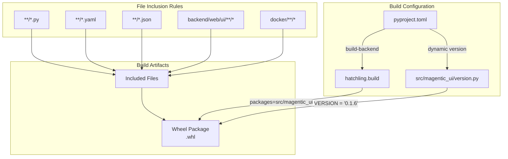
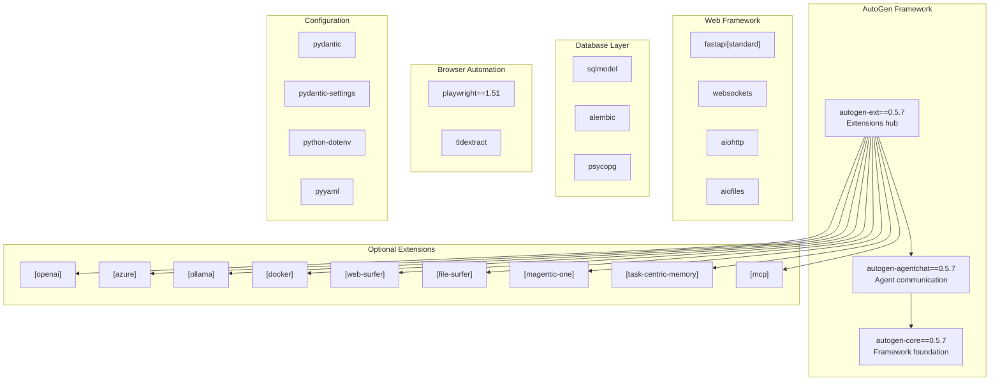
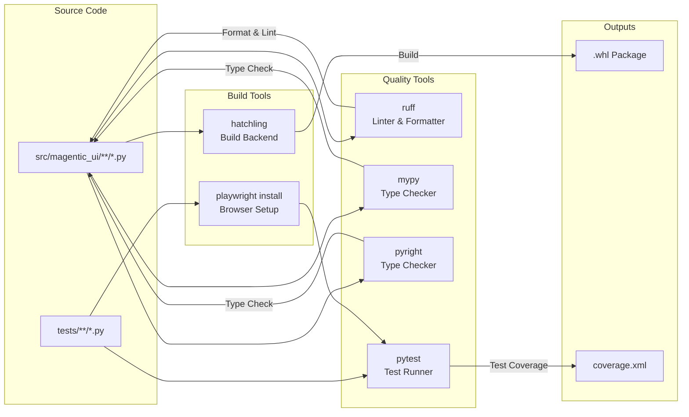
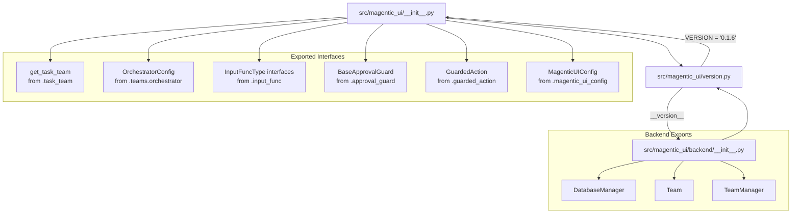

<!-- source: DeepWiki mcp.deepwiki.com · repo microsoft/magentic-ui · page 9 Development · fetched 2026-10-26 -->

# Development

<details>
<summary>Relevant source files</summary>

The following files were used as context for generating this wiki page:

- [.github/workflows/checks.yaml](.github/workflows/checks.yaml)
- [.gitignore](.gitignore)
- [CONTRIBUTING.md](CONTRIBUTING.md)
- [pyproject.toml](pyproject.toml)
- [src/magentic_ui/__init__.py](src/magentic_ui/__init__.py)
- [src/magentic_ui/backend/__init__.py](src/magentic_ui/backend/__init__.py)
- [src/magentic_ui/eval/benchmarks/custom/custom.py](src/magentic_ui/eval/benchmarks/custom/custom.py)
- [src/magentic_ui/teams/roundrobin_orchestrator.py](src/magentic_ui/teams/roundrobin_orchestrator.py)
- [src/magentic_ui/version.py](src/magentic_ui/version.py)

</details>


This document provides guidance for developers contributing to Magentic-UI, covering package organization, build configuration, dependency management, and development workflows. For information about runtime architecture and agent orchestration, see [System Architecture](#2). For deployment instructions, see [Docker and Deployment](#8).

---

## Package Organization

### Directory Structure

The Magentic-UI codebase is organized as a monorepo containing both the Python backend and React frontend:

```
magentic-ui/
├── src/magentic_ui/          # Python package root
│   ├── __init__.py           # Public API exports
│   ├── version.py            # Version management
│   ├── agents/               # Specialized agent implementations
│   ├── backend/              # FastAPI server, database, WebSocket
│   │   ├── cli.py           # Web server entry point
│   │   ├── database/        # SQLModel schemas and migrations
│   │   ├── datamodel/       # Core data models
│   │   ├── teammanager.py   # Agent team lifecycle management
│   │   └── web/             # REST API and WebSocket routes
│   │       └── ui/          # Built frontend assets (generated)
│   ├── teams/               # Team configurations and orchestration
│   ├── tools/               # Playwright controller, Docker utilities
│   ├── docker/              # Docker configurations
│   └── _cli.py             # Direct CLI entry point
├── frontend/                # React/TypeScript UI
│   ├── src/
│   │   ├── components/     # React components
│   │   └── types/          # TypeScript type definitions
│   └── package.json
├── pyproject.toml          # Python package configuration
└── uv.lock                 # Locked dependencies
```

**Sources:** [pyproject.toml:150-171](), [src/magentic_ui/__init__.py:1-33](), [src/magentic_ui/backend/__init__.py:1-7]()

### Package Exports

The main package exports public APIs through `src/magentic_ui/__init__.py`:

| Export | Purpose |
|--------|---------|
| `get_task_team` | Factory function for creating agent teams |
| `OrchestratorConfig` | Configuration for orchestrator agent |
| `AsyncInputFunc`, `SyncInputFunc` | Input handling interfaces |
| `BaseApprovalGuard`, `GuardedAction` | Approval mechanism components |
| `MagenticUIConfig`, `ModelClientConfigs` | Configuration data classes |
| `__version__` | Package version string |

**Sources:** [src/magentic_ui/__init__.py:1-33]()

---

## Build System Configuration

### Hatchling Build Backend

Magentic-UI uses **hatchling** as its build backend, configured in `pyproject.toml`:



**Sources:** [pyproject.toml:1-11](), [pyproject.toml:150-171](), [src/magentic_ui/version.py:1-4]()

### Dynamic Versioning

The package version is dynamically read from `src/magentic_ui/version.py` at build time using hatchling's version plugin. This ensures a single source of truth for version information.

**Sources:** [pyproject.toml:154-155](), [src/magentic_ui/version.py:1-4]()

### CLI Entry Points

Three command-line interfaces are registered as console scripts:

| Script Name | Module Path | Purpose |
|-------------|-------------|---------|
| `magentic` | `magentic_ui.backend.cli:run` | Start web server (primary interface) |
| `magentic-ui` | `magentic_ui.backend.cli:run` | Start web server (alias) |
| `magentic-cli` | `magentic_ui._cli:main` | Direct task execution without web UI |

**Sources:** [pyproject.toml:82-85]()

---

## Dependency Management

### Core Dependencies Architecture



**Sources:** [pyproject.toml:27-51]()

### Required Dependencies

All installations include these dependencies:

**AutoGen Framework:**
- `autogen-core==0.5.7` - Core agent runtime and event system
- `autogen-agentchat==0.5.7` - Multi-agent conversation patterns
- `autogen-ext[openai,docker,file-surfer,web-surfer,magentic-one,task-centric-memory,mcp]==0.5.7` - Extension features

**Web Infrastructure:**
- `fastapi[standard]` - REST API server with WebSocket support
- `websockets` - WebSocket protocol implementation
- `aiohttp` - Async HTTP client for external services
- `aiofiles` - Async file I/O operations

**Database:**
- `sqlmodel` - ORM with Pydantic integration
- `alembic` - Database migration framework
- `psycopg` - PostgreSQL adapter (also works with SQLite)

**Browser Automation:**
- `playwright==1.51` - Chromium control for WebSurfer agent
- `tldextract` - URL parsing and domain extraction

**Configuration & Utilities:**
- `pydantic`, `pydantic-settings` - Data validation and settings management
- `python-dotenv` - Environment variable loading
- `pyyaml` - YAML configuration parsing
- `typer` - CLI framework
- `loguru` - Structured logging
- `docker` - Docker container management
- `html2text` - HTML content extraction
- `psutil` - System resource monitoring
- `nest_asyncio` - Nested event loop support
- `aioconsole` - Async console I/O

**Sources:** [pyproject.toml:27-51]()

### Optional Feature Dependencies

Install with pip extras syntax (e.g., `pip install magentic_ui[azure,ollama]`):

| Extra | Dependencies | Purpose |
|-------|-------------|---------|
| `azure` | `autogen-ext[azure]==0.5.7` | Azure OpenAI API integration |
| `ollama` | `autogen-ext[ollama]==0.5.7` | Ollama local LLM support |
| `eval` | `huggingface_hub`, `pandas`, `scipy` | Evaluation benchmarks |
| `fara` | `pillow`, `tenacity`, `browserbase`, `vllm>=0.10.0` | Advanced browser automation features |

**Sources:** [pyproject.toml:58-80]()

### Development Dependencies

Development tools are managed separately in `[tool.uv.dev-dependencies]`:

**Type Checking:**
- `pyright==1.1.401` - Microsoft's static type checker
- `mypy==1.13.0` - Python type checker
- `types-aiofiles`, `types-docker`, `types-PyYaml` - Type stubs

**Code Quality:**
- `ruff==0.4.8` - Fast linter and formatter (replaces black, flake8, isort)

**Testing:**
- `pytest` - Test framework
- `pytest_asyncio` - Async test support
- `pytest-cov` - Coverage reporting

**Documentation:**
- `sphinx` - Documentation generator
- `sphinx-autodoc-typehints` - Type hint documentation
- `sphinx_rtd_theme` - ReadTheDocs theme

**Task Management:**
- `poethepoet` - Task runner

**Sources:** [pyproject.toml:88-102]()

---

## Development Workflows

### Task Runner (Poe the Poet)

The project uses **poethepoet** for task automation. Common development tasks:

| Task | Command | Description |
|------|---------|-------------|
| Format | `poe fmt` | Format code with `ruff format src tests samples` |
| Lint | `poe lint` | Lint code with `ruff check src` |
| Type Check (mypy) | `poe mypy` | Run mypy on `src` |
| Type Check (pyright) | `poe pyright` | Run pyright on `src` |
| Test | `poe test` | Install Playwright, run pytest with coverage |
| Check All | `poe check` | Run fmt, lint, pyright, and test sequentially |

**Sources:** [pyproject.toml:110-122]()

### Code Quality Configuration

#### Ruff Configuration

```toml
[tool.ruff]
exclude = ["src/benchmarks/assistantbench"]
```

Ruff provides fast linting and formatting with sensible defaults. It replaces multiple tools (black, flake8, isort, pyupgrade) with a single Rust-based implementation.

**Sources:** [pyproject.toml:104-105]()

#### Mypy Configuration

```toml
[tool.mypy]
strict = true
python_version = "3.11"
ignore_missing_imports = true
disallow_untyped_defs = true
no_implicit_optional = true
check_untyped_defs = true
warn_return_any = true
show_error_codes = true
warn_unused_ignores = false
disallow_incomplete_defs = true
disallow_untyped_decorators = true
disallow_any_unimported = true
exclude = ["src/magentic_ui/eval"]
```

Strict mode ensures high type safety standards across the codebase. The configuration excludes evaluation benchmarks that may have looser type requirements.

**Sources:** [pyproject.toml:124-140]()

#### Pyright Configuration

```toml
[tool.pyright]
include = ["src", "tests", "samples"]
exclude = [
    "src/magentic_ui/eval/benchmarks/assistantbench/evaluate_utils",
    "src/magentic_ui/agents/web_surfer/_cua_web_surfer.py",
    "src/magentic_ui/backend/web/routes",
    "src/magentic_ui/agents/web_surfer/fara",
    "src/magentic_ui/tools/playwright/playwright_controller_fara.py"
]
typeCheckingMode = "strict"
reportUnnecessaryIsInstance = false
reportMissingTypeStubs = false
```

Pyright provides faster type checking than mypy and is used for CI validation. The exclusion list contains experimental features and external evaluation utilities.

**Sources:** [pyproject.toml:142-147]()

### Testing Configuration

The test task uses a custom environment and sequence:

```toml
[tool.poe.tasks]
test.env = { PYTHONPATH = "src" }
test.sequence = [
    "playwright install",
    "pytest -m \"not npx\" tests --cov=src --cov-report=xml --cov-report=term-missing",
]
test.default_item_type = "cmd"
```

**Test Workflow:**
1. Set `PYTHONPATH` to include `src` directory
2. Install Playwright browsers
3. Run pytest excluding NPX-dependent tests
4. Generate coverage reports in XML and terminal formats

**Sources:** [pyproject.toml:116-121]()

---

## Evaluation Framework

Magentic-UI includes a built-in evaluation system for benchmarking agent performance across various datasets.

### Benchmark Support
The framework supports several standard benchmarks:
- **GAIA**: General AI Assistants benchmark
- **WebVoyager**: Browser automation tasks
- **AssistantBench**: Real-world assistant tasks
- **GPQA/SimpleQA**: Reasoning and fact-checking

### Custom Benchmarks
Developers can implement the `Benchmark` abstract class to add new evaluation sets. The `CustomBenchmark` class provides a reference implementation for loading tasks from CSV or pandas DataFrames.

```python
class CustomBenchmark(Benchmark):
    def load_dataset(self):
        # Implementation for loading CSV/DataFrame into self.tasks
        ...

    def evaluator(self, task: AllTaskTypes, candidate: AllCandidateTypes) -> AllEvalResultTypes:
        # Implementation for scoring results (e.g., LCS for URLs, LLM for answers)
        ...
```

For details, see [Evaluation Framework](#9.3).

**Sources:** [src/magentic_ui/eval/benchmarks/custom/custom.py:18-180]()

---

## Code-to-Concept Mapping

### Development Tool Chain



**Sources:** [pyproject.toml:110-122](), [pyproject.toml:1-11]()

### Package Initialization Flow



**Sources:** [src/magentic_ui/__init__.py:1-33](), [src/magentic_ui/backend/__init__.py:1-7](), [src/magentic_ui/version.py:1-4]()

---

## Subsection Preview

For detailed information about specific development topics:
- **Package Structure and Dependencies** - See [Package Structure and Dependencies](#9.1)
- **State Management and Persistence** - See [State Management and Persistence](#9.2)
- **Evaluation Framework** - See [Evaluation Framework](#9.3)

---

