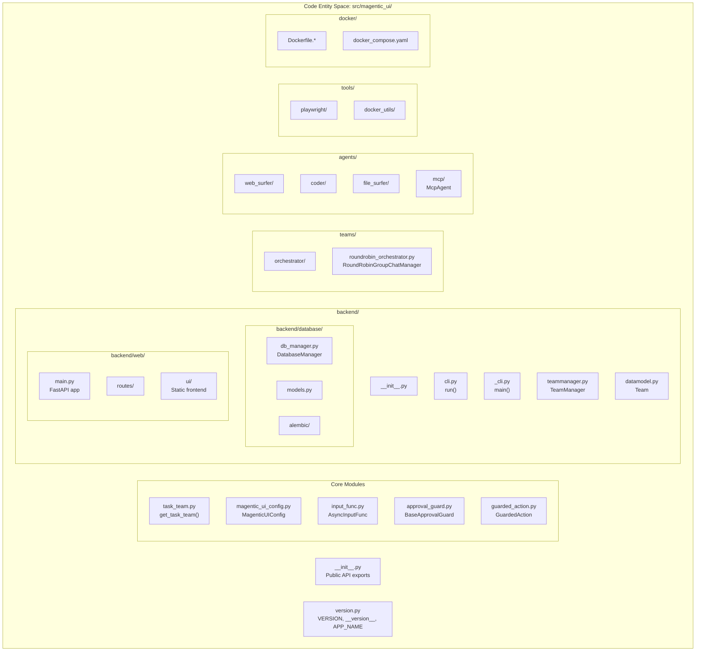
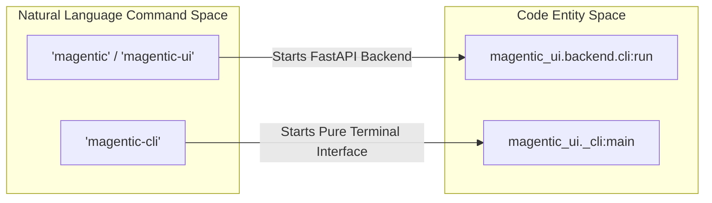
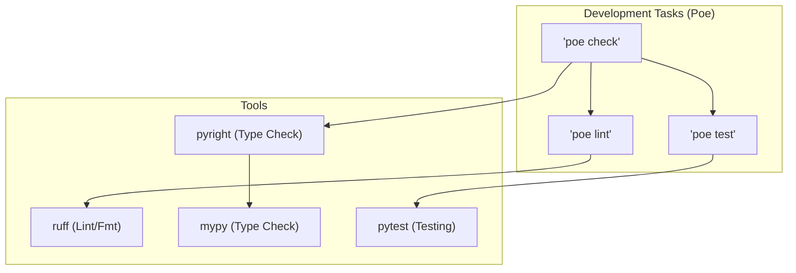

<!-- source: DeepWiki mcp.deepwiki.com · repo microsoft/magentic-ui · page 9.1 Package Structure and Dependencies · fetched 2026-10-26 -->

# Package Structure and Dependencies

<details>
<summary>Relevant source files</summary>

The following files were used as context for generating this wiki page:

- [.github/workflows/checks.yaml](.github/workflows/checks.yaml)
- [.gitignore](.gitignore)
- [CONTRIBUTING.md](CONTRIBUTING.md)
- [pyproject.toml](pyproject.toml)
- [pytest.ini](pytest.ini)
- [src/magentic_ui/__init__.py](src/magentic_ui/__init__.py)
- [src/magentic_ui/agents/mcp/__init__.py](src/magentic_ui/agents/mcp/__init__.py)
- [src/magentic_ui/backend/__init__.py](src/magentic_ui/backend/__init__.py)
- [src/magentic_ui/cli/__init__.py](src/magentic_ui/cli/__init__.py)
- [src/magentic_ui/eval/benchmarks/custom/custom.py](src/magentic_ui/eval/benchmarks/custom/custom.py)
- [src/magentic_ui/teams/roundrobin_orchestrator.py](src/magentic_ui/teams/roundrobin_orchestrator.py)
- [src/magentic_ui/version.py](src/magentic_ui/version.py)

</details>


This document provides a technical overview of the Magentic-UI package structure, build system, and dependency architecture. It covers the directory organization, build configuration using Hatchling, core runtime dependencies (AutoGen, Playwright, FastAPI), and optional extras for extended functionality.

For configuration management details, see section 2.1. For agent implementations, see section 4. For backend web services, see section 7.

## Package Directory Structure

Magentic-UI is organized as a Python package named `magentic_ui` with the following directory structure:

**Directory Structure Overview**



**Sources:** [pyproject.toml:150-165](), [src/magentic_ui/__init__.py:1-32](), [src/magentic_ui/backend/__init__.py:1-6](), [src/magentic_ui/version.py:1-3](), [src/magentic_ui/teams/roundrobin_orchestrator.py:58-60]()

## Build System Configuration

Magentic-UI uses **Hatchling** as its build backend, as defined in the project's build-system requirements.

### Build System Declaration

```toml
[build-system]
requires = ["hatchling"]
build-backend = "hatchling.build"
```

### Version Management

The package version is centrally managed in `version.py` and dynamically sourced by the build system.

| Code Entity | File Path | Value |
|-------------|-----------|-------|
| `VERSION` | `src/magentic_ui/version.py:1` | `"0.1.6"` |
| `APP_NAME` | `src/magentic_ui/version.py:3` | `"Magentic-UI"` |

The build configuration references this file via `tool.hatch.version` [pyproject.toml:154-155]().

### Package Inclusion Patterns

The Hatchling build target specifies which files to include in the distribution wheel. It specifically includes non-Python assets required for the UI and containerization.

**File Patterns Included**

| Pattern | Purpose |
|---------|---------|
| `src/magentic_ui/**/*.py` | Python source code |
| `src/magentic_ui/**/*.yaml` | Configuration templates |
| `src/magentic_ui/**/*.json` | JSON configuration and schemas |
| `src/magentic_ui/**/*.js` | JavaScript logic |
| `src/magentic_ui/backend/web/ui/**/*` | Static frontend assets |
| `src/magentic_ui/docker/**/*` | Dockerfiles and compose configs |

**File Patterns Excluded**
The build excludes test suites, byte-code caches, and temporary swap files [pyproject.toml:166-170]().

**Sources:** [pyproject.toml:1-3](), [pyproject.toml:150-171](), [src/magentic_ui/version.py:1-3]()

## Command Line Entry Points

The package provides three primary command-line entry points. These bridge the "Natural Language" command intent to specific Python functions.

**Entry Points Mapping**



| Command | Module Entry Point | Purpose |
|---------|-------------------|---------|
| `magentic` | `magentic_ui.backend.cli:run` | Web UI server (primary interface) |
| `magentic-ui` | `magentic_ui.backend.cli:run` | Alias for `magentic` |
| `magentic-cli` | `magentic_ui._cli:main` | Pure CLI interface for terminal-only execution |

**Sources:** [pyproject.toml:82-85]()

## Public API Exports

The package exposes a curated public API through its root `__init__.py`. This allows external consumers to import core functionality directly from `magentic_ui`.

**Primary Exports**

| Export | Source Module | Purpose |
|--------|---------------|---------|
| `get_task_team` | `task_team.py` | Factory function for creating agent teams [src/magentic_ui/__init__.py:1]() |
| `MagenticUIConfig` | `magentic_ui_config.py` | Main configuration class [src/magentic_ui/__init__.py:10]() |
| `ModelClientConfigs` | `magentic_ui_config.py` | LLM client configuration [src/magentic_ui/__init__.py:10]() |
| `OrchestratorConfig` | `teams.orchestrator.orchestrator_config` | Orchestrator settings [src/magentic_ui/__init__.py:2]() |
| `GuardedAction` | `guarded_action.py` | Approval-protected action wrapper [src/magentic_ui/__init__.py:9]() |
| `BaseApprovalGuard` | `approval_guard.py` | Base class for approval guards [src/magentic_ui/__init__.py:5]() |
| `__version__` | `version.py` | Package version string [src/magentic_ui/__init__.py:12]() |

The backend subpackage also exports management utilities: `DatabaseManager`, `Team`, and `TeamManager` [src/magentic_ui/backend/__init__.py:1-6]().

**Sources:** [src/magentic_ui/__init__.py:1-32](), [src/magentic_ui/backend/__init__.py:1-6]()

## Dependency Architecture

Magentic-UI manages dependencies using `uv` (evidenced by `uv.lock` and `tool.uv` sections) and categorizes them into core, optional, and development sets.

### Core Dependencies
The system relies heavily on the AutoGen ecosystem for multi-agent logic and standard web frameworks for the interface.

| Category | Dependencies | Purpose |
|----------|--------------|---------|
| **Multi-Agent Framework** | `autogen-agentchat`, `autogen-core`, `autogen-ext` | Foundation for agent coordination and specialized capabilities (MCP, WebSurfer, etc.) [pyproject.toml:28-30]() |
| **Automation** | `playwright`, `docker` | Browser control and secure code execution [pyproject.toml:33-35]() |
| **Web Infrastructure** | `fastapi[standard]`, `websockets`, `aiohttp` | REST API, real-time streaming, and HTTP clients [pyproject.toml:34-44]() |
| **Persistence** | `sqlmodel`, `alembic`, `psycopg` | Database schema management and migrations [pyproject.toml:45-47]() |
| **Utilities** | `pydantic`, `pyyaml`, `loguru` | Validation, configuration, and logging [pyproject.toml:37-48]() |

### Optional Dependencies (Extras)
Optional features are available for specific environments or tasks:

- **eval**: Adds `huggingface_hub`, `pandas`, and `scipy` for running benchmarks [pyproject.toml:59-63]().
- **azure**: Pulls in Azure-specific AutoGen extensions [pyproject.toml:65-67]().
- **ollama**: Pulls in Ollama-specific AutoGen extensions [pyproject.toml:69-71]().
- **fara**: Includes vision-related dependencies like `pillow` and `vllm` [pyproject.toml:73-80]().

### Development and Quality Control
The project uses `poethepoet` to manage development tasks and strict type checking.

**Dev Workflow Tools**



**Sources:** [pyproject.toml:87-102](), [pyproject.toml:110-122](), [.github/workflows/checks.yaml:17-94]()

---

