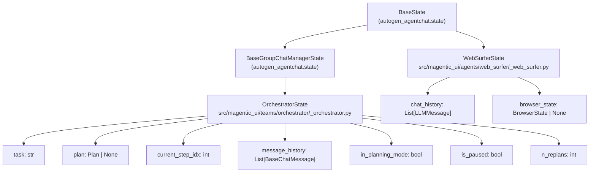
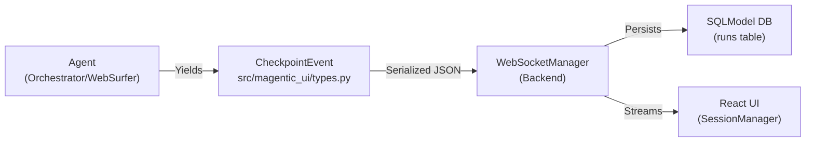
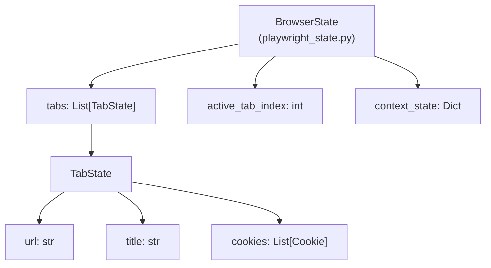
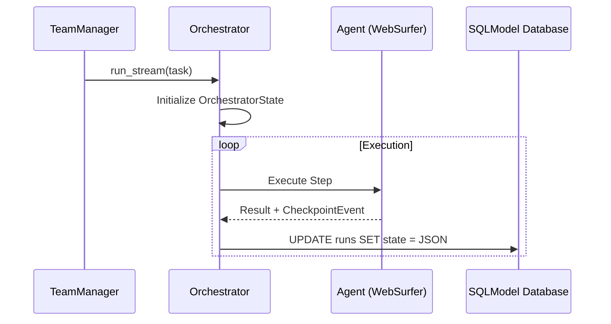

<!-- source: DeepWiki mcp.deepwiki.com · repo microsoft/magentic-ui · page 9.2 State Management and Persistence · fetched 2026-10-26 -->

# State Management and Persistence

Relevant source files

The following files were used as context for generating this wiki page:

- [src/magentic_ui/agents/web_surfer/_web_surfer.py](src/magentic_ui/agents/web_surfer/_web_surfer.py)
- [src/magentic_ui/learning/learner.py](src/magentic_ui/learning/learner.py)
- [src/magentic_ui/teams/orchestrator/_orchestrator.py](src/magentic_ui/teams/orchestrator/_orchestrator.py)
- [src/magentic_ui/teams/orchestrator/_prompts.py](src/magentic_ui/teams/orchestrator/_prompts.py)
- [src/magentic_ui/tools/playwright/playwright_controller.py](src/magentic_ui/tools/playwright/playwright_controller.py)
- [src/magentic_ui/types.py](src/magentic_ui/types.py)

This document covers the state management and persistence mechanisms in Magentic-UI, focusing on how agent state, browser state, and session state are serialized, saved, and restored. This enables features like session resumption, crash recovery, and tracking execution progress.

---

## Overview

Magentic-UI implements a multi-layered state management system:

1.  **Agent State**: In-memory state objects for orchestrator and agents (e.g., `OrchestratorState`, `WebSurferState`).
2.  **Browser State**: Playwright browser context including tabs, cookies, and page state.
3.  **Session State**: Persistent storage of runs, messages, and agent state in the database.
4.  **Frontend State**: React state management for UI sessions and WebSocket connections.

State persistence enables session resumption from the last checkpoint, debugging of agent state at any point in execution, and complete audit trails of agent actions.

---

## Agent State Classes

### State Class Hierarchy

Agent state classes inherit from `BaseState` or `BaseGroupChatManagerState` (provided by `autogen-agentchat`), which defines the interface for state serialization.

**Natural Language to Code Entity Space: State Hierarchy**

**Sources:** [src/magentic_ui/teams/orchestrator/_orchestrator.py:70-87](), [src/magentic_ui/agents/web_surfer/_web_surfer.py:145-158]()

### OrchestratorState

The `OrchestratorState` class maintains the execution state of the orchestrator agent during task execution [src/magentic_ui/teams/orchestrator/_orchestrator.py:70-87]().

| Field | Type | Purpose |
|-------|------|---------|
| `task` | `str` | Current task description |
| `plan` | `Plan \| None` | Structured plan object with steps [src/magentic_ui/types.py:62-79]() |
| `n_rounds` | `int` | Number of execution rounds completed |
| `current_step_idx` | `int` | Index of current step being executed |
| `in_planning_mode` | `bool` | Whether agent is in planning vs execution mode |
| `is_paused` | `bool` | Whether execution is currently paused |
| `message_history` | `List[BaseChatMessage]` | Complete conversation history |
| `n_replans` | `int` | Number of times plan has been regenerated |

**Key State Transition Methods:**
*   `reset()`: Completely resets all state fields to initial values [src/magentic_ui/teams/orchestrator/_orchestrator.py:88-98]().
*   `reset_for_followup()`: Partial reset that preserves `message_history` to allow for follow-up questions [src/magentic_ui/teams/orchestrator/_orchestrator.py:102-110]().

**Sources:** [src/magentic_ui/teams/orchestrator/_orchestrator.py:70-111]()

### WebSurferState

The `WebSurferState` class captures the state of the web browsing agent, specifically focusing on the interaction history and the underlying browser context [src/magentic_ui/agents/web_surfer/_web_surfer.py:145-158]().

| Field | Type | Purpose |
|-------|------|---------|
| `chat_history` | `List[LLMMessage]` | LLM conversation history for context |
| `browser_state` | `BrowserState \| None` | Browser context state including tabs and cookies |

**Sources:** [src/magentic_ui/agents/web_surfer/_web_surfer.py:145-158]()

---

## State Serialization and Checkpoints

### Checkpoint Event Mechanism

State changes are communicated through `CheckpointEvent` objects. This event is a specialized `BaseAgentEvent` that carries a serialized string representation of the agent's current state [src/magentic_ui/types.py:191-198]().

**Checkpoint Data Flow**

**Sources:** [src/magentic_ui/types.py:191-198]()

---

## Browser State Management

### BrowserState Structure

The `BrowserState` captures the complete state of a Playwright browser context, managed by the `PlaywrightController` [src/magentic_ui/tools/playwright/playwright_controller.py:72-145]().

**Browser State Persistence Logic**

**Sources:** [src/magentic_ui/agents/web_surfer/_web_surfer.py:106-110](), [src/magentic_ui/tools/playwright/playwright_controller.py:146-190]()

### Save and Load Functions

The browser state persistence is handled by dedicated utility functions imported into the `WebSurfer` agent [src/magentic_ui/agents/web_surfer/_web_surfer.py:108-109]():

*   `save_browser_state(context: BrowserContext)`: Captures current browser context including all tabs, cookies, and storage.
*   `load_browser_state(context: BrowserContext, state: BrowserState)`: Restores the captured state into a new or existing Playwright context.

**Sources:** [src/magentic_ui/agents/web_surfer/_web_surfer.py:106-110]()

---

## Session State Persistence

### Database State Storage

Session state is persisted in the database through the `runs` table. The `state` field in this table stores the JSON-serialized agent state, allowing a run to be resumed even after a system restart.

**State Persistence Flow**

**Sources:** [src/magentic_ui/teams/orchestrator/_orchestrator.py:199](), [src/magentic_ui/types.py:191-198]()

---

## Plan Management and Adaptation

Plans are core to the Magentic-UI state. They are represented by the `Plan` class, which consists of a sequence of `PlanStep` or `SentinelPlanStep` objects [src/magentic_ui/types.py:62-79]().

### Plan Learning and Adaptation

The `learner.py` module provides utilities to generate or modify plans based on conversation history:

*   `learn_plan_from_messages()`: Uses a `ChatCompletionClient` to extract a structured `Plan` from a list of `TextMessage` or `MultiModalMessage` [src/magentic_ui/learning/learner.py:27-30]().
*   `adapt_plan()`: Takes an existing `Plan` and adapts it to a new `task` string [src/magentic_ui/learning/learner.py:114-117]().

**Sources:** [src/magentic_ui/learning/learner.py:27-155](), [src/magentic_ui/types.py:29-84]()

---

## Frontend State Management

### Session and Run Status Tracking

The frontend `SessionManager` tracks the lifecycle of active sessions and their associated WebSocket connections.

**Key Status Types:**
The `RunStatus` (tracked in the frontend) reflects the backend state:
*   `active`: The orchestrator is currently processing.
*   `awaiting_input`: The system is waiting for user approval or clarification [src/magentic_ui/teams/orchestrator/_orchestrator.py:160-170]().
*   `paused`: Execution is suspended via the `_pause_event` [src/magentic_ui/teams/orchestrator/_orchestrator.py:193]().

**Sources:** [src/magentic_ui/teams/orchestrator/_orchestrator.py:193](), [src/magentic_ui/types.py:142-154]()

---

