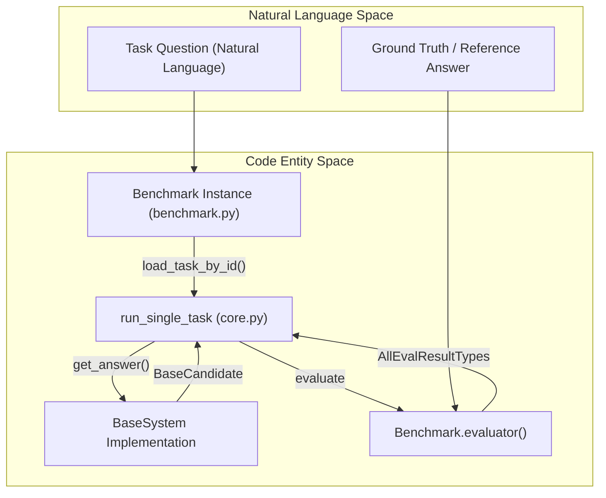
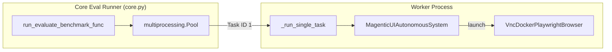

<!-- source: DeepWiki mcp.deepwiki.com · repo microsoft/magentic-ui · page 9.3 Evaluation Framework · fetched 2026-10-26 -->

# Evaluation Framework

<details>
<summary>Relevant source files</summary>

The following files were used as context for generating this wiki page:

- [docs/tutorials/web_agent_tutorial_full.ipynb](docs/tutorials/web_agent_tutorial_full.ipynb)
- [experiments/endpoint_configs/.gitignore](experiments/endpoint_configs/.gitignore)
- [experiments/endpoint_configs/config_template.yaml](experiments/endpoint_configs/config_template.yaml)
- [experiments/endpoint_configs/test_client.py](experiments/endpoint_configs/test_client.py)
- [experiments/eval/.gitignore](experiments/eval/.gitignore)
- [experiments/eval/README.md](experiments/eval/README.md)
- [experiments/eval/analyze_sim_user.py](experiments/eval/analyze_sim_user.py)
- [experiments/eval/explore_results.py](experiments/eval/explore_results.py)
- [experiments/eval/plot_results.py](experiments/eval/plot_results.py)
- [experiments/eval/prepare_for_submission.py](experiments/eval/prepare_for_submission.py)
- [experiments/eval/run.py](experiments/eval/run.py)
- [experiments/eval/sample_eval_systems.py](experiments/eval/sample_eval_systems.py)
- [experiments/eval/systems/__init__.py](experiments/eval/systems/__init__.py)
- [experiments/eval/systems/magentic_one_system.py](experiments/eval/systems/magentic_one_system.py)
- [experiments/eval/systems/magentic_ui_sim_user_system.py](experiments/eval/systems/magentic_ui_sim_user_system.py)
- [experiments/eval/systems/magentic_ui_system.py](experiments/eval/systems/magentic_ui_system.py)
- [src/magentic_ui/agents/_user_proxy.py](src/magentic_ui/agents/_user_proxy.py)
- [src/magentic_ui/agents/users/_metadata_user_proxy.py](src/magentic_ui/agents/users/_metadata_user_proxy.py)
- [src/magentic_ui/eval/benchmark.py](src/magentic_ui/eval/benchmark.py)
- [src/magentic_ui/eval/benchmarks/__init__.py](src/magentic_ui/eval/benchmarks/__init__.py)
- [src/magentic_ui/eval/benchmarks/baseqa.py](src/magentic_ui/eval/benchmarks/baseqa.py)
- [src/magentic_ui/eval/benchmarks/gpqa/README.md](src/magentic_ui/eval/benchmarks/gpqa/README.md)
- [src/magentic_ui/eval/benchmarks/gpqa/__init__.py](src/magentic_ui/eval/benchmarks/gpqa/__init__.py)
- [src/magentic_ui/eval/benchmarks/gpqa/gpqa.py](src/magentic_ui/eval/benchmarks/gpqa/gpqa.py)
- [src/magentic_ui/eval/benchmarks/simpleqa/README.md](src/magentic_ui/eval/benchmarks/simpleqa/README.md)
- [src/magentic_ui/eval/benchmarks/simpleqa/__init__.py](src/magentic_ui/eval/benchmarks/simpleqa/__init__.py)
- [src/magentic_ui/eval/benchmarks/simpleqa/prompts.py](src/magentic_ui/eval/benchmarks/simpleqa/prompts.py)
- [src/magentic_ui/eval/benchmarks/simpleqa/simpleqa.py](src/magentic_ui/eval/benchmarks/simpleqa/simpleqa.py)
- [src/magentic_ui/eval/benchmarks/webvoyager/webvoyager.py](src/magentic_ui/eval/benchmarks/webvoyager/webvoyager.py)
- [src/magentic_ui/eval/core.py](src/magentic_ui/eval/core.py)
- [src/magentic_ui/eval/models.py](src/magentic_ui/eval/models.py)
- [src/magentic_ui/eval/utils.py](src/magentic_ui/eval/utils.py)
- [src/magentic_ui/teams/orchestrator/_utils.py](src/magentic_ui/teams/orchestrator/_utils.py)

</details>


The Magentic-UI Evaluation Framework is a comprehensive system designed to benchmark AI agent performance across diverse tasks, including web navigation, code execution, and fact-gathering. It supports standardized datasets like GAIA, WebVoyager, and AssistantBench, providing automated runners, simulated user interactions, and detailed metrics collection [src/magentic_ui/eval/core.py:19-67]().

## System Architecture

The evaluation system is built around three core components: the **Benchmark**, the **System**, and the **Eval Runner**.

### Core Components and Data Flow

The framework uses a decoupled architecture where the benchmark defines the "what" (tasks and evaluation logic) and the system defines the "how" (agent logic).

| Component | Responsibility | Key Class/Function |
| :--- | :--- | :--- |
| **Benchmark** | Dataset loading, task management, and success evaluation. | `Benchmark` [src/magentic_ui/eval/benchmark.py:11-32]() |
| **System** | The agent implementation being tested (e.g., Magentic-UI, MagenticOne). | `BaseSystem` [src/magentic_ui/eval/basesystem.py]() |
| **Eval Runner** | Orchestrates the execution of tasks across systems, handles parallelism, and logging. | `run_evaluate_benchmark_func` [src/magentic_ui/eval/core.py:388-410]() |

#### Evaluation Process Diagram
This diagram bridges the natural language task space to the code entities responsible for execution.


Sources: [src/magentic_ui/eval/core.py:85-118](), [src/magentic_ui/eval/benchmark.py:11-55](), [src/magentic_ui/eval/models.py:11-18]()

## Supported Benchmarks

The framework includes built-in support for several high-stakes agentic benchmarks:

*   **GAIA**: Tasks requiring tool-use and multi-step reasoning [src/magentic_ui/eval/benchmarks/webvoyager/webvoyager.py:9-10]().
*   **WebVoyager**: End-to-end web navigation tasks. Supports both `exact_match` and `gpt_eval` (multimodal evaluation using screenshots) [src/magentic_ui/eval/benchmarks/webvoyager/webvoyager.py:49-76]().
*   **AssistantBench**: Complex assistant tasks often requiring web and file access [experiments/eval/README.md:71-75]().
*   **WebGames**: Interactive web-based challenges [experiments/eval/README.md:17-21]().
*   **GPQA / SimpleQA**: Factuality and high-difficulty science questions [src/magentic_ui/eval/benchmarks/simpleqa/simpleqa.py:49-55]().

## Evaluation Runner (`run.py`)

The primary entry point for experiments is `experiments/eval/run.py`. It handles configuration loading, system instantiation, and result persistence [experiments/eval/run.py:185-197]().

### Key Arguments
*   `--mode`: `run` (execute tasks) or `eval` (score existing results) [experiments/eval/run.py:194-196]().
*   `--dataset`: The benchmark name (e.g., `Gaia`, `WebVoyager`) [experiments/eval/run.py:100-120]().
*   `--parallel`: Number of concurrent processes for task execution [src/magentic_ui/eval/core.py:302-315]().
*   `--simulated-user-type`: Configures human-in-the-loop simulation [experiments/eval/systems/magentic_ui_sim_user_system.py:108-114]().

### Simulated User Systems
Magentic-UI allows testing "Co-operative AI" by simulating different human behaviors via `MagenticUISimUserSystem` [experiments/eval/systems/magentic_ui_sim_user_system.py:69-87]():
1.  **Co-planning**: User interacts only during the planning phase.
2.  **Co-execution**: User provides feedback during step execution.
3.  **Metadata User**: A specialized `MetadataUserProxy` that provides "hints" derived from dataset metadata (e.g., GAIA intermediate steps) to test agent recovery [src/magentic_ui/agents/users/_metadata_user_proxy.py]().

## Reproducing Results

To reproduce experimental results, use the provided configuration templates and the `run.py` script.

### Configuration Setup
Copy `experiments/endpoint_configs/config_template.yaml` to `config.yaml` and define your LLM providers [experiments/endpoint_configs/config_template.yaml:1-15]().

### Execution Example (WebVoyager)
```bash
python experiments/eval/run.py \
  --current-dir . \
  --dataset WebVoyager \
  --split webvoyager \
  --run-id 1 \
  --simulated-user-type none \
  --parallel 1 \
  --config experiments/endpoint_configs/config.yaml \
  --web-surfer-only true \
  --mode run
```
Sources: [experiments/eval/README.md:23-27](), [experiments/eval/run.py:151-182]()

## Implementation Details

### Result Persistence
For every task execution, the runner creates a structured directory:
`runs/[SYSTEM]/[DATASET]/[SPLIT]/[RUN_ID]/[TASK_ID]/`

It persists the following:
*   `[TASK_ID]_messages.json`: Full conversation history [experiments/eval/README.md:12]().
*   `times.json`: Duration of the run [src/magentic_ui/eval/core.py:153-156]().
*   `score.json`: The output of the `Benchmark.evaluator` [experiments/eval/README.md:12]().
*   `screenshots/`: Raw and Annotated (SOM) images from `WebSurfer` [experiments/eval/systems/magentic_ui_system.py:98-102]().

### Parallel Execution Logic
The framework uses `multiprocessing` to run tasks in parallel. Each process instantiates its own `BaseSystem` to ensure isolation, particularly for browser-based tasks where Playwright requires dedicated ports [src/magentic_ui/eval/core.py:302-340]().


Sources: [src/magentic_ui/eval/core.py:320-335](), [experiments/eval/systems/magentic_ui_system.py:159-163](), [src/magentic_ui/tools/playwright/browser/utils.py:27]()

---

