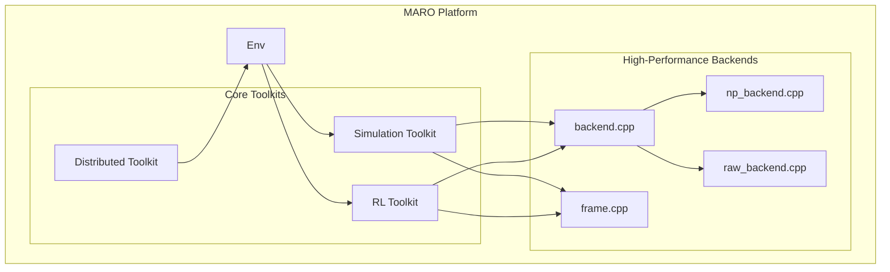
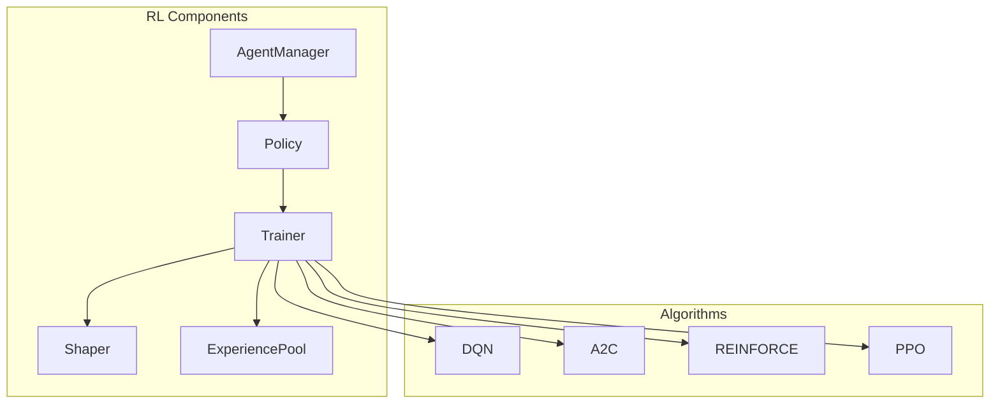
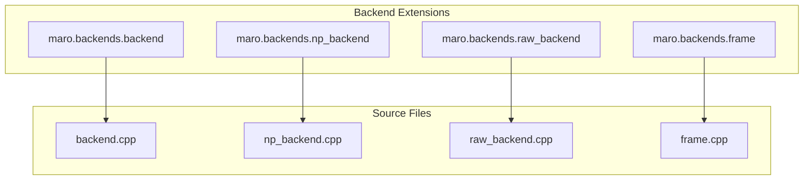
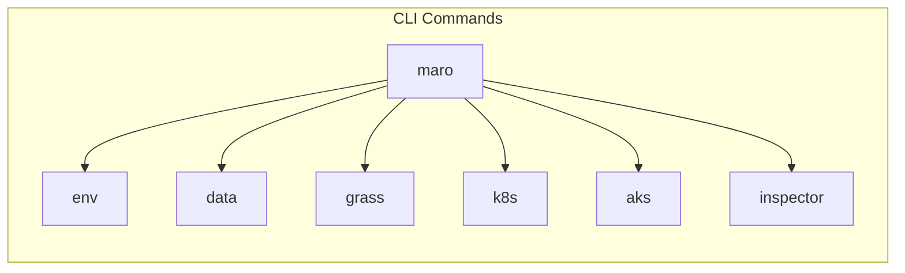

<!-- source: DeepWiki mcp.deepwiki.com · repo microsoft/maro · page 1 MARO Platform Overview · fetched 2026-10-26 -->

# MARO Platform Overview

<details>
<summary>Relevant source files</summary>

The following files were used as context for generating this wiki page:

- [LICENSE](LICENSE)
- [README.md](README.md)
- [docs/source/images/logo.svg](docs/source/images/logo.svg)
- [docs/source/images/maro_overview.svg](docs/source/images/maro_overview.svg)
- [docs/source/images/visualization/geographic/real_time_mode.gif](docs/source/images/visualization/geographic/real_time_mode.gif)
- [docs/source/index.rst](docs/source/index.rst)
- [maro/README.rst](maro/README.rst)
- [setup.py](setup.py)

</details>


## Purpose and Scope

This document provides a comprehensive overview of the Multi-Agent Resource Optimization (MARO) platform, covering its three core toolkits, main architectural components, and entry points. MARO is an instance of Reinforcement Learning as a Service (RaaS) designed for real-world resource optimization problems across industrial domains including container inventory management, bike repositioning, virtual machine provisioning, and asset management.

For detailed information about specific simulation scenarios, see [Simulation Scenarios](#3). For RL training specifics, see [Reinforcement Learning Framework](#2.2). For cluster deployment and management, see [Cluster Management](#5.1).

## Core Architecture Overview

MARO is built around three fundamental toolkits that work together to provide a complete resource optimization platform:



**Sources:** [README.md:41-48](), [setup.py:45-83]()

### Simulation Toolkit

The simulation toolkit provides predefined scenarios and reusable components for building new environments. The main entry point is the `Env` class which serves as the primary interface for all simulations.

| Component | Purpose | Code Location |
|-----------|---------|---------------|
| **Env Class** | Main simulation interface | `maro.simulator.Env` |
| **Business Engines** | Scenario-specific logic | `maro.simulator.scenarios` |
| **Event Buffer** | Event management system | Core simulation engine |
| **Data Model** | State representation | Frame system |

```mermaid
graph LR
    subgraph "Simulation Flow"
        ENV["Env"]
        BE["BusinessEngine"]
        EB["EventBuffer"]
        FRAME["Frame"]
    end
    
    subgraph "Scenarios"
        CIM["CIM"]
        CITIBIKE["CitiBike"]
        VM["VMScheduling"]
    end
    
    ENV --> BE
    BE --> EB
    BE --> FRAME
    BE <|-- CIM
    BE <|-- CITIBIKE
    BE <|-- VM
```

**Sources:** [README.md:43-44](), [setup.py:165-167](), [docs/source/index.rst:34-40]()

### RL Toolkit

The RL toolkit provides a full-stack abstraction for reinforcement learning, including agent management, algorithms, and various training components.



**Sources:** [README.md:45-46](), [docs/source/index.rst:25-26]()

### Distributed Toolkit

The distributed toolkit enables cluster provisioning, job orchestration, and distributed communication across multiple deployment targets.

| Deployment Type | Technology | CLI Command |
|-----------------|------------|-------------|
| **Azure VMs** | GraSS | `maro grass` |
| **Kubernetes** | AKS | `maro k8s`, `maro aks` |
| **Local** | Multi-process | `maro local` |

**Sources:** [README.md:47-48](), [setup.py:158-160]()

## Main Components and Code Entities

### Environment Interface

The `Env` class in `maro.simulator` serves as the primary interface for all MARO simulations:

```python
from maro.simulator import Env

env = Env(scenario="cim", topology="toy.5p_ssddd_l0.0", start_tick=0, durations=100)
metrics, decision_event, is_done = env.step(None)
```

**Sources:** [README.md:152-164](), [docs/source/index.rst:34-63]()

### High-Performance Backends

MARO uses C++ extensions for performance-critical operations:



**Sources:** [setup.py:45-83](), [setup.py:28-31]()

### CLI Interface

The command-line interface provides comprehensive management capabilities:



**Sources:** [setup.py:158-160]()

## Package Structure

The platform is distributed as the `pymaro` package with the following structure:

| Directory | Purpose |
|-----------|---------|
| `maro/` | Main source code |
| `docs/` | Documentation |
| `examples/` | Usage examples |
| `notebooks/` | Jupyter notebooks |

**Sources:** [README.md:54-59](), [setup.py:162]()

## Installation and Distribution

MARO supports multiple installation methods:

- **PyPI Package:** `pip install pymaro` (core functionality)
- **Source Installation:** Full CLI and visualization support
- **Docker Images:** `maro2020/maro` and `maro2020/playground`

The build system compiles C++ extensions using platform-specific compilers and supports cross-platform wheel distribution.

**Sources:** [README.md:63-81](), [setup.py:20-26](), [setup.py:87-106]()

## Quick Start

The basic usage pattern involves creating an environment and stepping through the simulation:

```python
from maro.simulator import Env

# Initialize environment
env = Env(scenario="cim", topology="toy.5p_ssddd_l0.0", start_tick=0, durations=100)

# Simulation loop
metrics, decision_event, is_done = env.step(None)
while not is_done:
    metrics, decision_event, is_done = env.step(None)

print(f"environment metrics: {env.metrics}")
```

For visualization and analysis:

```bash
# Enable data dumping
env = Env(scenario="cim", topology="toy.5p_ssddd_l0.0", 
          options={"enable-dump-snapshot": "./dump_data"})

# Launch dashboard
maro inspector dashboard --source_path ./dump_data/YOUR_SNAPSHOT_DUMP_FOLDER
```

**Sources:** [README.md:152-178](), [docs/source/index.rst:32-63]()

---

