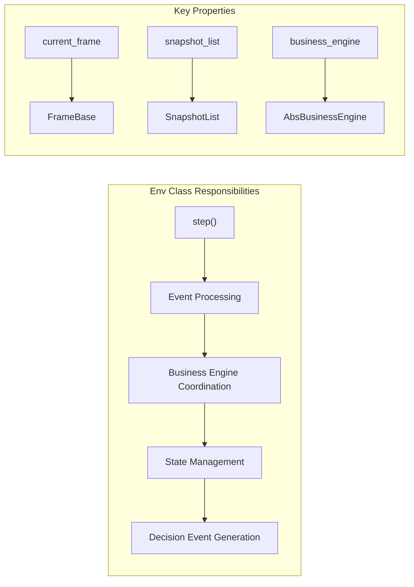
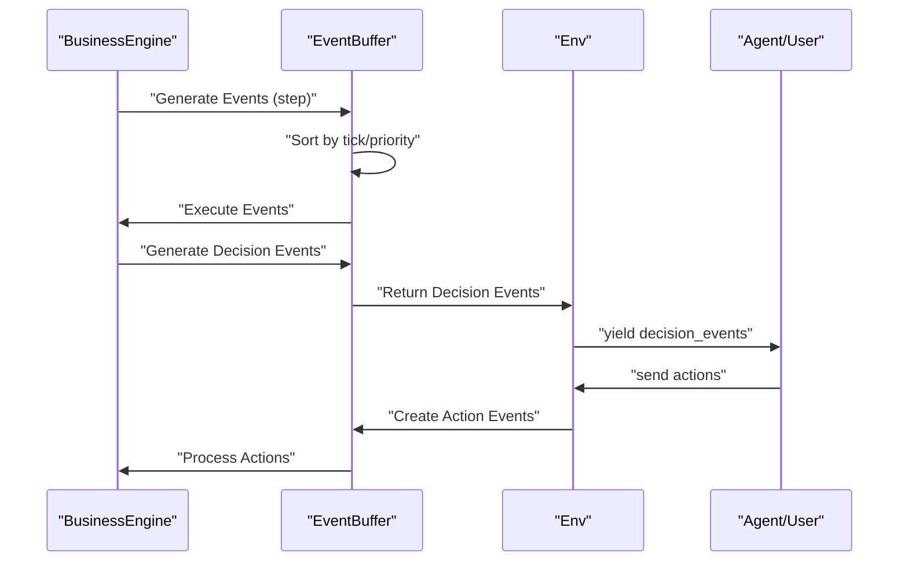
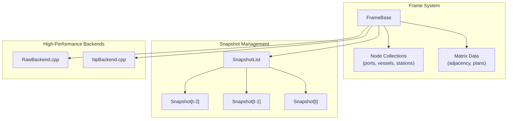
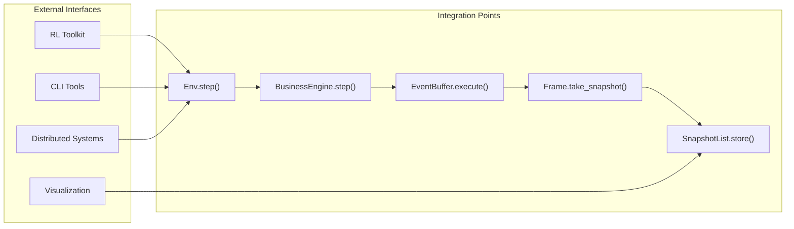

<!-- source: DeepWiki mcp.deepwiki.com · repo microsoft/maro · page 2 Core Architecture · fetched 2026-10-26 -->

# Core Architecture

<details>
<summary>Relevant source files</summary>

The following files were used as context for generating this wiki page:

- [LICENSE](LICENSE)
- [README.md](README.md)
- [docs/source/images/logo.svg](docs/source/images/logo.svg)
- [docs/source/images/maro_overview.svg](docs/source/images/maro_overview.svg)
- [docs/source/images/visualization/geographic/real_time_mode.gif](docs/source/images/visualization/geographic/real_time_mode.gif)
- [docs/source/index.rst](docs/source/index.rst)
- [maro/README.rst](maro/README.rst)
- [maro/simulator/abs_core.py](maro/simulator/abs_core.py)
- [maro/simulator/core.py](maro/simulator/core.py)
- [maro/simulator/scenarios/abs_business_engine.py](maro/simulator/scenarios/abs_business_engine.py)
- [maro/simulator/scenarios/cim/business_engine.py](maro/simulator/scenarios/cim/business_engine.py)
- [maro/simulator/scenarios/citi_bike/business_engine.py](maro/simulator/scenarios/citi_bike/business_engine.py)
- [maro/simulator/scenarios/citi_bike/station.py](maro/simulator/scenarios/citi_bike/station.py)
- [setup.py](setup.py)

</details>


This document provides a comprehensive overview of MARO's fundamental architectural components and their interactions. It covers the core design patterns, key abstractions, and integration points that enable MARO's three primary capabilities: simulation, reinforcement learning, and distributed execution.

For specific implementation details of the simulation engine, see [Simulation Framework](#2.1). For RL-specific components, see [Reinforcement Learning Framework](#2.2). For performance-critical data operations, see [High-Performance Data Backends](#2.3).

## Architectural Overview

MARO follows a layered architecture centered around the `Env` class, which serves as the primary interface between users and the simulation system. The architecture is built on several key design patterns:

- **Event-driven simulation** with centralized event processing
- **Pluggable business engines** for different scenarios
- **High-performance data backends** using C++ extensions
- **Snapshot-based state management** for time-series data access

### Core Architecture Diagram

```mermaid
graph TB
    subgraph "User Interface Layer"
        Env["Env<br/>(maro.simulator.core)"]
        CLI["maro CLI<br/>(maro.cli.maro)"]
    end
    
    subgraph "Simulation Core"
        BE["AbsBusinessEngine<br/>(abs_business_engine.py)"]
        EB["EventBuffer<br/>(maro.event_buffer)"]
        Frame["FrameBase<br/>(maro.backends.frame)"]
    end
    
    subgraph "Business Engines"
        CIM["CimBusinessEngine<br/>(cim/business_engine.py)"]
        CitiBike["CitibikeBusinessEngine<br/>(citi_bike/business_engine.py)"]
        VM["VmSchedulingEngine<br/>(vm_scheduling/business_engine.py)"]
    end
    
    subgraph "Data Backends"
        RawBackend["RawBackend<br/>(backends/raw_backend.cpp)"]
        NpBackend["NumpyBackend<br/>(backends/np_backend.cpp)"]
        Snapshots["SnapshotList<br/>(backends/frame)"]
    end
    
    subgraph "RL Components"
        Policy["Policy Classes<br/>(maro.rl)"]
        Trainer["Trainer Classes<br/>(maro.rl)"]
        Sampler["EnvSampler<br/>(maro.rl)"]
    end
    
    Env --> BE
    Env --> EB
    Env --> Frame
    BE <|-- CIM
    BE <|-- CitiBike
    BE <|-- VM
    Frame --> RawBackend
    Frame --> NpBackend
    Frame --> Snapshots
    Sampler --> Env
    Policy --> Env
    Trainer --> Policy
    CLI --> Env
```

**Sources:** [maro/simulator/core.py:20-382](), [maro/simulator/scenarios/abs_business_engine.py:14-236](), [setup.py:45-83]()

## Core Components

### Environment (Env)

The `Env` class in [maro/simulator/core.py:20-382]() serves as the primary simulation interface, implementing the `AbsEnv` abstract base class from [maro/simulator/abs_core.py:25-177](). It orchestrates all simulation components and provides the main `step()` method for simulation execution.



**Sources:** [maro/simulator/core.py:92-133](), [maro/simulator/abs_core.py:74-176]()

### Business Engine Abstraction

The `AbsBusinessEngine` class in [maro/simulator/scenarios/abs_business_engine.py:14-236]() defines the interface that all scenario implementations must follow. This abstraction enables MARO to support multiple simulation scenarios through a common interface.

| Method | Purpose | Called By |
|--------|---------|-----------|
| `step(tick)` | Execute scenario logic for current tick | `Env._simulate()` |
| `post_step(tick)` | Post-process after tick completion | `Env._simulate()` |
| `reset()` | Reset scenario state | `Env.reset()` |
| `get_metrics()` | Return scenario metrics | `Env.step()` |

**Key Business Engine Implementations:**

- **CimBusinessEngine** [maro/simulator/scenarios/cim/business_engine.py:37-831]() - Container inventory management
- **CitibikeBusinessEngine** [maro/simulator/scenarios/citi_bike/business_engine.py:46-602]() - Bike repositioning
- **VmSchedulingBusinessEngine** - Virtual machine resource allocation

**Sources:** [maro/simulator/scenarios/abs_business_engine.py:14-236](), [maro/simulator/scenarios/cim/business_engine.py:37-831]()

## Event-Driven Architecture

MARO implements a sophisticated event-driven simulation pattern where all state changes occur through events processed by the `EventBuffer`. This design ensures deterministic simulation execution and enables complex temporal dependencies.

### Event Processing Flow



**Event Types:**
- **Atom Events** - Single-step events with immediate execution
- **Cascade Events** - Events that can spawn child events
- **Decision Events** - Special events that require agent input

**Sources:** [maro/simulator/core.py:336-381](), [maro/simulator/scenarios/cim/business_engine.py:358-370]()

## Data Management Architecture

MARO's data management is built around a frame-based system that provides efficient storage and time-series access to simulation state.

### Frame and Snapshot System



**Key Features:**
- **Snapshot Resolution** - Configurable frequency of state snapshots
- **Memory Management** - Automatic cleanup of old snapshots based on `max_snapshots`
- **Time-Series Access** - Query historical states at any snapshot point
- **High-Performance Storage** - C++ backends for memory-efficient operations

**Sources:** [maro/simulator/core.py:207-212](), [setup.py:75-83](), [maro/simulator/scenarios/abs_business_engine.py:115-129]()

## High-Performance Data Backends

MARO leverages C++ extensions for performance-critical data operations, compiled through Cython as defined in [setup.py:45-83]().

### Backend Architecture

| Backend | Purpose | Implementation |
|---------|---------|----------------|
| `RawBackend` | Low-level memory operations | [maro/backends/raw_backend.cpp]() |
| `NumpyBackend` | NumPy integration | [maro/backends/np_backend.cpp]() |
| `Frame` | Data structure management | [maro/backends/frame.cpp]() |

These backends provide:
- **Memory-efficient storage** for large-scale simulations
- **Fast data access** for time-series operations  
- **NumPy compatibility** for scientific computing workflows
- **Cross-platform compilation** with optimized C++ code

**Sources:** [setup.py:45-83](), [setup.py:153-156]()

## Integration and Extensibility

### Scenario Development Pattern

MARO's architecture supports easy extension through the business engine pattern:

1. **Inherit from AbsBusinessEngine** - Implement required abstract methods
2. **Define Frame Structure** - Create nodes and matrices for state representation
3. **Implement Event Handlers** - Register callbacks for event processing
4. **Configure Topology** - Define scenario-specific parameters

### Cross-Component Communication



The architecture's loose coupling enables:
- **RL Framework Integration** - Seamless connection to training algorithms
- **Distributed Execution** - Cluster deployment through CLI tools
- **Visualization Support** - Dashboard and geographic visualization
- **Custom Extensions** - User-defined scenarios and business logic

**Sources:** [maro/simulator/core.py:92-133](), [maro/simulator/scenarios/abs_business_engine.py:166-201](), [setup.py:157-161]()

---

