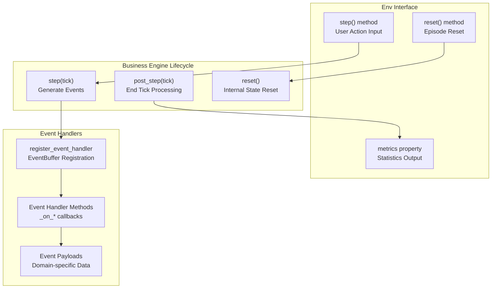
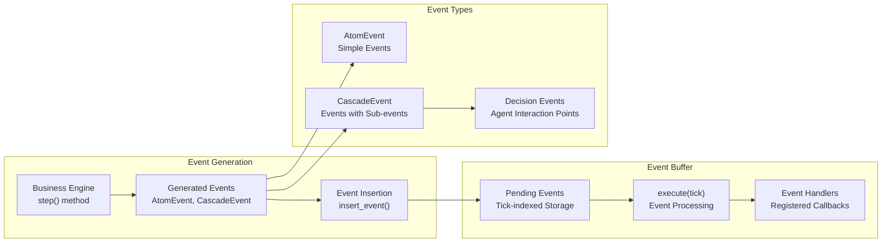
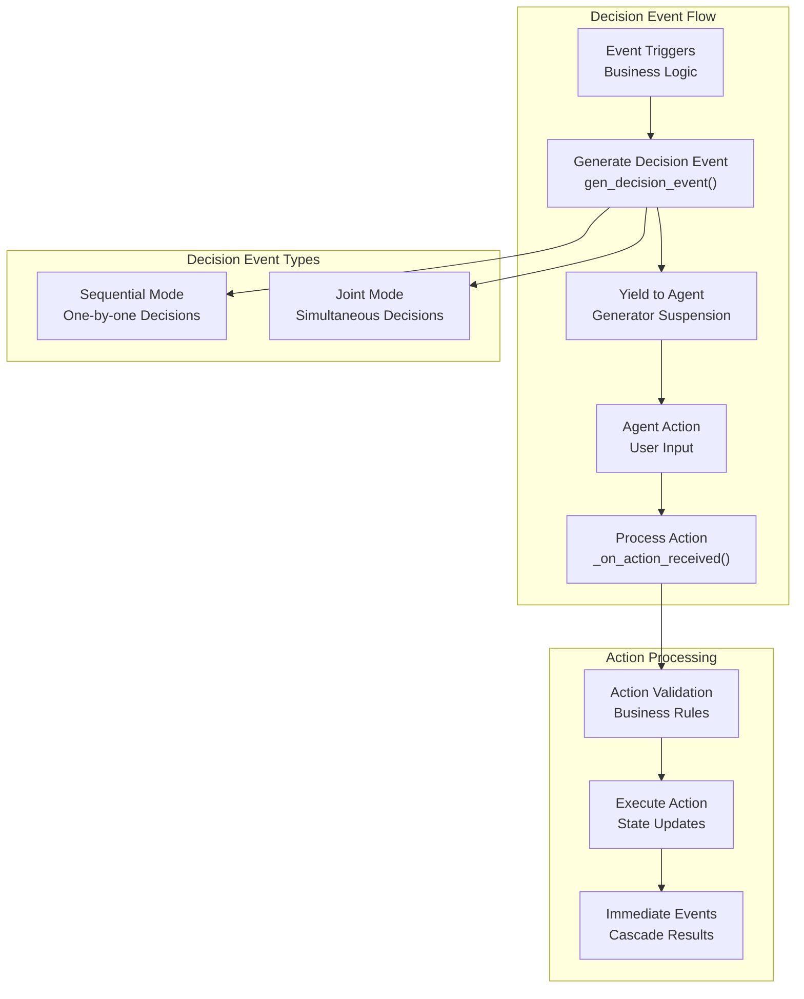

<!-- source: DeepWiki mcp.deepwiki.com · repo microsoft/maro · page 2.1 Simulation Framework · fetched 2026-10-26 -->

# Simulation Framework

<details>
<summary>Relevant source files</summary>

The following files were used as context for generating this wiki page:

- [examples/citi_bike/online_lp/launcher.py](examples/citi_bike/online_lp/launcher.py)
- [maro/event_buffer/__init__.py](maro/event_buffer/__init__.py)
- [maro/event_buffer/event.py](maro/event_buffer/event.py)
- [maro/event_buffer/event_linked_list.py](maro/event_buffer/event_linked_list.py)
- [maro/event_buffer/event_pool.py](maro/event_buffer/event_pool.py)
- [maro/simulator/abs_core.py](maro/simulator/abs_core.py)
- [maro/simulator/core.py](maro/simulator/core.py)
- [maro/simulator/scenarios/abs_business_engine.py](maro/simulator/scenarios/abs_business_engine.py)
- [maro/simulator/scenarios/cim/business_engine.py](maro/simulator/scenarios/cim/business_engine.py)
- [maro/simulator/scenarios/citi_bike/business_engine.py](maro/simulator/scenarios/citi_bike/business_engine.py)
- [maro/simulator/scenarios/citi_bike/station.py](maro/simulator/scenarios/citi_bike/station.py)
- [tests/test_event_buffer.py](tests/test_event_buffer.py)

</details>


The simulation framework forms the core engine that powers all MARO simulation scenarios. It provides an event-driven simulation environment where business logic is encapsulated in pluggable business engines, and simulation state is managed through a unified interface.

For information about the high-performance data storage that underlies this framework, see [High-Performance Data Backends](#2.3). For details about specific simulation scenarios, see [Simulation Scenarios](#3).

## Core Architecture

The simulation framework is built around the `Env` class, which serves as the main entry point for all simulations. It orchestrates the interaction between business engines, event processing, and state management through a standardized interface.

### Simulation Loop Architecture

```mermaid
graph TD
    subgraph "Main Simulation Loop"
        ENV["Env class<br/>maro.simulator.core.Env"]
        SIMGEN["_simulate() generator<br/>maro/simulator/core.py:317-381"]
    end
    
    subgraph "Business Logic Layer"
        ABE["AbsBusinessEngine<br/>Abstract Base Class"]
        CIM["CimBusinessEngine<br/>Container Management"]
        CITI["CitibikeBusinessEngine<br/>Bike Repositioning"]
        VM["VMBusinessEngine<br/>VM Scheduling"]
    end
    
    subgraph "Event Processing"
        EB["EventBuffer<br/>maro.event_buffer.EventBuffer"]
        EVTS["Events Processing<br/>execute() method"]
        DECISION["Decision Events<br/>PENDING_DECISION"]
    end
    
    subgraph "State Management"
        FRAME["FrameBase<br/>State Container"]
        SNAP["SnapshotList<br/>Historical States"]
    end
    
    ENV --> SIMGEN
    SIMGEN --> ABE
    ABE <|-- CIM
    ABE <|-- CITI
    ABE <|-- VM
    
    SIMGEN --> EB
    EB --> EVTS
    EVTS --> DECISION
    
    ABE --> FRAME
    FRAME --> SNAP
    
    DECISION -.->|"Actions"| SIMGEN
    SIMGEN -.->|"Metrics"| ENV
```

**Core Simulation Loop Flow**

The simulation operates through a generator-based loop that processes events and manages state transitions:

Sources: [maro/simulator/core.py:317-381](), [maro/simulator/abs_core.py:25-177]()

### Business Engine Integration



**Business Engine Responsibilities**

Each business engine implements scenario-specific logic while conforming to the `AbsBusinessEngine` interface:

| Method | Purpose | Implementation Example |
|--------|---------|----------------------|
| `step(tick)` | Generate events for current tick | [maro/simulator/scenarios/cim/business_engine.py:122-199]() |
| `post_step(tick)` | End-of-tick processing and metrics | [maro/simulator/scenarios/cim/business_engine.py:201-224]() |
| `reset()` | Reset simulation state | [maro/simulator/scenarios/cim/business_engine.py:226-242]() |
| Event handlers | Process domain events | [maro/simulator/scenarios/cim/business_engine.py:358-831]() |

Sources: [maro/simulator/scenarios/abs_business_engine.py:14-236](), [maro/simulator/scenarios/cim/business_engine.py:37-831]()

## Event-Driven Simulation Model

The framework uses an event-driven architecture where simulation progression is controlled by discrete events that trigger business logic and state changes.

### Event Types and Processing



**Event Processing Flow**

1. **Event Generation**: Business engines create events during their `step()` method
2. **Event Buffering**: Events are stored in tick-indexed collections within `EventBuffer`
3. **Event Execution**: The simulation loop processes all events for the current tick
4. **Handler Dispatch**: Events trigger registered callback methods in business engines

Sources: [maro/event_buffer/event_buffer.py](), [tests/test_event_buffer.py:15-337]()

### Decision Events and Agent Interaction

Decision events represent points where external agents can influence the simulation through actions.



The framework supports two decision modes:
- **Sequential**: Agents make decisions one at a time
- **Joint**: Multiple agents make simultaneous decisions

Sources: [maro/simulator/core.py:301-381](), [maro/simulator/abs_core.py:14-23]()

## Key Classes and Components

### Env Class - Main Interface

The `Env` class provides the primary interface for simulation control and follows a standard reinforcement learning environment pattern.

**Core Methods:**
- `step(action)` - Advance simulation by one decision point
- `reset()` - Reset simulation to initial state  
- `set_seed(seed)` - Control randomness for reproducibility

**Key Properties:**
- `tick` - Current simulation time
- `metrics` - Performance statistics
- `snapshot_list` - Historical state data
- `agent_idx_list` - Available agent identifiers

Sources: [maro/simulator/core.py:20-382]()

### AbsBusinessEngine - Scenario Interface

The abstract business engine defines the contract that all scenario implementations must follow.

**Required Methods:**
- `step(tick)` - Generate events for the current tick
- `frame` property - Access to state data structure
- `snapshots` property - Access to historical snapshots
- `get_agent_idx_list()` - Return available agent identifiers

**Lifecycle Hooks:**
- `post_step(tick)` - End-of-tick processing
- `reset()` - Reset internal state
- `get_metrics()` - Return performance statistics

Sources: [maro/simulator/scenarios/abs_business_engine.py:14-236]()

### Business Engine Examples

#### CIM Business Engine

The Container Inventory Management engine demonstrates complex event-driven logistics simulation:

**Key Event Types:**
- `ORDER` - Customer container requests
- `VESSEL_ARRIVAL` - Ship arrival at ports
- `LOAD_FULL` - Container loading operations
- `DISCHARGE_FULL` - Container discharge operations

**State Management:**
- Port inventory tracking
- Vessel routing and capacity
- Order fulfillment metrics

Sources: [maro/simulator/scenarios/cim/business_engine.py:37-831]()

#### CitiBike Business Engine

The bike-sharing scenario shows real-time demand-supply simulation:

**Key Features:**
- Trip demand generation from historical data
- Station capacity constraints
- Weather and temporal feature integration
- Dynamic rebalancing decisions

Sources: [maro/simulator/scenarios/citi_bike/business_engine.py:46-602]()

## Integration with Other Systems

The simulation framework integrates with several other MARO components:

- **RL Toolkit**: Decision events serve as observation/action points for reinforcement learning agents
- **Data Backends**: Frame system provides high-performance state storage and querying
- **CLI Tools**: Environment management and execution through command-line interface
- **Visualization**: Real-time monitoring and post-simulation analysis

The framework's modular design allows new scenarios to be implemented by extending `AbsBusinessEngine` while leveraging the common event processing and state management infrastructure.

Sources: [maro/simulator/core.py:1-382](), [maro/simulator/scenarios/abs_business_engine.py:1-236](), [maro/event_buffer/__init__.py:1-18]()

---

