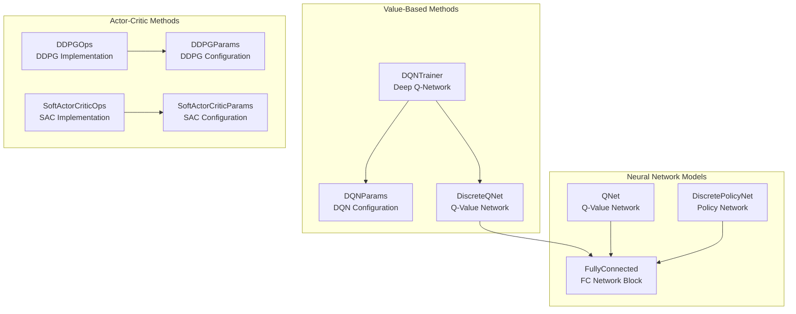
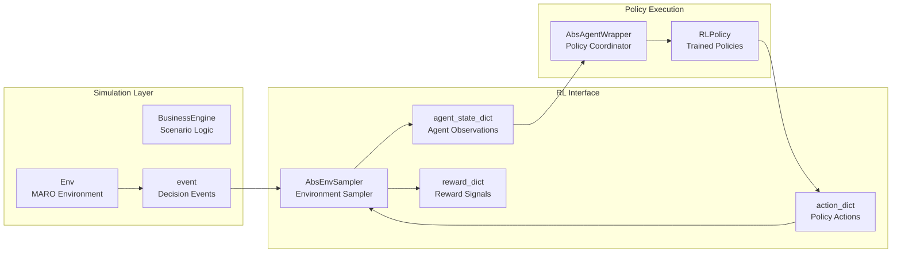

<!-- source: DeepWiki mcp.deepwiki.com · repo microsoft/maro · page 2.2 Reinforcement Learning Framework · fetched 2026-10-26 -->

# Reinforcement Learning Framework

<details>
<summary>Relevant source files</summary>

The following files were used as context for generating this wiki page:

- [examples/cim/rl/algorithms/dqn.py](examples/cim/rl/algorithms/dqn.py)
- [examples/vm_scheduling/rl/algorithms/dqn.py](examples/vm_scheduling/rl/algorithms/dqn.py)
- [maro/__misc__.py](maro/__misc__.py)
- [maro/rl/__init__.py](maro/rl/__init__.py)
- [maro/rl/model/fc_block.py](maro/rl/model/fc_block.py)
- [maro/rl/policy/discrete_rl_policy.py](maro/rl/policy/discrete_rl_policy.py)
- [maro/rl/rollout/env_sampler.py](maro/rl/rollout/env_sampler.py)
- [maro/rl/training/algorithms/ddpg.py](maro/rl/training/algorithms/ddpg.py)
- [maro/rl/training/algorithms/sac.py](maro/rl/training/algorithms/sac.py)
- [maro/rl/training/replay_memory.py](maro/rl/training/replay_memory.py)
- [maro/rl/training/trainer.py](maro/rl/training/trainer.py)
- [maro/utils/exception/rl_toolkit_exception.py](maro/utils/exception/rl_toolkit_exception.py)
- [tests/rl/gym_wrapper/common.py](tests/rl/gym_wrapper/common.py)

</details>


## Purpose and Scope

The Reinforcement Learning (RL) Framework provides a comprehensive toolkit for training RL agents within MARO environments. This framework handles the complete RL pipeline from policy definition and environment interaction to algorithm implementation and distributed training. For information about the simulation environments that RL agents interact with, see [Simulation Framework](#2.1). For details on deploying RL training at scale, see [Cluster Management](#5.1).

The framework is designed around modular components that can be combined to create custom RL solutions for various scenarios like container inventory management, VM scheduling, and other optimization problems supported by MARO.

## Core Components Overview

The RL framework consists of four main architectural layers that work together to provide end-to-end RL training capabilities:

### RL Framework Architecture

```mermaid
graph TB
    subgraph "Environment Interface Layer"
        AbsEnvSampler["AbsEnvSampler<br/>Base Environment Sampler"]
        SimpleAgentWrapper["SimpleAgentWrapper<br/>Policy Coordination"]
        ExpElement["ExpElement<br/>Experience Storage"]
    end
    
    subgraph "Policy Layer"
        AbsPolicy["AbsPolicy<br/>Base Policy Interface"]
        DiscreteRLPolicy["DiscreteRLPolicy<br/>Discrete Action Policies"] 
        ValueBasedPolicy["ValueBasedPolicy<br/>Q-Value Based Policies"]
        DiscretePolicyGradient["DiscretePolicyGradient<br/>Policy Gradient Methods"]
    end
    
    subgraph "Training Layer" 
        AbsTrainer["AbsTrainer<br/>Base Trainer Interface"]
        SingleAgentTrainer["SingleAgentTrainer<br/>Single Policy Training"]
        MultiAgentTrainer["MultiAgentTrainer<br/>Multi-Policy Training"]
        AbsTrainOps["AbsTrainOps<br/>Training Operations"]
    end
    
    subgraph "Algorithm Layer"
        DQNTrainer["DQNTrainer<br/>Deep Q-Network"]
        DDPGOps["DDPGOps<br/>Deep Deterministic Policy Gradient"]
        SoftActorCriticOps["SoftActorCriticOps<br/>Soft Actor-Critic"]
        ReplayMemory["ReplayMemory<br/>Experience Replay"]
    end
    
    AbsEnvSampler --> SimpleAgentWrapper
    SimpleAgentWrapper --> AbsPolicy
    AbsPolicy <|-- DiscreteRLPolicy
    DiscreteRLPolicy <|-- ValueBasedPolicy
    DiscreteRLPolicy <|-- DiscretePolicyGradient
    
    AbsTrainer <|-- SingleAgentTrainer
    AbsTrainer <|-- MultiAgentTrainer
    SingleAgentTrainer --> AbsTrainOps
    AbsTrainOps <|-- DDPGOps
    AbsTrainOps <|-- SoftActorCriticOps
    DQNTrainer --|> SingleAgentTrainer
    
    AbsTrainOps --> ReplayMemory
    ExpElement --> ReplayMemory
```

**Sources:** [maro/rl/rollout/env_sampler.py:21-92](), [maro/rl/policy/discrete_rl_policy.py:17-48](), [maro/rl/training/trainer.py:28-153](), [maro/rl/training/algorithms/sac.py:28-73](), [maro/rl/training/algorithms/ddpg.py:42-73]()

## Policy Architecture

### Policy Hierarchy and Types

The policy system is built around a hierarchical class structure that supports both discrete and continuous action spaces:

```mermaid
graph TD
    AbsPolicy["AbsPolicy<br/>Abstract Base Policy"]
    RLPolicy["RLPolicy<br/>Reinforcement Learning Policy"]
    DiscreteRLPolicy["DiscreteRLPolicy<br/>Discrete Action Space"]
    ContinuousRLPolicy["ContinuousRLPolicy<br/>Continuous Action Space"]
    
    ValueBasedPolicy["ValueBasedPolicy<br/>Q-Value Based Learning"]
    DiscretePolicyGradient["DiscretePolicyGradient<br/>Policy Gradient Methods"]
    
    DiscreteQNet["DiscreteQNet<br/>Q-Network Model"]
    DiscretePolicyNet["DiscretePolicyNet<br/>Policy Network Model"]
    ExploreStrategy["ExploreStrategy<br/>Exploration Strategy"]
    
    AbsPolicy <|-- RLPolicy
    RLPolicy <|-- DiscreteRLPolicy
    RLPolicy <|-- ContinuousRLPolicy
    DiscreteRLPolicy <|-- ValueBasedPolicy
    DiscreteRLPolicy <|-- DiscretePolicyGradient
    
    ValueBasedPolicy --> DiscreteQNet
    ValueBasedPolicy --> ExploreStrategy
    DiscretePolicyGradient --> DiscretePolicyNet
```

**Sources:** [maro/rl/policy/discrete_rl_policy.py:17-48](), [maro/rl/policy/discrete_rl_policy.py:64-96](), [maro/rl/policy/discrete_rl_policy.py:239-267]()

### Policy Implementation Details

| Component | Purpose | Key Methods |
|-----------|---------|-------------|
| `DiscreteRLPolicy` | Base class for discrete action policies | `get_actions()`, `_get_random_actions_impl()` |
| `ValueBasedPolicy` | Q-value based decision making | `q_values_for_all_actions()`, `q_values()` |
| `DiscretePolicyGradient` | Direct policy optimization | `get_action_probs()`, `get_action_logps()` |

The `ValueBasedPolicy` class implements Q-learning approaches where actions are selected based on Q-value estimates. It uses a `DiscreteQNet` for value function approximation and supports exploration strategies like epsilon-greedy through the `ExploreStrategy` interface.

**Sources:** [maro/rl/policy/discrete_rl_policy.py:64-96](), [maro/rl/policy/discrete_rl_policy.py:168-194]()

## Training System

### Trainer Architecture

The training system is organized around trainer classes that coordinate policy updates and experience collection:

```mermaid
graph TB
    subgraph "Trainer Layer"
        AbsTrainer["AbsTrainer<br/>Base Trainer Interface"]
        SingleAgentTrainer["SingleAgentTrainer<br/>Single Policy Training"]
        MultiAgentTrainer["MultiAgentTrainer<br/>Multiple Policy Training"]
    end
    
    subgraph "Training Operations"
        AbsTrainOps["AbsTrainOps<br/>Training Logic"]
        RemoteOps["RemoteOps<br/>Distributed Training"]
        LocalOps["LocalOps<br/>Local Training"]
    end
    
    subgraph "Memory Management"
        ReplayMemory["ReplayMemory<br/>Experience Storage"]
        RandomReplayMemory["RandomReplayMemory<br/>Random Sampling"]
        PrioritizedReplayMemory["PrioritizedReplayMemory<br/>Priority Sampling"]
        FIFOReplayMemory["FIFOReplayMemory<br/>FIFO Sampling"]
    end
    
    subgraph "Experience Data"
        TransitionBatch["TransitionBatch<br/>Batch of Transitions"]
        ExpElement["ExpElement<br/>Single Experience"]
    end
    
    AbsTrainer <|-- SingleAgentTrainer
    AbsTrainer <|-- MultiAgentTrainer
    SingleAgentTrainer --> AbsTrainOps
    AbsTrainOps <|-- RemoteOps
    AbsTrainOps <|-- LocalOps
    
    ReplayMemory <|-- RandomReplayMemory
    ReplayMemory <|-- PrioritizedReplayMemory  
    ReplayMemory <|-- FIFOReplayMemory
    AbsTrainOps --> ReplayMemory
    
    ExpElement --> TransitionBatch
    TransitionBatch --> ReplayMemory
```

**Sources:** [maro/rl/training/trainer.py:28-153](), [maro/rl/training/trainer.py:155-194](), [maro/rl/training/replay_memory.py:233-273]()

### Training Process Flow

The training process follows a structured pipeline:

1. **Experience Collection**: `AbsEnvSampler` collects experiences from environment interactions
2. **Memory Storage**: Experiences are stored in `ReplayMemory` using various sampling strategies
3. **Batch Sampling**: Training batches are sampled from memory for policy updates
4. **Policy Updates**: `AbsTrainOps` implementations perform algorithm-specific updates

The `SingleAgentTrainer` class coordinates this process for individual policies, while `MultiAgentTrainer` handles scenarios with multiple interacting policies.

**Sources:** [maro/rl/training/trainer.py:247-272](), [maro/rl/training/trainer.py:155-194]()

## Environment Sampling

### Environment Sampler Architecture

The environment sampling system bridges MARO simulation environments with RL training:

```mermaid
graph TB
    subgraph "Environment Interface"
        AbsEnvSampler["AbsEnvSampler<br/>Base Environment Sampler"]
        learn_env["learn_env<br/>Training Environment"]
        test_env["test_env<br/>Testing Environment"]
    end
    
    subgraph "Agent Management"
        AbsAgentWrapper["AbsAgentWrapper<br/>Agent Coordination"]
        SimpleAgentWrapper["SimpleAgentWrapper<br/>Basic Implementation"]
        agent2policy["agent2policy<br/>Agent-Policy Mapping"]
    end
    
    subgraph "Experience Processing"
        ExpElement["ExpElement<br/>Experience Container"]
        CacheElement["CacheElement<br/>Cached Experience"]
        reward_eval_delay["reward_eval_delay<br/>Delayed Reward Calculation"]
    end
    
    subgraph "Data Flow"
        state_by_agent["state_by_agent<br/>Agent States"]
        action_dict["action_dict<br/>Agent Actions"]
        reward_dict["reward_dict<br/>Agent Rewards"]
        env_action_dict["env_action_dict<br/>Environment Actions"]
    end
    
    AbsEnvSampler --> learn_env
    AbsEnvSampler --> test_env
    AbsEnvSampler --> AbsAgentWrapper
    AbsAgentWrapper <|-- SimpleAgentWrapper
    SimpleAgentWrapper --> agent2policy
    
    state_by_agent --> action_dict
    action_dict --> env_action_dict
    env_action_dict --> reward_dict
    
    ExpElement --> CacheElement
    reward_eval_delay --> CacheElement
```

**Sources:** [maro/rl/rollout/env_sampler.py:238-310](), [maro/rl/rollout/env_sampler.py:93-138](), [maro/rl/rollout/env_sampler.py:140-180]()

### Sampling Methods

| Method | Purpose | Key Parameters |
|--------|---------|----------------|
| `sample()` | Collect training experiences | `policy_state`, `num_steps` |
| `eval()` | Evaluate policy performance | `policy_state`, `num_episodes` |
| `_get_global_and_agent_state()` | Extract observation states | `event`, `tick` |
| `_translate_to_env_action()` | Convert policy actions to environment actions | `action_dict`, `event` |

The `AbsEnvSampler` class provides abstract methods that must be implemented for specific environments. The `sample()` method runs the main experience collection loop, while `eval()` assesses policy performance without exploration.

**Sources:** [maro/rl/rollout/env_sampler.py:438-537](), [maro/rl/rollout/env_sampler.py:561-611]()

## Algorithms and Models

### Implemented RL Algorithms

The framework includes several state-of-the-art RL algorithms:



**Sources:** [maro/rl/training/algorithms/sac.py:16-26](), [maro/rl/training/algorithms/ddpg.py:16-40](), [maro/rl/model/fc_block.py:11-52]()

### Algorithm Implementations

#### Soft Actor-Critic (SAC)
The `SoftActorCriticOps` class implements the SAC algorithm for continuous control:

- **Critic Update**: Uses twin Q-networks to reduce overestimation bias
- **Actor Update**: Maximizes expected reward while maintaining entropy
- **Target Networks**: Soft updates for stable training

Key methods include `update_critic()`, `update_actor()`, and `soft_update_target()`.

#### Deep Deterministic Policy Gradient (DDPG)
The `DDPGOps` class provides DDPG implementation:

- **Deterministic Policy**: Direct action prediction without stochasticity
- **Experience Replay**: Off-policy learning from stored experiences  
- **Target Networks**: Separate target networks for stable Q-learning

**Sources:** [maro/rl/training/algorithms/sac.py:59-114](), [maro/rl/training/algorithms/ddpg.py:74-136]()

### Neural Network Components

The `FullyConnected` class provides flexible neural network building blocks:

| Parameter | Purpose | Default |
|-----------|---------|---------|
| `hidden_dims` | Layer dimensions | `[]` |
| `activation` | Activation function | `None` |
| `batch_norm` | Batch normalization | `False` |
| `dropout_p` | Dropout probability | `None` |
| `skip_connection` | Residual connections | `False` |

**Sources:** [maro/rl/model/fc_block.py:37-94]()

## Integration with Simulation Framework

The RL framework integrates seamlessly with MARO's simulation environments through standardized interfaces:

### Environment Integration Points



**Sources:** [maro/rl/rollout/env_sampler.py:254-265](), [maro/rl/rollout/env_sampler.py:326-348]()

The integration requires implementing environment-specific methods in `AbsEnvSampler` subclasses:

- `_get_global_and_agent_state_impl()`: Extract observations from simulation state
- `_translate_to_env_action()`: Convert policy outputs to environment actions  
- `_get_reward()`: Calculate reward signals based on environment feedback

This design allows the same RL algorithms to work across different MARO scenarios like CIM, VM scheduling, and Citi Bike repositioning with minimal code changes.

**Sources:** [maro/rl/rollout/env_sampler.py:350-388]()

---

