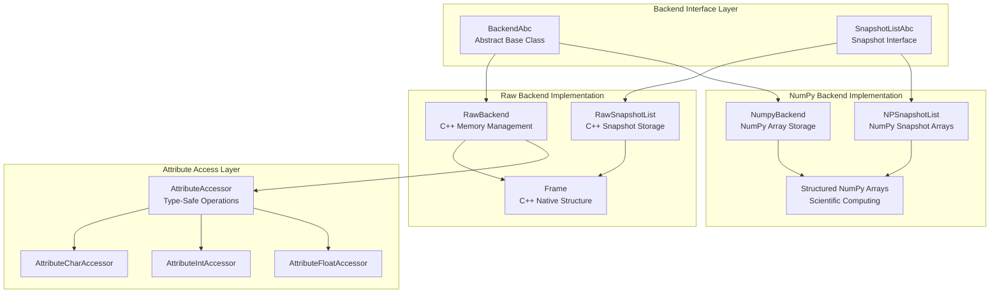
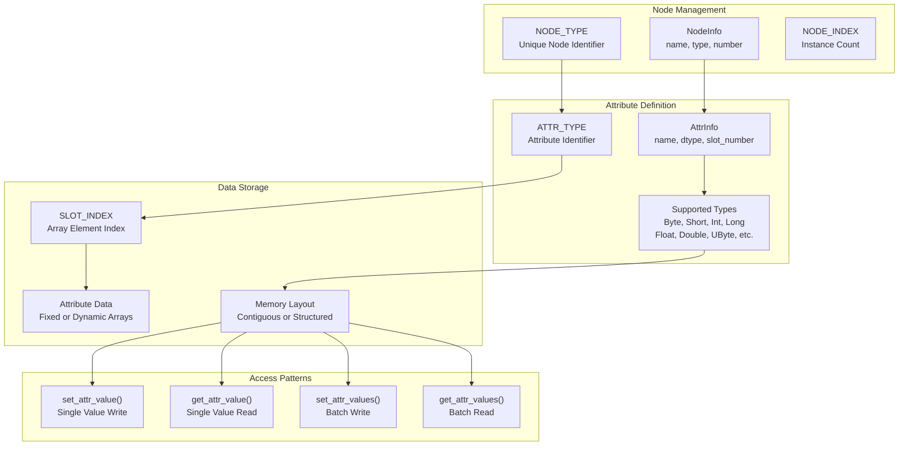
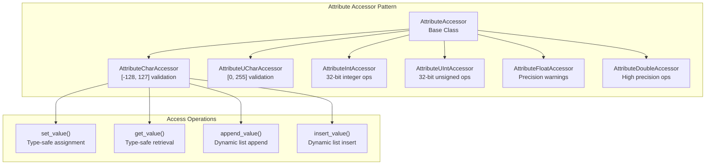
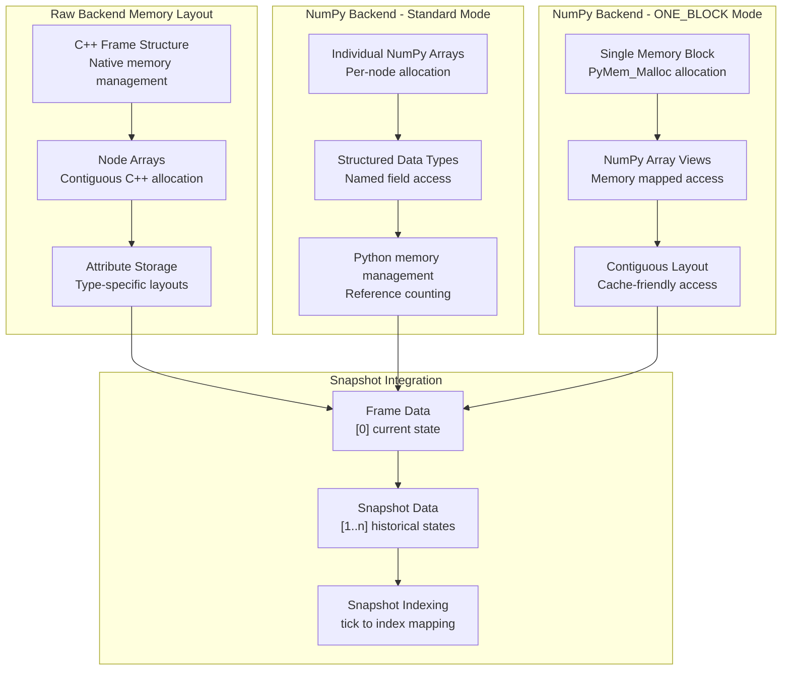
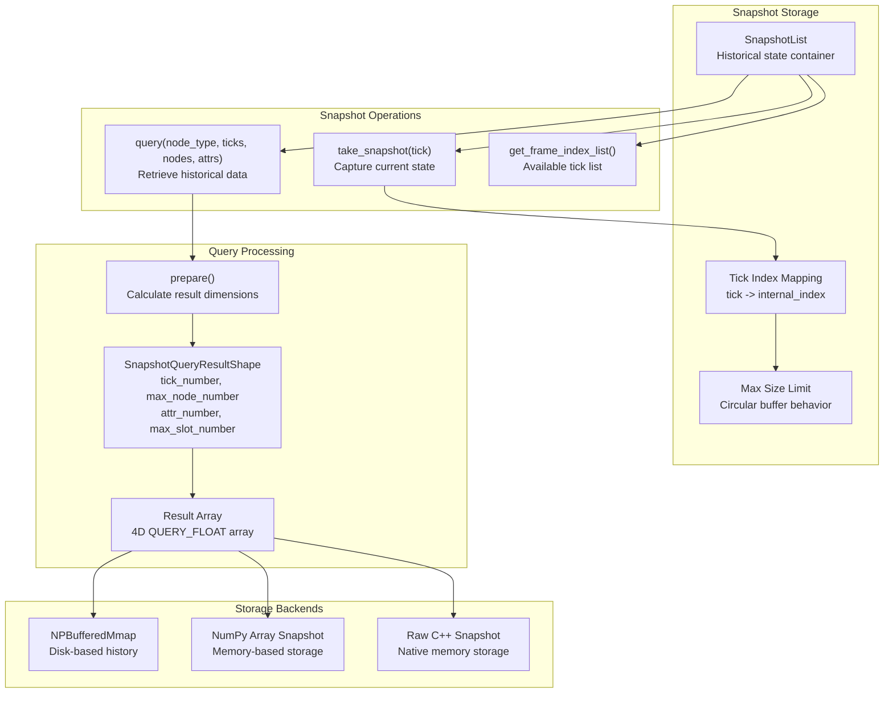

<!-- source: DeepWiki mcp.deepwiki.com · repo microsoft/maro · page 2.3 High-Performance Data Backends · fetched 2026-10-26 -->

# High-Performance Data Backends

Relevant source files

The following files were used as context for generating this wiki page:

- [.gitignore](.gitignore)
- [maro/backends/backend.pxd](maro/backends/backend.pxd)
- [maro/backends/np_backend.pyx](maro/backends/np_backend.pyx)
- [maro/backends/raw/attribute.cpp](maro/backends/raw/attribute.cpp)
- [maro/backends/raw/common.h](maro/backends/raw/common.h)
- [maro/backends/raw/test/README.md](maro/backends/raw/test/README.md)
- [maro/backends/raw/test/main.cpp](maro/backends/raw/test/main.cpp)
- [maro/backends/raw/test/test_attribute.cpp](maro/backends/raw/test/test_attribute.cpp)
- [maro/backends/raw/test/test_frame.cpp](maro/backends/raw/test/test_frame.cpp)
- [maro/backends/raw/xmake.lua](maro/backends/raw/xmake.lua)
- [maro/backends/raw_backend.pyx](maro/backends/raw_backend.pyx)

The high-performance data backends provide the foundational data storage and access layer for MARO's simulation framework. These backends are designed to handle large-scale state management, historical data snapshots, and high-frequency data operations with optimal performance characteristics.

This document covers the backend architecture, data models, and performance optimizations. For information about the simulation framework that uses these backends, see [Simulation Framework](#2.1). For reinforcement learning data sampling, see [Reinforcement Learning Framework](#2.2).

## Backend Architecture

MARO implements two high-performance backend variants that share a common interface but use different underlying storage strategies:

**Backend Architecture Overview**

The backend system uses a two-tier inheritance model where both `RawBackend` and `NumpyBackend` implement the `BackendAbc` interface, providing consistent APIs while optimizing for different use cases.

Sources: [maro/backends/backend.pxd:70-158](), [maro/backends/raw_backend.pyx:99-256](), [maro/backends/np_backend.pyx:153-590]()

## Data Model and Node Structure

The backend data model organizes simulation state using a hierarchical structure of nodes, attributes, and slots:

**Data Model Structure**

Each node represents a simulation entity (e.g., vessel, port, VM) with multiple typed attributes. Attributes can be fixed-size arrays or dynamic lists, with slots representing individual array elements.

Sources: [maro/backends/backend.pxd:31-40](), [maro/backends/np_backend.pyx:111-152](), [maro/backends/raw_backend.pyx:107-135]()

## Type System and Attribute Accessors

The backend implements a comprehensive type system with specialized accessors for performance optimization:

| Data Type | Range | Backend Usage | Memory Size |
|-----------|-------|---------------|-------------|
| `ATTR_CHAR` | -128 to 127 | Flags, small integers | 1 byte |
| `ATTR_UCHAR` | 0 to 255 | Counters, indices | 1 byte |
| `ATTR_SHORT` | -32,768 to 32,767 | Medium integers | 2 bytes |
| `ATTR_USHORT` | 0 to 65,535 | IDs, small counts | 2 bytes |
| `ATTR_INT` | -2,147,483,648 to 2,147,483,647 | Standard integers | 4 bytes |
| `ATTR_UINT` | 0 to 4,294,967,295 | Large counts, IDs | 4 bytes |
| `ATTR_LONG` | -9,223,372,036,854,775,808 to 9,223,372,036,854,775,807 | Large integers | 8 bytes |
| `ATTR_ULONG` | 0 to 18,446,744,073,709,551,615 | Large unsigned values | 8 bytes |
| `ATTR_FLOAT` | IEEE 754 single precision | Approximate values | 4 bytes |
| `ATTR_DOUBLE` | IEEE 754 double precision | High precision values | 8 bytes |

The raw backend uses type-specific accessor classes for optimal performance:

**Type-Safe Attribute Access**

Each data type has a dedicated accessor class that provides range validation and type-specific optimizations, preventing data corruption and improving performance.

Sources: [maro/backends/raw_backend.pyx:74-566](), [maro/backends/backend.pxd:17-44](), [maro/backends/raw/common.h:34-62]()

## Memory Layout Strategies

The backends implement different memory layout strategies optimized for various use cases:

**Memory Layout Comparison**

The raw backend uses C++ native memory management for maximum performance, while the NumPy backend offers two modes: individual arrays for flexibility or a single memory block for cache efficiency.

Sources: [maro/backends/np_backend.pyx:282-344](), [maro/backends/raw_backend.pyx:197-221](), [maro/backends/np_backend.pyx:56-73]()

## Snapshot Management System

The snapshot system provides historical state management with efficient storage and querying capabilities:

**Snapshot System Architecture**

The snapshot system supports time-series queries with configurable storage backends, enabling analysis of simulation state evolution over time.

Sources: [maro/backends/raw_backend.pyx:257-348](), [maro/backends/np_backend.pyx:457-590](), [maro/backends/backend.pxd:46-68]()

## Performance Features and Optimizations

### Dynamic List Support

The raw backend provides dynamic list functionality for attributes that need runtime resizing:

- `append_to_list()` - Add elements to dynamic arrays
- `resize_list()` - Change array capacity
- `clear_list()` - Remove all elements
- `remove_from_list()` - Delete specific elements
- `insert_to_list()` - Insert at specific positions

Sources: [maro/backends/raw_backend.pyx:175-192](), [maro/backends/backend.pxd:117-130]()

### Query Optimization

Both backends implement optimized filtering operations for high-performance data access:

- `where()` - Custom filter functions
- `slots_greater_than()` / `slots_less_than()` - Numeric comparisons
- `slots_equal()` / `slots_not_equal()` - Equality checks
- `slots_greater_equal()` / `slots_less_equal()` - Inclusive comparisons

The NumPy backend leverages vectorized operations through `np.where()` for superior performance on large datasets.

Sources: [maro/backends/raw_backend.pyx:222-256](), [maro/backends/np_backend.pyx:416-451]()

### Memory Management

**Raw Backend:**
- C++ native memory allocation through frame structures
- Manual memory management for optimal performance
- Direct pointer access for minimal overhead

**NumPy Backend:**
- Optional `ONE_BLOCK` mode for contiguous memory allocation
- Memory-mapped files for large snapshot histories
- Reference counting through Python memory management

Sources: [maro/backends/np_backend.pyx:319-344](), [maro/backends/np_backend.pyx:81-110]()

## Backend Selection Guidelines

| Use Case | Recommended Backend | Justification |
|----------|-------------------|---------------|
| Maximum Performance | RawBackend | C++ native operations, minimal overhead |
| Scientific Computing | NumpyBackend | NumPy integration, vectorized operations |
| Large Memory Footprints | NumpyBackend (ONE_BLOCK) | Contiguous allocation, cache efficiency |
| Dynamic Attribute Sizes | RawBackend | Native dynamic list support |
| Historical Analysis | NumpyBackend | Memory-mapped file support |
| Small State Spaces | Either | Performance difference negligible |

The choice between backends depends on specific simulation requirements, with the raw backend optimized for pure performance and the NumPy backend optimized for scientific computing workflows.

Sources: [maro/backends/raw_backend.pyx:104-106](), [maro/backends/np_backend.pyx:266-347]()

---

