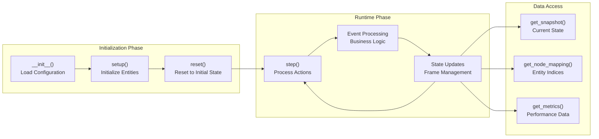
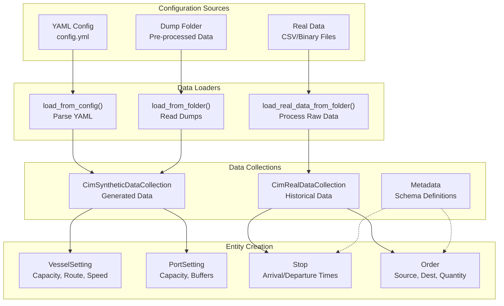
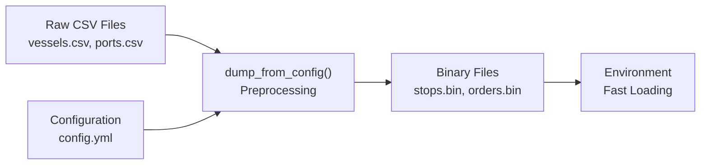

<!-- source: DeepWiki mcp.deepwiki.com · repo microsoft/maro · page 3 Simulation Scenarios · fetched 2026-10-26 -->

# Simulation Scenarios

<details>
<summary>Relevant source files</summary>

The following files were used as context for generating this wiki page:

- [docs/source/images/badges/cim.svg](docs/source/images/badges/cim.svg)
- [docs/source/images/badges/citi_bike.svg](docs/source/images/badges/citi_bike.svg)
- [docs/source/images/badges/platform.svg](docs/source/images/badges/platform.svg)
- [docs/source/images/badges/platforms.svg](docs/source/images/badges/platforms.svg)
- [maro/data_lib/cim/cim_data_loader.py](maro/data_lib/cim/cim_data_loader.py)
- [maro/data_lib/cim/utils.py](maro/data_lib/cim/utils.py)
- [maro/data_lib/cim/vessel_future_stops_prediction.py](maro/data_lib/cim/vessel_future_stops_prediction.py)
- [maro/data_lib/cim/vessel_past_stops_wrapper.py](maro/data_lib/cim/vessel_past_stops_wrapper.py)
- [maro/data_lib/cim/vessel_reachable_stops_wrapper.py](maro/data_lib/cim/vessel_reachable_stops_wrapper.py)
- [maro/simulator/scenarios/cim/meta/cim.stops.meta.yml](maro/simulator/scenarios/cim/meta/cim.stops.meta.yml)
- [maro/simulator/scenarios/cim/vessel.py](maro/simulator/scenarios/cim/vessel.py)
- [maro/simulator/scenarios/citi_bike/meta/source_urls.yml](maro/simulator/scenarios/citi_bike/meta/source_urls.yml)
- [maro/simulator/utils/sim_random.py](maro/simulator/utils/sim_random.py)
- [tests/cim/test_cim_scenario.py](tests/cim/test_cim_scenario.py)
- [tests/citi_bike/test_bike_scenario.py](tests/citi_bike/test_bike_scenario.py)

</details>


This document provides an overview of the built-in simulation scenarios available in MARO and explains how they integrate with the simulation framework. Simulation scenarios are domain-specific implementations of business logic that define the rules, entities, and dynamics of particular optimization problems.

For detailed information about the core simulation engine that powers these scenarios, see [Simulation Framework](#2.1). For specific implementation details of individual scenarios, see [Container Inventory Management (CIM)](#3.1), [VM Scheduling](#3.2), and [Citi Bike Repositioning](#3.3).

## Overview

MARO provides three primary simulation scenarios out of the box, each targeting different optimization domains:

| Scenario | Code Name | Business Domain | Primary Optimization Challenge |
|----------|-----------|-----------------|-------------------------------|
| Container Inventory Management | `cim` | Maritime logistics | Vessel routing and container allocation |
| VM Scheduling | `vm_scheduling` | Cloud computing | Resource allocation and virtual machine placement |
| Citi Bike Repositioning | `citi_bike` | Urban mobility | Bike-sharing system rebalancing |

Each scenario implements the abstract `BusinessEngine` interface and provides domain-specific state representations, action spaces, and reward functions suitable for reinforcement learning applications.

Sources: [tests/cim/test_cim_scenario.py:22-26](), [tests/citi_bike/test_bike_scenario.py:9-10](), [docs/source/images/badges/cim.svg:1](), [docs/source/images/badges/citi_bike.svg:1]()

## Scenario Architecture

The following diagram shows how simulation scenarios integrate with MARO's core simulation framework:

**Scenario Integration Architecture**

```mermaid
graph TB
    subgraph "User Interface"
        ENV["Env Class<br/>Main Interface"]
        CONFIG["YAML Configuration<br/>Topology Definition"]
    end
    
    subgraph "Simulation Core"
        BE["BusinessEngine<br/>Abstract Base Class"]
        EB["EventBuffer<br/>Event Management"]
        FRAME["Frame System<br/>State Storage"]
    end
    
    subgraph "Scenario Implementations"
        CIM_BE["CimBusinessEngine<br/>Maritime Logistics"]
        VM_BE["VmSchedulingBusinessEngine<br/>Cloud Resources"]
        BIKE_BE["CitibikeBusinessEngine<br/>Urban Mobility"]
    end
    
    subgraph "Data Infrastructure"
        LOADER["Data Loaders<br/>CSV/Binary/Config"]
        ENTITIES["Entity Definitions<br/>Vessels, Ports, VMs, Stations"]
        SNAPSHOTS["Snapshot System<br/>Historical States"]
    end
    
    ENV --> BE
    CONFIG --> BE
    BE --> EB
    BE --> FRAME
    
    BE <|-- CIM_BE
    BE <|-- VM_BE
    BE <|-- BIKE_BE
    
    CIM_BE --> LOADER
    VM_BE --> LOADER
    BIKE_BE --> LOADER
    
    LOADER --> ENTITIES
    FRAME --> SNAPSHOTS
    
    CIM_BE -.-> ENTITIES
    VM_BE -.-> ENTITIES
    BIKE_BE -.-> ENTITIES
```

Sources: [maro/simulator/scenarios/cim/business_engine.py:1](), [tests/cim/test_cim_scenario.py:48-57](), [tests/citi_bike/test_bike_scenario.py:50-61]()

## Common Scenario Interface

All scenarios implement a consistent interface through the `BusinessEngine` base class, providing standardized methods for initialization, state management, and simulation stepping:

**Scenario Lifecycle and Methods**



Key interface methods include:
- `step(actions)`: Process agent actions and advance simulation by one tick
- `get_node_mapping()`: Retrieve entity name-to-index mappings
- `reset()`: Reset simulation to initial state
- `get_event_payload_detail()`: Get event type definitions
- `get_agent_idx_list()`: Get list of decision-making agent indices

Sources: [tests/cim/test_cim_scenario.py:457-461](), [tests/cim/test_cim_scenario.py:87-89](), [tests/cim/test_cim_scenario.py:107-109]()

## Scenario Data Loading Patterns

MARO scenarios support flexible data loading from multiple sources with consistent patterns across all implementations:

**Data Loading Architecture**



Sources: [maro/data_lib/cim/cim_data_loader.py:360-406](), [maro/data_lib/cim/cim_data_loader.py:409-450](), [tests/cim/test_cim_scenario.py:29-32](), [tests/cim/test_cim_scenario.py:111-116]()

## Scenario-Specific Features

### Random Number Management

All scenarios use the `SimRandom` system for reproducible simulations with multiple independent random streams:

```python
# Random streams used in CIM scenario
ORDER_INIT_RAND_KEY = "order_init"
ROUTE_INIT_RAND_KEY = "route_init" 
ORDER_NUM_RAND_KEY = "order_number"
BUFFER_TICK_RAND_KEY = "buffer_time"
```

Sources: [maro/data_lib/cim/utils.py:8-11](), [maro/simulator/utils/sim_random.py:96-102]()

### Event-Driven Simulation

Scenarios implement event-driven logic using the `EventBuffer` system with scenario-specific event types:

| Scenario | Key Event Types | Purpose |
|----------|----------------|---------|
| CIM | `VESSEL_ARRIVAL`, `PENDING_DECISION`, `VESSEL_DEPARTURE` | Vessel routing and port operations |
| Citi Bike | `RequireBike`, `ReturnBike` | Bike demand and return events |
| VM Scheduling | `VmRequestEvent`, `VmCompleteEvent` | Resource allocation lifecycle |

Sources: [tests/cim/test_cim_scenario.py:438-456](), [tests/citi_bike/test_bike_scenario.py:83-90]()

### State Snapshot System

All scenarios provide frame-based state snapshots for observation and analysis:

```python
# Example: Accessing CIM port states
states = business_engine.snapshots["ports"][::[
    "empty", "full", "booking", "shortage"
]]

# Example: Accessing Citi Bike station states  
states = business_engine.snapshots["stations"][::[
    "bikes", "shortage", "trip_requirement", "fulfillment"
]]
```

Sources: [tests/cim/test_cim_scenario.py:103-124](), [tests/citi_bike/test_bike_scenario.py:103-137]()

## Working with Scenarios

### Environment Initialization

Create a scenario environment by specifying the scenario name and configuration:

```python
from maro.simulator import Env

# Initialize CIM scenario
env = Env(
    scenario="cim",
    topology="path/to/config",
    start_tick=0,
    durations=200,
    options={"enable-dump-snapshot": "/tmp"}
)

# Initialize Citi Bike scenario
env = Env(
    scenario="citi_bike", 
    topology="path/to/bike_config",
    start_tick=0,
    durations=100
)
```

### Data Processing Pipeline

Scenarios support preprocessing pipelines for converting raw data into optimized binary formats:

**CIM Data Pipeline**


Sources: [tests/cim/test_cim_scenario.py:138-150](), [maro/data_lib/cim/__init__.py:1]()

### Testing and Validation

Each scenario includes comprehensive test suites covering:

- **Deterministic Behavior**: Consistent results with same random seeds
- **Data Loading**: Multiple data source formats (YAML, CSV, binary)
- **State Transitions**: Proper entity state updates
- **Event Processing**: Correct event sequencing and handling
- **Serialization**: Pickle-safe decision events and states

Example seed management for reproducible tests:

```python
# Test deterministic behavior
env.reset(keep_seed=True)  # Same random sequence
env.reset(keep_seed=False) # New random sequence
```

Sources: [tests/cim/test_cim_scenario.py:326-362](), [tests/citi_bike/test_bike_scenario.py:139-170](), [tests/cim/test_cim_scenario.py:391-435]()

---

