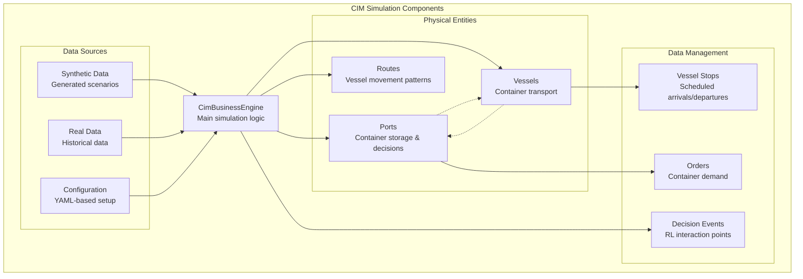
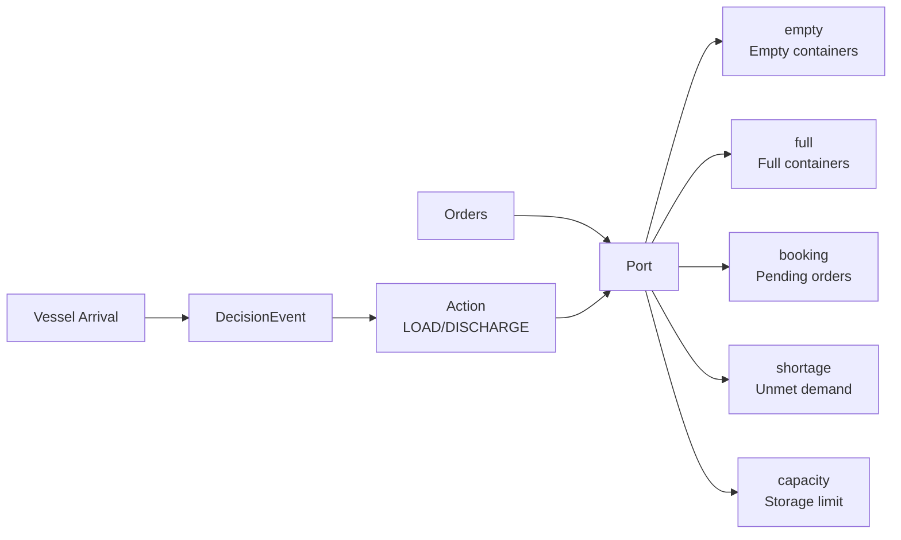
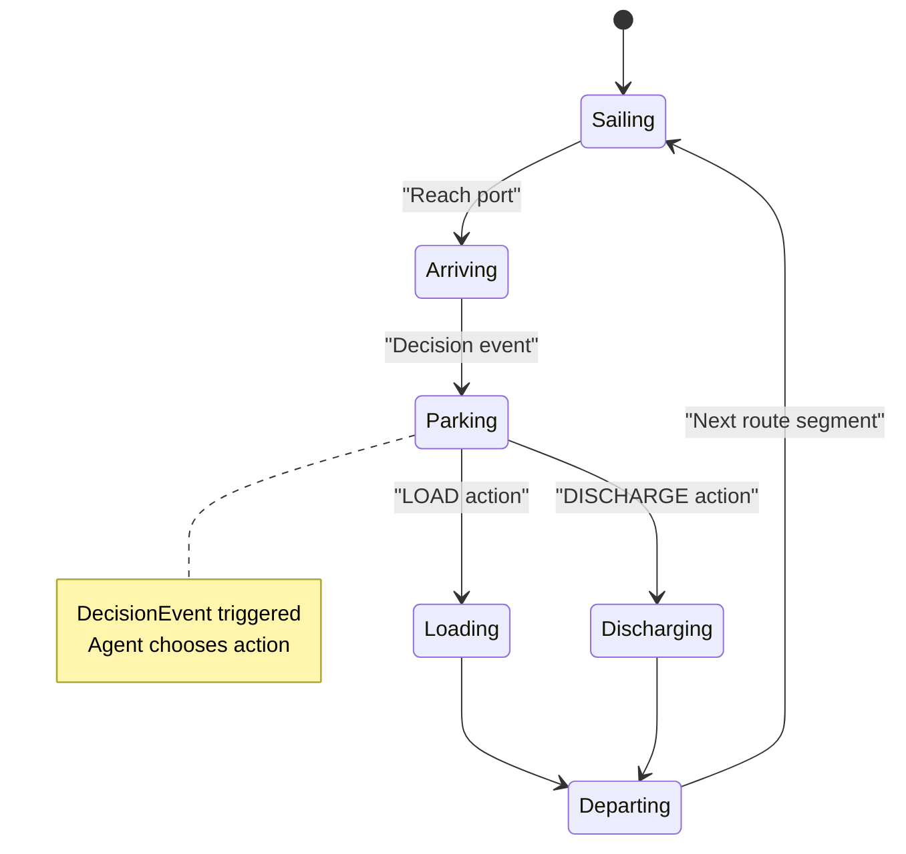
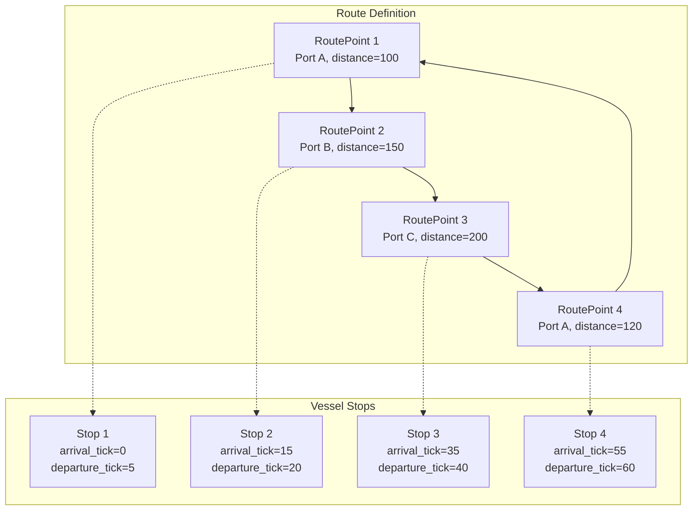
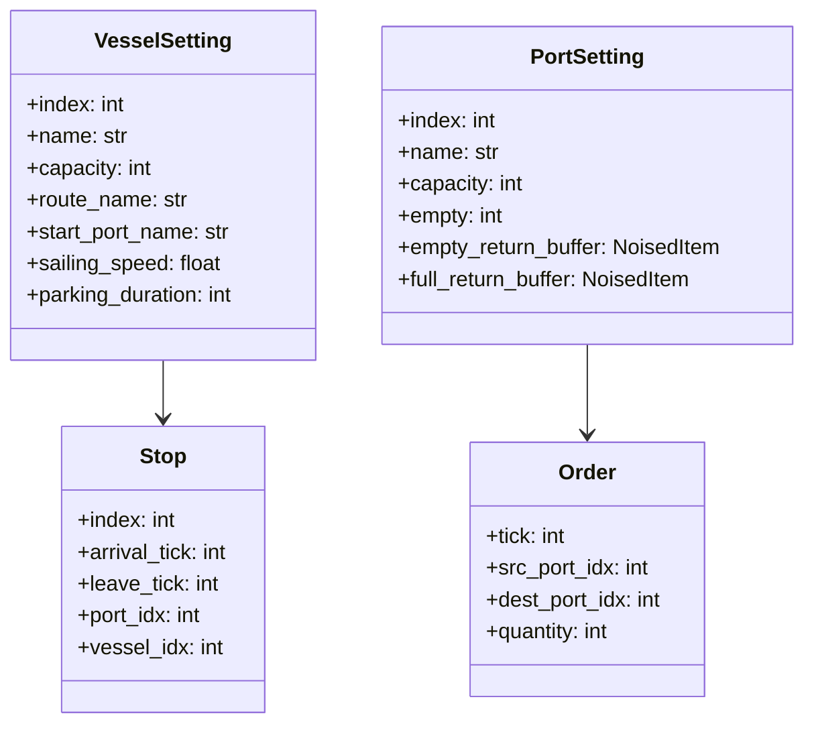
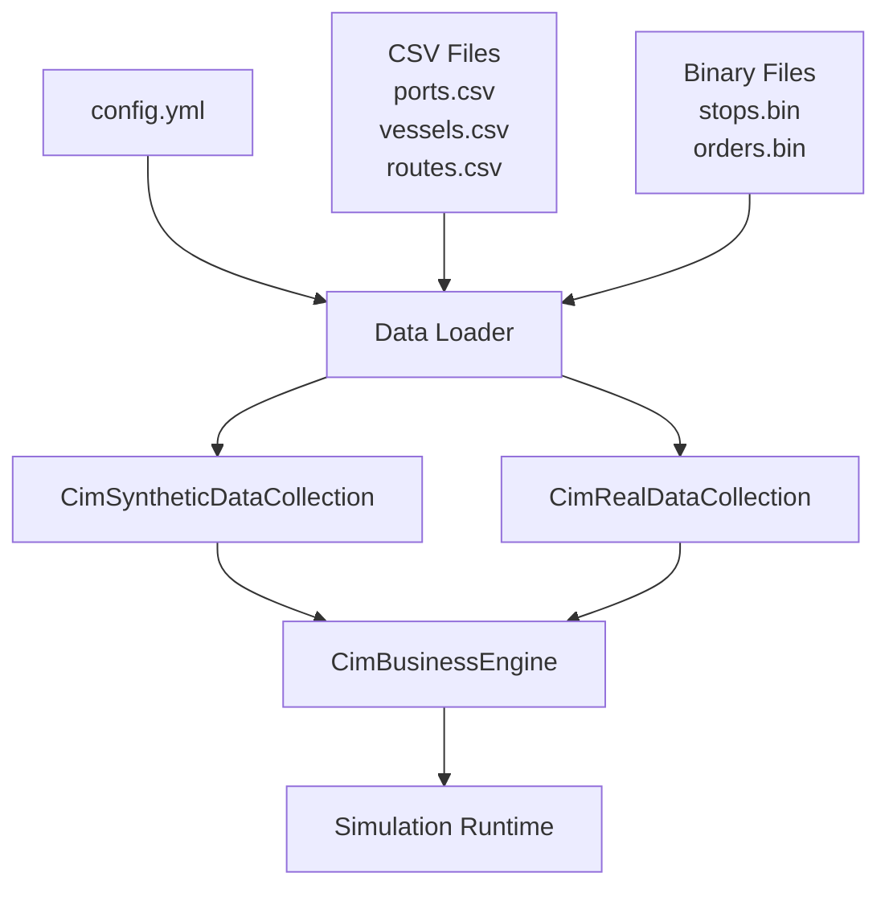
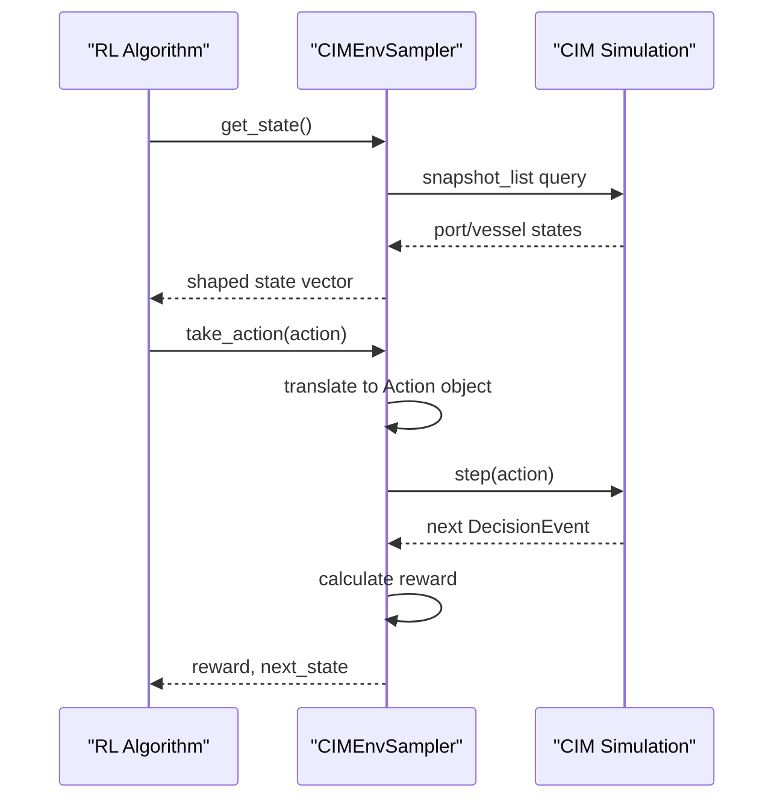
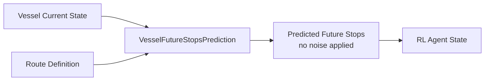

<!-- source: DeepWiki mcp.deepwiki.com · repo microsoft/maro · page 3.1 Container Inventory Management (CIM) · fetched 2026-10-26 -->

# Container Inventory Management (CIM)

<details>
<summary>Relevant source files</summary>

The following files were used as context for generating this wiki page:

- [maro/data_lib/cim/cim_data_loader.py](maro/data_lib/cim/cim_data_loader.py)
- [maro/data_lib/cim/utils.py](maro/data_lib/cim/utils.py)
- [maro/data_lib/cim/vessel_future_stops_prediction.py](maro/data_lib/cim/vessel_future_stops_prediction.py)
- [maro/data_lib/cim/vessel_past_stops_wrapper.py](maro/data_lib/cim/vessel_past_stops_wrapper.py)
- [maro/data_lib/cim/vessel_reachable_stops_wrapper.py](maro/data_lib/cim/vessel_reachable_stops_wrapper.py)
- [maro/simulator/scenarios/cim/vessel.py](maro/simulator/scenarios/cim/vessel.py)
- [maro/simulator/utils/sim_random.py](maro/simulator/utils/sim_random.py)
- [notebooks/container_inventory_management/rl_formulation.ipynb](notebooks/container_inventory_management/rl_formulation.ipynb)
- [tests/cim/test_cim_scenario.py](tests/cim/test_cim_scenario.py)
- [tests/citi_bike/test_bike_scenario.py](tests/citi_bike/test_bike_scenario.py)

</details>


## Purpose and Scope

This document covers the Container Inventory Management (CIM) scenario in MARO, which simulates the optimization of empty container repositioning in global shipping networks. The CIM scenario models the complex logistics of managing container inventory across multiple ports to minimize shortages while considering vessel capacity constraints and routing schedules.

For information about reinforcement learning training with CIM, see the RL Framework documentation ([2.2](#2.2)). For setting up and running CIM simulations, see the Getting Started guide ([4](#4)).

## Overview

The CIM scenario consists of a network of ports connected by vessel routes. Vessels transport both full (laden) and empty containers between ports according to predefined schedules. The challenge is to decide when vessels arrive at ports whether to load or discharge empty containers, and in what quantities, to minimize future container shortages across the network.



**Diagram: CIM System Architecture**

Sources: [tests/cim/test_cim_scenario.py:23-24](), [maro/simulator/scenarios/cim/vessel.py:10-125](), [maro/data_lib/cim/cim_data_loader.py:360-406]()

## Business Logic Components

### Ports

Ports are the primary decision-making agents in the CIM scenario. Each port manages:

- **Container Inventory**: Empty and full container storage with capacity limits
- **Order Generation**: Demand for containers to other destinations
- **Loading/Discharging Decisions**: Actions taken when vessels arrive



**Diagram: Port State and Decision Flow**

Sources: [tests/cim/test_cim_scenario.py:285-324](), [maro/data_lib/cim/cim_data_loader.py:223-269]()

### Vessels

Vessels transport containers along predefined routes with the following key attributes:

| Attribute | Description | Code Reference |
|-----------|-------------|----------------|
| `capacity` | Maximum container volume | [maro/simulator/scenarios/cim/vessel.py:14]() |
| `empty` | Current empty container count | [maro/simulator/scenarios/cim/vessel.py:17]() |
| `full` | Current full container count | [maro/simulator/scenarios/cim/vessel.py:20]() |
| `remaining_space` | Available capacity | [maro/simulator/scenarios/cim/vessel.py:23]() |
| `early_discharge` | Containers for early unloading | [maro/simulator/scenarios/cim/vessel.py:26]() |



**Diagram: Vessel State Machine**

Sources: [maro/simulator/scenarios/cim/vessel.py:47-125](), [tests/cim/test_cim_scenario.py:232-280]()

### Routes and Vessel Movement

Vessels follow circular routes defined by sequences of ports with distances and travel times. The system supports:

- **Route Points**: Port sequences with distances between stops
- **Vessel Scheduling**: Arrival/departure times with parking durations
- **Noise Application**: Random variations in travel and parking times



**Diagram: Route Definition and Vessel Stop Generation**

Sources: [maro/data_lib/cim/cim_data_loader.py:111-134](), [tests/cim/test_cim_scenario.py:152-230]()

## Data Model and Entities

### Data Collections

CIM supports multiple data loading approaches through specialized data collection classes:

| Collection Type | Purpose | Key Components |
|----------------|---------|----------------|
| `CimSyntheticDataCollection` | Generated scenarios | Order proportions, global distributions |
| `CimRealDataCollection` | Historical data | Pre-recorded orders and vessel schedules |

### Key Entity Classes



**Diagram: Core CIM Entity Classes**

Sources: [maro/data_lib/cim/cim_data_loader.py:52-79](), [maro/data_lib/cim/cim_data_loader.py:272-307]()

### Data Loading Pipeline



**Diagram: CIM Data Loading Architecture**

Sources: [maro/data_lib/cim/cim_data_loader.py:360-450](), [tests/cim/test_cim_scenario.py:59-71]()

## Reinforcement Learning Integration

### Decision Events and Actions

The CIM scenario exposes RL decision points through `DecisionEvent` objects when vessels arrive at ports:

```python
# From notebooks/container_inventory_management/rl_formulation.ipynb
class DecisionEvent:
    port_idx: int           # Port making the decision
    vessel_idx: int         # Arriving vessel
    action_scope: ActionScope  # Available load/discharge quantities
    early_discharge: int    # Containers available for early discharge
```

Actions are defined by the `Action` class with `ActionType` enum:

| Action Type | Description | Parameters |
|-------------|-------------|------------|
| `LOAD` | Load empty containers onto vessel | `quantity`, `vessel_idx`, `port_idx` |
| `DISCHARGE` | Discharge empty containers from vessel | `quantity`, `vessel_idx`, `port_idx` |

Sources: [notebooks/container_inventory_management/rl_formulation.ipynb:24](), [tests/cim/test_cim_scenario.py:404-416]()

### Environment Sampler Implementation

The `CIMEnvSampler` provides the interface between the simulation and RL algorithms:



**Diagram: RL-CIM Interaction Flow**

### State Representation

The state vector includes historical and current information:

- **Port Attributes**: `empty`, `full`, `booking`, `shortage`, `fulfillment`
- **Vessel Attributes**: `empty`, `full`, `remaining_space`
- **Temporal Context**: Look-back window for historical states
- **Route Context**: Future ports in vessel's route

Sources: [notebooks/container_inventory_management/rl_formulation.ipynb:76-89](), [notebooks/container_inventory_management/rl_formulation.ipynb:52-53]()

### Reward Shaping

Rewards are calculated based on future fulfillment and shortage with time decay:

```python
# Reward components from rl_formulation.ipynb
reward = (fulfillment_factor * future_fulfillment - 
          shortage_factor * future_shortage) * time_decay
```

Sources: [notebooks/container_inventory_management/rl_formulation.ipynb:119-134]()

## Advanced Features

### Vessel Future Stops Prediction

The `VesselFutureStopsPrediction` class enables agents to anticipate vessel movements:



**Diagram: Future Stops Prediction System**

Sources: [maro/data_lib/cim/vessel_future_stops_prediction.py:11-85]()

### Early Discharge Mechanism

Vessels can discharge containers at intermediate ports before their final destination to optimize space utilization:

```python
# Early discharge calculation from vessel.py
early_discharge_available = vessel.early_discharge
plan_action = percent * (action_scope.discharge + early_discharge) - early_discharge
```

Sources: [tests/cim/test_cim_scenario.py:391-435](), [notebooks/container_inventory_management/rl_formulation.ipynb:111-113]()

### Configuration Options

CIM scenarios support extensive configuration through YAML files and topology specifications:

| Configuration | Purpose | Example Values |
|---------------|---------|----------------|
| `topology` | Scenario definition | `"toy.4p_ssdd_l0.0"`, custom folder path |
| `durations` | Simulation length | `500`, `1000` |
| `reward_shaping_conf` | RL reward parameters | `time_window: 99`, `shortage_factor: 1.0` |
| `state_shaping_conf` | State representation | `look_back: 7`, `max_ports_downstream: 2` |

Sources: [notebooks/container_inventory_management/rl_formulation.ipynb:42-58](), [tests/cim/test_cim_scenario.py:50-56]()

---

