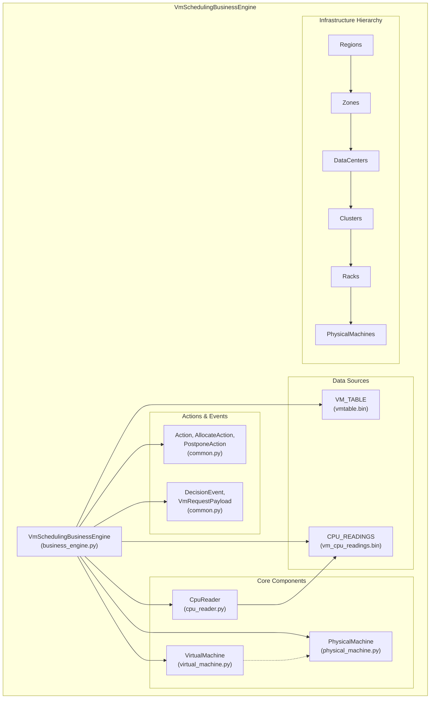
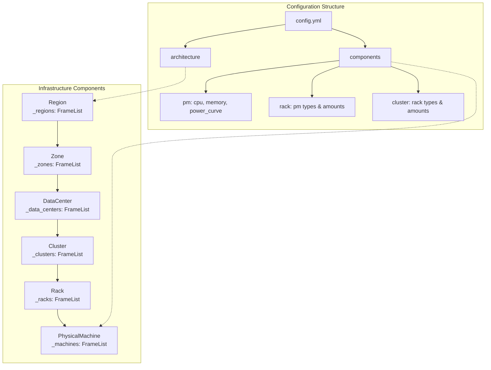
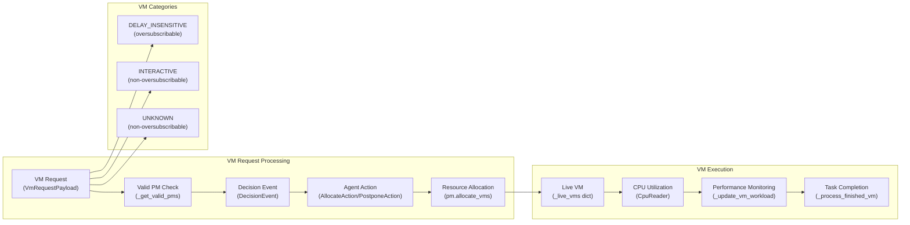
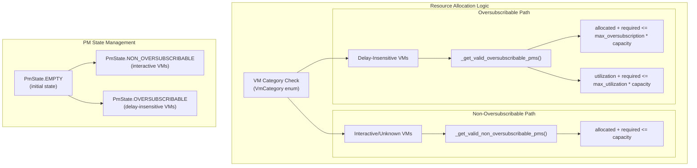

<!-- source: DeepWiki mcp.deepwiki.com · repo microsoft/maro · page 3.2 VM Scheduling · fetched 2026-10-26 -->

# VM Scheduling

<details>
<summary>Relevant source files</summary>

The following files were used as context for generating this wiki page:

- [maro/simulator/scenarios/vm_scheduling/business_engine.py](maro/simulator/scenarios/vm_scheduling/business_engine.py)
- [maro/simulator/scenarios/vm_scheduling/common.py](maro/simulator/scenarios/vm_scheduling/common.py)
- [maro/simulator/scenarios/vm_scheduling/physical_machine.py](maro/simulator/scenarios/vm_scheduling/physical_machine.py)
- [maro/simulator/scenarios/vm_scheduling/topologies/azure.2019.10k.oversubscription/config.yml](maro/simulator/scenarios/vm_scheduling/topologies/azure.2019.10k.oversubscription/config.yml)
- [maro/simulator/scenarios/vm_scheduling/topologies/azure.2019.10k/config.yml](maro/simulator/scenarios/vm_scheduling/topologies/azure.2019.10k/config.yml)
- [maro/simulator/scenarios/vm_scheduling/topologies/azure.2019.336k.oversubscription.multi_clusters/config.yml](maro/simulator/scenarios/vm_scheduling/topologies/azure.2019.336k.oversubscription.multi_clusters/config.yml)
- [maro/simulator/scenarios/vm_scheduling/topologies/azure.2019.336k.oversubscription/config.yml](maro/simulator/scenarios/vm_scheduling/topologies/azure.2019.336k.oversubscription/config.yml)
- [maro/simulator/scenarios/vm_scheduling/topologies/azure.2019.336k/config.yml](maro/simulator/scenarios/vm_scheduling/topologies/azure.2019.336k/config.yml)
- [maro/simulator/scenarios/vm_scheduling/virtual_machine.py](maro/simulator/scenarios/vm_scheduling/virtual_machine.py)
- [tests/data/vm_scheduling/config.yml](tests/data/vm_scheduling/config.yml)
- [tests/vm_scheduling/test_vm_scheduling_scenario.py](tests/vm_scheduling/test_vm_scheduling_scenario.py)

</details>


This document covers the VM Scheduling simulation scenario in MARO, which models virtual machine allocation and resource management in cloud data centers. The VM Scheduling scenario simulates the challenge of efficiently placing virtual machines (VMs) onto physical machines (PMs) while optimizing for resource utilization, energy consumption, and service level agreements.

For information about other simulation scenarios, see [Container Inventory Management (CIM)](#3.1) and [Citi Bike Repositioning](#3.3). For details on the underlying simulation framework, see [Simulation Framework](#2.1).

## System Architecture

The VM Scheduling scenario implements a hierarchical data center architecture with real-world workload patterns based on Microsoft Azure trace data. The system models the complete lifecycle of VM requests, resource allocation decisions, and performance monitoring.



**Sources:** [maro/simulator/scenarios/vm_scheduling/business_engine.py:50-98](), [maro/simulator/scenarios/vm_scheduling/common.py:1-156](), [maro/simulator/scenarios/vm_scheduling/physical_machine.py:12-151](), [maro/simulator/scenarios/vm_scheduling/virtual_machine.py:9-95]()

## Data Center Infrastructure

The VM Scheduling scenario models a realistic data center hierarchy with configurable topologies. The infrastructure is defined through YAML configuration files that specify the physical layout and resource capacities.



**Sources:** [maro/simulator/scenarios/vm_scheduling/business_engine.py:229-399](), [maro/simulator/scenarios/vm_scheduling/topologies/azure.2019.10k/config.yml:39-70](), [maro/simulator/scenarios/vm_scheduling/physical_machine.py:65-110]()

## Virtual Machine Lifecycle

The system processes VM requests through a complete lifecycle from creation to deletion, with dynamic workload patterns and resource allocation decisions.



**Sources:** [maro/simulator/scenarios/vm_scheduling/business_engine.py:805-846](), [maro/simulator/scenarios/vm_scheduling/business_engine.py:847-896](), [maro/simulator/scenarios/vm_scheduling/virtual_machine.py:25-95](), [maro/simulator/scenarios/vm_scheduling/common.py:57-77]()

## Core Classes and Data Structures

### VmSchedulingBusinessEngine

The main business engine class that orchestrates the entire VM scheduling simulation. It inherits from `AbsBusinessEngine` and implements the core simulation logic.

| Method | Purpose | Line Reference |
|--------|---------|----------------|
| `step(tick)` | Process VM requests and update system state | [449-497]() |
| `post_step(tick)` | Update metrics and handle overload conditions | [498-525]() |
| `_on_vm_required()` | Handle incoming VM requests | [805-846]() |
| `_on_action_received()` | Process agent allocation decisions | [847-896]() |
| `_get_valid_pms()` | Find eligible physical machines for VM placement | [713-741]() |

**Sources:** [maro/simulator/scenarios/vm_scheduling/business_engine.py:50-98]()

### PhysicalMachine

Represents physical server hardware with resource capacities and current allocations. Uses the Frame system for efficient data storage and snapshot capabilities.

| Attribute | Type | Description |
|-----------|------|-------------|
| `cpu_cores_capacity` | `NodeAttribute("i2")` | Total CPU cores available |
| `memory_capacity` | `NodeAttribute("i2")` | Total memory in GB |
| `cpu_cores_allocated` | `NodeAttribute("i2")` | Currently allocated CPU cores |
| `memory_allocated` | `NodeAttribute("i2")` | Currently allocated memory |
| `cpu_utilization` | `NodeAttribute("f")` | Current CPU usage percentage |
| `energy_consumption` | `NodeAttribute("f")` | Current energy consumption |
| `oversubscribable` | `NodeAttribute("i2")` | PM state for oversubscription policy |

**Sources:** [maro/simulator/scenarios/vm_scheduling/physical_machine.py:12-151]()

### VirtualMachine

Represents a virtual machine instance with resource requirements and dynamic workload patterns.

| Attribute | Type | Description |
|-----------|------|-------------|
| `cpu_cores_requirement` | `int` | Required CPU cores |
| `memory_requirement` | `int` | Required memory in GB |
| `lifetime` | `int` | VM duration in ticks |
| `category` | `VmCategory` | VM type affecting placement policy |
| `_utilization_series` | `List[float]` | Historical CPU utilization data |

**Sources:** [maro/simulator/scenarios/vm_scheduling/virtual_machine.py:9-95]()

## Resource Management and Oversubscription

The system supports sophisticated resource management policies including oversubscription for different VM categories.



**Sources:** [maro/simulator/scenarios/vm_scheduling/business_engine.py:743-780](), [maro/simulator/scenarios/vm_scheduling/enums.py](), [maro/simulator/scenarios/vm_scheduling/business_engine.py:885-895]()

## Performance Metrics and Monitoring

The system tracks comprehensive metrics for evaluating allocation efficiency, energy consumption, and service quality.

### Key Metrics

| Metric | Description | Calculation |
|--------|-------------|-------------|
| `total_incomes` | Revenue from VM allocations | `vm.unit_price * duration` |
| `energy_consumption_cost` | Power usage costs | `pm.energy_consumption * unit_price * PUE` |
| `total_profit` | Net profit | `total_incomes - energy_consumption_cost` |
| `successful_allocation` | Successfully placed VMs | Count of allocated VMs |
| `failed_allocation` | Failed VM placements | Count of rejected VMs |
| `total_oversubscriptions` | Oversubscription events | PM-tick count of oversubscribed machines |
| `total_latency` | Cumulative delays | `Latency.due_to_agent + Latency.due_to_resource` |

**Sources:** [maro/simulator/scenarios/vm_scheduling/business_engine.py:27-45](), [maro/simulator/scenarios/vm_scheduling/business_engine.py:550-574](), [maro/simulator/scenarios/vm_scheduling/common.py:138-156]()

### Energy Consumption Model

The system uses a realistic power consumption model based on CPU utilization with configurable power curves for different PM types.

```python
# Energy calculation formula from business_engine.py:673-688
energy_consumption_per_hour = idle_power + (busy_power - idle_power) * (
    2 * cpu_utilization - pow(cpu_utilization, power)
)
energy_per_tick = (energy_consumption_per_hour / ticks_per_hour) / 1000
```

**Sources:** [maro/simulator/scenarios/vm_scheduling/business_engine.py:673-688](), [maro/simulator/scenarios/vm_scheduling/topologies/azure.2019.10k/config.yml:44-48]()

## Configuration and Topologies

The VM Scheduling scenario provides multiple pre-configured topologies based on real Azure data center traces.

### Available Topologies

| Topology | VMs | Description |
|----------|-----|-------------|
| `azure.2019.10k` | 10,000 | Small-scale dataset for development |
| `azure.2019.336k` | 336,000 | Large-scale dataset for research |
| `azure.2019.10k.oversubscription` | 10,000 | With oversubscription policies |
| `azure.2019.336k.oversubscription` | 336,000 | Large-scale with oversubscription |

### Configuration Parameters

| Parameter | Purpose | Default |
|-----------|---------|---------|
| `BUFFER_TIME_BUDGET` | Maximum delay allowed for VM placement | 0 |
| `DELAY_DURATION` | Ticks to wait when postponing placement | 1 |
| `MAX_CPU_OVERSUBSCRIPTION_RATE` | CPU oversubscription limit | 1.0-1.15 |
| `MAX_MEM_OVERSUBSCRIPTION_RATE` | Memory oversubscription limit | 1.0 |
| `KILL_ALL_VMS_IF_OVERLOAD` | Overload handling policy | True |

**Sources:** [maro/simulator/scenarios/vm_scheduling/topologies/azure.2019.10k/config.yml:1-70](), [maro/simulator/scenarios/vm_scheduling/topologies/azure.2019.336k/config.yml:1-70](), [maro/simulator/scenarios/vm_scheduling/business_engine.py:118-137]()

## Agent Integration

Agents interact with the VM Scheduling environment through the standard MARO agent interface, receiving decision events and returning allocation actions.

### Decision Events

The `DecisionEvent` provides agents with the information needed to make placement decisions:

```python
# Key fields in DecisionEvent
frame_index: int                    # Current simulation state
valid_pms: List[int]               # Eligible physical machines
vm_id: int                         # VM to be allocated
vm_cpu_cores_requirement: int      # Required CPU cores
vm_memory_requirement: int         # Required memory
remaining_buffer_time: int         # Time budget for decision
```

### Agent Actions

Agents can respond with two types of actions:

- **AllocateAction**: Place VM on specified PM
- **PostponeAction**: Delay placement decision

**Sources:** [maro/simulator/scenarios/vm_scheduling/common.py:79-135](), [maro/simulator/scenarios/vm_scheduling/common.py:11-55](), [maro/simulator/scenarios/vm_scheduling/business_engine.py:847-896]()

---

