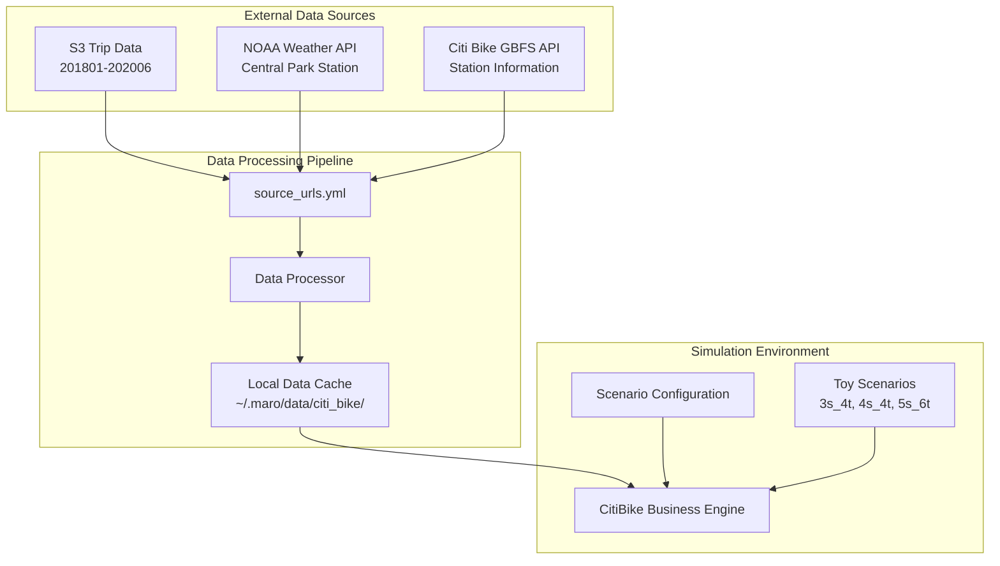

<!-- source: DeepWiki mcp.deepwiki.com · repo microsoft/maro · page 3.3 Citi Bike Repositioning · fetched 2026-10-26 -->

# Citi Bike Repositioning

<details>
<summary>Relevant source files</summary>

The following files were used as context for generating this wiki page:

- [docs/source/images/badges/cim.svg](docs/source/images/badges/cim.svg)
- [docs/source/images/badges/citi_bike.svg](docs/source/images/badges/citi_bike.svg)
- [docs/source/images/badges/platform.svg](docs/source/images/badges/platform.svg)
- [docs/source/images/badges/platforms.svg](docs/source/images/badges/platforms.svg)
- [maro/simulator/scenarios/cim/meta/cim.stops.meta.yml](maro/simulator/scenarios/cim/meta/cim.stops.meta.yml)
- [maro/simulator/scenarios/citi_bike/meta/source_urls.yml](maro/simulator/scenarios/citi_bike/meta/source_urls.yml)

</details>


## Purpose and Scope

This document covers the Citi Bike Repositioning scenario, one of the built-in simulation environments in MARO. This scenario models the bike-sharing repositioning problem using real-world data from New York City's Citi Bike system. The simulation allows users to experiment with reinforcement learning policies for optimally redistributing bikes across stations to meet demand patterns.

For information about other simulation scenarios, see [Container Inventory Management (CIM)](#3.1) and [VM Scheduling](#3.2). For details on the core simulation framework architecture, see [Simulation Framework](#2.1).

## Bike Sharing Repositioning Problem

The bike-sharing repositioning problem involves managing the distribution of bicycles across a network of stations to minimize user wait times and maximize system utilization. Key challenges include:

- **Demand Imbalance**: Popular destinations accumulate bikes while departure points become empty
- **Temporal Patterns**: Rush hour flows create predictable but challenging redistribution needs  
- **Weather Dependencies**: External conditions significantly impact ridership patterns
- **Capacity Constraints**: Limited truck capacity and station dock availability

The MARO Citi Bike scenario provides a realistic environment for testing repositioning strategies using historical trip data, weather information, and station characteristics from New York City's bike-sharing system.

## Data Sources and Integration

The Citi Bike scenario integrates multiple real-world data sources to create a comprehensive simulation environment:

### Trip Data Sources
**Citi Bike Trip Records**: Historical trip data from Amazon S3 containing pickup/dropoff locations, timestamps, and user information for months spanning 2018-2020.

### Weather Data Integration  
**NOAA Weather Services**: Daily weather summaries from Central Park station including precipitation, snow, temperature, and wind data that influence ridership patterns.

### Station Information
**GBFS Station Data**: Real-time station information from Citi Bike's General Bikeshare Feed Specification API providing station locations, capacities, and operational status.

### Data Source Configuration



**Citi Bike Data Source Architecture**

The scenario supports both real NYC data and simplified toy scenarios for development and testing purposes.

Sources: [maro/simulator/scenarios/citi_bike/meta/source_urls.yml:1-136]()

## Data Source Details

### Trip Data Coverage

| Time Period | Data Source | Coverage |
|-------------|-------------|----------|
| 2018-01 to 2020-06 | S3 Trip Data | Monthly CSV files with full trip records |
| 2018-01 to 2020-06 | NOAA Weather | Daily weather summaries for NYC |
| Real-time | GBFS API | Current station information and status |

### Toy Scenarios

The scenario includes simplified toy datasets for development and testing:

- **toy.3s_4t**: 3 stations, 4 time periods
- **toy.4s_4t**: 4 stations, 4 time periods  
- **toy.5s_6t**: 5 stations, 6 time periods

These toy scenarios enable rapid prototyping and unit testing without requiring large dataset downloads.

Sources: [maro/simulator/scenarios/citi_bike/meta/source_urls.yml:62-67]()

## Simulation Architecture

The Citi Bike simulation follows MARO's standard business engine pattern, implementing bike-sharing specific logic within the broader simulation framework:

```mermaid
graph TB
    subgraph "MARO Simulation Framework"
        ENV["Env Class"]
        BE["Business Engine Interface"]
        EB["Event Buffer"]
        FRAME["Frame System"]
    end
    
    subgraph "Citi Bike Implementation"
        CBENGINE["CitiBikeBusinessEngine"]
        CBFRAME["CitiBike Frame Schema"]
        CBEVENTS["CitiBike Event Types"]
    end
    
    subgraph "Simulation State"
        STATIONS["Station States<br/>bike_count, capacity"]
        TRIPS["Trip Events<br/>pickup, dropoff"]
        WEATHER["Weather Conditions<br/>daily_summary"]
        REPOSITION["Repositioning Actions<br/>truck_movements"]
    end
    
    subgraph "External Integration"
        DATALOADER["Data Loader"]
        TRIPGEN["Trip Generator"]
        WEATHERSIM["Weather Simulator"]
    end
    
    ENV --> BE
    BE <|-- CBENGINE
    EB --> CBEVENTS
    FRAME --> CBFRAME
    
    CBENGINE --> STATIONS
    CBENGINE --> TRIPS
    CBENGINE --> WEATHER
    CBENGINE --> REPOSITION
    
    DATALOADER --> TRIPGEN
    DATALOADER --> WEATHERSIM
    TRIPGEN --> CBENGINE
    WEATHERSIM --> CBENGINE
```

**Citi Bike Business Engine Architecture**

The `CitiBikeBusinessEngine` manages station states, processes trip events, and handles repositioning actions within the standard MARO simulation framework.

Sources: [maro/simulator/scenarios/citi_bike/meta/source_urls.yml:1-136]()

## Environment Configuration

### Scenario Selection

The Citi Bike environment supports multiple configuration options through the scenario naming convention:

```
citi_bike:<topology>.<duration_suffix>
```

Where:
- **topology**: Defines the station network and data source (e.g., `ny` for New York, `toy` for test scenarios)
- **duration_suffix**: Specifies the time period (e.g., `201801` for January 2018)

### Example Configurations

| Scenario Name | Description | Use Case |
|---------------|-------------|----------|
| `citi_bike:toy.3s_4t` | 3 stations, 4 time periods | Unit testing, development |
| `citi_bike:toy.5s_6t` | 5 stations, 6 time periods | Algorithm prototyping |
| `citi_bike:ny.201801` | NYC data, January 2018 | Full-scale experimentation |
| `citi_bike:ny.201907` | NYC data, July 2019 | Summer ridership patterns |

### Data Download and Caching

The simulation automatically downloads and caches required data from external sources on first use. Data is stored locally in `~/.maro/data/citi_bike/` for subsequent runs.

Sources: [maro/simulator/scenarios/citi_bike/meta/source_urls.yml:62-67]()

## Reinforcement Learning Formulation

### State Space

The Citi Bike environment provides state information including:

- **Station States**: Current bike inventory, capacity, and availability for each station
- **Weather Conditions**: Current weather parameters affecting demand patterns
- **Time Context**: Hour of day, day of week, seasonal indicators
- **Trip Patterns**: Recent trip volume and directional flows

### Action Space

Repositioning actions typically include:

- **Truck Dispatch**: Send repositioning vehicles between stations
- **Bike Transfers**: Specify number of bikes to move between locations
- **Route Planning**: Optimize multi-stop repositioning routes
- **No Action**: Maintain current distribution

### Reward Formulation

Common reward structures for bike repositioning include:

- **Service Level**: Reward successful trip fulfillment, penalize denied requests
- **Efficiency**: Encourage minimal repositioning cost while maintaining service
- **Balance**: Reward maintaining balanced bike distribution across stations
- **Customer Satisfaction**: Minimize wait times and travel distance to available bikes

The environment provides flexibility for implementing custom reward functions based on specific optimization objectives.

Sources: [maro/simulator/scenarios/citi_bike/meta/source_urls.yml:1-136]()

---

