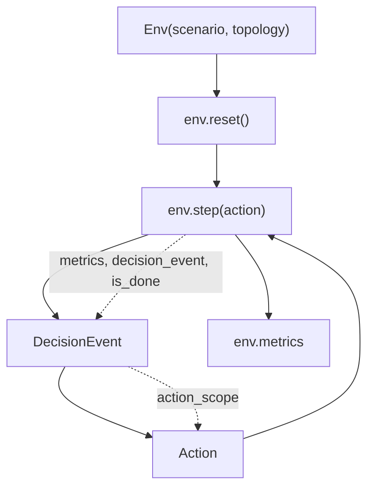
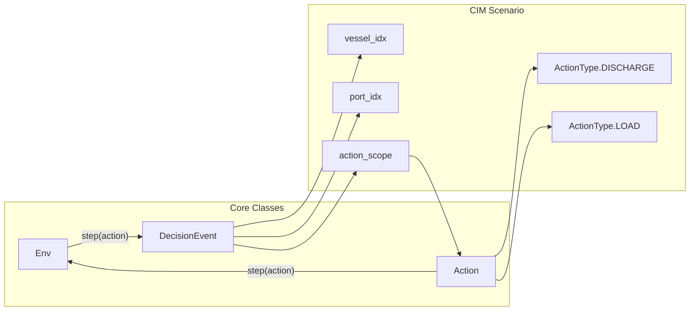
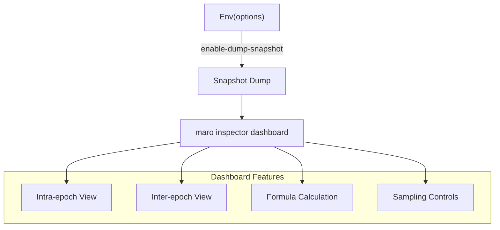

<!-- source: DeepWiki mcp.deepwiki.com · repo microsoft/maro · page 4 Getting Started · fetched 2026-10-26 -->

# Getting Started

<details>
<summary>Relevant source files</summary>

The following files were used as context for generating this wiki page:

- [docs/source/key_components/dashboard_visualization.rst](docs/source/key_components/dashboard_visualization.rst)
- [examples/hello_world/cim/hello.py](examples/hello_world/cim/hello.py)
- [examples/hello_world/cim/hello_geo_vis.py](examples/hello_world/cim/hello_geo_vis.py)
- [examples/hello_world/cim/hello_streamlit.py](examples/hello_world/cim/hello_streamlit.py)
- [maro/cli/maro_real_time_vis/.env](maro/cli/maro_real_time_vis/.env)
- [maro/cli/maro_real_time_vis/docker-compose.yaml](maro/cli/maro_real_time_vis/docker-compose.yaml)
- [playground.md](playground.md)

</details>


This page provides a practical introduction to the MARO platform for new users. It covers basic installation, core concepts, and walks through simple examples to get you started with simulation environments and reinforcement learning. For comprehensive architecture details, see [Core Architecture](#2). For specific scenario documentation, see [Simulation Scenarios](#3). For production deployment guides, see [Development and Deployment](#7).

## MARO Platform Overview

MARO (Multi-Agent Resource Optimization) is a platform for building and running complex simulations with reinforcement learning capabilities. The platform centers around three core toolkits:

- **Simulation Toolkit**: Provides business scenarios like Container Inventory Management (CIM), VM Scheduling, and Citi Bike repositioning
- **RL Toolkit**: Includes policies, trainers, and algorithms for multi-agent reinforcement learning  
- **Distributed Toolkit**: Enables scaling to cloud clusters using Azure, Kubernetes, and native VM management

**Core MARO Workflow**


Sources: [examples/hello_world/cim/hello.py:10-41]()

## Installation Options

### Option 1: MARO Playground (Recommended for Beginners)

The playground provides a pre-configured environment with Jupyter Lab, examples, and visualization tools:

| Service | Description | Host |
|---------|-------------|------|
| `Jupyter Lab` | MARO environment with examples and notebooks | http://127.0.0.1:40010 |
| `Redis Commander` | Redis Web GUI for data inspection | http://127.0.0.1:40009 |

The playground includes:
- `examples/` - Showcases of predefined scenarios
- `notebooks/` - Quick-start tutorials

Sources: [playground.md:1-22]()

### Option 2: Local Installation

Install MARO directly using pip:

```bash
pip install maro
```

For development installations with visualization dependencies:

```bash
pip install streamlit altair
```

Sources: [docs/source/key_components/dashboard_visualization.rst:21-25]()

## Hello World Example

The most basic MARO program demonstrates the core simulation loop using the Container Inventory Management (CIM) scenario:

**Basic Simulation Loop**


### Key Components

The hello world example in [examples/hello_world/cim/hello.py:10-11]() shows the essential initialization:

```python
env = Env(scenario="cim", topology="global_trade.22p_l0.1", start_tick=0, durations=100)
```

**Core Classes and Their Roles:**

| Class | Purpose | Key Methods |
|-------|---------|-------------|
| `Env` | Main simulation interface | `step()`, `reset()`, `summary`, `metrics` |
| `Action` | Represents agent decisions | Constructor with vessel_idx, port_idx, quantity, action_type |
| `DecisionEvent` | Contains decision context | `action_scope`, `vessel_idx`, `port_idx` |
| `ActionType` | Enum for action types | `DISCHARGE`, `LOAD` |

Sources: [examples/hello_world/cim/hello.py:6-7](), [examples/hello_world/cim/hello.py:27-32]()

### Complete Example Walkthrough

The basic pattern follows these steps:

1. **Environment Creation**: [examples/hello_world/cim/hello.py:11]()
2. **Reset**: [examples/hello_world/cim/hello.py:14]()  
3. **Episode Loop**: [examples/hello_world/cim/hello.py:19-41]()
4. **Action Selection**: [examples/hello_world/cim/hello.py:24-32]()
5. **Environment Step**: [examples/hello_world/cim/hello.py:35]()
6. **Metrics Collection**: [examples/hello_world/cim/hello.py:39]()

The decision-making logic in [examples/hello_world/cim/hello.py:24-32]() shows how to extract action constraints from the `DecisionEvent` and create valid `Action` objects.

Sources: [examples/hello_world/cim/hello.py:1-42]()

## Visualization Options

MARO provides two main visualization approaches for experiment analysis:

### Dashboard Visualization

Post-experiment analysis using Streamlit-based dashboards. Enable data collection by configuring the environment options:

```python
opts = {"enable-dump-snapshot": "./dump_data"}
env = Env(scenario="cim", topology="global_trade.22p_l0.1", options=opts)
```

Launch the dashboard:
```bash
maro inspector dashboard --source_path SNAPSHOT_DUMP_DATA_FOLDER --force true
```

**Dashboard Architecture**


Sources: [examples/hello_world/cim/hello_streamlit.py:13-28](), [docs/source/key_components/dashboard_visualization.rst:32-61](), [docs/source/key_components/dashboard_visualization.rst:73-78]()

### Real-time Geographic Visualization

For scenarios with spatial components, enable real-time streaming:

```python
import os
os.environ["MARO_STREAMIT_ENABLED"] = "true"
os.environ["MARO_STREAMIT_EXPERIMENT_NAME"] = "experiment_example"

from maro.streamit import streamit

with streamit:
    env = Env(scenario="cim", topology="global_trade.22p_l0.1")
    # ... simulation loop
    streamit.episode(ep)  # Mark episode boundaries
```

Sources: [examples/hello_world/cim/hello_geo_vis.py:5-31]()

## Available Scenarios and Topologies

MARO includes several pre-built scenarios:

| Scenario | Description | Example Topology |
|----------|-------------|------------------|
| `"cim"` | Container Inventory Management | `"global_trade.22p_l0.1"`, `"toy.5p_ssddd_l0.0"` |
| `"vm_scheduling"` | Virtual Machine Scheduling | Various VM cluster configurations |
| `"citi_bike"` | Bike Sharing Repositioning | Urban bike-sharing network topologies |

The topology parameter specifies the specific configuration within a scenario, controlling factors like network size, complexity, and data sources.

Sources: [examples/hello_world/cim/hello.py:11](), [examples/hello_world/cim/hello_streamlit.py:24](), [docs/source/key_components/dashboard_visualization.rst:55]()

## Next Steps

After completing the hello world examples, explore these areas:

1. **Scenario Deep Dives**: Learn specific scenarios in [Simulation Scenarios](#3)
2. **RL Integration**: Implement learning agents using [Reinforcement Learning Framework](#2.2)  
3. **Custom Scenarios**: Build new simulation environments following the patterns in [Simulation Framework](#2.1)
4. **Production Deployment**: Scale to clusters using [Command Line Interface](#5) and [Cluster Management](#5.1)
5. **Advanced Visualization**: Explore dashboard features in [Visualization and Monitoring](#6)

For comprehensive examples and tutorials, start with the playground environment or explore the `examples/` directory in the repository.

Sources: [playground.md:14-20]()

---

