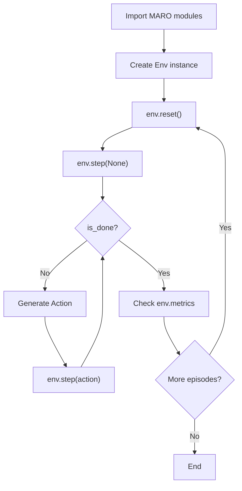
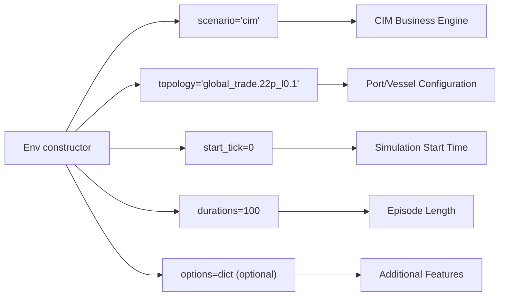
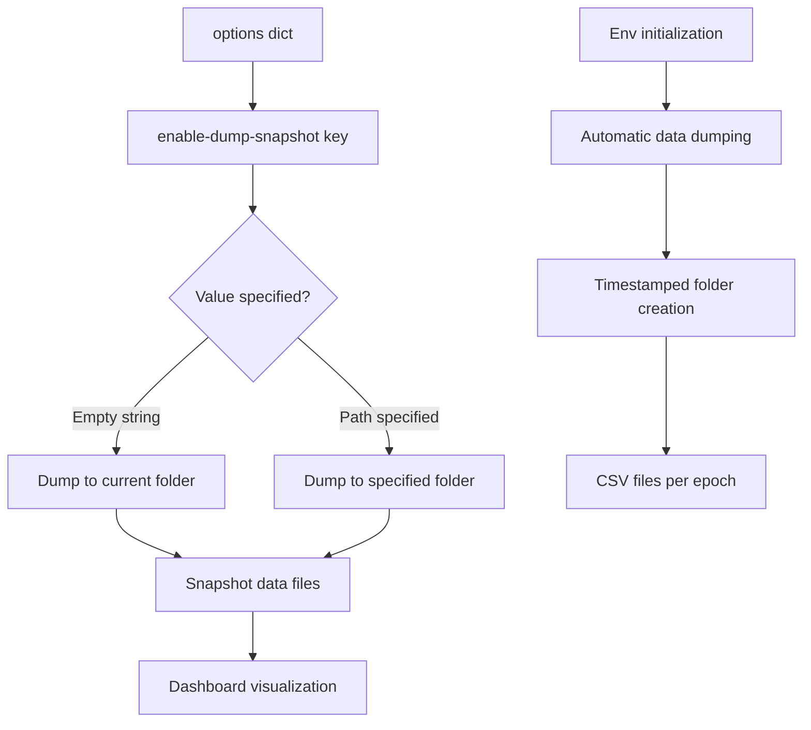
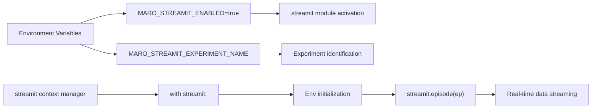
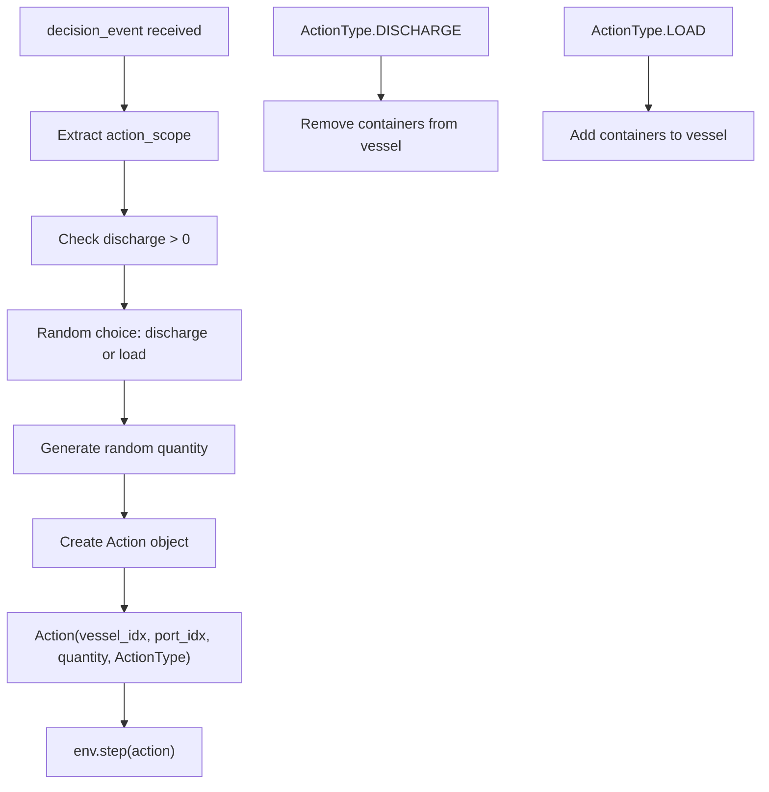
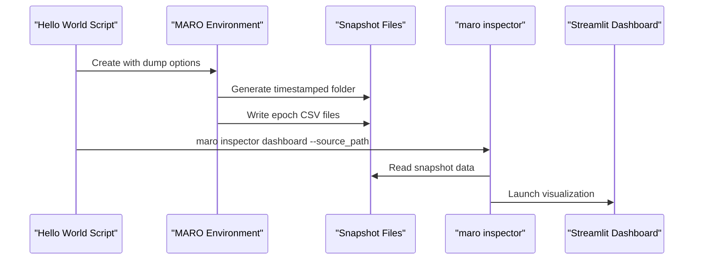

<!-- source: DeepWiki mcp.deepwiki.com · repo microsoft/maro · page 4.1 Hello World Examples · fetched 2026-10-26 -->

# Hello World Examples

Relevant source files

The following files were used as context for generating this wiki page:

- [docs/source/key_components/dashboard_visualization.rst](docs/source/key_components/dashboard_visualization.rst)
- [examples/hello_world/cim/hello.py](examples/hello_world/cim/hello.py)
- [examples/hello_world/cim/hello_geo_vis.py](examples/hello_world/cim/hello_geo_vis.py)
- [examples/hello_world/cim/hello_streamlit.py](examples/hello_world/cim/hello_streamlit.py)
- [maro/cli/maro_real_time_vis/.env](maro/cli/maro_real_time_vis/.env)
- [maro/cli/maro_real_time_vis/docker-compose.yaml](maro/cli/maro_real_time_vis/docker-compose.yaml)

This page provides step-by-step tutorials demonstrating basic MARO usage through simple examples. These examples introduce the core simulation workflow using the Container Inventory Management (CIM) scenario and show how to integrate with MARO's visualization tools. For detailed information about specific scenarios, see [Simulation Scenarios](#3). For visualization setup and configuration, see [Visualization and Monitoring](#6).

## Basic Simulation Loop

The fundamental MARO workflow follows a gym-like pattern with environment initialization, reset, and step-based interaction. All hello world examples use the CIM scenario to demonstrate core concepts.

### Core Workflow Pattern

The basic hello world example demonstrates this pattern with random action generation:

**Key Components:**
- `Env` class: Main simulation interface
- `Action` class: Represents agent decisions  
- `ActionType` enum: DISCHARGE or LOAD operations
- `env.step()`: Advances simulation and returns metrics, events, done status
- `env.reset()`: Reinitializes environment state
- `env.metrics`: Final episode performance metrics

Sources: [examples/hello_world/cim/hello.py:1-42]()

### Environment Initialization

The `Env` constructor parameters configure the simulation scenario, topology file, time parameters, and optional features like data dumping or visualization.

Sources: [examples/hello_world/cim/hello.py:10-11](), [examples/hello_world/cim/hello_streamlit.py:22-28]()

## Hello World Variants

### Basic Example

The simplest example demonstrates core simulation mechanics with random actions:

**Key Methods and Classes:**
- `Env(scenario, topology, start_tick, durations)`: Environment initialization
- `env.summary`: Environment configuration and business instance information  
- `decision_event.action_scope`: Available action constraints (discharge/load limits)
- `Action(vessel_idx, port_idx, quantity, ActionType)`: Agent decision representation
- `env.metrics`: Final episode performance metrics

The example runs 2 episodes with 100 ticks each, using random discharge/load decisions within action scope constraints.

Sources: [examples/hello_world/cim/hello.py:1-42]()

### Visualization-Enabled Example

The streamlit variant enables data dumping for post-experiment dashboard analysis:

**Configuration Pattern:**
- `opts["enable-dump-snapshot"] = "YOUR_FOLDER_NAME"`: Specify dump location
- `opts["enable-dump-snapshot"] = ""`: Dump to current directory
- Generates timestamped folders with CSV files for each epoch
- Compatible with `maro inspector dashboard` command

Sources: [examples/hello_world/cim/hello_streamlit.py:13-28](), [docs/source/key_components/dashboard_visualization.rst:36-65]()

### Real-Time Geographic Visualization

The geo-visualization variant enables real-time data streaming for geographic scenarios:

**Real-Time Integration:**
- Environment variables configure streamit module activation
- `with streamit:` context manager wraps simulation
- `streamit.episode(ep)` marks episode boundaries for streaming
- Enables real-time geographic visualization during simulation

Sources: [examples/hello_world/cim/hello_geo_vis.py:6-31]()

## Action Generation Pattern

All examples follow the same action generation logic for CIM scenarios:

The action generation demonstrates key CIM concepts:
- `decision_event.vessel_idx`: Current vessel requiring decision
- `decision_event.port_idx`: Current port location
- `action_scope.discharge`: Maximum containers that can be discharged
- `action_scope.load`: Maximum containers that can be loaded
- Random action selection within feasible action space

Sources: [examples/hello_world/cim/hello.py:24-35](), [examples/hello_world/cim/hello_streamlit.py:37-49]()

## Integration Points

### Dashboard Visualization Workflow

**File Structure Generated:**
- `epoch_#/`: Folders for each epoch's data
- `{resource_holder}.csv`: Attributes per epoch
- `manifest.yml`: Scenario metadata
- `index_name_mapping`: Resource holder name mappings
- `{resource_holder}_summary.csv`: Cross-epoch summaries

Sources: [docs/source/key_components/dashboard_visualization.rst:86-98]()

### Environment Summary Information

The `env.summary` property provides comprehensive environment configuration details including business instances, attributes, and topology information useful for understanding the simulation setup.

Sources: [examples/hello_world/cim/hello.py:16-17]()

---

