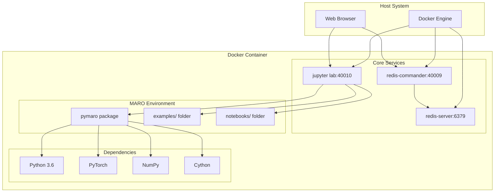
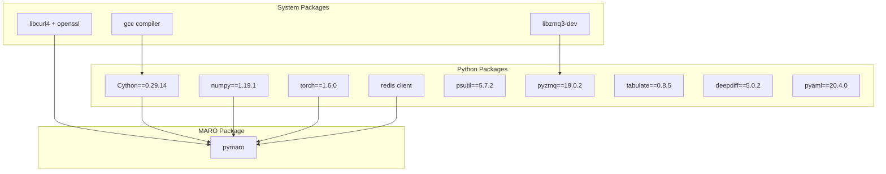
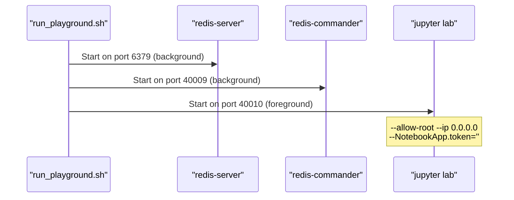
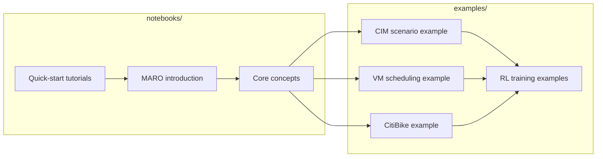
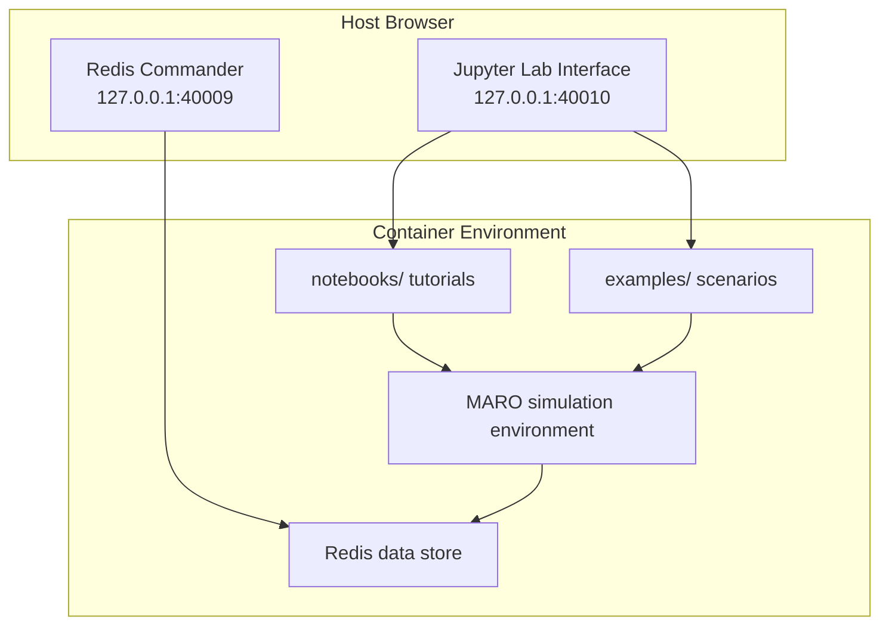

<!-- source: DeepWiki mcp.deepwiki.com · repo microsoft/maro · page 4.2 Playground Environment · fetched 2026-10-26 -->

# Playground Environment

Relevant source files

The following files were used as context for generating this wiki page:

- [.dockerignore](.dockerignore)
- [docker_files/cpu.runtime.df](docker_files/cpu.runtime.df)
- [docker_files/gpu.runtime.df](docker_files/gpu.runtime.df)
- [playground.md](playground.md)
- [scripts/run_playground.sh](scripts/run_playground.sh)

## Purpose and Scope

The Playground Environment provides a containerized, standalone MARO development environment for experimentation and learning. It combines pre-configured Docker containers with Jupyter Lab notebooks and example scenarios to enable immediate hands-on experience with MARO scenarios and RL training workflows.

For production cluster deployment and management, see [Cluster Management](#5.1). For detailed scenario documentation, see [Simulation Scenarios](#3).

## Architecture Overview

The playground consists of a Docker-based environment that packages MARO with supporting services and example content into a ready-to-use development platform.

**Playground Architecture**

Sources: [playground.md:1-22](), [scripts/run_playground.sh:1-10]()

## Docker Environment Configuration

The playground provides two Docker image variants optimized for different hardware configurations.

### Runtime Variants

| Variant | Base Image | GPU Support | PyTorch Version |
|---------|------------|-------------|-----------------|
| CPU | `python:3.6-buster` | No | `1.6.0` |
| GPU | `nvidia/cuda:11.0-runtime-ubuntu18.04` | CUDA 11.0 | `1.6.0+cu101` |

### Dependency Stack

Both variants install identical Python dependencies with version-locked packages:

**Core Dependencies**

Sources: [docker_files/cpu.runtime.df:14-27](), [docker_files/gpu.runtime.df:19-32]()

## Service Components

The playground startup script configures three key services that provide the development environment interface.

### Service Configuration

**Service Startup Sequence**

### Service Details

| Service | Component | Port | Purpose | Configuration |
|---------|-----------|------|---------|---------------|
| Data Store | `redis-server` | 6379 | State persistence | Default config |
| Web GUI | `redis-commander` | 40009 | Redis management | Web interface |
| Development | `jupyter lab` | 40010 | Interactive coding | Token disabled |

The `jupyter lab` service is configured for playground convenience with [scripts/run_playground.sh:9]():
- `--allow-root`: Permits root execution in container
- `--ip 0.0.0.0`: Binds to all interfaces for host access  
- `--NotebookApp.token=''`: Disables authentication for local use

Sources: [scripts/run_playground.sh:5-9](), [playground.md:7-11]()

## Content Organization

The playground provides structured learning materials organized into two main directories.

### Directory Structure

| Directory | Content Type | Purpose |
|-----------|--------------|---------|
| `examples/` | Scenario showcases | Complete MARO scenario implementations |
| `notebooks/` | Tutorial notebooks | Step-by-step learning materials |

### Learning Path

**Content Progression Flow**

The `examples/` directory contains complete implementations demonstrating production-ready usage patterns, while `notebooks/` provides guided tutorials for understanding MARO concepts and APIs.

Sources: [playground.md:14-20]()

## Development Workflow

The playground enables immediate experimentation with MARO scenarios through its integrated environment.

### Access Pattern

**User Interaction Flow**

Users access the playground through web interfaces that connect to the containerized MARO environment. The Jupyter Lab interface provides direct access to tutorials and examples, while Redis Commander enables inspection of simulation state data.

### Container Isolation

The playground uses Docker's `.dockerignore` configuration to optimize build performance and container size by excluding development artifacts:

- CLI components (`maro_cli/`)
- Log files (`examples/**/*.log`)
- Cache directories (`**/__pycache__`)
- IDE configuration (`.idea/`, `.vscode/`)

Sources: [playground.md:7-12](), [.dockerignore:1-10]()

---

