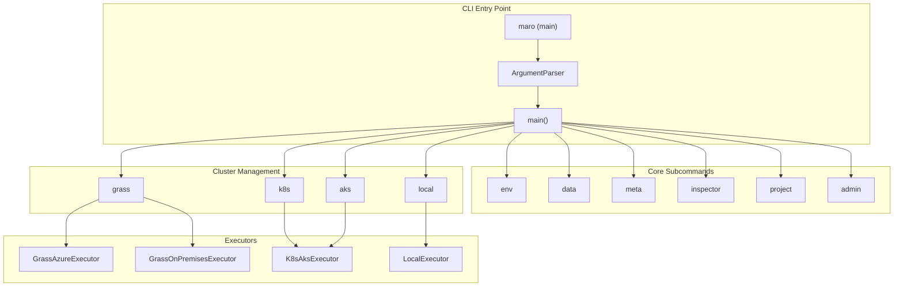
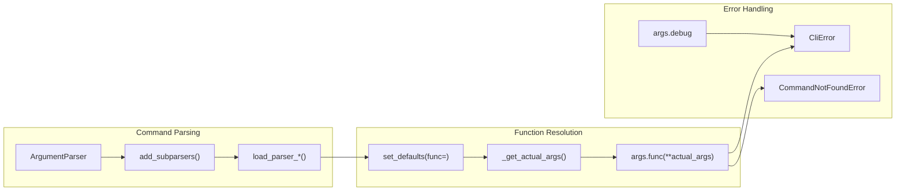
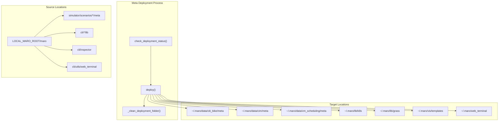
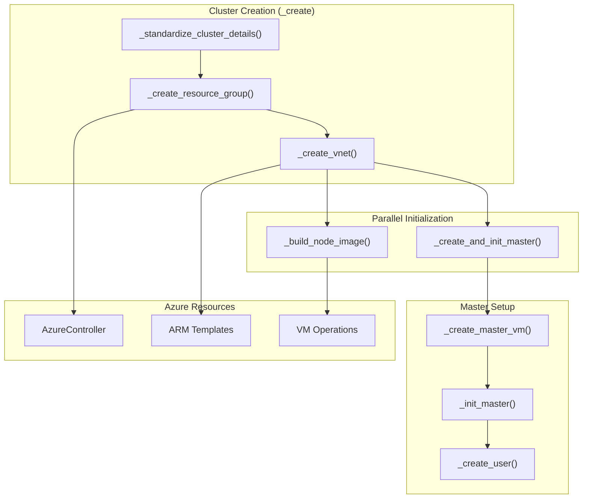
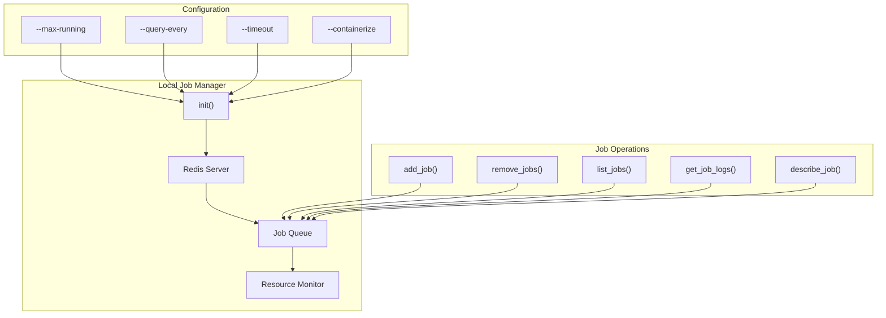
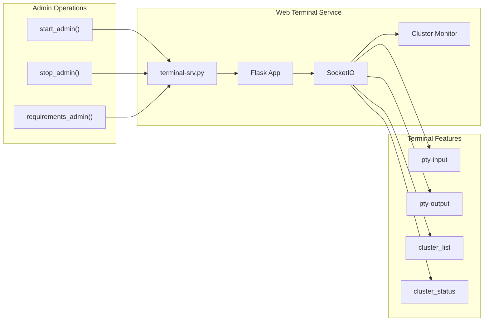

<!-- source: DeepWiki mcp.deepwiki.com · repo microsoft/maro · page 5 Command Line Interface · fetched 2026-10-26 -->

# Command Line Interface

<details>
<summary>Relevant source files</summary>

The following files were used as context for generating this wiki page:

- [docs/source/scenarios/citi_bike.rst](docs/source/scenarios/citi_bike.rst)
- [examples/vm_scheduling/rule_based_algorithm/README.md](examples/vm_scheduling/rule_based_algorithm/README.md)
- [maro/cli/grass/data.py](maro/cli/grass/data.py)
- [maro/cli/grass/executors/grass_azure_executor.py](maro/cli/grass/executors/grass_azure_executor.py)
- [maro/cli/grass/lib/services/master_agent/agent.py](maro/cli/grass/lib/services/master_agent/agent.py)
- [maro/cli/maro.py](maro/cli/maro.py)
- [maro/cli/utils/node_admin.py](maro/cli/utils/node_admin.py)
- [maro/cli/utils/params.py](maro/cli/utils/params.py)
- [maro/cli/utils/web_terminal/terminal-srv.py](maro/cli/utils/web_terminal/terminal-srv.py)
- [maro/data_lib/cim/vessel_sailing_plan_wrapper.py](maro/data_lib/cim/vessel_sailing_plan_wrapper.py)
- [maro/utils/utils.py](maro/utils/utils.py)
- [maro/vector_env/vector_env.py](maro/vector_env/vector_env.py)
- [tests/cli/speed/test_k8s_copy.py](tests/cli/speed/test_k8s_copy.py)

</details>


The MARO Command Line Interface (CLI) provides a comprehensive set of tools for managing MARO environments, distributed clusters, data processing, and visualization. The CLI serves as the primary interface for deploying and orchestrating MARO simulations across different execution environments, from local development to cloud-scale distributed clusters.

This document covers the complete CLI system architecture and command reference. For details about specific cluster deployment configurations, see [Cluster Management](#5.1). For environment-specific simulation setup, see [Environment and Data Commands](#5.2).

## CLI Architecture Overview

The MARO CLI is built around a hierarchical command structure with the main entry point at `maro` and multiple specialized subcommands. The system supports multiple execution modes and cloud platforms through pluggable executor patterns.

### Main CLI Entry Point



**CLI Architecture and Command Structure**

Sources: [maro/cli/maro.py:33-162]()

### Command Loading and Execution Pattern



**Command Loading and Execution Flow**

Sources: [maro/cli/maro.py:138-161](), [maro/cli/maro.py:311-634]()

## Main Commands

### Environment Commands (`maro env`)

The `env` command group manages MARO simulation environments and scenario configurations.

| Command | Function | Description |
|---------|----------|-------------|
| `maro env list` | `list_scenarios()` | List available built-in scenarios |
| `maro env topology -s <scenario>` | `list_topologies()` | List topologies for a scenario |
| `maro env data generate -s <scenario> -t <topology>` | `generate()` | Generate scenario data files |
| `maro env data list` | `list_env()` | List environments requiring data generation |

Sources: [maro/cli/maro.py:636-716]()

### Data Commands (`maro data`)

The `data` command processes CSV data files to MARO's binary format for efficient simulation loading.

```bash
maro data build --meta <meta_file> --file <csv_file> --output <binary_file>
```

Sources: [maro/cli/maro.py:57-64]()

### Meta Commands (`maro meta`)

The `meta` command manages MARO's metadata and deployment files, handling the installation of required libraries and configuration files to `~/.maro/`.



**Meta Deployment Architecture**

Sources: [maro/utils/utils.py:84-196]()

## Cluster Management Commands

### Grass Commands (`maro grass`)

Grass (MARO's native cluster orchestration) supports Azure and on-premises deployments with comprehensive cluster lifecycle management.

#### Core Grass Operations

| Operation | Azure Function | On-Premises Function | Description |
|-----------|----------------|---------------------|-------------|
| `create` | `GrassAzureExecutor.create()` | `GrassOnPremisesExecutor.create()` | Create new cluster |
| `delete` | `executor.delete()` | `executor.delete()` | Delete entire cluster |
| `node scale` | `executor.scale_node()` | `executor.scale_node()` | Scale nodes to target count |
| `node start/stop` | `executor.start_node()/stop_node()` | `executor.start_node()/stop_node()` | Control node state |
| `job start` | `executor.start_job()` | `executor.start_job()` | Submit training jobs |
| `data push/pull` | `executor.push_data()/pull_data()` | `executor.push_data()/pull_data()` | Transfer data files |

Sources: [maro/cli/maro.py:311-634]()

#### Azure Cluster Creation Process



**Azure Grass Cluster Creation Flow**

Sources: [maro/cli/grass/executors/grass_azure_executor.py:54-321]()

### Kubernetes Commands (`maro k8s` and `maro aks`)

Kubernetes support provides container orchestration for MARO workloads with both generic K8s and Azure Kubernetes Service (AKS) backends.

#### K8s Command Structure

| Command Group | Operations | Functions |
|---------------|------------|-----------|
| `cluster` | `create`, `delete` | Cluster lifecycle management |
| `node` | `scale`, `list` | Node pool management |
| `image` | `push`, `list` | Container image operations |
| `data` | `push`, `pull`, `remove` | Data volume management |
| `job` | `start`, `stop`, `list`, `logs` | Job execution control |
| `schedule` | `start`, `stop` | Scheduled job management |

Sources: [maro/cli/maro.py:718-978]()

### Local Commands (`maro local`)

The local execution mode provides job management for single-machine deployments with Redis-based coordination.



**Local Job Management Architecture**

Sources: [maro/cli/maro.py:163-309]()

## Environment and Data Commands

### Data Generation Workflow

The CLI provides automated data preparation for scenarios requiring external datasets:

```bash
# List environments needing data generation
maro env data list

# Generate data for specific scenario/topology
maro env data generate -s citi_bike -t ny.201802 -f

# Build binary data from CSV
maro data build --meta ~/.maro/data/citibike/meta/trips.yml \
                --file ~/.maro/data/citibike/source/_clean/ny201801/trip.csv \
                --output ~/.maro/data/citibike/_build/ny201801/trip.bin
```

Sources: [docs/source/scenarios/citi_bike.rst:513-600]()

### Global Configuration Parameters

The CLI uses centralized configuration through `GlobalParams` and `GlobalPaths` classes:

| Parameter | Default Value | Description |
|-----------|---------------|-------------|
| `PARALLELS` | 5 | Concurrent operation limit |
| `LOG_LEVEL` | `logging.INFO` | Default logging level |
| `DEFAULT_REDIS_PORT` | 6379 | Redis server port |
| `DEFAULT_SSH_PORT` | 22 | SSH connection port |
| `MARO_CLUSTERS` | `~/.maro/clusters` | Cluster configuration path |
| `MARO_DATA` | `~/.maro/data` | Data storage path |

Sources: [maro/cli/utils/params.py:9-41]()

## Visualization and Admin Commands

### Inspector Command (`maro inspector`)

The inspector provides web-based visualization for experimental data and cluster monitoring.

Sources: [maro/cli/maro.py:102-109]()

### Admin Commands (`maro admin`)

Admin commands control the web terminal service for cluster monitoring:



**Web Terminal Service Architecture**

Sources: [maro/cli/utils/node_admin.py:9-35](), [maro/cli/utils/web_terminal/terminal-srv.py:22-318]()

### Version and Deployment Management

The CLI includes automatic deployment verification and version management:

```python
# Check if deployment is needed
if not check_deployment_status():
    deploy(hide_info=False)
```

The deployment process copies essential files from the MARO installation to user directories, including scenario metadata, cluster management libraries, and visualization templates.

Sources: [maro/utils/utils.py:167-196]()

---

