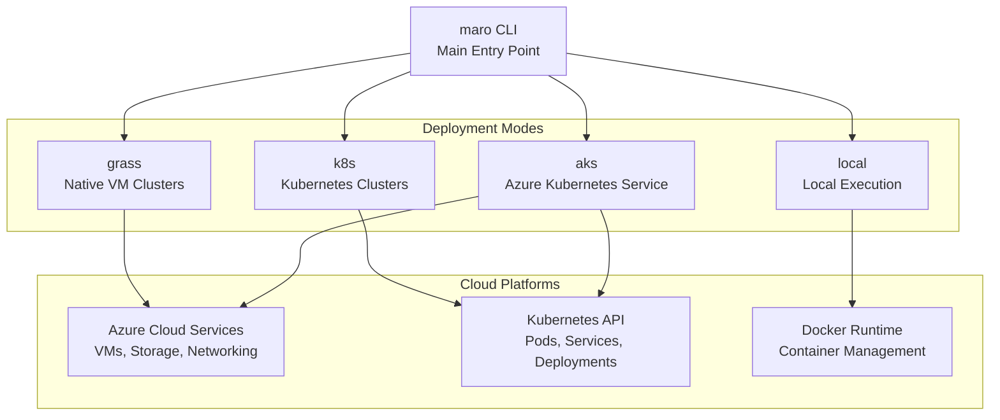
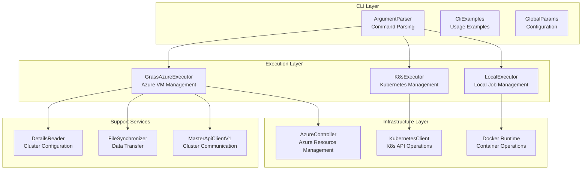
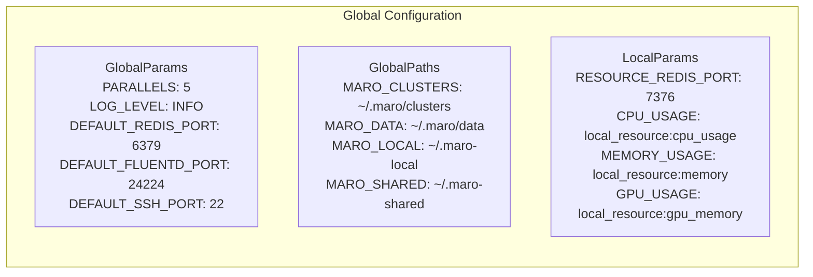
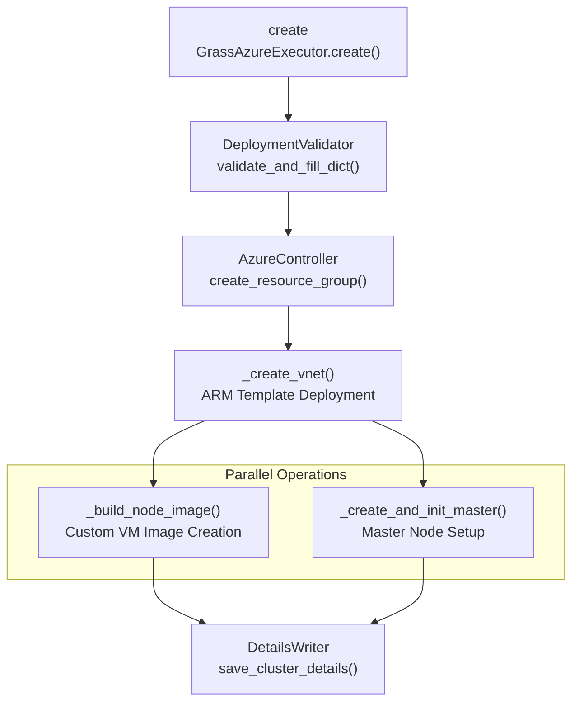
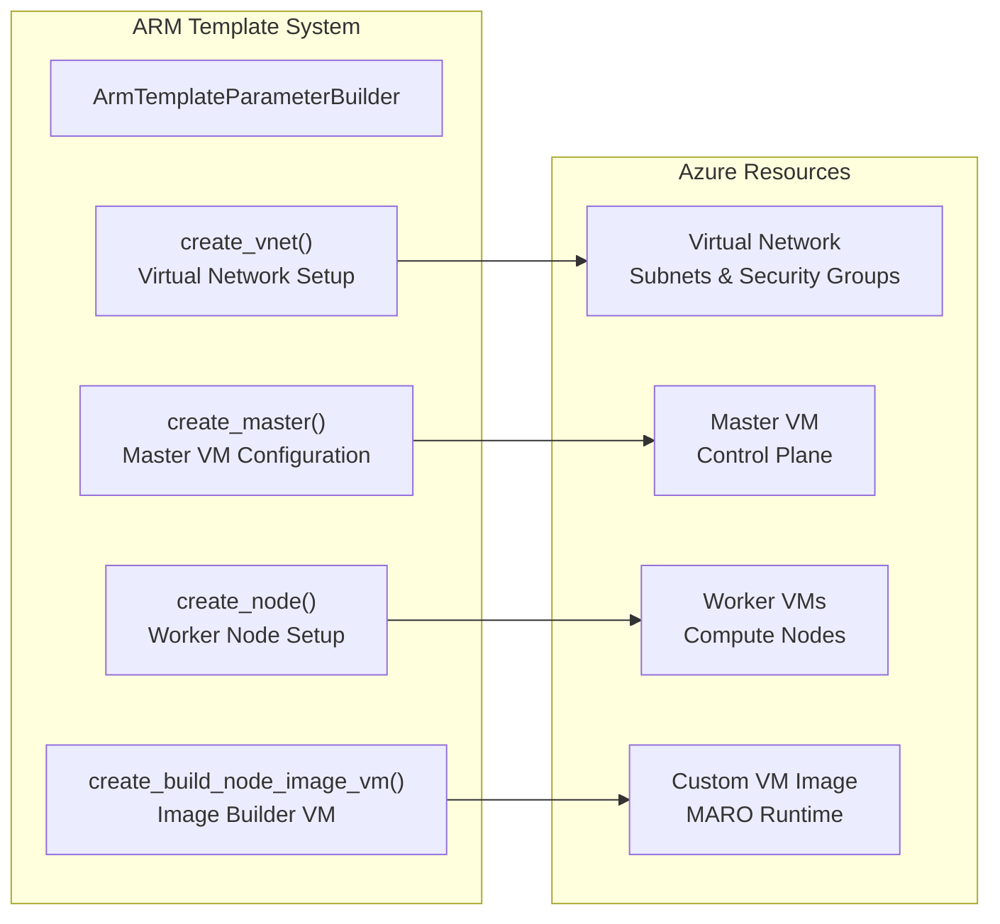
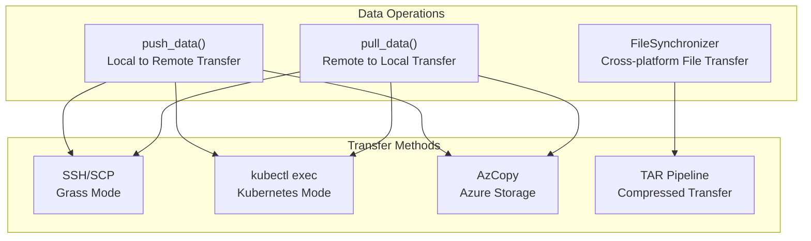
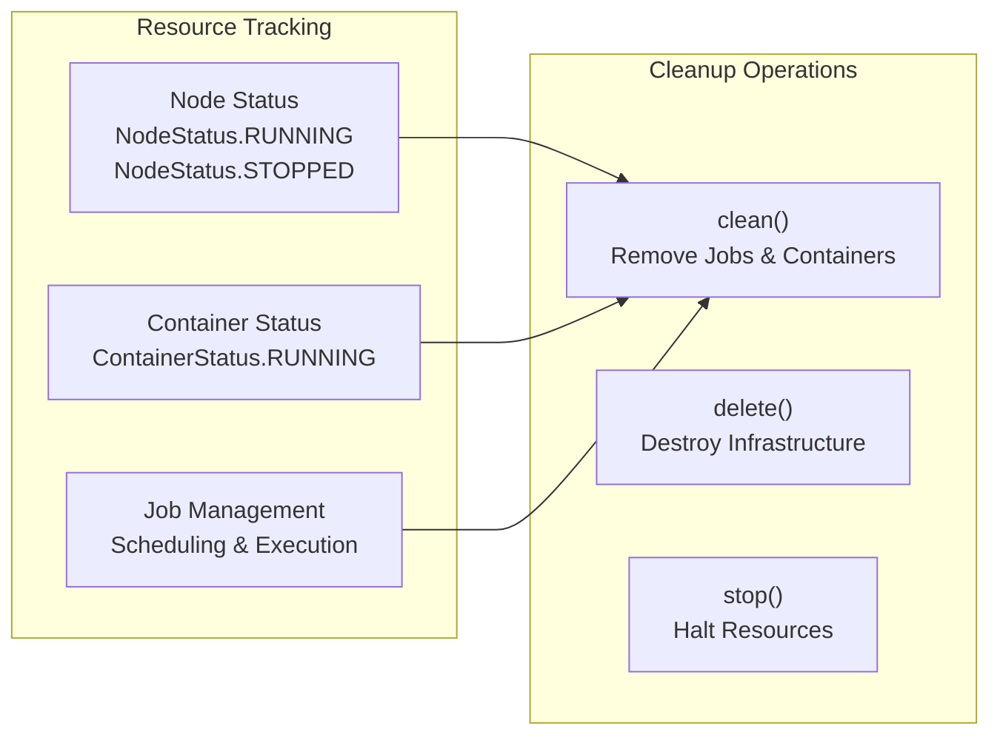

<!-- source: DeepWiki mcp.deepwiki.com · repo microsoft/maro · page 5.1 Cluster Management · fetched 2026-10-26 -->

# Cluster Management

Relevant source files

The following files were used as context for generating this wiki page:

- [maro/cli/grass/data.py](maro/cli/grass/data.py)
- [maro/cli/grass/executors/grass_azure_executor.py](maro/cli/grass/executors/grass_azure_executor.py)
- [maro/cli/maro.py](maro/cli/maro.py)
- [maro/cli/utils/params.py](maro/cli/utils/params.py)
- [tests/cli/speed/test_k8s_copy.py](tests/cli/speed/test_k8s_copy.py)

This document covers the MARO cluster management system, which provides distributed computing capabilities across multiple cloud platforms and local environments. The cluster management system is part of MARO's distributed toolkit and enables users to deploy, manage, and execute MARO workloads on various infrastructure platforms including Azure VMs, Kubernetes clusters, and local machines.

For information about the simulation framework and RL components that run on these clusters, see [Core Architecture](#2). For visualization and monitoring of cluster resources, see [Visualization and Monitoring](#6).

## Overview

MARO's cluster management system supports four primary deployment modes, each optimized for different use cases and infrastructure requirements:

**Sources:** [maro/cli/maro.py:75-135]()

## CLI Command Structure

The cluster management commands follow a hierarchical structure accessible through the `maro` CLI tool:

| Mode | Commands | Purpose |
|------|----------|---------|
| `grass` | `create`, `delete`, `node`, `image`, `data`, `job`, `schedule`, `clean`, `status`, `template` | Native VM cluster management |
| `k8s` | `create`, `delete`, `node`, `image`, `data`, `job`, `schedule`, `status`, `template` | Kubernetes cluster management |
| `aks` | `init`, `exit`, `job` | Azure Kubernetes Service integration |
| `local` | `init`, `exit`, `run`, `job` | Local development and testing |

Each mode provides a consistent interface for cluster lifecycle management, job execution, and data transfer operations.

**Sources:** [maro/cli/maro.py:311-635](), [maro/cli/maro.py:718-979](), [maro/cli/maro.py:981-1062](), [maro/cli/maro.py:163-309]()

## Core Architecture Components

The cluster management system is built around several key architectural components:

**Sources:** [maro/cli/utils/params.py:9-41](), [maro/cli/grass/executors/grass_azure_executor.py:33-48]()

## Configuration and Global Parameters

The system uses centralized configuration through `GlobalParams` and `GlobalPaths` classes:

These configuration classes provide system-wide defaults for networking, storage paths, and resource monitoring parameters.

**Sources:** [maro/cli/utils/params.py:9-41]()

## Grass Mode: Native VM Clusters

Grass mode provides native virtual machine cluster management on Azure and on-premises infrastructure. The `GrassAzureExecutor` serves as the primary orchestrator:

### Cluster Lifecycle Management

### Node Management Operations

The system supports dynamic node scaling with parallel operations:

| Operation | Method | Description |
|-----------|--------|-------------|
| Scale | `scale_node(replicas, node_size)` | Adjust node count to target replicas |
| Create | `_create_nodes(num, node_size)` | Add new nodes in parallel |
| Delete | `_delete_nodes(num, node_size)` | Remove idle nodes in parallel |
| Start | `start_node(replicas, node_size)` | Start stopped VM instances |
| Stop | `stop_node(replicas, node_size)` | Stop running VM instances |

**Sources:** [maro/cli/grass/executors/grass_azure_executor.py:54-100](), [maro/cli/grass/executors/grass_azure_executor.py:407-444](), [maro/cli/grass/executors/grass_azure_executor.py:455-486]()

### ARM Template Integration

Grass mode uses Azure Resource Manager (ARM) templates for infrastructure provisioning:

**Sources:** [maro/cli/grass/executors/grass_azure_executor.py:884-1028]()

## Data Management

The cluster management system provides unified data transfer capabilities across all deployment modes:

The data management system automatically selects the appropriate transfer method based on the cluster mode and optimizes for different file sizes and types.

**Sources:** [maro/cli/grass/data.py:11-48](), [tests/cli/speed/test_k8s_copy.py:130-427]()

## Job and Schedule Management

All cluster modes support job execution and scheduling through a consistent API:

### Job Lifecycle

| Stage | Grass Commands | K8s Commands | Local Commands |
|-------|---------------|--------------|----------------|
| Submit | `maro grass job start` | `maro k8s job start` | `maro local job add` |
| Monitor | `maro grass job list` | `maro k8s job list` | `maro local job ls` |
| Logs | `maro grass job logs` | `maro k8s job logs` | `maro local job logs` |
| Stop | `maro grass job stop` | `maro k8s job stop` | `maro local job rm` |

### Resource Management

The system provides cluster-wide resource monitoring and cleanup:

**Sources:** [maro/cli/grass/executors/grass_azure_executor.py:847-855](), [maro/cli/grass/utils/params.py]()

## Error Handling and Validation

The cluster management system implements comprehensive error handling and validation:

- **Deployment Validation**: `DeploymentValidator.validate_and_fill_dict()` ensures configuration correctness
- **Connection Retry**: `retry_connection()` handles network instability during node setup
- **Resource Cleanup**: Automatic cleanup on failure prevents orphaned resources
- **Status Verification**: Continuous monitoring of cluster and job states

**Sources:** [maro/cli/grass/executors/grass_azure_executor.py:93-98](), [maro/cli/grass/executors/grass_azure_executor.py:132-141]()

---

