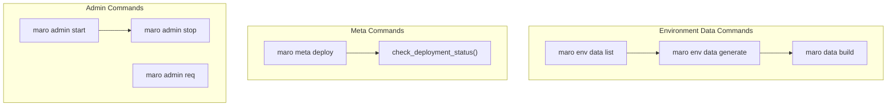
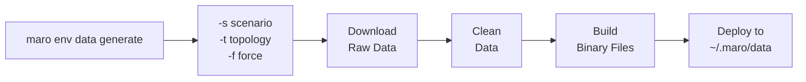
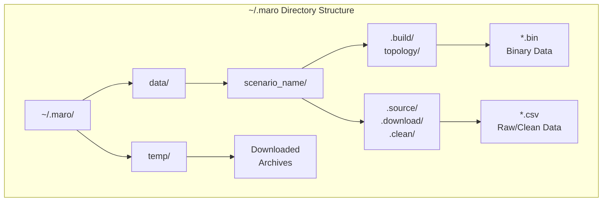
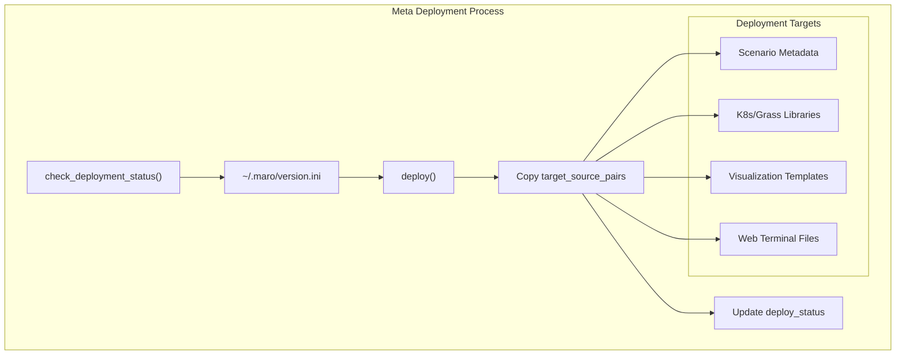
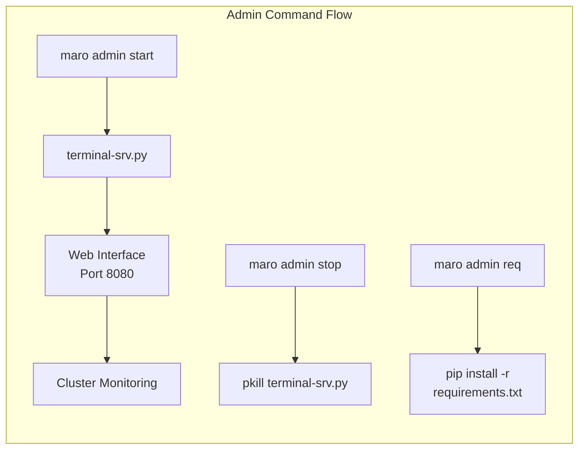
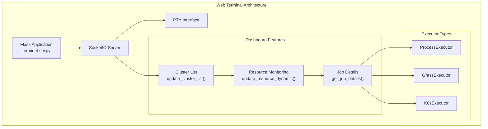
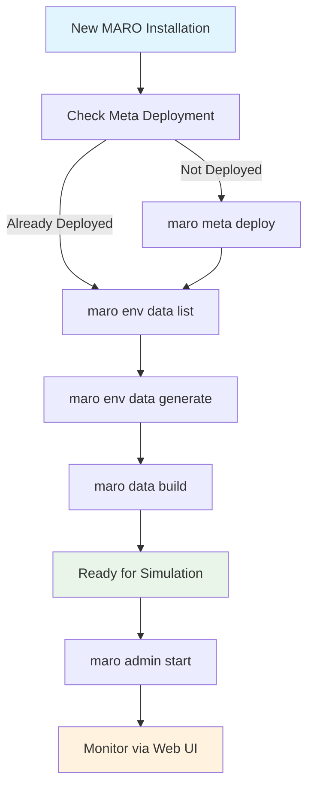

<!-- source: DeepWiki mcp.deepwiki.com · repo microsoft/maro · page 5.2 Environment and Data Commands · fetched 2026-10-26 -->

# Environment and Data Commands

<details>
<summary>Relevant source files</summary>

The following files were used as context for generating this wiki page:

- [docs/source/scenarios/citi_bike.rst](docs/source/scenarios/citi_bike.rst)
- [examples/vm_scheduling/rule_based_algorithm/README.md](examples/vm_scheduling/rule_based_algorithm/README.md)
- [maro/cli/grass/lib/services/master_agent/agent.py](maro/cli/grass/lib/services/master_agent/agent.py)
- [maro/cli/utils/node_admin.py](maro/cli/utils/node_admin.py)
- [maro/cli/utils/web_terminal/terminal-srv.py](maro/cli/utils/web_terminal/terminal-srv.py)
- [maro/data_lib/cim/vessel_sailing_plan_wrapper.py](maro/data_lib/cim/vessel_sailing_plan_wrapper.py)
- [maro/utils/utils.py](maro/utils/utils.py)
- [maro/vector_env/vector_env.py](maro/vector_env/vector_env.py)

</details>


This document covers the MARO CLI commands for environment data management, metadata deployment, and administrative operations. These commands handle downloading, processing, and deploying scenario data files, managing metadata, and providing administrative tools for MARO installations.

For cluster management operations, see [Cluster Management](#5.1). For visualization and monitoring commands, see [Visualization and Monitoring](#6).

## Command Categories Overview

The environment and data commands fall into three main categories:



**Sources:** [docs/source/scenarios/citi_bike.rst:530-600](), [maro/utils/utils.py:116-196](), [maro/cli/utils/node_admin.py:9-35]()

## Environment Data Commands

### Data List Command

The `maro env data list` command displays all available scenario-topology combinations that require data file generation:

| Command | Purpose | Output |
|---------|---------|---------|
| `maro env data list` | List environments needing data files | Scenario-topology pairs |

Example output:
```
scenario: citi_bike, topology: ny.201801
scenario: citi_bike, topology: ny.201802
scenario: cim, topology: toy.4p_ssdd_l0.0
```

### Data Generate Command

The `maro env data generate` command automatically downloads and processes scenario data:



**Command syntax:**
```bash
maro env data generate -s citi_bike -t ny.201802 [-f]
```

**Parameters:**
- `-s`: Scenario name (required)
- `-t`: Topology name (required)  
- `-f`: Force regeneration of existing files (optional)

**Sources:** [docs/source/scenarios/citi_bike.rst:548-566]()

### Data Build Command

The `maro data build` command converts CSV data files to binary format for simulator use:

```bash
maro data build --meta META_FILE --file SOURCE_FILE --output TARGET_FILE
```

**Parameters:**
- `--meta`: Path to metadata YAML file defining column mappings
- `--file`: Path to source CSV file (or file list with `@` prefix)
- `--output`: Path for output binary file

**Sources:** [docs/source/scenarios/citi_bike.rst:582-600]()

## Data Directory Structure

The environment data commands work with a standardized directory structure:



**Target source pairs defined in code:**
- Citi Bike: `~/.maro/data/citi_bike/meta` ← `maro/simulator/scenarios/citi_bike/meta`
- CIM: `~/.maro/data/cim/meta` ← `maro/simulator/scenarios/cim/meta`  
- VM Scheduling: `~/.maro/data/vm_scheduling/meta` ← `maro/simulator/scenarios/vm_scheduling/meta`

**Sources:** [docs/source/scenarios/citi_bike.rst:568-581](), [maro/utils/utils.py:84-113]()

## Meta Deployment System

The meta deployment system manages MARO's core files and ensures proper installation:



### Deployment Status Management

The system tracks deployment status through `version.ini`:

```ini
[MARO_DATA]
version = 1.0.0
deploy_time = 1640995200
deploy_status = deployed
```

**Status values:**
- `started`: Deployment in progress
- `deployed`: Successfully deployed
- `failed`: Deployment failed

**Sources:** [maro/utils/utils.py:116-196]()

### Auto-deployment Check

Before any MARO operation, the system checks if deployment is needed:

```python
def check_deployment_status() -> bool:
    # Returns True if deployment is current, False if needed
    # Checks SKIP_DEPLOYMENT environment variable
    # Validates version and status in version.ini
```

**Sources:** [maro/utils/utils.py:167-189]()

## Admin Commands

The admin commands provide web-based management tools:



### Admin Start

Launches the web-based admin interface:

```bash
maro admin start
```

This starts `terminal-srv.py` with:
- Web terminal on port 8080
- Cluster status monitoring
- Resource usage tracking
- Job management interface

### Admin Stop

Terminates the admin interface:

```bash
maro admin stop
```

Kills all processes matching the terminal server path.

### Admin Requirements

Installs dependencies for the admin tools:

```bash
maro admin req
```

Installs packages from the requirements file in the web terminal directory.

**Sources:** [maro/cli/utils/node_admin.py:9-35](), [maro/cli/utils/web_terminal/terminal-srv.py:1-318]()

## Web Terminal Integration

The admin system includes a comprehensive web terminal with cluster management capabilities:



The web terminal supports multiple dashboard types:
- `DashboardType.PROCESS`: Local process monitoring
- `DashboardType.LOCAL`: Local Grass clusters  
- `DashboardType.AZURE`: Azure-based clusters
- `DashboardType.ONPREMISES`: On-premises clusters

**Sources:** [maro/cli/utils/web_terminal/terminal-srv.py:34-154](), [maro/cli/utils/web_terminal/terminal-srv.py:180-238]()

## Command Integration Workflow

The environment and data commands work together in a typical workflow:



This workflow ensures all necessary data files and metadata are properly deployed before running MARO scenarios or using administrative tools.

**Sources:** [maro/utils/utils.py:116-196](), [docs/source/scenarios/citi_bike.rst:515-566](), [maro/cli/utils/node_admin.py:9-35]()

---

