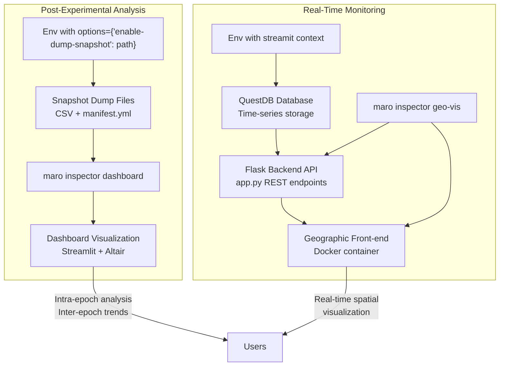
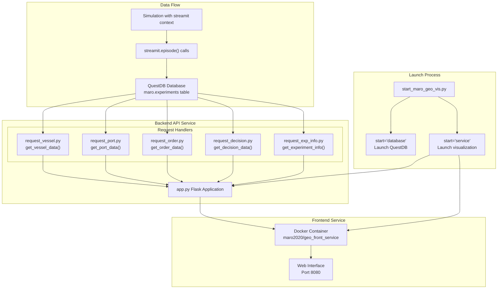
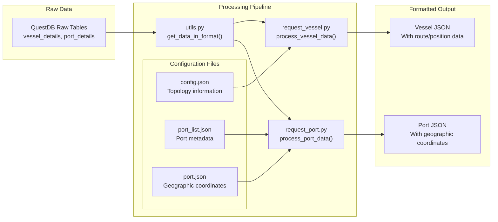

<!-- source: DeepWiki mcp.deepwiki.com · repo microsoft/maro · page 6 Visualization and Monitoring · fetched 2026-10-26 -->

# Visualization and Monitoring

<details>
<summary>Relevant source files</summary>

The following files were used as context for generating this wiki page:

- [docs/source/key_components/dashboard_visualization.rst](docs/source/key_components/dashboard_visualization.rst)
- [examples/hello_world/cim/hello.py](examples/hello_world/cim/hello.py)
- [examples/hello_world/cim/hello_geo_vis.py](examples/hello_world/cim/hello_geo_vis.py)
- [examples/hello_world/cim/hello_streamlit.py](examples/hello_world/cim/hello_streamlit.py)
- [maro/cli/maro_real_time_vis/.env](maro/cli/maro_real_time_vis/.env)
- [maro/cli/maro_real_time_vis/back_end/vis_app/app.py](maro/cli/maro_real_time_vis/back_end/vis_app/app.py)
- [maro/cli/maro_real_time_vis/back_end/vis_app/data_process/request/request_decision.py](maro/cli/maro_real_time_vis/back_end/vis_app/data_process/request/request_decision.py)
- [maro/cli/maro_real_time_vis/back_end/vis_app/data_process/request/request_exp_info.py](maro/cli/maro_real_time_vis/back_end/vis_app/data_process/request/request_exp_info.py)
- [maro/cli/maro_real_time_vis/back_end/vis_app/data_process/request/request_order.py](maro/cli/maro_real_time_vis/back_end/vis_app/data_process/request/request_order.py)
- [maro/cli/maro_real_time_vis/back_end/vis_app/data_process/request/request_port.py](maro/cli/maro_real_time_vis/back_end/vis_app/data_process/request/request_port.py)
- [maro/cli/maro_real_time_vis/back_end/vis_app/data_process/request/request_vessel.py](maro/cli/maro_real_time_vis/back_end/vis_app/data_process/request/request_vessel.py)
- [maro/cli/maro_real_time_vis/back_end/vis_app/data_process/request/utils.py](maro/cli/maro_real_time_vis/back_end/vis_app/data_process/request/utils.py)
- [maro/cli/maro_real_time_vis/docker-compose.yaml](maro/cli/maro_real_time_vis/docker-compose.yaml)
- [maro/cli/maro_real_time_vis/start_maro_geo_vis.py](maro/cli/maro_real_time_vis/start_maro_geo_vis.py)

</details>


This document covers MARO's visualization and monitoring capabilities, which provide tools for analyzing simulation experiments and monitoring real-time execution. MARO offers two primary visualization systems: dashboard visualization for post-experimental analysis and geographic visualization for real-time monitoring.

For information about the core simulation framework that generates the data visualized by these tools, see [Simulation Framework](#2.1). For details about the CLI commands that launch these visualization tools, see [Command Line Interface](#5).

## Overview

MARO provides two distinct visualization systems serving different use cases:



**Sources:** [docs/source/key_components/dashboard_visualization.rst:1-205](), [maro/cli/maro_real_time_vis/start_maro_geo_vis.py:19-94](), [examples/hello_world/cim/hello_streamlit.py:1-56](), [examples/hello_world/cim/hello_geo_vis.py:1-55]()

## Dashboard Visualization

The dashboard visualization system provides post-experimental analysis capabilities using Streamlit and Altair. It operates on snapshot data dumped during simulation execution.

### Data Generation and Structure

Dashboard visualization requires snapshot data to be generated during simulation by specifying the `enable-dump-snapshot` option when creating an `Env` object:

| Option | Description | Example |
|--------|-------------|---------|
| `{"enable-dump-snapshot": ""}` | Dump to current directory | Creates timestamped folder in working directory |
| `{"enable-dump-snapshot": "./dump_data"}` | Dump to specific path | Creates timestamped folder in specified path |

The generated folder structure follows this format:

```
SNAPSHOT_DUMP_DATA_FOLDER/
├── epoch_0/                     # Epoch-specific data folders
│   ├── ports.csv               # Port attributes for this epoch
│   ├── vessels.csv             # Vessel attributes for this epoch
│   └── ...                     # Other resource holders
├── epoch_1/
├── manifest.yml                # Basic experiment metadata
├── index_name_mapping           # Resource holder index mappings
└── ports_summary.csv           # Cross-epoch summary data
```

### Launch and Features

The dashboard is launched using the CLI command:
```bash
maro inspector dashboard --source_path SNAPSHOT_DUMP_DATA_FOLDER --force {true/false}
```

The system provides two main analysis modes:

| View Mode | Purpose | Features |
|-----------|---------|----------|
| **Intra-epoch** | Detailed analysis within single epoch | Resource holder selection, tick-based analysis, formula calculation |
| **Inter-epoch** | Cross-epoch trend analysis | Epoch sampling, convergence analysis, algorithm evaluation |

**Sources:** [docs/source/key_components/dashboard_visualization.rst:32-105](), [examples/hello_world/cim/hello_streamlit.py:13-28]()

## Geographic Visualization

The geographic visualization system provides real-time monitoring of spatial simulation scenarios using a web-based interface with geographic mapping capabilities.

### Architecture Components



**Sources:** [maro/cli/maro_real_time_vis/back_end/vis_app/app.py:1-262](), [maro/cli/maro_real_time_vis/start_maro_geo_vis.py:19-94]()

### REST API Endpoints

The Flask backend exposes several REST endpoints for real-time data access:

| Endpoint | Purpose | Handler Function |
|----------|---------|------------------|
| `/experiment_info` | Get basic experiment metadata | `get_experiment_info()` |
| `/get_snapshot_vessel` | Vessel data for single tick | `get_vessel_data()` |
| `/get_snapshot_port` | Port data for single tick | `get_port_data()` |
| `/get_acc_snapshot_vessel` | Vessel data for tick range | `get_acc_vessel_data()` |
| `/get_acc_snapshot_port` | Port data for tick range | `get_acc_port_data()` |
| `/get_snapshot_order` | Order data for single tick | `get_order_data()` |
| `/get_snapshot_decision` | Decision data for single tick | `get_decision_data()` |

### Launch Process

The geographic visualization system is started using a two-step process:

1. **Database Setup**: `maro inspector geo-vis start database`
   - Starts QuestDB container via Docker
   - Initializes database schema

2. **Service Launch**: `maro inspector geo-vis start service --experiment_name <name>`
   - Validates experiment exists in database
   - Creates `pending_experiments` table
   - Launches frontend Docker container
   - Starts Flask backend service

**Sources:** [maro/cli/maro_real_time_vis/start_maro_geo_vis.py:21-93](), [maro/cli/maro_real_time_vis/back_end/vis_app/app.py:67-255]()

## Data Processing and Formatting

Both visualization systems include sophisticated data processing pipelines to transform raw simulation data into visualization-ready formats.

### Geographic Data Processing



The processing pipeline enriches raw simulation data with:
- **Vessel Data**: Route information, sailing speed, geographic positioning
- **Port Data**: Geographic coordinates, status classification (surplus/demand/balance)
- **Order Data**: Cargo movement and booking information
- **Decision Data**: Agent actions and their spatial context

**Sources:** [maro/cli/maro_real_time_vis/back_end/vis_app/data_process/request/request_vessel.py:72-188](), [maro/cli/maro_real_time_vis/back_end/vis_app/data_process/request/request_port.py:91-131](), [maro/cli/maro_real_time_vis/back_end/vis_app/data_process/request/utils.py:7-37]()

## Configuration and Setup

### Dashboard Prerequisites

The dashboard visualization requires specific Python dependencies:

```bash
pip install streamlit altair
```

### Geographic Visualization Prerequisites

The geographic visualization system requires Docker for container orchestration and uses the following key containers:

| Container | Image | Purpose |
|-----------|-------|---------|
| Frontend | `maro2020/geo_front_service` | Web interface on port 8080 |
| Backend | Built from `back_end/vis_app/` | Flask API service on port 5000 |
| Database | `questdb/questdb` | Time-series data storage |

### Environment Variables

Real-time visualization can be enabled in simulation code using environment variables:

```python
import os
os.environ["MARO_STREAMIT_ENABLED"] = "true"
os.environ["MARO_STREAMIT_EXPERIMENT_NAME"] = "experiment_example"
```

**Sources:** [docs/source/key_components/dashboard_visualization.rst:12-26](), [maro/cli/maro_real_time_vis/start_maro_geo_vis.py:15-16](), [examples/hello_world/cim/hello_geo_vis.py:6-10](), [maro/cli/maro_real_time_vis/docker-compose.yaml:1-62]()

---

