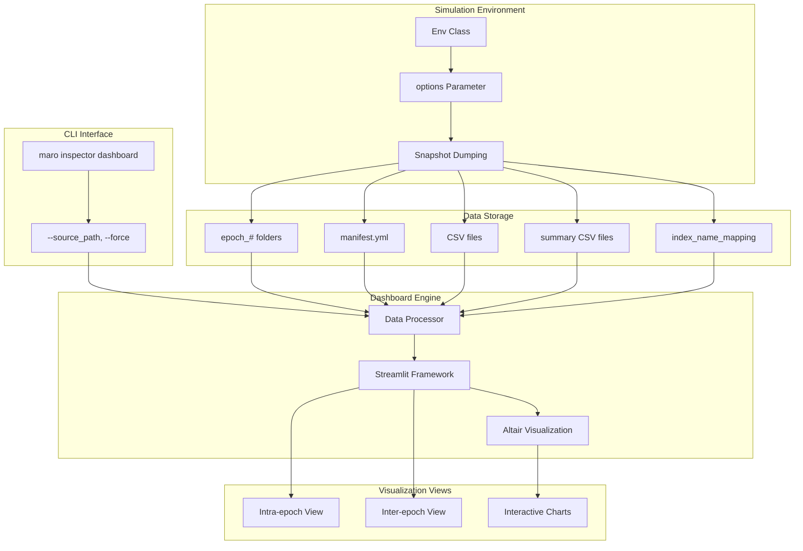

<!-- source: DeepWiki mcp.deepwiki.com · repo microsoft/maro · page 6.1 Dashboard Visualization · fetched 2026-10-26 -->

# Dashboard Visualization

<details>
<summary>Relevant source files</summary>

The following files were used as context for generating this wiki page:

- [.github/ISSUE_TEMPLATE/---bug-report.md](.github/ISSUE_TEMPLATE/---bug-report.md)
- [.github/PULL_REQUEST_TEMPLATE.md](.github/PULL_REQUEST_TEMPLATE.md)
- [.github/workflows/test_with_cli.yml](.github/workflows/test_with_cli.yml)
- [docs/source/installation/grass_on_premises_cluster_provisioning.rst](docs/source/installation/grass_on_premises_cluster_provisioning.rst)
- [docs/source/installation/multi_processes_localhost_provisioning.rst](docs/source/installation/multi_processes_localhost_provisioning.rst)
- [docs/source/installation/pip_install.rst](docs/source/installation/pip_install.rst)
- [docs/source/key_components/dashboard_visualization.rst](docs/source/key_components/dashboard_visualization.rst)
- [docs/source/key_components/geographic_visualization.rst](docs/source/key_components/geographic_visualization.rst)
- [examples/hello_world/cim/hello.py](examples/hello_world/cim/hello.py)
- [examples/hello_world/cim/hello_geo_vis.py](examples/hello_world/cim/hello_geo_vis.py)
- [examples/hello_world/cim/hello_streamlit.py](examples/hello_world/cim/hello_streamlit.py)
- [maro/cli/maro_real_time_vis/.env](maro/cli/maro_real_time_vis/.env)
- [maro/cli/maro_real_time_vis/docker-compose.yaml](maro/cli/maro_real_time_vis/docker-compose.yaml)
- [scripts/build_manylinux.sh](scripts/build_manylinux.sh)

</details>


The Dashboard Visualization system provides post-experimental analysis capabilities for MARO simulation environments. It enables users to explore and analyze dumped simulation data through interactive web-based visualizations built on Streamlit and Altair. This tool is designed for analyzing completed experiments to guide algorithm design and fine-tuning decisions.

For real-time geographic visualization of running experiments, see [Geographic Visualization](#6.2).

## System Architecture

The dashboard visualization system operates as a standalone analysis tool that processes pre-generated snapshot data from MARO simulation environments.

**Dashboard System Components**


Sources: [docs/source/key_components/dashboard_visualization.rst:1-205](), [examples/hello_world/cim/hello_streamlit.py:1-56]()

## Data Pipeline and Processing Flow

The dashboard system requires a specific data generation and processing pipeline to transform simulation results into interactive visualizations.

**Data Generation and Visualization Pipeline**

```mermaid
graph LR
    subgraph "Simulation Phase"
        ENV_INIT["Env() with options"]
        ENABLE_DUMP["enable-dump-snapshot"]
        SIM_RUN["Simulation Execution"]
        AUTO_DUMP["Automatic Data Dump"]
    end
    
    subgraph "Data Processing Phase"
        CLI_CMD["maro inspector dashboard"]
        DATA_LOAD["Load Snapshot Data"]
        SUMMARY_GEN["Generate Summary Data"]
        VALIDATION["Validate Folder Structure"]
    end
    
    subgraph "Visualization Phase"
        STREAMLIT_LAUNCH["Streamlit Server Launch"]
        PORT_FIND["Find Free Port (8501+)"]
        WEB_INTERFACE["Web Dashboard Interface"]
    end
    
    subgraph "User Interaction"
        EPOCH_SELECT["Epoch Selection"]
        RESOURCE_SELECT["Resource Holder Selection"]
        FORMULA_CALC["Formula Calculations"]
        SAMPLING["Data Sampling Controls"]
    end
    
    ENV_INIT --> ENABLE_DUMP
    ENABLE_DUMP --> SIM_RUN
    SIM_RUN --> AUTO_DUMP
    
    AUTO_DUMP --> CLI_CMD
    CLI_CMD --> DATA_LOAD
    DATA_LOAD --> VALIDATION
    VALIDATION --> SUMMARY_GEN
    
    SUMMARY_GEN --> STREAMLIT_LAUNCH
    STREAMLIT_LAUNCH --> PORT_FIND
    PORT_FIND --> WEB_INTERFACE
    
    WEB_INTERFACE --> EPOCH_SELECT
    WEB_INTERFACE --> RESOURCE_SELECT
    WEB_INTERFACE --> FORMULA_CALC
    WEB_INTERFACE --> SAMPLING
```


Sources: [docs/source/key_components/dashboard_visualization.rst:32-98](), [examples/hello_world/cim/hello_streamlit.py:13-28]()

## Dependencies and Setup

The dashboard visualization system requires specific Python packages to function properly.

### Required Dependencies

| Package | Purpose | Installation |
|---------|---------|--------------|
| `streamlit` | Web application framework | `pip install streamlit` |
| `altair` | Statistical visualization library | `pip install altair` |

Both dependencies must be installed before using the dashboard:

```bash
pip install streamlit altair
```

Sources: [docs/source/key_components/dashboard_visualization.rst:11-26]()

## Data Generation Process

### Environment Configuration

To generate dashboard-compatible data, configure the simulation environment with the `enable-dump-snapshot` option:

```python
# Dump to specific folder
opts = {"enable-dump-snapshot": "./dump_data"}

# Dump to current directory  
opts = {"enable-dump-snapshot": ""}

env = Env(scenario="cim", topology="toy.5p_ssddd_l0.0",
          start_tick=0, durations=100, options=opts)
```

The data dumping occurs automatically when the `Env` object is initialized. Each experiment generates a data folder with a timestamp suffix.

### Required Folder Structure

The dashboard expects a specific directory structure:

```
./SNAPSHOT_DUMP_DATA_FOLDER
    epoch_#/                          # folders for each epoch
        {resource_holder}.csv         # attributes of current epoch
    manifest.yml                      # basic experiment info
    index_name_mapping               # resource holder index mapping
    {resource_holder}_summary.csv    # cross-epoch summary data
```

Sources: [docs/source/key_components/dashboard_visualization.rst:32-98](), [examples/hello_world/cim/hello_streamlit.py:13-28]()

## Dashboard Launch and Usage

### CLI Command

Launch the dashboard using the `maro inspector dashboard` command:

```bash
maro inspector dashboard --source_path SNAPSHOT_DUMP_DATA_FOLDER --force {true/false}
```

**Parameters:**
- `source_path`: Path to the dumped snapshot data folder
- `force`: Whether to regenerate cross-epoch summary data (default: true)

### Port Selection

The dashboard automatically finds an available port starting from 8501. The selected port is displayed in the command line output.

Sources: [docs/source/key_components/dashboard_visualization.rst:70-108]()

## Visualization Features

### Supported Scenarios

The dashboard currently supports visualization for:
- **Container Inventory Management (CIM)**: Complex multi-resource analysis with ports and vessels
- **Citi Bike**: Station-based resource analysis with simpler data structures

### View Types

**Intra-epoch View**
- Detailed analysis of specific resource holders or time ticks
- Time dimension: Resource holder property changes over time
- Space dimension: All resource holder states at selected time points
- Epoch/Snapshot/Resource Holder index selection via sliders
- Sampling ratio controls for data filtering

**Inter-epoch View**  
- Cross-epoch analysis for convergence and trend analysis
- Important attribute summaries from each epoch
- Epoch sampling ratio selection
- Line charts and bar charts for trend visualization

### Interactive Controls

| Feature | Description | Availability |
|---------|-------------|--------------|
| Index Selection | Select specific epoch/snapshot/resource holder | Both views |
| Sampling Ratio | Control data density for performance | Both views |
| Formula Calculation | Generate custom attributes using predefined formulas | Both views |
| Time Window Selection | Select analysis time ranges | Intra-epoch only |

### Formula Calculation System

The dashboard provides a formula calculation feature that allows users to:
- Generate custom attributes using predefined mathematical formulas
- Reuse formula calculation results as inputs for additional formulas
- Create derived metrics for deeper analysis

Sources: [docs/source/key_components/dashboard_visualization.rst:109-205]()

---

