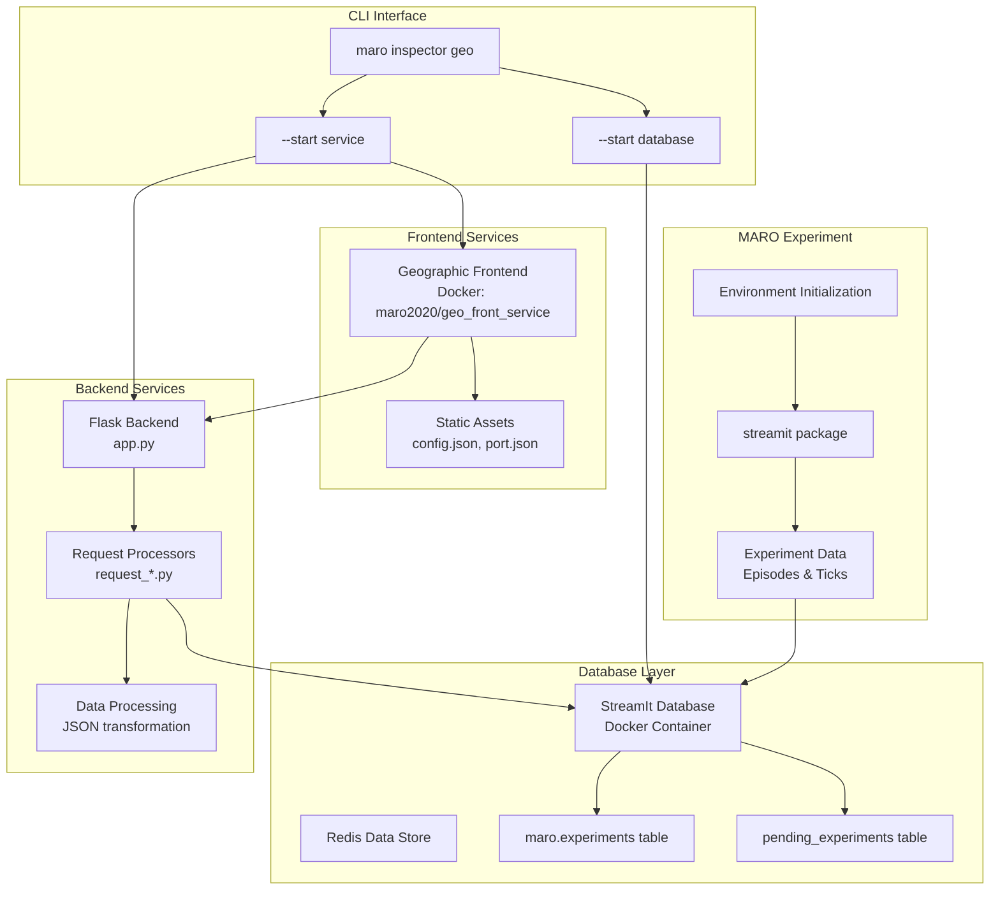
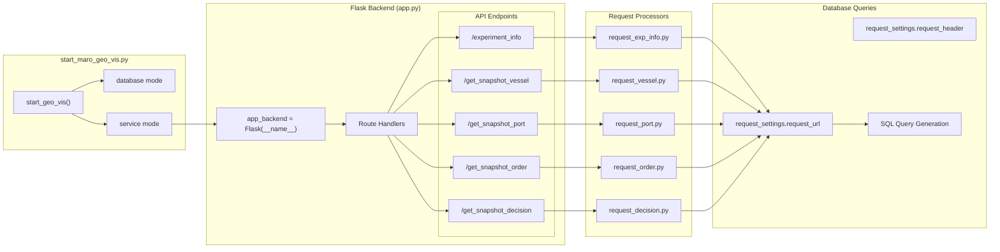
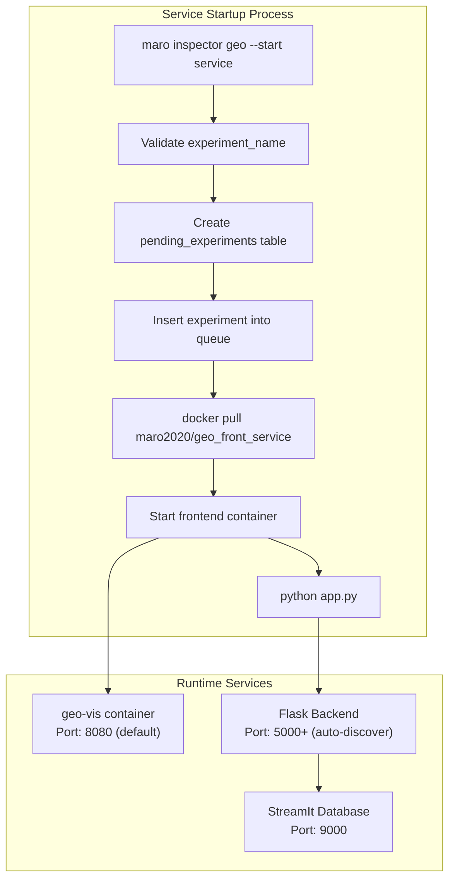
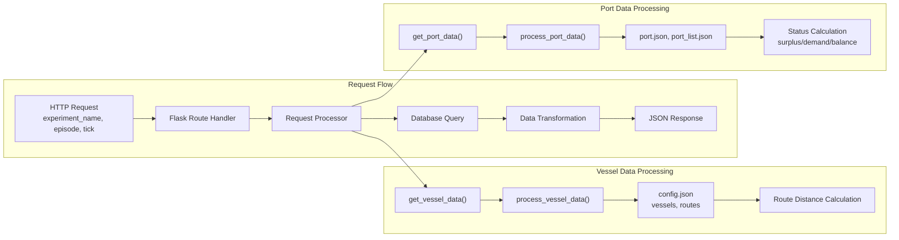
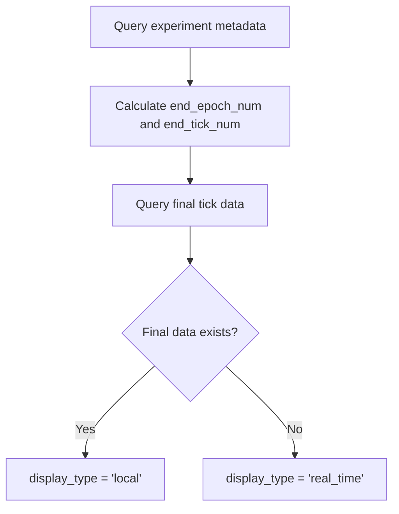

<!-- source: DeepWiki mcp.deepwiki.com · repo microsoft/maro · page 6.2 Geographic Visualization · fetched 2026-10-26 -->

# Geographic Visualization

<details>
<summary>Relevant source files</summary>

The following files were used as context for generating this wiki page:

- [.github/ISSUE_TEMPLATE/---bug-report.md](.github/ISSUE_TEMPLATE/---bug-report.md)
- [.github/PULL_REQUEST_TEMPLATE.md](.github/PULL_REQUEST_TEMPLATE.md)
- [.github/workflows/test_with_cli.yml](.github/workflows/test_with_cli.yml)
- [docs/source/installation/grass_on_premises_cluster_provisioning.rst](docs/source/installation/grass_on_premises_cluster_provisioning.rst)
- [docs/source/installation/multi_processes_localhost_provisioning.rst](docs/source/installation/multi_processes_localhost_provisioning.rst)
- [docs/source/installation/pip_install.rst](docs/source/installation/pip_install.rst)
- [docs/source/key_components/geographic_visualization.rst](docs/source/key_components/geographic_visualization.rst)
- [maro/cli/maro_real_time_vis/back_end/vis_app/app.py](maro/cli/maro_real_time_vis/back_end/vis_app/app.py)
- [maro/cli/maro_real_time_vis/back_end/vis_app/data_process/request/request_decision.py](maro/cli/maro_real_time_vis/back_end/vis_app/data_process/request/request_decision.py)
- [maro/cli/maro_real_time_vis/back_end/vis_app/data_process/request/request_exp_info.py](maro/cli/maro_real_time_vis/back_end/vis_app/data_process/request/request_exp_info.py)
- [maro/cli/maro_real_time_vis/back_end/vis_app/data_process/request/request_order.py](maro/cli/maro_real_time_vis/back_end/vis_app/data_process/request/request_order.py)
- [maro/cli/maro_real_time_vis/back_end/vis_app/data_process/request/request_port.py](maro/cli/maro_real_time_vis/back_end/vis_app/data_process/request/request_port.py)
- [maro/cli/maro_real_time_vis/back_end/vis_app/data_process/request/request_vessel.py](maro/cli/maro_real_time_vis/back_end/vis_app/data_process/request/request_vessel.py)
- [maro/cli/maro_real_time_vis/back_end/vis_app/data_process/request/utils.py](maro/cli/maro_real_time_vis/back_end/vis_app/data_process/request/utils.py)
- [maro/cli/maro_real_time_vis/start_maro_geo_vis.py](maro/cli/maro_real_time_vis/start_maro_geo_vis.py)
- [scripts/build_manylinux.sh](scripts/build_manylinux.sh)

</details>


The Geographic Visualization system provides real-time and post-experiment visualization capabilities for spatially-aware MARO scenarios. This tool displays simulation data on interactive maps with time-series charts, enabling users to analyze container shipping routes, port operations, and vessel movements in the Container Inventory Management (CIM) scenario.

For general experiment visualization and analysis, see [Dashboard Visualization](#6.1). For CLI management commands, see [Environment and Data Commands](#5.2).

## System Architecture

The geographic visualization system operates as a three-tier architecture with a database layer, backend API services, and frontend interface, all orchestrated through Docker containers.

### High-Level Architecture



Sources: [maro/cli/maro_real_time_vis/start_maro_geo_vis.py:19-94](), [docs/source/key_components/geographic_visualization.rst:28-34](), [maro/cli/maro_real_time_vis/back_end/vis_app/app.py:15-16]()

## Component Architecture

### Core Components and Data Flow



Sources: [maro/cli/maro_real_time_vis/start_maro_geo_vis.py:19](), [maro/cli/maro_real_time_vis/back_end/vis_app/app.py:15-262](), [maro/cli/maro_real_time_vis/back_end/vis_app/data_process/request/request_vessel.py:15-38]()

## Database Integration

The geographic visualization system relies on a containerized database that stores experiment data from MARO simulations. The system supports both real-time data streaming during active experiments and historical data analysis for completed experiments.

### Database Schema and Tables

| Table Name | Purpose | Key Columns |
|------------|---------|------------|
| `maro.experiments` | Experiment metadata | `name`, `scenario`, `topology` |
| `pending_experiments` | Active experiment queue | `name`, `time` |
| `{experiment_name}.port_details` | Port state data | `episode`, `tick`, `index`, `empty`, `booking` |
| `{experiment_name}.vessel_details` | Vessel state data | `episode`, `tick`, `index`, `loc_idx`, `payload` |
| `{experiment_name}.full_on_ports` | Order data | `episode`, `tick`, `index`, `action` |
| `{experiment_name}.full_on_vessels` | Decision data | `episode`, `tick`, `index`, `action` |

### Data Collection Process

The system integrates with MARO experiments through the `streamit` package, which automatically sends simulation data to the database when specific environment variables are configured.

**Required Environment Variables:**
- `MARO_STREAMIT_ENABLED="true"` - Enables data transmission
- `MARO_STREAMIT_EXPERIMENT_NAME` - Sets experiment identifier (optional)

**Integration Code Pattern:**
```python
# Import streamit before environment initialization
from maro.streamit import streamit

# Initialize environment 
env = Env(scenario="cim", topology="global_trade.22p_l0.1",
          start_tick=0, durations=100)

# Send data by episode
for ep in range(EPISODE_NUMBER):
    streamit.episode(ep)
```

Sources: [docs/source/key_components/geographic_visualization.rst:88-128](), [maro/cli/maro_real_time_vis/back_end/vis_app/data_process/request/request_exp_info.py:13-29]()

## Service Management

### Database Service Startup

The `start_geo_vis()` function in [maro/cli/maro_real_time_vis/start_maro_geo_vis.py:19-94]() handles two distinct startup modes:

**Database Mode:**
```bash
maro inspector geo --start database
```
- Executes `sh run_docker.sh` in `streamit/server` directory
- Starts containerized database accessible at `localhost:9000`
- Creates required database schemas and tables

**Service Mode:**
```bash
maro inspector geo --start service --experiment_name EXPERIMENT_NAME --front_end_port 8080
```

### Service Architecture



Sources: [maro/cli/maro_real_time_vis/start_maro_geo_vis.py:30-94](), [docs/source/key_components/geographic_visualization.rst:134-152]()

## Data Processing Pipeline

### Request Processing Architecture

The backend Flask application processes geographic data through specialized request handlers that transform database records into frontend-compatible JSON formats.



### Key Data Transformations

**Vessel Data Processing** ([maro/cli/maro_real_time_vis/back_end/vis_app/data_process/request/request_vessel.py:72-126]()):
- Maps vessel indices to vessel names using topology configuration
- Calculates route distances and positions
- Groups vessels by route for geographic display

**Port Status Calculation** ([maro/cli/maro_real_time_vis/back_end/vis_app/data_process/request/request_port.py:122-127]()):
```python
"status": list(
    map(
        lambda x, y: "surplus" if (x - y * 5 > 50) else ("demand" if (x - y * 5 < -50) else "balance"),
        original_port_data["empty"],
        original_port_data["booking"],
    ),
)
```

Sources: [maro/cli/maro_real_time_vis/back_end/vis_app/data_process/request/request_vessel.py:15-189](), [maro/cli/maro_real_time_vis/back_end/vis_app/data_process/request/request_port.py:35-131]()

## Visualization Modes

### Real-time vs Local Mode Detection

The system automatically determines the appropriate visualization mode based on data completeness in the database:



**Mode Detection Logic** ([maro/cli/maro_real_time_vis/back_end/vis_app/data_process/request/request_exp_info.py:88-104]()):
- **Local Mode**: Complete dataset available for historical analysis
- **Real-time Mode**: Incomplete dataset, data arriving during experiment execution

### Frontend Capabilities

| Feature | Real-time Mode | Local Mode |
|---------|---------------|------------|
| Time window selection | ❌ | ✅ |
| Playback speed control | Limited | Full control |
| Data completeness | Partial | Complete |
| Mode switching | ✅ (to local for completed portions) | ✅ |

Sources: [maro/cli/maro_real_time_vis/back_end/vis_app/data_process/request/request_exp_info.py:90-106](), [docs/source/key_components/geographic_visualization.rst:164-208]()

## Configuration and Topology Integration

The geographic visualization requires topology files with geographic coordinates for meaningful spatial display. Configuration files define the mapping between simulation entities and their geographic representations.

### Required Configuration Files

| File | Location | Purpose |
|------|----------|---------|
| `config.json` | `nginx/static/` | Vessel and route definitions |
| `port.json` | `nginx/static/` | Port coordinates and metadata |
| `port_list.json` | `nginx/static/` | Port name mappings |

### Topology Requirements

The system only supports CIM scenario topologies that include geographic information. Topology files must contain:
- Port coordinates (`position` field)
- Route definitions with distance calculations
- Vessel specifications and route assignments

Sources: [maro/cli/maro_real_time_vis/back_end/vis_app/data_process/request/request_vessel.py:84-90](), [maro/cli/maro_real_time_vis/back_end/vis_app/data_process/request/request_port.py:101-108](), [docs/source/key_components/geographic_visualization.rst:96-99]()

---

