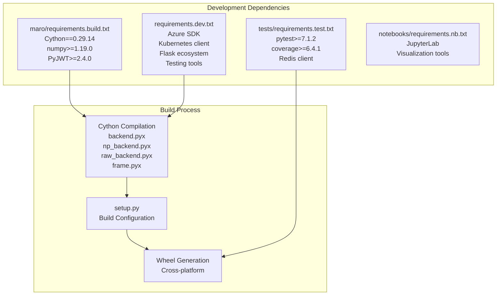
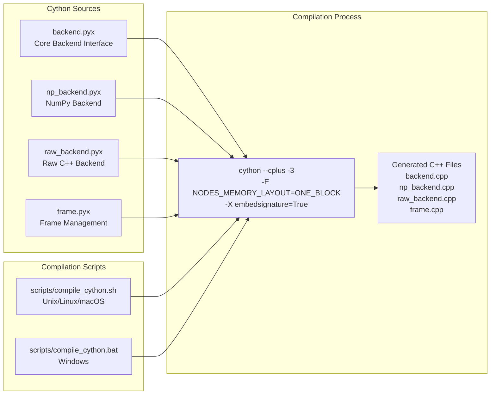
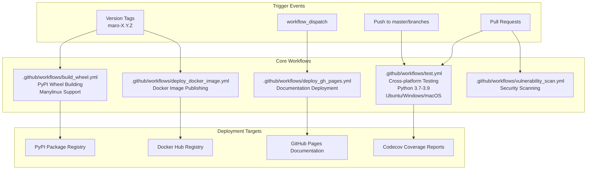
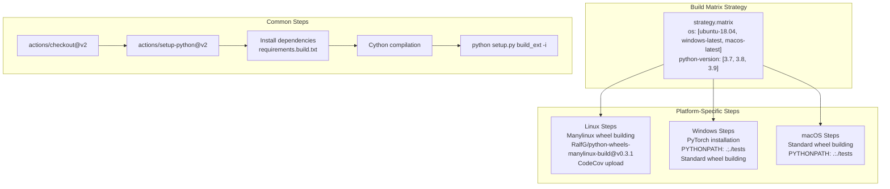
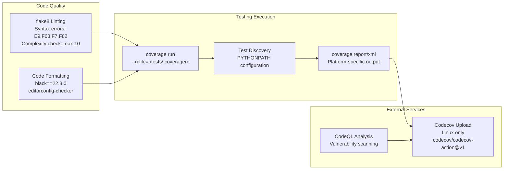
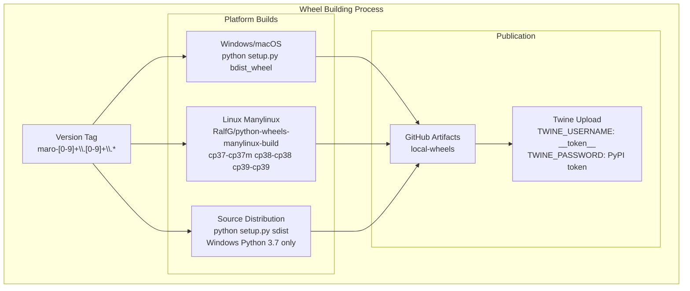
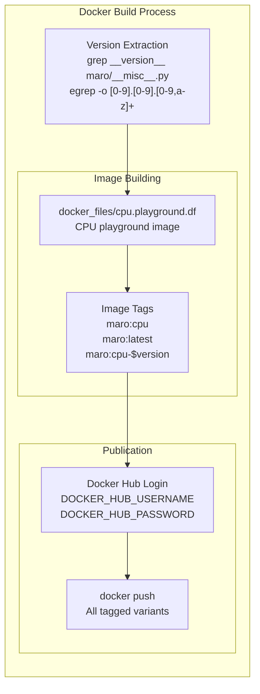
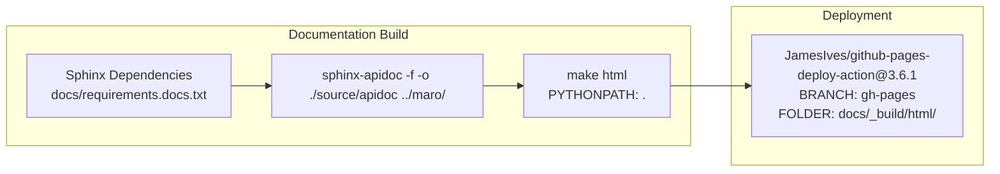

<!-- source: DeepWiki mcp.deepwiki.com · repo microsoft/maro · page 7 Development and Deployment · fetched 2026-10-26 -->

# Development and Deployment

Relevant source files

The following files were used as context for generating this wiki page:

- [.github/workflows/build_wheel.yml](.github/workflows/build_wheel.yml)
- [.github/workflows/deploy_docker_image.yml](.github/workflows/deploy_docker_image.yml)
- [.github/workflows/deploy_gh_pages.yml](.github/workflows/deploy_gh_pages.yml)
- [.github/workflows/test.yml](.github/workflows/test.yml)
- [.github/workflows/vulnerability_scan.yml](.github/workflows/vulnerability_scan.yml)
- [maro/cli/maro_real_time_vis/back_end/vis_app/requirements.txt](maro/cli/maro_real_time_vis/back_end/vis_app/requirements.txt)
- [maro/requirements.build.txt](maro/requirements.build.txt)
- [notebooks/requirements.nb.txt](notebooks/requirements.nb.txt)
- [pyproject.toml](pyproject.toml)
- [requirements.dev.txt](requirements.dev.txt)
- [scripts/compile_cython.bat](scripts/compile_cython.bat)
- [scripts/compile_cython.sh](scripts/compile_cython.sh)
- [tests/requirements.test.txt](tests/requirements.test.txt)

This page provides a comprehensive guide for developers working on the MARO platform and deploying MARO-based applications. It covers development environment setup, the build system, CI/CD pipelines, testing practices, and deployment processes. For specific environment configuration details, see [Environment Setup](#7.1). For CI/CD pipeline specifics, see [CI/CD Pipeline](#7.2). For code quality standards, see [Code Quality and Testing](#7.3).

## Overview

MARO's development and deployment infrastructure is built around a multi-stage pipeline that handles cross-platform compilation, testing, and distribution. The system supports Python 3.7-3.9 across Linux, Windows, and macOS platforms, with specialized handling for Cython-based high-performance components.

## Development Environment Architecture

### Dependency Management

MARO uses a hierarchical dependency structure with specialized requirements files for different use cases:

| Requirements File | Purpose | Key Dependencies |
|------------------|---------|------------------|
| `maro/requirements.build.txt` | Core build dependencies | Cython, NumPy, PyJWT |
| `requirements.dev.txt` | Full development environment | Azure SDK, Flask, Kubernetes client, Testing tools |
| `tests/requirements.test.txt` | Testing-specific dependencies | pytest, coverage, Redis |
| `notebooks/requirements.nb.txt` | Jupyter notebook environment | IPython, JupyterLab, visualization tools |

**Sources:** [maro/requirements.build.txt:1-7](), [requirements.dev.txt:1-59](), [tests/requirements.test.txt:1-18](), [notebooks/requirements.nb.txt:1-18]()

### Cython Compilation System

The core performance components in MARO are implemented in Cython and require compilation before use. The compilation process is standardized across platforms:

**Sources:** [scripts/compile_cython.sh:16-18](), [scripts/compile_cython.bat:14-16](), [.github/workflows/test.yml:30-32]()

## CI/CD Pipeline Architecture

### GitHub Actions Workflow System

MARO employs a comprehensive CI/CD system using GitHub Actions with specialized workflows for different aspects of development and deployment:

**Sources:** [.github/workflows/test.yml:1-82](), [.github/workflows/build_wheel.yml:1-82](), [.github/workflows/deploy_docker_image.yml:1-42](), [.github/workflows/deploy_gh_pages.yml:1-68]()

### Cross-Platform Build Matrix

The testing and build system supports multiple platform and Python version combinations:

| Platform | Python Versions | Special Considerations |
|----------|----------------|----------------------|
| `ubuntu-18.04` / `ubuntu-latest` | 3.7, 3.8, 3.9 | Manylinux wheel building, CodeCov reporting |
| `windows-latest` | 3.7, 3.8, 3.9 | PyTorch installation, PYTHONPATH handling |
| `macos-latest` | 3.7, 3.8, 3.9 | Standard wheel building |

**Sources:** [.github/workflows/test.yml:12-17](), [.github/workflows/build_wheel.yml:12-17](), [.github/workflows/test.yml:38-42](), [.github/workflows/build_wheel.yml:49-60]()

## Testing and Quality Assurance

### Testing Pipeline

The testing system includes code quality checks, unit testing, and coverage reporting:

**Sources:** [.github/workflows/test.yml:49-54](), [.github/workflows/test.yml:61-81](), [requirements.dev.txt:9](), [requirements.dev.txt:15-16]()

### Coverage Configuration

Testing uses a centralized coverage configuration in `.coveragerc` with platform-specific PYTHONPATH settings:

- **Windows**: `PYTHONPATH: .;./tests`
- **Linux/macOS**: `PYTHONPATH: .:./tests`

**Sources:** [.github/workflows/test.yml:58-70]()

## Deployment Processes

### PyPI Package Distribution

The wheel building process creates cross-platform distributions with special handling for Linux manylinux wheels:

**Sources:** [.github/workflows/build_wheel.yml:5-7](), [.github/workflows/build_wheel.yml:39-47](), [.github/workflows/build_wheel.yml:49-66](), [.github/workflows/build_wheel.yml:75-81]()

### Docker Image Publishing

Docker images are built and published for tagged releases with version-specific tagging:

**Sources:** [.github/workflows/deploy_docker_image.yml:29-34](), [.github/workflows/deploy_docker_image.yml:35-41]()

### Documentation Deployment

Documentation is built using Sphinx and deployed to GitHub Pages:

**Sources:** [.github/workflows/deploy_gh_pages.yml:24-47](), [.github/workflows/deploy_gh_pages.yml:49-55]()

## Build System Configuration

### Core Build Components

The build system is configured through several key files that define dependencies and build behavior:

| File | Purpose | Key Configuration |
|------|---------|------------------|
| `pyproject.toml` | Modern Python build configuration | Build system requirements, NumPy version constraints |
| `setup.py` | Legacy build configuration | Extension compilation, package metadata |
| Cython compilation scripts | Platform-specific compilation | Compiler flags, memory layout options |

**Sources:** [pyproject.toml:1-3]()

The build process consistently uses the `NODES_MEMORY_LAYOUT=ONE_BLOCK` configuration for optimal memory performance in the C++ backends, and enables embedsignature for better debugging support.

**Sources:** [.github/workflows/build_wheel.yml:37](), [.github/workflows/test.yml:32](), [scripts/compile_cython.sh:18]()

---

