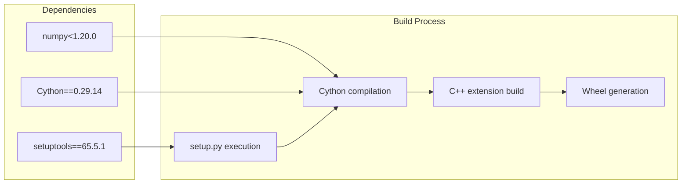
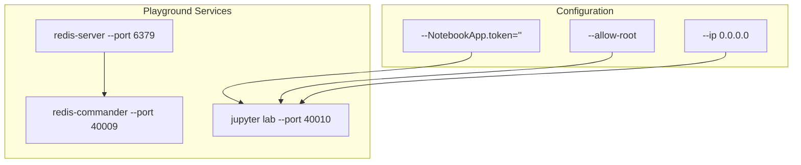
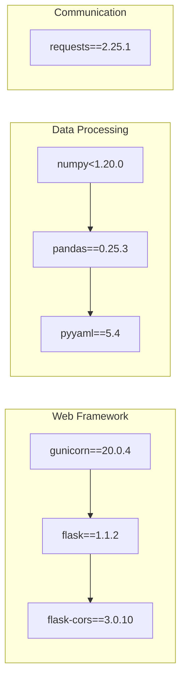

<!-- source: DeepWiki mcp.deepwiki.com · repo microsoft/maro · page 7.1 Environment Setup · fetched 2026-10-26 -->

# Environment Setup

<details>
<summary>Relevant source files</summary>

The following files were used as context for generating this wiki page:

- [.dockerignore](.dockerignore)
- [docker_files/cpu.runtime.df](docker_files/cpu.runtime.df)
- [docker_files/gpu.runtime.df](docker_files/gpu.runtime.df)
- [maro/cli/maro_real_time_vis/back_end/vis_app/requirements.txt](maro/cli/maro_real_time_vis/back_end/vis_app/requirements.txt)
- [maro/requirements.build.txt](maro/requirements.build.txt)
- [notebooks/requirements.nb.txt](notebooks/requirements.nb.txt)
- [pyproject.toml](pyproject.toml)
- [requirements.dev.txt](requirements.dev.txt)
- [scripts/run_playground.sh](scripts/run_playground.sh)
- [tests/requirements.test.txt](tests/requirements.test.txt)

</details>


This document covers the setup of development environments for working on the MARO platform codebase. It includes configuration of dependencies, build systems, testing environments, and containerized development workflows. This guide is intended for developers contributing to MARO itself.

For information about setting up MARO for end-user applications, see [Getting Started](#4). For CI/CD pipeline details, see [CI/CD Pipeline](#7.2). For testing practices, see [Code Quality and Testing](#7.3).

## Development Dependencies Overview

The MARO project uses multiple requirement files to manage different types of dependencies across various development scenarios.

### Dependency Structure

```mermaid
graph TB
    subgraph "Core Dependencies"
        BUILD[requirements.build.txt<br/>"Core build requirements"]
        DEV[requirements.dev.txt<br/>"Full development stack"]
    end
    
    subgraph "Specialized Requirements"
        TEST[requirements.test.txt<br/>"Testing dependencies"]
        NB[requirements.nb.txt<br/>"Jupyter notebook tools"]
        VIS[vis_app/requirements.txt<br/>"Visualization backend"]
    end
    
    subgraph "Build System"
        PYPROJECT[pyproject.toml<br/>"PEP 518 build config"]
        CYTHON["Cython==0.29.14"]
        NUMPY["numpy>=1.19.0"]
    end
    
    subgraph "Container Environments"
        CPU_DF[cpu.runtime.df<br/>"CPU runtime container"]
        GPU_DF[gpu.runtime.df<br/>"GPU runtime container"]
        PLAYGROUND[run_playground.sh<br/>"Local development"]
    end
    
    BUILD --> PYPROJECT
    DEV --> BUILD
    DEV --> TEST
    DEV --> NB
    
    PYPROJECT --> CYTHON
    PYPROJECT --> NUMPY
    
    CPU_DF --> BUILD
    GPU_DF --> BUILD
    PLAYGROUND --> DEV
```

**Sources:** [requirements.dev.txt:1-58](), [maro/requirements.build.txt:1-7](), [tests/requirements.test.txt:1-18](), [notebooks/requirements.nb.txt:1-18](), [pyproject.toml:1-3]()

### Core Build Dependencies

The minimal build requirements are defined in `maro/requirements.build.txt` and include essential packages for compiling MARO:

| Package | Version | Purpose |
|---------|---------|---------|
| `PyJWT` | >=2.4.0 | Authentication tokens |
| `numpy` | >=1.19.0 | Numerical computing foundation |
| `cython` | >=0.29.14 | C++ extension compilation |
| `altair` | >=4.1.0 | Visualization |
| `streamlit` | >=0.69.1 | Dashboard framework |
| `tqdm` | >=4.51.0 | Progress bars |

**Sources:** [maro/requirements.build.txt:1-7]()

### Development Dependencies

The complete development environment includes 58 packages in `requirements.dev.txt`, categorized as follows:

#### Core Development Tools
- **Code Quality**: `black==22.3.0`, `flake8==4.0.1`, `editorconfig-checker==2.4.0`, `pre-commit==2.19.0`
- **Testing**: `deepdiff>=5.7.0`, `coverage` (via test requirements)
- **Build Tools**: `Cython==0.29.14`, `setuptools==65.5.1`

#### Cloud and Distributed Computing
- **Azure Integration**: `azure-identity`, `azure-mgmt-authorization`, `azure-mgmt-containerservice`, `azure-mgmt-resource`, `azure-mgmt-storage`, `azure-storage-file-share`
- **Kubernetes**: `kubernetes>=21.7.0`
- **Container Management**: `docker`

#### Scientific Computing and ML
- **Core Libraries**: `numpy>=1.19.5`, `pandas>=0.25.3`, `scipy>=1.7.0`
- **Machine Learning**: `torch==1.13.1`, `torchsummary==1.5.1`
- **Visualization**: `matplotlib==3.5.2`, `altair>=4.1.0`, `palettable==3.3.0`

**Sources:** [requirements.dev.txt:1-58]()

## Build System Configuration

### PEP 518 Build Backend

The build system is configured using `pyproject.toml` following PEP 518 standards:

```toml
[build-system]
requires = ["setuptools", "wheel", "numpy<1.20.0"]
```

This configuration ensures that `setuptools`, `wheel`, and a compatible version of `numpy` are available during the build process, which is critical for compiling Cython extensions.

**Sources:** [pyproject.toml:1-3]()

### Build Environment Setup



**Sources:** [pyproject.toml:1-3](), [requirements.dev.txt:12](), [requirements.dev.txt:44]()

## Docker Environment Setup

### Runtime Container Configuration

MARO provides two Docker runtime environments optimized for different hardware configurations:

#### CPU Runtime Environment

The CPU runtime uses `python:3.6-buster` as the base image and includes essential system packages:

```dockerfile
FROM python:3.6-buster
# System packages: gcc, libcurl4, libssl-dev, libzmq3-dev
# Python packages: Cython==0.29.14, numpy==1.19.1, torch==1.6.0
```

#### GPU Runtime Environment

The GPU runtime uses `nvidia/cuda:11.0-runtime-ubuntu18.04` for CUDA support:

```dockerfile
FROM nvidia/cuda:11.0-runtime-ubuntu18.04
# Python packages: torch==1.6.0+cu101, torchvision==0.7.0+cu101
```

Both environments install MARO via `pip install pymaro` and include the same core Python dependencies.

**Sources:** [docker_files/cpu.runtime.df:1-28](), [docker_files/gpu.runtime.df:1-33]()

### Container Dependency Matrix

| Package | CPU Version | GPU Version | Purpose |
|---------|-------------|-------------|---------|
| `Cython` | 0.29.14 | 0.29.14 | Extension compilation |
| `numpy` | 1.19.1 | 1.19.1 | Numerical computing |
| `torch` | 1.6.0 | 1.6.0+cu101 | Deep learning |
| `pyzmq` | 19.0.2 | 19.0.2 | Messaging |
| `redis` | latest | latest | Data store |
| `psutil` | 5.7.2 | 5.7.2 | System monitoring |

**Sources:** [docker_files/cpu.runtime.df:15-28](), [docker_files/gpu.runtime.df:20-33]()

## Testing Environment

### Test Dependencies

The testing environment is defined in `tests/requirements.test.txt` with 17 specialized packages:

#### Testing Framework
- **Core**: `pytest>=7.1.2`, `coverage>=6.4.1`
- **Data Validation**: `deepdiff>=5.7.0`

#### Cloud Testing
- **Azure**: `azure-storage-blob<12.9.0`, `azure-storage-common`
- **Kubernetes**: `kubernetes>=21.7.0`
- **Messaging**: `redis>=3.5.3`, `pyzmq>=19.0.2`

#### Scenario Testing
- **Geographic**: `geopy>=2.0.0`
- **Temporal**: `holidays>=0.10.3`
- **Visualization**: `streamlit>=0.69.1`, `termgraph>=0.5.3`

**Sources:** [tests/requirements.test.txt:1-18]()

## Playground Environment

### Playground Service Configuration

The playground environment provides an interactive development setup through `scripts/run_playground.sh`:



The playground launches three services:
1. **Redis Server**: Data storage backend on port 6379
2. **Redis Commander**: Web-based Redis management on port 40009
3. **Jupyter Lab**: Interactive development environment on port 40010

**Sources:** [scripts/run_playground.sh:1-10]()

### Notebook Development Dependencies

For Jupyter notebook development, additional packages are specified in `notebooks/requirements.nb.txt`:

#### Jupyter Ecosystem
- **Core**: `jupyter>=1.0.0`, `jupyterlab`, `jupyterlab-server`
- **Extensions**: `jupyter-contrib-nbextensions`, `jupyter-nbextensions-configurator`, `jupyter-highlight-selected-word`
- **Themes**: `jupyterthemes`

#### Data Science Tools
- **Visualization**: `matplotlib>=3.1.2`, `seaborn>=0.9.0`
- **ML Interpretability**: `shap>=0.32.1`

**Sources:** [notebooks/requirements.nb.txt:1-18]()

## Visualization Backend Setup

### Real-time Visualization Dependencies

The real-time visualization backend has specific requirements in `maro/cli/maro_real_time_vis/back_end/vis_app/requirements.txt`:



This lightweight stack provides a web API for the visualization dashboard with minimal dependencies to reduce deployment complexity.

**Sources:** [maro/cli/maro_real_time_vis/back_end/vis_app/requirements.txt:1-8]()

## Development Workflow Environment Matrix

| Environment | Purpose | Key Dependencies | Entry Point |
|-------------|---------|------------------|-------------|
| **Build** | Package compilation | `cython`, `numpy<1.20.0` | `pyproject.toml` |
| **Development** | Full development stack | 58 packages including cloud/ML tools | `requirements.dev.txt` |
| **Testing** | Automated testing | `pytest`, `coverage`, cloud clients | `requirements.test.txt` |
| **Notebooks** | Interactive development | Jupyter ecosystem, visualization | `requirements.nb.txt` |
| **Playground** | Local experimentation | Redis, Jupyter Lab, MARO core | `run_playground.sh` |
| **Visualization** | Real-time dashboard | Flask, lightweight data tools | `vis_app/requirements.txt` |
| **CPU Runtime** | Production deployment | Core MARO + essential tools | `cpu.runtime.df` |
| **GPU Runtime** | GPU-accelerated deployment | CUDA + PyTorch GPU support | `gpu.runtime.df` |

**Sources:** [requirements.dev.txt:1-58](), [maro/requirements.build.txt:1-7](), [tests/requirements.test.txt:1-18](), [notebooks/requirements.nb.txt:1-18](), [scripts/run_playground.sh:1-10](), [maro/cli/maro_real_time_vis/back_end/vis_app/requirements.txt:1-8](), [docker_files/cpu.runtime.df:1-28](), [docker_files/gpu.runtime.df:1-33](), [pyproject.toml:1-3]()

---

