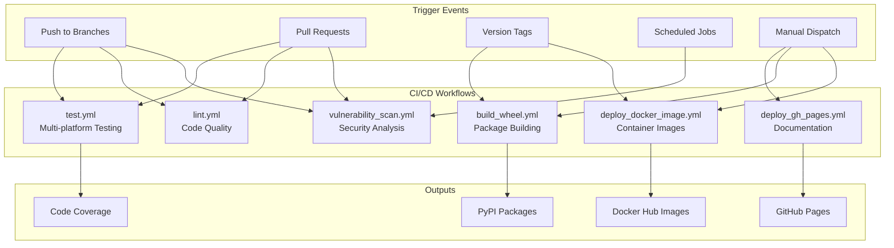
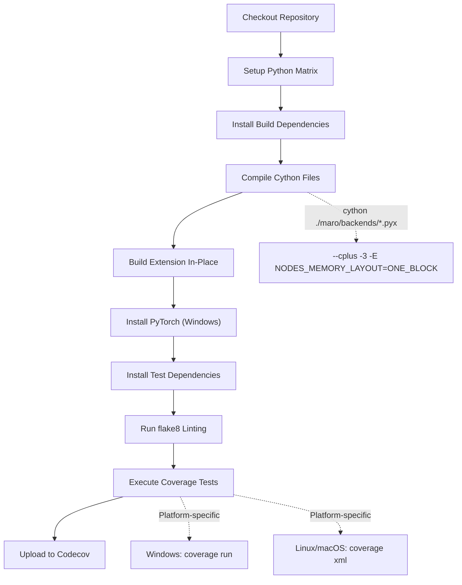
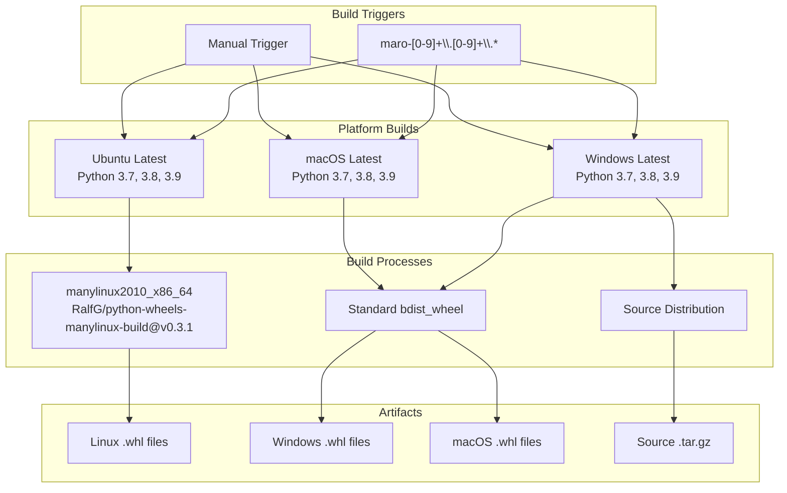
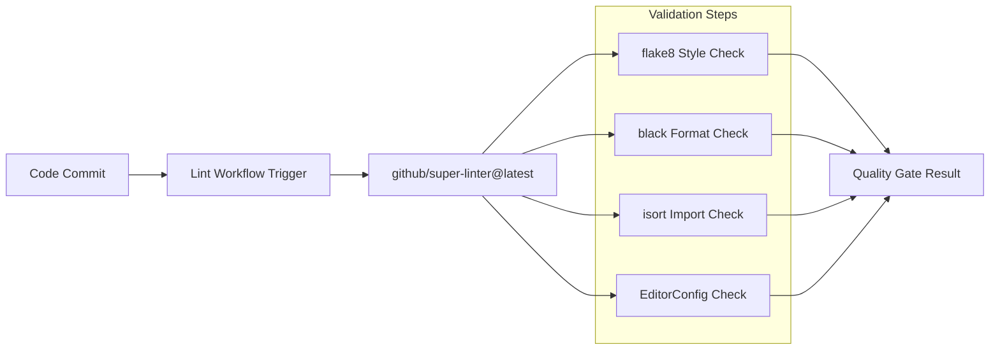
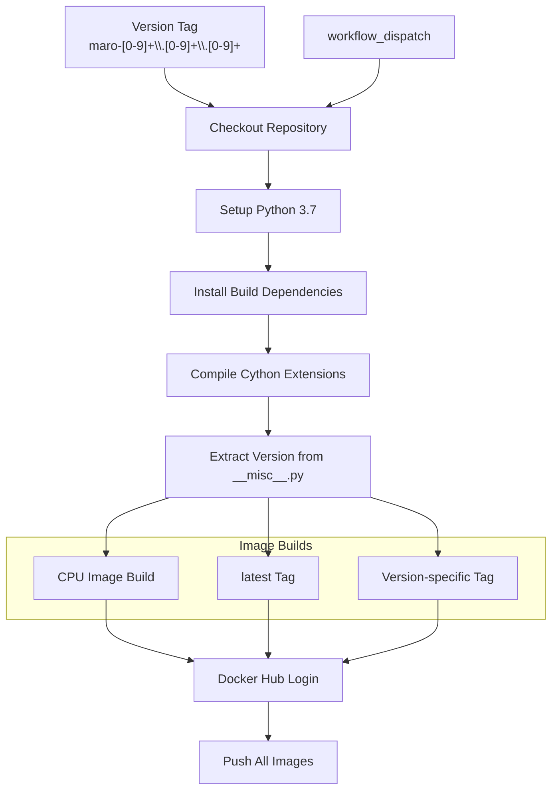
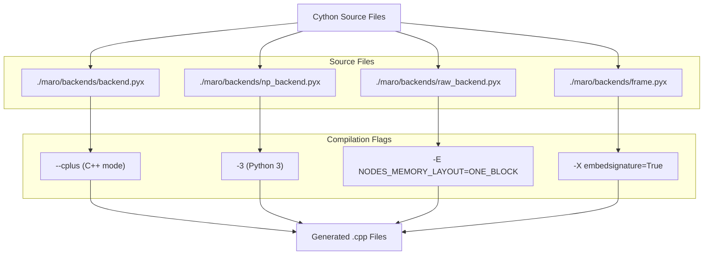

<!-- source: DeepWiki mcp.deepwiki.com · repo microsoft/maro · page 7.2 CI/CD Pipeline · fetched 2026-10-26 -->

# CI/CD Pipeline

Relevant source files

The following files were used as context for generating this wiki page:

- [.editorconfig](.editorconfig)
- [.github/linters/tox.ini](.github/linters/tox.ini)
- [.github/workflows/build_wheel.yml](.github/workflows/build_wheel.yml)
- [.github/workflows/deploy_docker_image.yml](.github/workflows/deploy_docker_image.yml)
- [.github/workflows/deploy_gh_pages.yml](.github/workflows/deploy_gh_pages.yml)
- [.github/workflows/lint.yml](.github/workflows/lint.yml)
- [.github/workflows/test.yml](.github/workflows/test.yml)
- [.github/workflows/vulnerability_scan.yml](.github/workflows/vulnerability_scan.yml)
- [CONTRIBUTING.md](CONTRIBUTING.md)
- [scripts/compile_cython.bat](scripts/compile_cython.bat)
- [scripts/compile_cython.sh](scripts/compile_cython.sh)

This document describes the automated build, test, and deployment workflows that ensure code quality and reliable releases for the MARO platform. The CI/CD pipeline encompasses multiple GitHub Actions workflows that handle testing, building, packaging, and deployment across different platforms and environments.

For information about setting up development environments and dependencies, see [Environment Setup](#7.1). For details about code quality standards and testing practices, see [Code Quality and Testing](#7.3).

## Pipeline Overview

The MARO CI/CD system consists of six primary automated workflows that handle different aspects of the development lifecycle:

Sources: [.github/workflows/test.yml:1-82](), [.github/workflows/lint.yml:1-59](), [.github/workflows/vulnerability_scan.yml:1-73](), [.github/workflows/build_wheel.yml:1-82](), [.github/workflows/deploy_docker_image.yml:1-42](), [.github/workflows/deploy_gh_pages.yml:1-68]()

## Testing Pipeline

The testing workflow provides comprehensive validation across multiple platforms and Python versions:

| Component | Configuration |
|-----------|---------------|
| **Operating Systems** | ubuntu-18.04, windows-latest, macos-latest |
| **Python Versions** | 3.7, 3.8, 3.9 |
| **Trigger Events** | Push to master/v0.1/v0.2/v0.3, Pull Requests |
| **Test Framework** | pytest with coverage |
| **Linting** | flake8 |

### Test Execution Flow

The Cython compilation step is critical and uses specific parameters: [.github/workflows/test.yml:30-32]()

Sources: [.github/workflows/test.yml:10-82]()

## Build and Release Pipeline

The wheel building workflow creates distributable packages for PyPI:

### Build Matrix and Artifacts

The manylinux build uses specific configurations for maximum compatibility: [.github/workflows/build_wheel.yml:51-59]()

Sources: [.github/workflows/build_wheel.yml:4-82]()

## Code Quality Pipeline

### Linting Configuration

The linting pipeline uses GitHub's super-linter with MARO-specific configurations:

| Tool | Configuration File | Purpose |
|------|-------------------|---------|
| **flake8** | `.github/linters/tox.ini` | Python style and error checking |
| **black** | `pyproject.toml` | Code formatting |
| **isort** | `pyproject.toml` | Import sorting |
| **editorconfig** | `.editorconfig` | Editor consistency |

### Quality Gates

The flake8 configuration excludes specific directories and ignores certain rules: [.github/linters/tox.ini:12-26]()

Sources: [.github/workflows/lint.yml:44-58](), [.github/linters/tox.ini:1-34](), [.editorconfig:1-40]()

## Docker Image Pipeline

The Docker deployment workflow builds and publishes container images:

### Docker Build Process

The Docker build uses the playground Dockerfile and extracts version information dynamically: [.github/workflows/deploy_docker_image.yml:29-33]()

Sources: [.github/workflows/deploy_docker_image.yml:7-42]()

## Documentation Pipeline

The documentation deployment workflow builds and publishes API documentation:

```mermaid
graph LR
    MANUAL_DISPATCH["Manual Workflow Dispatch"]
    
    subgraph "Build Process"
        CHECKOUT["Checkout Code"]
        PYTHON_SETUP["Setup Python 3.7"]
        DOCS_DEPS["Install Docs Dependencies"]
        BUILD_DEPS["Install Build Dependencies"]
        CYTHON_BUILD["Compile & Build Extensions"]
        SPHINX_APIDOC["sphinx-apidoc Generation"]
        MAKE_HTML["make html"]
    end
    
    DEPLOY["Deploy to gh-pages<br/>JamesIves/github-pages-deploy-action"]
    
    MANUAL_DISPATCH --> CHECKOUT
    CHECKOUT --> PYTHON_SETUP
    PYTHON_SETUP --> DOCS_DEPS
    DOCS_DEPS --> BUILD_DEPS
    BUILD_DEPS --> CYTHON_BUILD
    CYTHON_BUILD --> SPHINX_APIDOC
    SPHINX_APIDOC --> MAKE_HTML
    MAKE_HTML --> DEPLOY
```

The Sphinx API documentation is generated from the compiled MARO modules: [.github/workflows/deploy_gh_pages.yml:41-47]()

Sources: [.github/workflows/deploy_gh_pages.yml:11-56]()

## Security and Vulnerability Scanning

The vulnerability scanning workflow uses GitHub's CodeQL for security analysis:

| Trigger | Schedule |
|---------|----------|
| **Push Events** | master, v0.1, v0.2, v0.3 branches |
| **Pull Requests** | master branch |
| **Scheduled** | Weekly (Monday 11:00 UTC) |
| **Manual** | workflow_dispatch |

The CodeQL analysis targets Python code specifically and runs automated vulnerability detection: [.github/workflows/vulnerability_scan.yml:45-72]()

Sources: [.github/workflows/vulnerability_scan.yml:8-73]()

## Cython Compilation Process

The Cython compilation is a critical step across multiple workflows, handled by dedicated scripts:

### Compilation Parameters

The compilation scripts handle platform differences between Linux/macOS and Windows: [scripts/compile_cython.sh:16-18](), [scripts/compile_cython.bat:14-16]()

Sources: [scripts/compile_cython.sh:1-19](), [scripts/compile_cython.bat:1-17]()

## Release Process

The complete release process involves multiple coordinated workflows:

1. **Version Tagging**: Tags matching `maro-X.Y.Z` trigger build and Docker workflows
2. **Multi-platform Builds**: Wheels are built for Linux (manylinux), Windows, and macOS
3. **Package Publishing**: Successful builds are automatically published to PyPI
4. **Container Publishing**: Docker images are built and pushed to Docker Hub
5. **Documentation Updates**: Manual deployment of updated API documentation

The release process relies on proper version tagging and uses GitHub secrets for secure publishing to external repositories.

Sources: [.github/workflows/build_wheel.yml:75-81](), [.github/workflows/deploy_docker_image.yml:35-41]()

---

